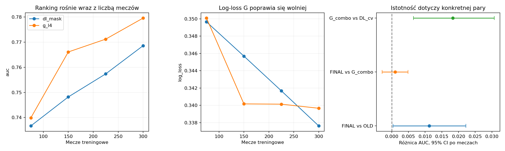
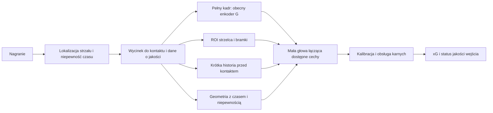

# Audyt wyników xG z obrazu i kierunków rozwoju

Stan na 7 września 2026, commit `1343f5b`. Podstawą jest [aktualny HANDOFF](HANDOFF.md), kod eksperymentu, indeks v1.2 oraz zapisane predykcje. Ścieżka `/home/kuba/projects/tactifoot_vision/research/HANDOFF.md` z prośby nie istnieje. Dokument jest obecnie w tym katalogu eksperymentu.

**Obecne rozwiązanie jest wartościowym PoC przewidywania gola ze znanego momentu strzału. Najmocniejszym wynikiem jest G-combo.** Potwierdzam główne metryki, ale rekomendację produkcyjną uznaję za przedwczesną. Pozostają luki w niezależności walidacji, dokładności czasu kontaktu oraz zapisie modelu do późniejszej inferencji. Zwiększenie liczby dobrych przykładów ma sens. Najpierw trzeba jednak zadbać, żeby nowe dane opisywały właściwy moment i pełny zbiór strzałów.

Audyt obejmuje odtworzenie metryk, trzy sparowane porównania po 2000 losowań meczów, kontrolę pokrycia predykcji 40 modeli foldowych, analizę kodu i dokumentacji oraz źródeł pierwotnych. Nie obejmuje ponownego treningu, ręcznej anotacji kontaktów ani pomiaru wydajności inferencji. Testy eksperymentu przeszły: 41/41.

**Wyniki dają się odtworzyć.** Wszystkie poniższe modele oceniłem na tych samych 2229 strzałach ze 100 meczów, z 296 golami, przy etykietach v1.2. Dla starszego ensemble'u zastąpiłem 52 nieaktualne etykiety zapisane w CSV.

| Model | AUC | Log-loss, mniej znaczy lepiej | Brier skill score | AUC bez karnych |
|---|---:|---:|---:|---:|
| Finalny ensemble | 0,7933 | 0,32318 | 16,27% | 0,7793 |
| G-combo, 10 modeli | 0,7923 | 0,32420 | 16,07% | 0,7783 |
| Zamrożony DINOv2-L, 10 głów foldowych | 0,7740 | 0,33192 | 14,07% | 0,7582 |
| GBM pozycyjny, 10 modeli | 0,6469 | 0,36861 | 6,21% | 0,6192 |
| Starszy ensemble, przeliczony na v1.2 | 0,7823 | 0,33022 | 14,40% | 0,7671 |

Źródło: [przeliczone metryki](../results_reports/audit_2026-09-07/metrics.csv). BSS porównuje Brier ze stałą równą częstości goli w ocenianym zbiorze. Nie oznacza procentu poprawnie przewidzianych strzałów ani przewagi nad komercyjnym xG.

Finalny wynik ma AUC 95% CI [0,7689; 0,8165] i log-loss CI [0,3016; 0,3468]. Minimalna różnica względem handoffu wynika z 2000 losowań w tym audycie. Bezwzględne przedziały w `build_ensemble.score` korzystają z domyślnych 500 losowań `compare.bootstrap`, a istniejące porównania sparowane z 2000.

ECE wynosi 0,016. Suma xG to 308,7 przy 296 golach, czyli nadwyżka 12,7 gola. To opis próbki, bez dowodu systematycznego przeszacowania. Dobre średnie i ECE w dziesięciu koszykach nie dowodzą poprawności wysokich xG ani kalibracji w każdej lidze. Przykładowo GBM ma niższe ECE, około 0,008, a dużo gorszy log-loss i ranking. Dlatego główną metryką dalszych prac powinien być log-loss, uzupełniony Brierem, AUC i wykresami kalibracji.

**Największą zaletą architektury jest wykorzystanie obrazu przy niedoskonałej geometrii.** DINOv2 dostarcza reprezentację sceny, mała głowa uwagowa zbiera informacje z patchy, a G dostraja cztery ostatnie bloki. Pozwala to uczyć cechy potrzebne w piłce nożnej bez dostrajania całego ViT-L. Tor obrazowy nie uzależnia dostępności wyniku od wykrycia piłki, poprawnej homografii i przypisania wszystkich zawodników do drużyn.

Przewaga G-combo nad zamrożonym D-L jest potwierdzona w tej próbce: sparowane ΔAUC +0,0183, CI [0,0065; 0,0307], oraz redukcja log-loss około 0,0078, CI [0,0023; 0,0130]. Nie można przypisać całego zysku wyłącznie odmrożeniu bloków, bo G-combo zawiera również RRC i zadanie pomocnicze. Porównanie uzasadnia wybór całego wariantu jako punktu odniesienia.

Atutami prac są także maskowanie grafiki transmisji i sondy kontrolne, poprawienie etykiet dobitek, podział po meczach, wieloseedowe próby, kontrola duplikatów oraz zachowanie predykcji. Etykieta „celny” trafia do funkcji straty jako dodatkowy cel, a nie jako wejście. To poprawne wykorzystanie dodatkowej informacji treningowej. Wspólny trener i kalibracja ułatwiają porównania architektur. Audyt duplikatów zawiera kalibrację progu podobieństwa, a nie arbitralny perceptual hash.

**Dodatkowy ensemble nie ma wykazanej przewagi nad G-combo.** Odtworzyłem sparowane różnice:

| Porównanie | Mediana ΔAUC i 95% CI | Redukcja log-loss i 95% CI |
|---|---|---|
| Finalny vs starszy, te same etykiety | +0,0112 [0,0004; 0,0222] | +0,00704 [0,00235; 0,01159] |
| Finalny vs G-combo | +0,0010 [−0,0029; 0,0049] | +0,00102 [−0,00056; 0,00261] |
| G-combo vs zamrożony D-L | +0,0183 [0,0065; 0,0307] | +0,00777 [0,00231; 0,01298] |

Źródło: [sparowane porównania](../results_reports/audit_2026-09-07/paired.csv). Przedziały opisują zmienność meczów dla ustalonych predykcji. Nie obejmują całej niepewności selekcji eksperymentów i ponownego treningu.

Zdanie z handoffu, że ensemble poprawia jakość prawdopodobieństw względem G-combo, jest mocniejsze niż dowody. Różnica log-loss również obejmuje zero. Z kolei reguła „różnica poniżej 0,02 AUC jest nierozróżnialna od szumu” jest błędna: granica zależy od konkretnej sparowanej różnicy, co pokazuje już pierwszy wiersz. Kolumny `P` to udział losowań z dodatnią różnicą, nie klasyczne p-value ani prawdopodobieństwo prawdziwości hipotezy.

Końcowy stack obejmuje 5 modeli C-combo, 10 G-combo, 5 G-combo-mix oraz 10 GBM. To 20 modeli obrazowych i 10 drzewiastych, a nie po pięć modeli każdego członka. Wagi z handoffu są współczynnikami regresji na logitach. Nie należy normalizować ich jak wag średniej prawdopodobieństw. G-combo jest rozsądniejszą bazą przy dalszym badaniu kosztu i jakości.

**Walidacja nadal wymaga naprawy przed kolejną rundą selekcji.** W [run_cv.py](../scripts/run_cv.py:10) sam opis przyznaje, że fold OOF służy do wyboru epoki i temperatury. [Trener](../xgpoc/models/common.py:211) dopasowuje temperaturę na nim w każdej epoce i wybiera najlepszy wynik. Model nie trenuje gradientem na tych strzałach, ale ich etykiety wpływają na wybór modelu i jego prawdopodobieństwa. OOF nie jest więc w pełni niezależną walidacją. Rozmiaru optymizmu nie zmierzono.

Dochodzi niespójność kryterium w [build_ensemble.py](../scripts/build_ensemble.py:175). Pojedynczy model oceniany jest na wejściowych predykcjach walidacyjnych, choć na test trafia po dodatkowym Platt scaling. Stack oceniany jest po wewnętrznym CV regresji. Routing karnych następuje dopiero po selekcji. W efekcie wybór nie porównuje identycznych końcowych procedur. Wewnętrzne CV stacku grupuje po meczu, mimo że zewnętrzne foldy grupują po gospodarzu.

Kalibracja ma też różne rozkłady wejścia: dla G-combo pojedynczy strzał OOF ma średnią dwóch predykcji seedowych z jednego foldu, a strzał testowy średnią dziesięciu predykcji z pięciu foldów. Uśrednianie może zmieniać rozrzut logitów. Nie dowodzi to błędu finalnych prawdopodobieństw, ale wymaga sprawdzenia kalibracji dokładnie takiego ensemble'u, jaki będzie wdrażany.

Naprawa powinna rozdzielić zewnętrzny fold oceny od wewnętrznego wyboru epoki i kalibracji. Tańszym wariantem jest ustalenie budżetu treningu z góry i wydzielenie niezależnej kohorty do kalibracji gotowego ensemble'u. Każdy kandydat powinien przechodzić tę samą pełną procedurę, łącznie z routingiem. Wszystkie wyliczenia częstości karnych muszą wykluczać oceniany fold. Dobór z dziesiątek kandydatów nadal wymaga zewnętrznej oceny.

**Obecny test został wielokrotnie obejrzany.** Dziennik zawiera wyniki testowe screeningu oraz wstępnych ensemble'i o 13:30, 15:35 i 16:40, przed finałem o 17:55. `build_ensemble` wybiera minimum walidacyjne, co jest zaletą, ale wylicza test dla wszystkich składów. [Dziennik](quality_run_worklog.md:45) przy mixup odnotowuje „valid lepszy, test gorszy” przed decyzją o CV. Zatem „test dotknięty raz” nie opisuje rzeczywistego procesu. Nie oznacza to uczenia gradientem na teście. Oznacza, że rezultat jest oceną wielokrotnie analizowanego benchmarku, a ostateczne potwierdzenie wymaga nowych meczów odłożonych przed kolejnymi decyzjami. Bootstrap nie usuwa tego problemu.

**Najpilniejszym audytem danych jest czas rzeczywistego kontaktu.** Guard w `datasets.py` pilnuje nazwy kolumny i odrzuca dodatni offset. Nie sprawdza, czy `frame_path` faktycznie przedstawia moment przed strzałem. Dataset card opisuje około sekundy szumu oraz klatki t0 już po kontakcie. Starszy review nie znalazł jednoznacznego wycieku na podstawie krzywej offsetów. To argument uspokajający, ale nie dowód poprawności każdej klatki.

Lokalny parser prawidłowo rozdziela czas gola od czasu strzału i pomija pozytywy bez wiarygodnej kotwicy strzału. Sama dokładność etykiety `Shots` pozostaje osobnym problemem. Oficjalny protokół SoccerNet określa kontakt jako czas strzału, ale format milisekundowy nie gwarantuje dokładności klatkowej. [SoccerNet-v2](https://arxiv.org/html/2011.13367).

Proponuję próbkę 300–500 sytuacji z puli rozwojowej, z celowym uwzględnieniem dobitek, główek, karnych, nieczytelnych ujęć i dużych błędów modelu. Równolegle potrzebna jest próbka losowa do oszacowania częstości błędów. Dla każdej oznaczyć kontakt, niepewność, strzelca, część ciała, wynik i widoczność. Próbka wzbogacona w trudne przypadki nie może służyć do oszacowania częstości błędów w całym zbiorze bez uwzględnienia doboru.

Na poprawionych kotwicach porównać stałe przesunięcia przed kontaktem i krótki kontekst. Jeżeli usunięcie klatek po kontakcie obniży AUC, otrzymamy bardziej wiarygodne pre-shot xG. W modelu temporalnym trzeba sprawdzać rzeczywiste znaczniki czasu także przy odczycie gotowego cache. Obecny `TemporalFeatureDataset` sam nie odrzuca dodatnich offsetów, a odczyt istniejącego cache omija konstrukcję `ImageDataset`.

**Tor pozycyjny ogranicza jakość pomiaru sceny.** W obecnym cache całej kohorty flaga `has_ball` wynosi 75,96%, `homography_ok` 80,55%, a `gk_present` tylko 14,20%. To dostępność cech, nie pomiar precision lub recall detektora. `gkp_valid` wynosi 75,84%, ponieważ brakującego bramkarza zastępuje najgłębszy obrońca. Takiego proxy nie można interpretować jak potwierdzonej pozycji bramkarza.

Ekstraktor wybiera stronę bramki według położenia piłki i drużynę atakującą według najbliższego zawodnika. Przy piłce już lecącej w kierunku obrońcy założenie może zawodzić. Homografia boiska nie rekonstruuje wysokości piłki. Dodatkowo fallback korzysta z całej sceny −400 lub −800 ms, lecz [cache](../xgpoc/features/cache.py:61) nie zapisuje wybranego czasu. Głowa obrazowa i geometria mogą więc opisywać różne chwile.

Wniosek nie brzmi „geometria nie pomaga”. GBM dostaje zaszumione pomiary, a obraz zachowuje informacje, których ekstraktor nie potrafi nazwać. Priorytetem są pomiar błędu geometrii, identyfikacja strzelca i bramkarza oraz jawna informacja o niepewności i czasie każdej cechy. Wiarygodne pozycje z SoccerTrack pomogą testować ekstrakcję i nadzór pomocniczy, ale 10 meczów panoramy nie uzasadnia obietnicy AUC 0,70 na transmisjach SoccerNet.

**Diagnoza pasa 11–16 m jest hipotezą, nie lokalizacją potwierdzonej przyczyny.** To 290 przykładów, 46 goli, AUC 0,6635 i BSS tylko 3,9% względem stałej w tej podgrupie. Warto go zbadać. Nie można jednak wnioskować wyłącznie z niższego AUC, że model nie rozumie bramkarza: zawężenie zakresu sytuacji utrudnia ranking, a sam dystans pochodzi z niedoskonałej geometrii i czasem wcześniejszej klatki. Przed ROI potrzeba ręcznej kontroli dystansu i rodzaju strzału.

Nowy podział po znanym gospodarzu daje inne liczby niż handoff. Dla modeli CV gospodarza należy porównać z całą pulą train+valid:

| Gospodarz w puli train+valid | Strzały | Mecze | Gole | AUC | Log-loss |
|---|---:|---:|---:|---:|---:|
| Znany | 1928 | 87 | 252 | 0,7979 | 0,3191 |
| Nieznany | 301 | 13 | 44 | 0,7658 | 0,3491 |

Źródło: [przeliczone podgrupy](../results_reports/audit_2026-09-07/venues.csv). Różnica to około 3,2 punktu procentowego AUC, ale przy 13 meczach nie określa precyzyjnie kary za nowy stadion. Gospodarz jest tylko przybliżeniem domeny transmisji. Nie gwarantuje innego stadionu, nadawcy ani nieobecności drużyny w meczach wyjazdowych. Potrzebny jest test po nowych ligach, sezonach i rodzaju kamery. Nie porównywać bezpośrednio AUC różnych podgrup jako miary samej trudności architektury.

**Więcej danych ma uzasadnienie, ale prognoza zysku jest zbyt pewna.** D-L poprawia AUC i log-loss wraz z rozmiarem treningu. G poprawia AUC z 0,740 do 0,780, lecz od 150 do 300 meczów log-loss zmienia się tylko z 0,34017 do 0,33966. Brier przy 300 meczach jest gorszy niż przy 225. G ma jeden seed, a podzbiory pochodzą z jednego losowania meczów. Stała liczba epok oznacza też więcej kroków optymalizacji przy większym zbiorze.



Podtrzymuję priorytet pozyskania danych, szczególnie nowych sytuacji i domen. Nie traktuję „podwojenie daje +0,02 AUC” jak prognozy z przedziałem ufności. Następna krzywa powinna obejmować kilka losowań podzbiorów, kilka seedów i końcową kalibrację, z kontrolą budżetu optymalizacji. Dla jakości xG ważniejsze będzie, czy rośnie jakość prawdopodobieństw, a nie wyłącznie ranking.

Plan pozyskania wymaga korekty: wykorzystano już wszystkie 500 meczów SoccerNet-v2, które rozszerza anotacje tego samego zbioru. „Pozostałe sezony SoccerNet” nie są dodatkową pulą w tej kohorcie. SoccerReplay-1988 jest kandydatem, lecz ma inną ontologię zdarzeń i automatycznie wyrównywane komentarze. Najpierw potrzebny jest pilotaż kompletności strzałów i czasu kontaktu. [SoccerNet-v2](https://arxiv.org/html/2011.13367), [SoccerReplay-1988](https://arxiv.org/html/2412.01820v3).

Trzeba również sprawdzić mianownik datasetu. Dataset card odnotowuje 205 goli bez anotacji strzału poza zaufanym indeksem, około 12,1% goli źródłowych. Ich wykluczenie chroni przed błędną kotwicą, lecz może zmieniać zestaw sytuacji. Nie wiadomo, czy podobnie kompletne są strzały zablokowane. Obecne xG dotyczy zachowanej kohorty widocznych, anotowanych strzałów. Podobna częstość goli pomiędzy ligami nie dowodzi braku biasu selekcji.

**Rozbudowę modelu zacząłbym od dodania brakującej informacji, z małym przyrostem liczby parametrów.** Proponowana architektura rozdziela moment strzału, reprezentację sytuacji i prawdopodobieństwo:



Diagram przedstawia wariant docelowy do badania. Nie należy wdrażać wszystkich gałęzi jednocześnie. Bieżący eksperyment ocenia xG przy podanym czasie strzału i znanej fladze karnego. Nie mierzy wykrywania strzałów w pełnym meczu. W produkcie trzeba osobno zmierzyć pominięte i fałszywe strzały oraz błędy czasu kontaktu.

Pierwszym eksperymentem architektonicznym powinien być pełny kadr plus wycinek strzelca i obszaru bramki w wyższej rozdzielczości. Sam crop bramki może zgubić ułożenie ciała strzelca. Rozsądny start to wspólny enkoder, niewielka głowa łącząca cechy i maska dostępności ROI. W kontrolowanym pilotażu porównać ręcznie poprawione ROI jako oszacowanie potencjału, ROI automatyczne oraz crop kontrolny o podobnej wielkości. Dopiero wariant automatyczny mierzy realne rozwiązanie. Porażka zwiększania rozdzielczości całego kadru nie rozstrzyga tego eksperymentu.

Drugim eksperymentem jest tani model czasu na zamrożonych cechach, z małym GRU lub splotem czasowym. Powinien porównywać jedną klatkę, zwykłe uśrednianie kilku klatek i model uwzględniający kolejność, na identycznych sytuacjach. Pozwoli oddzielić sam efekt wielu widoków od informacji o ruchu. Najpierw skorzystać z dostępnych offsetów po poprawieniu kotwic, potem zwiększać gęstość do kilku lub kilkunastu klatek.

Handoff błędnie stwierdza, że modelu temporalnego jeszcze nie ma. Istnieją [TemporalXG](../xgpoc/models/f_temporal.py:36), `run_f` i trzy przebiegi `night_v1/f`, historycznie około 0,697 AUC. Stare predykcje przeliczone na v1.2 dają 0,718–0,722 AUC. Używały DINOv2-S i starego trenera, więc nie rozstrzygają wartości czasu przy obecnej bazie. Poprawne zadanie to ponowienie kontrolowanej ablacji, a nie pisanie nowej ścieżki od początku. T-DEED może służyć do propozycji czasu kontaktu, ale jego jakość spottingu nie jest wynikiem xG. [Kod autorów T-DEED](https://github.com/arturxe2/T-DEED).

Trzecim kierunkiem są wiarygodne cechy bramkarza, płynnego zasłonięcia bramki, części ciała i wysokości kontaktu. To uzasadnione piłkarsko informacje, opisane także w modelu StatsBomb. [Opis modelu](https://www.hudl.com/blog/upgrading-expected-goals), [wysokość kontaktu](https://blogarchive.statsbomb.com/news/statsbomb-release-expected-goals-with-shot-impact-height/). W tym projekcie część tych cech już istnieje, lecz bazuje na proxy. Najpierw zmierzyć poprawność ekstrakcji i porównać potencjał poprawnych cech z automatycznymi. Nie obiecywać przyrostu AUC z innego zbioru. Nie używać prędkości piłki po kontakcie jako wejścia pre-shot.

**Architektura kodu potrzebuje przede wszystkim odtwarzalnego artefaktu inferencji.** W katalogu eksperymentu nie znalazłem wytrenowanych checkpointów. Trener zachowuje najlepszy `state_dict` w pamięci, a `write_result` zapisuje CSV i JSON. Parametry Platt scalera nie są eksportowane jako model. JSON stacku zawiera zaokrąglone wagi, bez interceptu. Z tych plików można audytować wynik na teście, ale nie uruchomić dokładnie tego modelu na nowym nagraniu.

Następny trening powinien zapisywać wybrane wagi, pełne parametry kalibracji, metadane routingu, konfigurację wejścia, commit kodu oraz hash indeksu i foldów. Odbiór artefaktu to uruchomienie inferencji w nowym procesie i zgodność z zapisanymi predykcjami w określonej tolerancji. Prędkość około 50 ms z raportu wymaga osobnego benchmarku dla faktycznego zestawu modeli, z liczbą obrazów, precyzją obliczeń i sposobem pomiaru. W tym audycie jej nie potwierdzono.

Są też dwie konkretne luki odtwarzalności. `run_g` tworzy losową głowę przed wywołaniem `seed_all` wewnątrz `train_torch`. Ten sam numer seeda nie gwarantuje więc tej samej inicjalizacji, a kolejność wykonywania lub pomijania zadań może wpływać na wynik. Ziarno trzeba ustawić przed konstrukcją modelu. Ponadto `done()` sprawdza tylko obecność pliku metryk, a cache foldów i cech nie sprawdza pełnej tożsamości danych oraz konfiguracji. Wznowienie jest wygodne, ale nie dowodzi zgodności artefaktów z nowym uruchomieniem.

Proponuję mały interfejs `predict_shots`, przyjmujący przykłady z czasem kontaktu, legalnymi klatkami i metadanymi jakości. Enkoder, głowa i kalibracja pozostają wewnątrz modułu modelu. Trening i ewaluacja mają osobne wejścia. Nie potrzeba nowego frameworka: największą wartość dadzą jeden format paczki modelu, jeden kontrakt przykładu oraz manifest danych i cache.

**Kolejność dalszych prac powinna rozstrzygać hipotezy, nie mnożyć warianty.**

| Priorytet | Praca | Kryterium zakończenia |
|---|---|---|
| 1 | Niezależna walidacja, spójna kalibracja, nowy zamrożony test | Zewnętrzne etykiety nie wybierają epoki ani parametrów kalibracji. Porównuje się pełną procedurę na tych samych strzałach. |
| 1 | Audyt kontaktu i kompletności strzałów | Zmierzony błąd czasowy, udział klatek po kontakcie, błędy etykiet i przyczyny brakujących strzałów. |
| 1 | Zapis i odczyt G-combo | Nowy proces odtwarza referencyjne predykcje. Znany koszt jednego i wielu modeli. |
| 2 | Pilotaż nowych meczów i anotacji trudnych sytuacji | Potwierdzona jakość kotwic, zgodna definicja strzału, brak duplikatów. Zmierzony zysk na niezależnej walidacji. |
| 2 | Pełny kadr plus ROI | Automatyczne ROI poprawiają sparowany log-loss względem bazy i cropu kontrolnego, przy raportowanym pokryciu. |
| 3 | Lekki czas i lepsza geometria, osobne próby | Zysk ponad uśrednianie klatek lub dotychczasowe proxy, również bez karnych i przy złej widoczności. |
| 4 | Redukcja ensemble'u i destylacja | Wcześniej ustalony kompromis jakości i opóźnienia, sprawdzony na niewykorzystanej kohorcie. |

Jako praktyczny próg planowania można przyjąć oczekiwaną redukcję log-loss rzędu 0,003–0,005 dla rozbudowy architektury, z przedziałem dla sparowanej różnicy oraz kosztem inferencji. To propozycja decyzji biznesowej i badawczej, nie granica statystyczna obecnego testu. Tańszy model może być wart wdrożenia także przy zachowaniu jakości w uzgodnionej tolerancji. Nie przyjmowałbym kolejnego wariantu tylko dlatego, że poprawia czwartą cyfrę AUC.

Nie powtarzałbym teraz ślepego sweepu backbone'ów ani składów ensemble'u. Wyniki negatywne dotyczą jednak konkretnych ustawień: DINOv3 sprawdzono jako zamrożone cechy, zwiększanie rozdzielczości dotyczyło całego kadru i wcześniejszej rundy, a szkoda z TTA nie dowodzi automatycznie szkodliwości augmentacji odbiciem podczas treningu. Po istotnej zmianie danych lub sposobu treningu można do tych pytań wrócić z nową hipotezą.

Moja rekomendacja to zachować G-combo jako referencję, najpierw uszczelnić pomiar i przygotować model do odtworzenia, a następny budżet jakości przeznaczyć na poprawne kotwice, nowe mecze i kontrolowany eksperyment ROI. Krótki kontekst czasu ma sens jako kolejna ablacja na tej samej bazie. Największy potencjał widzę w lepszym opisie chwili strzału, a nie w zwiększaniu liczby parametrów bez zmiany informacji wejściowej.

Odtworzenie części liczbowej z katalogu `experiments/claude_fable`:

```bash
./run.sh python scripts/audit_results.py
./run.sh pytest -q
./run.sh ruff check scripts/audit_results.py
```

[Skrypt audytu](../scripts/audit_results.py) zapisuje metryki, kontrolę pokrycia, sparowane porównania, podgrupy gospodarzy, krzywe uczenia i wykres. [Manifest](../results_reports/audit_2026-09-07/summary.json) zawiera hashe indeksu i głównych plików predykcji. [Notatka źródłowa](audit_2026-09-07_sources.md) oddziela fakty z publikacji od propozycji dla projektu. Obliczenia korzystają z istniejących funkcji metryk i bootstrapu po sprawdzeniu ich kodu, a nie z niezależnej implementacji statystyki.
