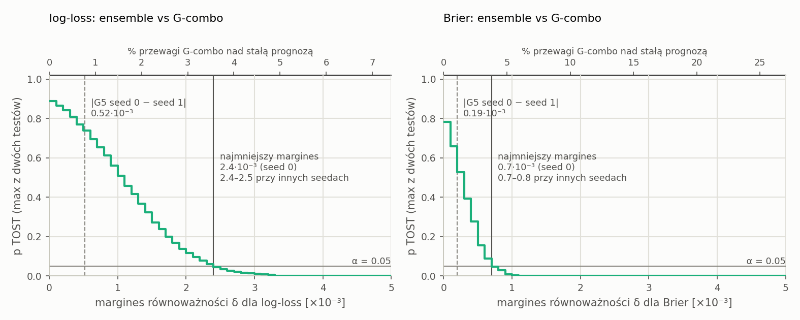
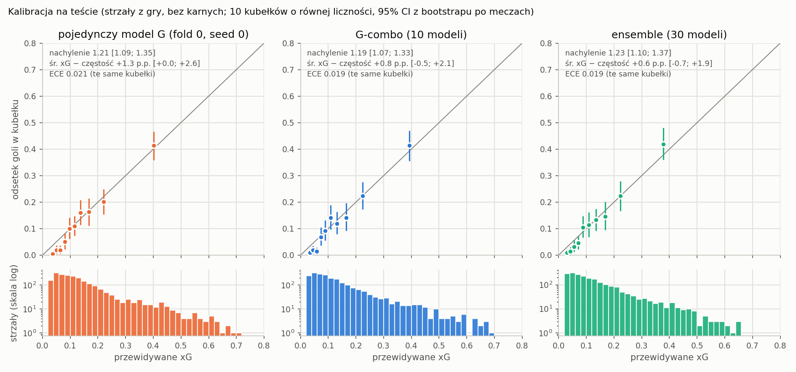
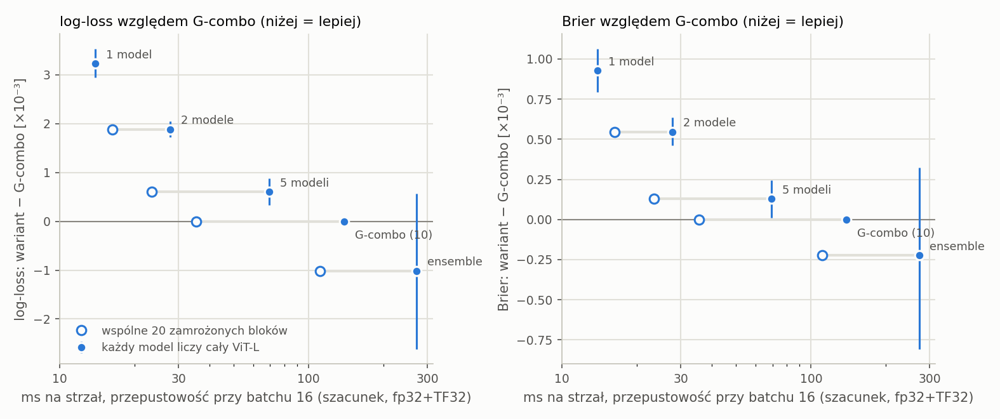
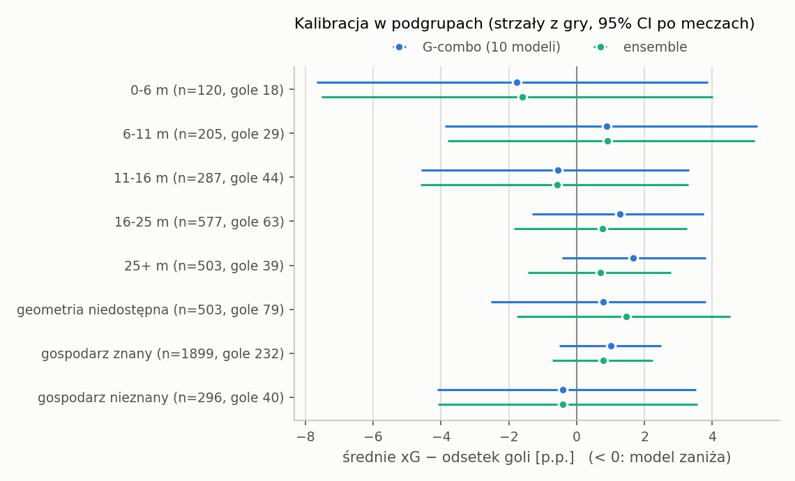

# Ensemble czy sam dostrajany DINOv2: kalibracja, przedziały ufności, koszt

Wersja z 2026-10-08, po recenzji GPT astra z 2026-10-03. Pierwsza wersja powstała 2026-10-02.
Odpowiedź na pierwszy punkt maila recenzenta: czy lepsze prawdopodobieństwa ensemble'u
(AUC 0.793) uzasadniają jego złożoność wobec samego dostrajanego DINOv2-L, czyli G-combo
(AUC 0.792). Recenzent poprosił o wykresy kalibracji i przedziały ufności dla różnic
log-loss i Brier score.

Bez nowego treningu. Wszystkie warianty G-combo odtworzyłem z zapisanych predykcji foldowych
(`results/v12_cv/g_combo`) z tą samą obróbką co we wdrożeniu: Platt na predykcjach
out-of-fold, korekta priora, routing karnych. Odtworzony G-combo zgadza się z
`results/v12_cv_ensemble/g_combo_test_predictions.csv` z dokładnością 2.5e-16. Test v1.2 to
2 229 strzałów ze 100 meczów. Przedziały to 95% bootstrap po meczach: 2 000 losowań, te same
co w `results/v12_report/significance_final`. Skrypt sprawdza, że przedziały ensemble kontra
G-combo zgadzają się z tamtym plikiem z dokładnością 1e-9.

**Historia porównania.** Wynik ensemble kontra G-combo i jego przedziały znamy od 2026-09-03
(`results/v12_report/significance_final/paired_tests.csv`). Regułę decyzji z pierwszej wersji
raportu spisałem 2026-10-02, już po tym wyniku, więc nie była ustalona z góry. Ta wersja nie
używa żadnego progu praktycznej istotności. Zamiast niego podaje krzywą równoważności i
najmniejszy margines, przy którym równoważność zachodzi. Test oglądaliśmy w poprzednich
rundach (audyt z 7.09), więc wszystkie liczby tutaj są rozwojowe.

## Wynik

1. **Nie wykazaliśmy przewagi ensemble'u nad G-combo.** Żaden z trzech przedziałów różnicy
   nie wyklucza zera. Test równoważności TOST daje górną granicę możliwego zysku: redukcja
   log-loss mniejsza niż 0.0024, redukcja Briera mniejsza niż 0.0008 (TOST 2 × 5%). To 3.6%
   i 4.3% przewagi G-combo nad stałą prognozą. Czy taki zysk byłby wart złożoności, ocenia
   czytelnik. Punkty odniesienia są w sekcji 1.
2. **Kalibracja obu modeli ma ten sam jakościowy problem, ale nie jest identyczna.** Oba mają
   nachylenie kalibracji ok. 1.2, czyli zbyt ściśnięte prognozy. U ensemble'u nachylenie jest
   wyższe o 0.037 [0.007; 0.067]. Różnica ECE nie jest rozstrzygnięta.
3. **Wybór 10 zamiast 5 modeli foldowych to kompromis kosztu.** Średnia dwóch zapisanych
   instancji z 5 modelami traci względem G-combo 0.0006 log-loss [0.0003; 0.0009]. Przedział
   każdej z tych dwóch instancji osobno obejmuje zero.
4. **Koszt to na razie szacunek przepustowości,** nie zmierzona latencja wdrożenia. Przy
   batchu 16 i losowych wagach G-combo ze wspólnym zamrożonym trzonem liczy ok. 35 ms na
   strzał, ensemble 111–272 ms.

**Rekomendacja:** modelem docelowym zostaje G-combo bez stacku. ConvNeXt, G-combo-mix i GBM
z torem pozycyjnym wypadają. Powód: nie wykazaliśmy, że dają cokolwiek, a ewentualny zysk
jest poniżej granicy z punktu 1. To nie jest dowód, że zysku nie ma.

## 1. Ensemble względem G-combo

Wszystkie strzały testu, karne obsłużone tą samą regułą w obu modelach. Δ oznacza przewagę
ensemble'u: wzrost AUC albo redukcję straty. P to odsetek losowań z przewagą ensemble'u,
nie p-value.

| Metryka | G-combo | ensemble | Δ | 95% CI | P |
|---|---|---|---|---|---|
| AUC | 0.7923 | 0.7933 | +0.0010 | [−0.0029; +0.0049] | 0.69 |
| log-loss | 0.3242 | 0.3232 | +0.0010 | [−0.0006; +0.0026] | 0.89 |
| Brier | 0.09665 | 0.09643 | +0.00022 | [−0.00032; +0.00081] | 0.78 |

Jako udział w przewadze G-combo nad stałą prognozą redukcja log-loss wynosi 1.5%
[−0.8%; 4.2%], a redukcja Briera 1.2% [−1.7%; 4.9%]. Iloraz liczę w każdym losowaniu osobno,
razem z mianownikiem. Stała prognoza używa częstości goli w ocenianej próbce, więc to opisowy
punkt odniesienia. Na całym teście ma log-loss 0.3917 i Brier 0.1152.

### Krzywa równoważności



Dla każdego marginesu δ od 0 do 0.005, co 0.0001, liczę dwa jednostronne testy na rozkładzie
bootstrapowym różnicy. Hipotezę „ensemble gorszy o δ lub więcej” odrzucam, gdy najwyżej 5%
losowań leży na −δ lub niżej. Hipotezę „ensemble lepszy o δ lub więcej” odrzucam, gdy najwyżej
5% losowań leży na δ lub wyżej. Równoważność przy δ wymaga obu odrzuceń, czyli 90% przedział
musi leżeć w (−δ; δ). Wykres pokazuje większe z dwóch p dla losowań raportu (seed 0, 2 000).

Najmniejszy margines leży na siatce, więc zależy od szumu Monte Carlo bootstrapu. Przy 2 000
losowań i seedach 0–9 wychodzi 0.0024–0.0025 dla log-loss i 0.0007–0.0008 dla Briera. Podaję
wartość z 20 000 losowań: 0.0024 i 0.0008. Dla Briera to wybór ostrożniejszy niż 0.0007 z
losowań raportu.

| | log-loss | Brier |
|---|---|---|
| redukcja przez ensemble | +0.0010 | +0.00022 |
| 90% przedział (seed 0, 2 000 losowań) | [−0.00035; +0.00237] | [−0.00024; +0.00069] |
| najmniejszy margines, seed 0, 2 000 losowań | 0.0024 | 0.0007 |
| najmniejszy margines, seedy 0–9, po 2 000 losowań | 0.0024–0.0025 | 0.0007–0.0008 |
| **najmniejszy margines, 20 000 losowań** | **0.0024** | **0.0008** |
| ten margines jako % przewagi G-combo nad stałą | 3.6% | 4.3% |
| przewaga G-combo nad stałą prognozą | 0.0675 | 0.0185 |
| \|G5 seed 0 − G5 seed 1\| | 0.00052 | 0.00019 |

Punkty odniesienia są niezależne od porównania ensemble'u z G-combo:

- **Dwie instancje tego samego modelu.** Dwie zapisane wersje G z 5 foldami, różniące się
  tylko seedem, różnią się log-lossem o 0.00052 i Brierem o 0.00019. Granica dla ensemble'u
  jest 4.6 razy większa dla log-loss i 4.1 razy większa dla Briera. Możliwy zysk ensemble'u
  może więc być kilka razy większy od różnicy między dwoma treningami. To jednak tylko jedna
  para treningów, a sparowany przedział samej różnicy log-loss między nimi, [−0.0022; +0.0012],
  obejmuje zero i jest szeroki.
- **Przewaga nad stałą prognozą.** Granica to mniej niż 4.5% tego, co G-combo zyskuje nad
  przewidywaniem średniej częstości goli.
- **Koszt.** Ensemble potrzebuje 15 przebiegów ViT-L, 5 ConvNeXt i toru pozycyjnego. Szacunek
  przepustowości to 111–272 ms na strzał wobec 35 ms dla G-combo. Szczegóły w sekcji 3.

## 2. Kalibracja



Strzały z gry: 2 195. 34 karne mają stałą wartość 0.68 i dawałyby jeden punkt. Punkty to 10
kubełków o równej liczności, pionowe odcinki to 95% CI odsetka goli z bootstrapu po meczach.
Osie i histogram obejmują cały zakres prognoz. Histogram ma skalę logarytmiczną, żeby było
widać 32 prognozy G-combo i 22 prognozy ensemble'u powyżej 0.5.

| Model | śr. xG − odsetek goli | nachylenie | wyraz wolny | ECE, kubełki równoliczne | ECE, kubełki równej szerokości |
|---|---|---|---|---|---|
| pojedynczy model G (fold 0, seed 0) | +1.3 p.p. [+0.0; +2.6] | 1.21 [1.09; 1.35] | 0.20 [−0.06; 0.47] | 0.021 | 0.018 |
| G-combo (10 modeli) | +0.8 p.p. [−0.5; +2.1] | 1.19 [1.07; 1.33] | 0.22 [−0.04; 0.49] | 0.019 | 0.016 |
| ensemble | +0.6 p.p. [−0.7; +1.9] | 1.23 [1.10; 1.37] | 0.30 [0.04; 0.58] | 0.019 | 0.016 |
| **ensemble − G-combo, sparowane** | −0.20 p.p. [−0.31; −0.10] | +0.037 [+0.007; +0.067] | +0.080 [+0.028; +0.132] | −0.0007 [−0.0093; +0.0078] | −0.0004 [−0.0093; +0.0068] |

Nachylenie i wyraz wolny pochodzą z regresji logistycznej `gol ~ a + b·logit(xG)`. Model
idealnie skalibrowany ma b = 1. Przy b > 1 prognozy są zbyt ściśnięte wokół średniej. Główny
ECE liczę na tych samych kubełkach równolicznych co wykres. Kubełki równej szerokości podaję
do porównania. Przedziały samego ECE pomijam, bo kubełkowy ECE jest zawyżony w każdym
losowaniu. Sparowana różnica ma to zawyżenie po obu stronach, więc jej przedział podaję.

Ogólny poziom xG się zgadza: średnia różni się od odsetka goli o mniej niż 1 p.p. Problem
leży w rozrzucie i skupia się na dole skali. Najniższe 30% prognoz G-combo to 659 strzałów ze
średnim xG 4.5%. Padło z nich 9 goli wobec 29.9 przewidywanych. 40% tych strzałów oddano z
ponad 25 m, wśród wszystkich strzałów z gry 23%. Powyżej xG ok. 0.07 punkty leżą na przekątnej w granicach
przedziałów.

Ensemble ma nachylenie wyższe o 0.037, a jego przedział nie obejmuje zera. Ensemble nie jest
więc lepiej skalibrowany. Jeśli już, jego prognozy są nieco bardziej ściśnięte. Różnica ECE
obejmuje zero przy obu definicjach kubełków.

### Co wiemy o przyczynie nachylenia

- **Niedopasowanie liczby modeli między OOF a testem nie wyjaśnia całego problemu, ale może
  mieć w nim udział.** Platt G-combo jest dopasowany na średnich z 2 modeli, a test liczony na
  średniej z 10. W wariancie z 2 modelami jednego foldu Platt i test mają tę samą konstrukcję.
  Nachylenia pięciu takich wariantów wynoszą 1.20, 1.17, 1.15, 1.16 i 1.05, średnio 1.15,
  wobec 1.19 dla G-combo. Pojedyncze modele mają 1.04–1.21, średnio 1.15. Warianty z 5
  modelami, gdzie Platt widział 1 model, a test 5, mają 1.23 i 1.21. Kierunek pasuje do
  udziału uśredniania. Te warianty różnią się jednak także wielkością próby dla Platta: 80
  meczów dla 1 i 2 modeli, 400 dla 5 i 10. Rozdzielenie tych efektów wymaga kalibracji pod
  kontrolą, na osobnych danych.
- **Współczynnik Platta to nie diagnoza kalibracji.** Platt G-combo przeskalowuje logity OOF
  współczynnikiem 0.98. To parametr transformacji. Nachylenie kalibracji po Platcie na tych
  samych OOF wynosi 1.00 dla wszystkich strzałów i 0.97 dla strzałów z gry. Liczone jest na
  tych samych etykietach, na których dopasowano Platta, a wcześniej wybrano epokę i
  temperaturę, więc nie jest niezależnym sprawdzeniem.
- **Na OOF G-combo słabiej rozróżnia strzały niż na teście.** AUC na strzałach z gry wynosi
  0.730 na OOF wobec 0.778 na teście, dla wszystkich strzałów 0.744 wobec 0.792. Hipoteza:
  foldy grupowane po gospodarzu są trudniejsze niż oficjalny test, a kalibracja przeniesiona z
  trudniejszego zbioru daje na łatwiejszym zbyt ostrożne prognozy. Różnica AUC nie wskazuje
  jednak przyczyny. Podział testu na znanych i nieznanych gospodarzy (sekcja 4) tego nie
  rozstrzyga.

### Ile dałaby rekalibracja

Pierwsza wersja raportu podawała 0.0016 jako górną granicę kosztu złej kalibracji. To był błąd.
Regresja kalibracyjna dopasowana i oceniana na tych samych strzałach testu jest optymistyczna
i ogranicza się do dwuparametrowej rodziny logistycznej. Regresja izotoniczna na tych samych
danych daje 0.0098, też przeuczone.

Zamiast tego dopasowuję rekalibrację na losowej połowie meczów testu (50 meczów, ok. 1 100
strzałów z gry) i oceniam ją na drugiej połowie. Powtarzam to dla 1 000 losowych podziałów, w
obu kierunkach. Zysk to spadek log-loss na ocenianej połowie.

| | G-combo | ensemble |
|---|---|---|
| log-loss strzałów z gry | 0.3198 | 0.3188 |
| logistyczna, in-sample (optymistycznie) | 0.0016 | 0.0019 |
| izotoniczna, in-sample (optymistycznie) | 0.0098 | 0.0089 |
| **logistyczna, połowa na połowę: średni zysk** | **+0.0002** | **+0.0005** |
| 2.5–97.5 percentyl po podziałach | [−0.0046; +0.0021] | [−0.0045; +0.0025] |
| odsetek podziałów z zyskiem | 66% | 72% |
| izotoniczna, połowa na połowę: średni zysk | −0.0068 | −0.0085 |

Rekalibracja dopasowana na 50 meczach poprawia drugie 50 średnio o 0.0002 log-lossu dla
G-combo, a w co trzecim podziale pogarsza wynik. Izotoniczna średnio szkodzi. Jej prognozy
przycinam do [0.001; 0.999], a gol w kubełku bez goli w połowie uczącej kosztuje dużo, więc ta
liczba pokazuje przeuczenie wartości in-sample, nie najlepszą możliwą elastyczną korektę.
Rozrzut po podziałach to nie przedział ufności, bo podziały się nakładają. Wynik jest też
z konstrukcji pesymistyczny: rekalibracja widzi tylko 50 meczów, więc nie jest to zysk, jaki
dałaby kalibracja dopasowana na większej próbie.

Wniosek: 50 meczów to za mało, żeby ta korekta pewnie pomagała. Ta diagnostyka nie mówi, ile
kosztuje zła kalibracja w ogóle. Kalibracji nie poprawiamy na tym teście, bo wtedy test
przestałby ją mierzyć. Właściwa poprawka to Platt dopasowany na świeżych meczach odłożonych do
kalibracji i sprawdzenie nachylenia na osobnym teście.

## 3. Ile modeli G potrzeba



Tutaj Δ to przewaga G-combo nad wariantem: o ile G-combo ma wyższe AUC i niższą stratę.
Wartość dodatnia znaczy, że 10 modeli jest lepsze.

### Każda instancja osobno

| Instancja | redukcja log-loss przez G-combo [95% CI] | ΔAUC [95% CI] |
|---|---|---|
| 1 model, fold 0 seed 0 | +0.0022 [−0.0003; +0.0047] | +0.0001 [−0.0069; +0.0072] |
| 1 model, fold 0 seed 1 | +0.0029 [−0.0002; +0.0058] | +0.0004 [−0.0066; +0.0076] |
| 1 model, fold 1 seed 0 | +0.0021 [−0.0006; +0.0048] | +0.0095 [+0.0027; +0.0161] |
| 1 model, fold 1 seed 1 | +0.0010 [−0.0018; +0.0037] | +0.0034 [−0.0026; +0.0099] |
| 1 model, fold 2 seed 0 | +0.0038 [+0.0006; +0.0069] | +0.0038 [−0.0042; +0.0120] |
| 1 model, fold 2 seed 1 | +0.0021 [−0.0006; +0.0046] | +0.0055 [−0.0010; +0.0124] |
| 1 model, fold 3 seed 0 | +0.0067 [+0.0041; +0.0093] | +0.0153 [+0.0075; +0.0236] |
| 1 model, fold 3 seed 1 | +0.0083 [+0.0054; +0.0111] | +0.0191 [+0.0108; +0.0272] |
| 1 model, fold 4 seed 0 | +0.0022 [−0.0009; +0.0053] | +0.0074 [+0.0017; +0.0136] |
| 1 model, fold 4 seed 1 | +0.0010 [−0.0027; +0.0047] | +0.0046 [−0.0038; +0.0140] |
| 2 modele, fold 0 | +0.0013 [−0.0010; +0.0035] | −0.0026 [−0.0083; +0.0033] |
| 2 modele, fold 1 | +0.0004 [−0.0017; +0.0025] | +0.0041 [−0.0008; +0.0091] |
| 2 modele, fold 2 | +0.0015 [−0.0007; +0.0037] | +0.0024 [−0.0037; +0.0082] |
| 2 modele, fold 3 | +0.0062 [+0.0041; +0.0084] | +0.0145 [+0.0080; +0.0216] |
| 2 modele, fold 4 | −0.0000 [−0.0030; +0.0028] | +0.0034 [−0.0019; +0.0094] |
| 5 modeli, seed 0 | +0.0009 [−0.0001; +0.0017] | +0.0005 [−0.0019; +0.0029] |
| 5 modeli, seed 1 | +0.0003 [−0.0005; +0.0012] | +0.0001 [−0.0022; +0.0025] |

Przedział redukcji log-loss obejmuje zero dla 7 z 10 pojedynczych modeli, 4 z 5 wariantów z 2
modelami i obu wariantów z 5 modelami. Wyraźną stratę widać głównie dla foldu 3.

### Średnia zapisanych instancji

| Konfiguracja | przebiegi ViT-L | ms/strzał, pełne / wspólny trzon | redukcja log-loss [95% CI] | jako % przewagi nad stałą | ΔAUC [95% CI] | redukcja Briera ×10⁻³ [95% CI] | log-loss instancji |
|---|---|---|---|---|---|---|---|
| 1 model (10 instancji) | 1 | 13.9 / 13.9 | +0.0032 [+0.0029; +0.0035] | 4.8% [4.2; 5.7] | +0.0069 [+0.0057; +0.0082] | +0.93 [+0.80; +1.06] | 0.3252–0.3325 |
| 2 modele, 1 fold (5) | 2 | 27.8 / 16.3 | +0.0019 [+0.0017; +0.0021] | 2.8% [2.3; 3.5] | +0.0044 [+0.0034; +0.0054] | +0.55 [+0.46; +0.64] | 0.3242–0.3304 |
| 5 foldów, 1 seed (2) | 5 | 69.5 / 23.5 | +0.0006 [+0.0003; +0.0009] | 0.9% [0.6; 1.2] | +0.0003 [−0.0001; +0.0007] | +0.13 [+0.01; +0.24] | 0.3245–0.3251 |
| **G-combo** | 10 | 138.9 / 35.4 | odniesienie | | | | 0.3242 |

Te przedziały opisują średnią wyników tych konkretnych zapisanych instancji na losowanych
meczach. Nie obejmują zmienności treningu, seeda ani podziału na foldy, więc nie mówią, ile
zyska przyszły trening z 10 modelami względem przyszłego treningu z 1. Do tego potrzeba
niezależnych powtórzeń całej procedury. Ponadto Platt dla 1 i 2 modeli jest dopasowany na 80
meczach jednego foldu, a dla 5 i 10 modeli na 400. Część różnicy to więc lepsza kalibracja,
nie samo uśrednianie. Modele foldowe uczyły się na 320 z 400 meczów. Pojedynczego modelu na
wszystkich 400 meczach nie trenowaliśmy.

**5 czy 10 modeli.** Średnia dwóch instancji z 5 modelami traci względem G-combo 0.0006
log-loss, czyli 0.9% przewagi nad stałą prognozą. Przedział każdej z nich osobno obejmuje zero.
Według szacunku przepustowości 5 modeli kosztuje 23.5 ms zamiast 35.4 ms. Zostajemy przy 10, bo
czas nie jest teraz wąskim gardłem. Gdy będzie, 5 modeli to rozsądny wybór. Dane nie
rozstrzygają między nimi.

### Czas inferencji

Czasy w tabeli i na wykresie to szacunek kosztu obliczeń, nie latencja wdrożonego G-combo:

- **Losowe wagi.** Wagi modeli foldowych nie zostały zapisane. Benchmark buduje sieci z
  losowymi wagami. Wagi nie zmieniają arytmetyki, ale nie da się sprawdzić zgodności predykcji
  całego G-combo ze wspólnym trzonem.
- **Przepustowość, nie latencja.** Czasy pochodzą z batcha 16 podzielonego przez 16. „fp32”
  oznacza fp32 z włączonym TF32. Karta to RTX 4070 Ti SUPER.
- **Pierwszy pomiar mnożył czasy fragmentów.** 35 ms to 11.5 ms trzonu plus 10 × 2.4 ms
  końcówki, a nie pomiar całego potoku.
- **Niespójna granica pomiaru toru pozycyjnego.** 57 ms toru GBM obejmuje odczyt klatek
  zapasowych −400/−800 ms (średnio 0.91 dodatkowego wywołania na strzał), ale nie odczyt klatki
  podstawowej. Tor ViT nie obejmował przygotowania obrazu.

**Wspólny trzon.** W każdym modelu foldowym uczyły się tylko 4 ostatnie bloki, końcowa
normalizacja i głowa. Pierwsze 20 bloków DINOv2-L, z `patch_embed` i `pos_embed`, jest
zamrożone, a EMA obejmuje tylko parametry trenowalne. Te bloki można więc policzyć raz na
klatkę. To wynika z kodu treningu. Obecny kod inferencji jeszcze tego nie robi.

`scripts/bench_inference.py` jest już poprawiony. Wszystkie klatki, także zapasowe, są
dekodowane przed pomiarem. Mierzony odcinek na każdym torze biegnie od zdekodowanej klatki do
wyniku i obejmuje przygotowanie obrazu. Każda konfiguracja jest mierzona w całości, z 15
osobnymi końcówkami. Przepustowość przy batchu 16 i latencję przy batchu 1 skrypt raportuje
osobno. **Ponowny pomiar czeka**, bo GPU jest zajęte treningiem. Do tego czasu liczby pochodzą
z pierwszego pomiaru.

## 4. Podgrupy (eksploracyjnie)



| Podgrupa | n | gole | AUC G-combo [95% CI] | nachylenie G-combo [95% CI] | śr. xG − odsetek: G-combo | ensemble | redukcja log-loss przez ensemble [95% CI] |
|---|---|---|---|---|---|---|---|
| 0–6 m | 120 | 18 | 0.856 [0.756; 0.933] | 1.93 [1.23; 3.14] | −1.8 p.p. [−7.7; +3.9] | −1.6 | −0.0010 [−0.0064; +0.0045] |
| 6–11 m | 205 | 29 | 0.755 [0.673; 0.836] | 1.17 [0.75; 1.79] | +0.9 [−3.9; +5.3] | +0.9 | +0.0043 [−0.0004; +0.0086] |
| 11–16 m | 287 | 44 | 0.649 [0.580; 0.721] | 0.67 [0.33; 1.07] | −0.6 [−4.6; +3.3] | −0.6 | +0.0017 [−0.0018; +0.0053] |
| 16–25 m | 577 | 63 | 0.767 [0.699; 0.832] | 1.36 [1.01; 1.79] | +1.3 [−1.3; +3.8] | +0.8 | +0.0013 [−0.0017; +0.0041] |
| 25+ m | 503 | 39 | 0.852 [0.806; 0.895] | 1.38 [1.07; 1.81] | +1.7 [−0.4; +3.8] | +0.7 | +0.0020 [−0.0025; +0.0065] |
| geometria niedostępna | 503 | 79 | 0.748 [0.700; 0.796] | 1.05 [0.82; 1.33] | +0.8 [−2.5; +3.8] | +1.5 | −0.0015 [−0.0044; +0.0017] |
| gospodarz znany | 1 899 | 232 | 0.785 [0.759; 0.810] | 1.20 [1.06; 1.36] | +1.0 [−0.5; +2.5] | +0.8 | +0.0010 [−0.0009; +0.0028] |
| gospodarz nieznany | 296 | 40 | 0.738 [0.640; 0.805] | 1.14 [0.77; 1.46] | −0.4 [−4.1; +3.5] | −0.4 | +0.0014 [−0.0021; +0.0046] |

Ta tabela ma 8 różnic log-loss i 8 nachyleń, bez korekty na wielokrotne porównania.
Pojedynczy brzegowy wynik byłby spodziewany nawet bez prawdziwego efektu. Żadna podgrupa nie
pokazuje przewagi ensemble'u w log-lossie.

- **0–6 m: ściśnięta skala, nie słaby ranking.** Nachylenie 1.93 przy AUC 0.856. Model dobrze
  porządkuje strzały z bliska, ale jego prognozy w tym paśmie są zbyt blisko siebie. To
  kandydat do sprawdzenia w analizie przypisania goli i dobitek, nie do zmiany modelu.
- **25+ m: ensemble systematycznie obniża prognozy, ale nie wiadomo, czy lepiej je kalibruje.**
  Średnia prognoza ensemble'u jest niższa niż G-combo o 0.98 p.p. [0.86; 1.13]. Różnica
  bezwzględnych błędów średnich, ensemble minus G-combo, wynosi −0.98 p.p. [−1.12; +1.00] i
  obejmuje zero. Obniżenie pasuje do cechy odległości z GBM, ale nie dowodzi lepszej
  kalibracji.
- **11–16 m** ma najniższe AUC (0.649) i nachylenie poniżej 1. Przedział nachylenia sięga
  jednak 1.07, a to jedna z 8 podgrup.

## 5. Ograniczenia

- Test oglądaliśmy w poprzednich rundach, a porównanie ensemble'u z G-combo było znane przed
  pierwszą wersją tego raportu. Liczby są rozwojowe. Potwierdzenie wymaga nowych meczów.
- Przedziały zakładają, że mecze są niezależnymi jednostkami. Nie obejmują zmienności
  treningu. Porównania szczebli dotyczą zapisanych instancji.
- Krzywa równoważności używa percentylowego bootstrapu ze 100 meczów. Najmniejszy margines
  zależy od siatki co 0.0001 i od szumu Monte Carlo: przy innych seedach bootstrapu przesuwa się
  o jeden krok siatki.
- Czasy to szacunek przepustowości z losowymi wagami na jednej karcie. Latencja przy batchu 1
  czeka na ponowny pomiar.

## 6. Szkic odpowiedzi dla recenzenta

> Porównaliśmy ensemble z samym dostrajanym DINOv2-L (5 foldów × 2 seedy) sparowanym
> bootstrapem po meczach (2 000 losowań, 100 meczów testu). Dodatnia wartość oznacza przewagę
> ensemble'u: ΔAUC +0.001 [−0.003; +0.005], redukcja log-loss +0.0010 [−0.0006; +0.0026],
> redukcja Briera +0.0002 [−0.0003; +0.0008]. Nie wykazaliśmy przewagi ensemble'u. Test
> równoważności (TOST, 2 × 5%) ogranicza możliwy zysk do redukcji log-loss poniżej 0.0024 i
> Briera poniżej 0.0008, czyli poniżej 4.5% przewagi modelu nad stałą prognozą. Dla porównania
> dwa treningi tego samego modelu różniące się seedem dzielą 0.0005 log-lossu. Nie ustaliliśmy
> wcześniej progu praktycznej istotności, a wynik tego porównania znaliśmy od września, więc
> podajemy granicę zamiast werdyktu.
>
> Oba modele mają podobny problem z kalibracją: nachylenie ok. 1.2, prognozy zbyt ściśnięte,
> zawyżone przy najniższych xG. Ensemble go nie zmniejsza, jego nachylenie jest nawet wyższe o
> 0.04 [0.01; 0.07]. Zostajemy przy samym DINOv2, bez ConvNeXt, drugiego wariantu G i toru
> pozycyjnego.
>
> Uśrednienie 10 modeli foldowych zmniejsza log-loss o 0.0032 [0.0029; 0.0035] względem średniej
> z 10 zapisanych pojedynczych modeli. Dla 7 z 10 z nich osobny przedział obejmuje zero, a
> część różnicy wynika z Platta dopasowanego na większej próbie. Wybór 10 zamiast 5 modeli
> (redukcja 0.0006 [0.0003; 0.0009] względem średniej dwóch instancji) traktujemy jako
> kompromis kosztu. Czas to na razie szacunek przepustowości przy batchu 16 z losowymi wagami:
> ok. 35 ms na strzał przy wspólnym zamrożonym trzonie wobec 111–272 ms dla ensemble'u.
> Latencję pojedynczego strzału zmierzymy osobno.
>
> Rekalibracja dopasowana na połowie meczów testu poprawia drugą połowę średnio o 0.0002
> log-lossu, a w co trzecim podziale szkodzi. Kalibrację poprawimy na świeżych meczach
> odłożonych do kalibracji, nie na obecnym teście. Wszystkie liczby są rozwojowe: ten test był
> już oglądany. Wykresy i tabele są w załączonym raporcie.

## Odtworzenie

```bash
cd experiments/claude_fable
./run.sh python scripts/bench_inference.py          # results/v16_complexity/timing.json, GPU, kilka minut
./run.sh python scripts/report_complexity.py        # tabele, wykresy, predykcje; ok. 1 min CPU
./run.sh pytest -q tests/test_report_complexity.py
```

Wyniki: `results/v16_complexity/`, m.in. predykcje każdego wariantu. Kopie tabel,
`summary.json`, `timing.json` i wykresy są w tym katalogu.
