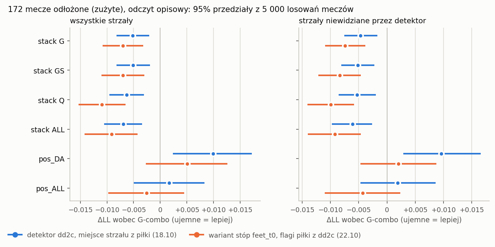

# Sweep metod na 172<!--n:sw.all.g_combo.matches--> meczach odłożonych i miejsce strzału ze stóp strzelca (odczyt opisowy)

Jakub Eichner, 2026-10-22. Gałąź `research/xg-detector`. Sweep z 2026-10-18: reguła `research/sweep_2026_10_rule.md` i skrypt `scripts/sweep_test.py` (commit `70cf84b`), wiersz dziennika decyzji `37ca3b4`. Dalszy ciąg z 2026-10-22 (rozkład błędów i wariant stóp): commit `99d48d2`.

W tekście źródłowym po każdej liczbie stoi niewidoczny znacznik `<!--n:…-->`. Plik `claims.toml` obok mówi, z którego pliku pochodzi liczba. Sprawdzenie: `./run.sh --no-sync python scripts/check_xgd_audit.py results_reports/sweep_2026_10/REPORT.md`. Przedziały w nawiasach to 95%<!--n:r.ci--> przedziały percentylowe z 5 000<!--n:r.draws--> losowań meczów (sparowany bootstrap, seed 0), o ile nie napisano inaczej. ΔLL to różnica log-loss na strzał; ujemna znaczy „lepiej niż odniesienie”.

## 1. Status: odczyt opisowy, nie test

To nie jest test konfirmacyjny. Raport nie ogłasza sukcesu żadnej metody.

- **Mecze są zużyte.** 172<!--n:sw.all.g_combo.matches--> mecze odłożone (135<!--n:sw.evaluation.g_combo.matches--> ewaluacyjnych i 37<!--n:sw.gate.g_combo.matches--> bramki) czytały już: xg-vendor (G-combo), test A1 i test xg-stack. Po teście xg-stack są zużyte dla wariantów wejść detektora.
- **Detektor widział część tych strzałów.** Ponownie wytrenowany detektor dd2c (`models/detector_yolo11l_1280_dd2c.pt`) uczył się m.in. na klatkach SoccerNet-v3 z tych meczów, także z chwil strzałów. Strzał liczę jako „widziany”, gdy w puli v3 jest obraz z tego meczu w oknie 3 s od strzału. Widzianych jest 1 688<!--n:sr.seen.seen_shots--> z 3 819<!--n:sw.all.g_combo.shots--> strzałów: 67%<!--n:sr.seen.pg--> goli (326<!--n:sr.seen.seen_goals--> z 488<!--n:sw.all.g_combo.goals-->) i 41%<!--n:sr.seen.po--> pozostałych strzałów (1 362<!--n:sr.seen.seen_other--> z 3 331<!--n:sr.seen.other-->). W meczach treningowych te udziały wynoszą 82%<!--n:lk.goal--> i 50%<!--n:lk.other--> (`results/xgs_stack_dd2c_leak`).
- **Dlatego każdy odczyt ma dwa podzbiory kontrolne:**
  - strzały niewidziane: 2 131<!--n:sw.unseen.g_combo.shots--> strzałów, w tym gole: 162<!--n:sw.unseen.g_combo.goals-->;
  - mecze bez żadnego obrazu v3: 53<!--n:sw.no_v3_game.g_combo.matches--> mecze, 1 177<!--n:sw.no_v3_game.g_combo.shots--> strzałów.
- **Wariant stóp (sekcje 5–6) powstał po odczycie sweepu.** Kierunek poprawki wskazał rozkład błędów na tych samych meczach, mierzony względem pozycji StatsBomb. Jego wyniki na tych meczach to hipoteza sformułowana na tych meczach.
- **Bez korekty na wielokrotność.** Porównań jest kilkadziesiąt. Pojedynczy przedział poniżej zera nie jest dowodem.

## 2. Metody

Każdy model poza G-combo i A1 dopasowano raz, na 7 062<!--n:r.train.shots--> strzałach z 328<!--n:r.train.matches--> meczów treningowych. Populacja testowa to wszystkie strzały poza karnymi z meczów odłożonych. Etykieta to kolumna `goal` indeksu, przeczytana raz, po zapisaniu wszystkich predykcji.

**Stała (const).** Każdy strzał dostaje częstość goli z treningu.

**G-combo.** Dostrojony DINOv2 na klatce strzału: średni logit dziesięciu modeli i skalowanie Platta, w postaci wdrożonej (`results/xgd_gcombo_test`). To odniesienie dla każdego ΔLL w raporcie.

**A1.** G-combo z geometrią ze starego detektora (D3) w głowicy, w postaci z testu A1 (`results/xgd_test`).

**stack_\*.** Regresja logistyczna z karą L2 na logicie G-combo (`z_g_combo`, bez kary) i cechach E3 z detektora. Siłę kary wybiera wewnętrzna walidacja krzyżowa po meczach. Ramiona są zdefiniowane w protokole C6 (`research/xgs_stack_protocol_c6.json`):

| ramię | wejścia |
|---|---|
| R | sam `z_g_combo` |
| G | R + odległość E3 (naturalny spline, 3 df) + kąt E3 + brak miejsca strzału + brak piłki |
| GS | G + cztery flagi kontekstu z adnotacji SoccerNet |
| Q | G + wejścia jakości: `shot_x`, strzał z piłki, strzelec przy bramce, pewność i liczba punktów boiska, liczba zawodników |
| ALL | GS + Q + wszystkie pozostałe kolumny E3 z chwili strzału i z klatki −400 ms (bramkarz, obrońcy w stożku, najbliższy rywal) |

Przyrostek `_old` to E3 ze starego detektora (`cache/xgd_full3/E3`), `_new` to E3 z detektora dd2c (`cache/xgd_full4/E3`). R, G i GS ze starym detektorem odtwarzają predykcje testu xg-stack co do bitu.

**pos_\*.** Ta sama regresja bez `z_g_combo`, czyli same pozycje z detektora, bez pikseli. Karane są wszystkie współczynniki. `pos_DA` to odległość (spline), kąt i wskaźniki braków. `pos_ALL` to wszystkie kolumny ramienia ALL poza logitem (podejście 2 w wersji logistycznej).

## 3. Wyniki sweepu z 2026-10-18

### 3.1 Wszystkie strzały

| metoda | log-loss | AUC | Brier | nachylenie kalibracji | ΔLL wobec G-combo [95%<!--n:r.ci-->] |
|---|---|---|---|---|---|
| const | 0.3821<!--n:sw.all.const.log_loss--> | 0.500<!--n:sw.all.const.auc--> | 0.1115<!--n:sw.all.const.brier--> | 0.47<!--n:sw.all.const.cal_slope--> | +0.0445 [+0.0353; +0.0542]<!--n:sw.all.const.d--> |
| G-combo | 0.3376<!--n:sw.all.g_combo.log_loss--> | 0.742<!--n:sw.all.g_combo.auc--> | 0.0999<!--n:sw.all.g_combo.brier--> | 1.05<!--n:sw.all.g_combo.cal_slope--> | — |
| A1 | 0.3386<!--n:sw.all.a1.log_loss--> | 0.739<!--n:sw.all.a1.auc--> | 0.1002<!--n:sw.all.a1.brier--> | 1.03<!--n:sw.all.a1.cal_slope--> | +0.0009 [−0.0012; +0.0030]<!--n:sw.all.a1.d--> |
| stack R | 0.3378<!--n:sw.all.stack_R.log_loss--> | 0.742<!--n:sw.all.stack_R.auc--> | 0.1000<!--n:sw.all.stack_R.brier--> | 1.11<!--n:sw.all.stack_R.cal_slope--> | +0.0002 [−0.0004; +0.0007]<!--n:sw.all.stack_R.d--> |
| stack G, stary | 0.3369<!--n:sw.all.stack_G_old.log_loss--> | 0.744<!--n:sw.all.stack_G_old.auc--> | 0.0997<!--n:sw.all.stack_G_old.brier--> | 1.11<!--n:sw.all.stack_G_old.cal_slope--> | −0.0008 [−0.0021; +0.0005]<!--n:sw.all.stack_G_old.d--> |
| stack GS, stary | 0.3369<!--n:sw.all.stack_GS_old.log_loss--> | 0.744<!--n:sw.all.stack_GS_old.auc--> | 0.0998<!--n:sw.all.stack_GS_old.brier--> | 1.11<!--n:sw.all.stack_GS_old.cal_slope--> | −0.0007 [−0.0018; +0.0004]<!--n:sw.all.stack_GS_old.d--> |
| stack ALL, stary | 0.3376<!--n:sw.all.stack_ALL_old.log_loss--> | 0.743<!--n:sw.all.stack_ALL_old.auc--> | 0.1000<!--n:sw.all.stack_ALL_old.brier--> | 1.09<!--n:sw.all.stack_ALL_old.cal_slope--> | −0.0000 [−0.0017; +0.0017]<!--n:sw.all.stack_ALL_old.d--> |
| pos_DA, stary | 0.3694<!--n:sw.all.pos_DA_old.log_loss--> | 0.637<!--n:sw.all.pos_DA_old.auc--> | 0.1087<!--n:sw.all.pos_DA_old.brier--> | 0.99<!--n:sw.all.pos_DA_old.cal_slope--> | +0.0318 [+0.0233; +0.0405]<!--n:sw.all.pos_DA_old.d--> |
| stack G, dd2c | 0.3325<!--n:sw.all.stack_G_new.log_loss--> | 0.755<!--n:sw.all.stack_G_new.auc--> | 0.0986<!--n:sw.all.stack_G_new.brier--> | 1.10<!--n:sw.all.stack_G_new.cal_slope--> | −0.0051 [−0.0082; −0.0021]<!--n:sw.all.stack_G_new.d--> |
| stack GS, dd2c | 0.3325<!--n:sw.all.stack_GS_new.log_loss--> | 0.755<!--n:sw.all.stack_GS_new.auc--> | 0.0988<!--n:sw.all.stack_GS_new.brier--> | 1.09<!--n:sw.all.stack_GS_new.cal_slope--> | −0.0051 [−0.0082; −0.0020]<!--n:sw.all.stack_GS_new.d--> |
| stack Q, dd2c | 0.3313<!--n:sw.all.stack_Q_new.log_loss--> | 0.756<!--n:sw.all.stack_Q_new.auc--> | 0.0981<!--n:sw.all.stack_Q_new.brier--> | 1.10<!--n:sw.all.stack_Q_new.cal_slope--> | −0.0063 [−0.0095; −0.0030]<!--n:sw.all.stack_Q_new.d--> |
| stack ALL, dd2c | 0.3307<!--n:sw.all.stack_ALL_new.log_loss--> | 0.756<!--n:sw.all.stack_ALL_new.auc--> | 0.0978<!--n:sw.all.stack_ALL_new.brier--> | 1.06<!--n:sw.all.stack_ALL_new.cal_slope--> | −0.0069 [−0.0105; −0.0034]<!--n:sw.all.stack_ALL_new.d--> |
| pos_DA, dd2c | 0.3475<!--n:sw.all.pos_DA_new.log_loss--> | 0.722<!--n:sw.all.pos_DA_new.auc--> | 0.1034<!--n:sw.all.pos_DA_new.brier--> | 1.12<!--n:sw.all.pos_DA_new.cal_slope--> | +0.0099 [+0.0024; +0.0172]<!--n:sw.all.pos_DA_new.d--> |
| pos_ALL, dd2c | 0.3393<!--n:sw.all.pos_ALL_new.log_loss--> | 0.742<!--n:sw.all.pos_ALL_new.auc--> | 0.1007<!--n:sw.all.pos_ALL_new.brier--> | 1.04<!--n:sw.all.pos_ALL_new.cal_slope--> | +0.0017 [−0.0050; +0.0083]<!--n:sw.all.pos_ALL_new.d--> |

- **Stary detektor nic nie daje.** A1 i ramiona `_old` nie różnią się od G-combo. Każdy ich przedział obejmuje zero.
- **Detektor dd2c daje poprawę.** Wszystkie cztery ramiona `_new` mają przedział poniżej zera. Najlepszy punkt ma stack ALL: −0.0069 [−0.0105; −0.0034]<!--n:sw.all.stack_ALL_new.d-->.
- **Same pozycje dorównują pikselom.** pos_ALL z dd2c ma log-loss 0.3393<!--n:sw.all.pos_ALL_new.log_loss--> wobec 0.3376<!--n:sw.all.g_combo.log_loss--> G-combo; ΔLL +0.0017 [−0.0050; +0.0083]<!--n:sw.all.pos_ALL_new.d-->.
- **Odległość i kąt z dd2c są dużo lepsze niż ze starego detektora:** ΔLL +0.0099 [+0.0024; +0.0172]<!--n:sw.all.pos_DA_new.d--> wobec +0.0318 [+0.0233; +0.0405]<!--n:sw.all.pos_DA_old.d-->.
- **Kalibracja.** Nachylenie stacków jest powyżej 1. Prognozy są więc nieco zbyt ostrożne.

### 3.2 Podzbiory: ΔLL wobec G-combo [95%<!--n:r.ci-->]

| metoda | ewaluacyjne | bramka | niewidziane | mecze bez v3 |
|---|---|---|---|---|
| A1 | +0.0011 [−0.0014; +0.0037]<!--n:sw.evaluation.a1.d--> | +0.0003 [−0.0034; +0.0041]<!--n:sw.gate.a1.d--> | +0.0018 [−0.0004; +0.0041]<!--n:sw.unseen.a1.d--> | +0.0020 [−0.0020; +0.0059]<!--n:sw.no_v3_game.a1.d--> |
| stack R | +0.0000 [−0.0006; +0.0007]<!--n:sw.evaluation.stack_R.d--> | +0.0006 [−0.0006; +0.0019]<!--n:sw.gate.stack_R.d--> | −0.0004 [−0.0010; +0.0001]<!--n:sw.unseen.stack_R.d--> | +0.0003 [−0.0004; +0.0012]<!--n:sw.no_v3_game.stack_R.d--> |
| stack G, stary | −0.0009 [−0.0023; +0.0006]<!--n:sw.evaluation.stack_G_old.d--> | −0.0004 [−0.0036; +0.0024]<!--n:sw.gate.stack_G_old.d--> | −0.0007 [−0.0023; +0.0008]<!--n:sw.unseen.stack_G_old.d--> | +0.0003 [−0.0021; +0.0025]<!--n:sw.no_v3_game.stack_G_old.d--> |
| stack GS, stary | −0.0007 [−0.0019; +0.0006]<!--n:sw.evaluation.stack_GS_old.d--> | −0.0008 [−0.0034; +0.0017]<!--n:sw.gate.stack_GS_old.d--> | −0.0009 [−0.0022; +0.0004]<!--n:sw.unseen.stack_GS_old.d--> | +0.0000 [−0.0019; +0.0019]<!--n:sw.no_v3_game.stack_GS_old.d--> |
| stack ALL, stary | −0.0001 [−0.0021; +0.0018]<!--n:sw.evaluation.stack_ALL_old.d--> | +0.0004 [−0.0035; +0.0042]<!--n:sw.gate.stack_ALL_old.d--> | +0.0002 [−0.0018; +0.0023]<!--n:sw.unseen.stack_ALL_old.d--> | +0.0023 [−0.0009; +0.0057]<!--n:sw.no_v3_game.stack_ALL_old.d--> |
| pos_DA, stary | +0.0314 [+0.0214; +0.0416]<!--n:sw.evaluation.pos_DA_old.d--> | +0.0332 [+0.0172; +0.0496]<!--n:sw.gate.pos_DA_old.d--> | +0.0264 [+0.0176; +0.0349]<!--n:sw.unseen.pos_DA_old.d--> | +0.0324 [+0.0185; +0.0464]<!--n:sw.no_v3_game.pos_DA_old.d--> |
| stack G, dd2c | −0.0045 [−0.0082; −0.0010]<!--n:sw.evaluation.stack_G_new.d--> | −0.0075 [−0.0130; −0.0017]<!--n:sw.gate.stack_G_new.d--> | −0.0047 [−0.0075; −0.0017]<!--n:sw.unseen.stack_G_new.d--> | −0.0049 [−0.0096; −0.0002]<!--n:sw.no_v3_game.stack_G_new.d--> |
| stack GS, dd2c | −0.0048 [−0.0086; −0.0010]<!--n:sw.evaluation.stack_GS_new.d--> | −0.0063 [−0.0115; −0.0010]<!--n:sw.gate.stack_GS_new.d--> | −0.0051 [−0.0081; −0.0022]<!--n:sw.unseen.stack_GS_new.d--> | −0.0048 [−0.0093; −0.0003]<!--n:sw.no_v3_game.stack_GS_new.d--> |
| stack Q, dd2c | −0.0057 [−0.0095; −0.0019]<!--n:sw.evaluation.stack_Q_new.d--> | −0.0085 [−0.0143; −0.0026]<!--n:sw.gate.stack_Q_new.d--> | −0.0053 [−0.0085; −0.0020]<!--n:sw.unseen.stack_Q_new.d--> | −0.0050 [−0.0101; +0.0003]<!--n:sw.no_v3_game.stack_Q_new.d--> |
| stack ALL, dd2c | −0.0055 [−0.0096; −0.0014]<!--n:sw.evaluation.stack_ALL_new.d--> | −0.0121 [−0.0185; −0.0058]<!--n:sw.gate.stack_ALL_new.d--> | −0.0061 [−0.0097; −0.0026]<!--n:sw.unseen.stack_ALL_new.d--> | −0.0055 [−0.0109; −0.0004]<!--n:sw.no_v3_game.stack_ALL_new.d--> |
| pos_DA, dd2c | +0.0104 [+0.0017; +0.0190]<!--n:sw.evaluation.pos_DA_new.d--> | +0.0079 [−0.0063; +0.0220]<!--n:sw.gate.pos_DA_new.d--> | +0.0096 [+0.0029; +0.0166]<!--n:sw.unseen.pos_DA_new.d--> | +0.0120 [+0.0016; +0.0227]<!--n:sw.no_v3_game.pos_DA_new.d--> |
| pos_ALL, dd2c | +0.0031 [−0.0047; +0.0108]<!--n:sw.evaluation.pos_ALL_new.d--> | −0.0035 [−0.0148; +0.0084]<!--n:sw.gate.pos_ALL_new.d--> | +0.0019 [−0.0047; +0.0086]<!--n:sw.unseen.pos_ALL_new.d--> | +0.0037 [−0.0058; +0.0136]<!--n:sw.no_v3_game.pos_ALL_new.d--> |

- **Na strzałach niewidzianych zysk zostaje:** stack ALL z dd2c −0.0061 [−0.0097; −0.0026]<!--n:sw.unseen.stack_ALL_new.d-->.
- **W meczach bez v3 też:** −0.0055 [−0.0109; −0.0004]<!--n:sw.no_v3_game.stack_ALL_new.d-->. Przedział jest szerszy, bo meczów jest mniej.
- **Ewaluacja i bramka mają ten sam kierunek.** Pełne tabele (log-loss, AUC, Brier, nachylenie) dla każdego podzbioru są w załączniku A.

## 4. Odniesienie StatsBomb (Data: StatsBomb.)

Strzały populacji primary sparowane ze StatsBomb w meczach ewaluacyjnych: 2 721<!--n:sb.paired_primary.g_combo.shots--> strzałów, w tym gole: 374<!--n:sb.paired_primary.g_combo.goals-->, z 135<!--n:sb.paired_primary.g_combo.matches--> meczów. Obok metod sweepu stoją xG dostawcy i trzy modele porównawcze na danych StatsBomb z fazy xg-vendor: freeze frame, zdarzenia oraz odległość i kąt. Te modele uczyły się na osobnej puli strzałów StatsBomb, nie na meczach SoccerNet. Żaden model sweepu nie widzi StatsBomb. Data: StatsBomb.

| metoda | log-loss | AUC | Brier | nachylenie kalibracji | ΔLL wobec G-combo [95%<!--n:r.ci-->] |
|---|---|---|---|---|---|
| const | 0.4007<!--n:sb.paired_primary.const.log_loss--> | 0.500<!--n:sb.paired_primary.const.auc--> | 0.1187<!--n:sb.paired_primary.const.brier--> | 0.21<!--n:sb.paired_primary.const.cal_slope--> | +0.0466 [+0.0349; +0.0584]<!--n:sb.paired_primary.const.d--> |
| G-combo | 0.3541<!--n:sb.paired_primary.g_combo.log_loss--> | 0.738<!--n:sb.paired_primary.g_combo.auc--> | 0.1059<!--n:sb.paired_primary.g_combo.brier--> | 1.04<!--n:sb.paired_primary.g_combo.cal_slope--> | — |
| A1 | 0.3555<!--n:sb.paired_primary.a1.log_loss--> | 0.734<!--n:sb.paired_primary.a1.auc--> | 0.1062<!--n:sb.paired_primary.a1.brier--> | 1.01<!--n:sb.paired_primary.a1.cal_slope--> | +0.0014 [−0.0012; +0.0039]<!--n:sb.paired_primary.a1.d--> |
| stack R | 0.3545<!--n:sb.paired_primary.stack_R.log_loss--> | 0.738<!--n:sb.paired_primary.stack_R.auc--> | 0.1061<!--n:sb.paired_primary.stack_R.brier--> | 1.09<!--n:sb.paired_primary.stack_R.cal_slope--> | +0.0004 [−0.0002; +0.0010]<!--n:sb.paired_primary.stack_R.d--> |
| stack G, stary | 0.3537<!--n:sb.paired_primary.stack_G_old.log_loss--> | 0.740<!--n:sb.paired_primary.stack_G_old.auc--> | 0.1059<!--n:sb.paired_primary.stack_G_old.brier--> | 1.10<!--n:sb.paired_primary.stack_G_old.cal_slope--> | −0.0004 [−0.0019; +0.0011]<!--n:sb.paired_primary.stack_G_old.d--> |
| stack GS, stary | 0.3540<!--n:sb.paired_primary.stack_GS_old.log_loss--> | 0.740<!--n:sb.paired_primary.stack_GS_old.auc--> | 0.1060<!--n:sb.paired_primary.stack_GS_old.brier--> | 1.09<!--n:sb.paired_primary.stack_GS_old.cal_slope--> | −0.0001 [−0.0013; +0.0012]<!--n:sb.paired_primary.stack_GS_old.d--> |
| stack ALL, stary | 0.3546<!--n:sb.paired_primary.stack_ALL_old.log_loss--> | 0.739<!--n:sb.paired_primary.stack_ALL_old.auc--> | 0.1063<!--n:sb.paired_primary.stack_ALL_old.brier--> | 1.08<!--n:sb.paired_primary.stack_ALL_old.cal_slope--> | +0.0005 [−0.0015; +0.0026]<!--n:sb.paired_primary.stack_ALL_old.d--> |
| pos_DA, stary | 0.3891<!--n:sb.paired_primary.pos_DA_old.log_loss--> | 0.627<!--n:sb.paired_primary.pos_DA_old.auc--> | 0.1159<!--n:sb.paired_primary.pos_DA_old.brier--> | 0.92<!--n:sb.paired_primary.pos_DA_old.cal_slope--> | +0.0350 [+0.0243; +0.0459]<!--n:sb.paired_primary.pos_DA_old.d--> |
| stack G, dd2c | 0.3496<!--n:sb.paired_primary.stack_G_new.log_loss--> | 0.748<!--n:sb.paired_primary.stack_G_new.auc--> | 0.1046<!--n:sb.paired_primary.stack_G_new.brier--> | 1.08<!--n:sb.paired_primary.stack_G_new.cal_slope--> | −0.0045 [−0.0081; −0.0006]<!--n:sb.paired_primary.stack_G_new.d--> |
| stack GS, dd2c | 0.3497<!--n:sb.paired_primary.stack_GS_new.log_loss--> | 0.749<!--n:sb.paired_primary.stack_GS_new.auc--> | 0.1047<!--n:sb.paired_primary.stack_GS_new.brier--> | 1.07<!--n:sb.paired_primary.stack_GS_new.cal_slope--> | −0.0044 [−0.0082; −0.0004]<!--n:sb.paired_primary.stack_GS_new.d--> |
| stack Q, dd2c | 0.3487<!--n:sb.paired_primary.stack_Q_new.log_loss--> | 0.749<!--n:sb.paired_primary.stack_Q_new.auc--> | 0.1042<!--n:sb.paired_primary.stack_Q_new.brier--> | 1.07<!--n:sb.paired_primary.stack_Q_new.cal_slope--> | −0.0054 [−0.0093; −0.0014]<!--n:sb.paired_primary.stack_Q_new.d--> |
| stack ALL, dd2c | 0.3490<!--n:sb.paired_primary.stack_ALL_new.log_loss--> | 0.748<!--n:sb.paired_primary.stack_ALL_new.auc--> | 0.1040<!--n:sb.paired_primary.stack_ALL_new.brier--> | 1.03<!--n:sb.paired_primary.stack_ALL_new.cal_slope--> | −0.0051 [−0.0095; −0.0008]<!--n:sb.paired_primary.stack_ALL_new.d--> |
| pos_DA, dd2c | 0.3661<!--n:sb.paired_primary.pos_DA_new.log_loss--> | 0.714<!--n:sb.paired_primary.pos_DA_new.auc--> | 0.1100<!--n:sb.paired_primary.pos_DA_new.brier--> | 1.08<!--n:sb.paired_primary.pos_DA_new.cal_slope--> | +0.0120 [+0.0026; +0.0216]<!--n:sb.paired_primary.pos_DA_new.d--> |
| pos_ALL, dd2c | 0.3582<!--n:sb.paired_primary.pos_ALL_new.log_loss--> | 0.732<!--n:sb.paired_primary.pos_ALL_new.auc--> | 0.1071<!--n:sb.paired_primary.pos_ALL_new.brier--> | 1.00<!--n:sb.paired_primary.pos_ALL_new.cal_slope--> | +0.0041 [−0.0041; +0.0124]<!--n:sb.paired_primary.pos_ALL_new.d--> |
| xG StatsBomb (dostawca) | 0.3320<!--n:sb.paired_primary.sb_vendor.log_loss--> | 0.793<!--n:sb.paired_primary.sb_vendor.auc--> | 0.0982<!--n:sb.paired_primary.sb_vendor.brier--> | 0.97<!--n:sb.paired_primary.sb_vendor.cal_slope--> | −0.0221 [−0.0334; −0.0102]<!--n:sb.paired_primary.sb_vendor.d--> |
| model na freeze frame StatsBomb | 0.3318<!--n:sb.paired_primary.sb_positions.log_loss--> | 0.790<!--n:sb.paired_primary.sb_positions.auc--> | 0.0979<!--n:sb.paired_primary.sb_positions.brier--> | 0.89<!--n:sb.paired_primary.sb_positions.cal_slope--> | −0.0223 [−0.0341; −0.0098]<!--n:sb.paired_primary.sb_positions.d--> |
| model na zdarzeniach StatsBomb | 0.3375<!--n:sb.paired_primary.sb_events.log_loss--> | 0.779<!--n:sb.paired_primary.sb_events.auc--> | 0.1002<!--n:sb.paired_primary.sb_events.brier--> | 0.93<!--n:sb.paired_primary.sb_events.cal_slope--> | −0.0166 [−0.0274; −0.0055]<!--n:sb.paired_primary.sb_events.d--> |
| odległość i kąt StatsBomb | 0.3599<!--n:sb.paired_primary.sb_dist_angle.log_loss--> | 0.743<!--n:sb.paired_primary.sb_dist_angle.auc--> | 0.1078<!--n:sb.paired_primary.sb_dist_angle.brier--> | 1.02<!--n:sb.paired_primary.sb_dist_angle.cal_slope--> | +0.0057 [−0.0058; +0.0183]<!--n:sb.paired_primary.sb_dist_angle.d--> |

- **Luka do dostawcy:** xG StatsBomb ma ΔLL −0.0221 [−0.0334; −0.0102]<!--n:sb.paired_primary.sb_vendor.d--> wobec G-combo, model na freeze frame −0.0223 [−0.0341; −0.0098]<!--n:sb.paired_primary.sb_positions.d-->.
- **dd2c zamyka mniej więcej jedną czwartą luki:** stack Q 24%<!--n:sr.gap.Q-->, stack ALL 23%<!--n:sr.gap.ALL--> (stosunek ΔLL metody do ΔLL dostawcy).
- **Ta sama para cech:** odległość i kąt z dd2c dają 0.3661<!--n:sb.paired_primary.pos_DA_new.log_loss-->, ze StatsBomb 0.3599<!--n:sb.paired_primary.sb_dist_angle.log_loss-->.
- Data: StatsBomb.

## 5. Rozkład błędów (2026-10-22)

Pytanie: gdzie stack ALL z dd2c wciąż traci do dostawcy. Strzały podzielono według błędu detektora względem pozycji StatsBomb, na strzałach sparowanych (`scripts/err_decomp.py`). Data: StatsBomb.

### 5.1 Bramkarz nie jest ograniczeniem

- Bramkarz jest wykryty przy 91%<!--n:sr.gk.det--> sparowanych strzałów (90%<!--n:sr.gk.det.all--> wszystkich strzałów odłożonych).
- Mediana błędu głębokości bramkarza wynosi 0.46 m<!--n:sr.gk.depth-->.
- Luka stacka do dostawcy jest i przy wykrytym bramkarzu (+0.0176<!--n:ed.sb_paired.gk_detected.1.0.gap_stack_minus_vendor-->), i przy niewykrytym (+0.0112<!--n:ed.sb_paired.gk_detected.0.0.gap_stack_minus_vendor-->).
- Przedziały w tabelach sekcji 5 pochodzą z 2 000<!--n:ed.draws--> losowań meczów (`scripts/err_decomp.py`).

| warstwa (sparowane strzały) | strzały | LL G-combo | LL stack ALL, dd2c | ΔLL stack − G-combo [95%<!--n:r.ci-->] | udział w LL stacka | luka stack − dostawca |
|---|---|---|---|---|---|---|
| bramkarz wykryty | 2 464<!--n:ed.sb_paired.gk_detected.1.0.shots--> | 0.3668<!--n:ed.sb_paired.gk_detected.1.0.LL_g_combo--> | 0.3612<!--n:ed.sb_paired.gk_detected.1.0.LL_stack_ALL_new--> | −0.0056 [−0.0102; −0.0012]<!--n:ed.sb_paired.gk_detected.1.0.d--> | 94%<!--n:ed.sb_paired.gk_detected.1.0.share_of_total_LL_stack--> | +0.0176<!--n:ed.sb_paired.gk_detected.1.0.gap_stack_minus_vendor--> |
| bramkarz niewykryty | 257<!--n:ed.sb_paired.gk_detected.0.0.shots--> | 0.2328<!--n:ed.sb_paired.gk_detected.0.0.LL_g_combo--> | 0.2322<!--n:ed.sb_paired.gk_detected.0.0.LL_stack_ALL_new--> | −0.0006 [−0.0233; +0.0219]<!--n:ed.sb_paired.gk_detected.0.0.d--> | 6%<!--n:ed.sb_paired.gk_detected.0.0.share_of_total_LL_stack--> | +0.0112<!--n:ed.sb_paired.gk_detected.0.0.gap_stack_minus_vendor--> |
| błąd głębokości bramkarza `<1m` | 2 045<!--n:ed.sb_paired.gk_depth_err.lt1m.shots--> | 0.3807<!--n:ed.sb_paired.gk_depth_err.lt1m.LL_g_combo--> | 0.3775<!--n:ed.sb_paired.gk_depth_err.lt1m.LL_stack_ALL_new--> | −0.0032 [−0.0083; +0.0019]<!--n:ed.sb_paired.gk_depth_err.lt1m.d--> | 81%<!--n:ed.sb_paired.gk_depth_err.lt1m.share_of_total_LL_stack--> | +0.0175<!--n:ed.sb_paired.gk_depth_err.lt1m.gap_stack_minus_vendor--> |
| błąd głębokości bramkarza `1-2m` | 376<!--n:ed.sb_paired.gk_depth_err.1-2m.shots--> | 0.3214<!--n:ed.sb_paired.gk_depth_err.1-2m.LL_g_combo--> | 0.3094<!--n:ed.sb_paired.gk_depth_err.1-2m.LL_stack_ALL_new--> | −0.0121 [−0.0219; −0.0022]<!--n:ed.sb_paired.gk_depth_err.1-2m.d--> | 12%<!--n:ed.sb_paired.gk_depth_err.1-2m.share_of_total_LL_stack--> | +0.0233<!--n:ed.sb_paired.gk_depth_err.1-2m.gap_stack_minus_vendor--> |
| błąd głębokości bramkarza `2-5m` | 83<!--n:ed.sb_paired.gk_depth_err.2-5m.shots--> | 0.3732<!--n:ed.sb_paired.gk_depth_err.2-5m.LL_g_combo--> | 0.3227<!--n:ed.sb_paired.gk_depth_err.2-5m.LL_stack_ALL_new--> | −0.0505 [−0.1002; −0.0100]<!--n:ed.sb_paired.gk_depth_err.2-5m.d--> | 3%<!--n:ed.sb_paired.gk_depth_err.2-5m.share_of_total_LL_stack--> | −0.0098<!--n:ed.sb_paired.gk_depth_err.2-5m.gap_stack_minus_vendor--> |
| błąd głębokości bramkarza `>=5m` | 192<!--n:ed.sb_paired.gk_depth_err.ge5m.shots--> | 0.1422<!--n:ed.sb_paired.gk_depth_err.ge5m.LL_g_combo--> | 0.1378<!--n:ed.sb_paired.gk_depth_err.ge5m.LL_stack_ALL_new--> | −0.0043 [−0.0274; +0.0140]<!--n:ed.sb_paired.gk_depth_err.ge5m.d--> | 3%<!--n:ed.sb_paired.gk_depth_err.ge5m.share_of_total_LL_stack--> | +0.0139<!--n:ed.sb_paired.gk_depth_err.ge5m.gap_stack_minus_vendor--> |
| brak głębokości bramkarza | 25<!--n:ed.sb_paired.gk_depth_err.missing.shots--> | 0.2382<!--n:ed.sb_paired.gk_depth_err.missing.LL_g_combo--> | 0.3229<!--n:ed.sb_paired.gk_depth_err.missing.LL_stack_ALL_new--> | +0.0847 [−0.0210; +0.2281]<!--n:ed.sb_paired.gk_depth_err.missing.d--> | 1%<!--n:ed.sb_paired.gk_depth_err.missing.share_of_total_LL_stack--> | −0.0083<!--n:ed.sb_paired.gk_depth_err.missing.gap_stack_minus_vendor--> |
| wszystkie sparowane | 2 721<!--n:ed.sb_paired.all.all.shots--> | 0.3541<!--n:ed.sb_paired.all.all.LL_g_combo--> | 0.3490<!--n:ed.sb_paired.all.all.LL_stack_ALL_new--> | −0.0052 [−0.0096; −0.0009]<!--n:ed.sb_paired.all.all.d--> | 100%<!--n:ed.sb_paired.all.all.share_of_total_LL_stack--> | +0.0170<!--n:ed.sb_paired.all.all.gap_stack_minus_vendor--> |

Data: StatsBomb.

### 5.2 Miejsce strzału jest ograniczeniem

- Mediana błędu miejsca strzału dd2c wynosi 2.62 m<!--n:sr.loc.all.all.dd2c_median_m-->. Błąd ≥ 5 m ma 32%<!--n:sr.loc.all.all.dd2c_ge5_share--> strzałów.
- Strzały z błędem ≥ 5 m dają 37%<!--n:ed.sb_paired.shot_err.ge5m.share_of_total_LL_stack--> całego log-loss stacka.

| błąd miejsca strzału dd2c | strzały | LL G-combo | LL stack ALL, dd2c | LL dostawcy | luka stack − dostawca | udział w LL stacka |
|---|---|---|---|---|---|---|
| `<1m` | 444<!--n:ed.sb_paired.shot_err.lt1m.shots--> | 0.2997<!--n:ed.sb_paired.shot_err.lt1m.LL_g_combo--> | 0.2980<!--n:ed.sb_paired.shot_err.lt1m.LL_stack_ALL_new--> | 0.2872<!--n:ed.sb_paired.shot_err.lt1m.LL_vendor--> | +0.0107<!--n:ed.sb_paired.shot_err.lt1m.gap_stack_minus_vendor--> | 14%<!--n:ed.sb_paired.shot_err.lt1m.share_of_total_LL_stack--> |
| `1-2m` | 637<!--n:ed.sb_paired.shot_err.1-2m.shots--> | 0.3130<!--n:ed.sb_paired.shot_err.1-2m.LL_g_combo--> | 0.3074<!--n:ed.sb_paired.shot_err.1-2m.LL_stack_ALL_new--> | 0.2932<!--n:ed.sb_paired.shot_err.1-2m.LL_vendor--> | +0.0142<!--n:ed.sb_paired.shot_err.1-2m.gap_stack_minus_vendor--> | 21%<!--n:ed.sb_paired.shot_err.1-2m.share_of_total_LL_stack--> |
| `2-3m` | 394<!--n:ed.sb_paired.shot_err.2-3m.shots--> | 0.3428<!--n:ed.sb_paired.shot_err.2-3m.LL_g_combo--> | 0.3425<!--n:ed.sb_paired.shot_err.2-3m.LL_stack_ALL_new--> | 0.3012<!--n:ed.sb_paired.shot_err.2-3m.LL_vendor--> | +0.0413<!--n:ed.sb_paired.shot_err.2-3m.gap_stack_minus_vendor--> | 14%<!--n:ed.sb_paired.shot_err.2-3m.share_of_total_LL_stack--> |
| `3-5m` | 370<!--n:ed.sb_paired.shot_err.3-5m.shots--> | 0.3660<!--n:ed.sb_paired.shot_err.3-5m.LL_g_combo--> | 0.3563<!--n:ed.sb_paired.shot_err.3-5m.LL_stack_ALL_new--> | 0.3530<!--n:ed.sb_paired.shot_err.3-5m.LL_vendor--> | +0.0032<!--n:ed.sb_paired.shot_err.3-5m.gap_stack_minus_vendor--> | 14%<!--n:ed.sb_paired.shot_err.3-5m.share_of_total_LL_stack--> |
| `>=5m` | 862<!--n:ed.sb_paired.shot_err.ge5m.shots--> | 0.4173<!--n:ed.sb_paired.shot_err.ge5m.LL_g_combo--> | 0.4104<!--n:ed.sb_paired.shot_err.ge5m.LL_stack_ALL_new--> | 0.3936<!--n:ed.sb_paired.shot_err.ge5m.LL_vendor--> | +0.0168<!--n:ed.sb_paired.shot_err.ge5m.gap_stack_minus_vendor--> | 37%<!--n:ed.sb_paired.shot_err.ge5m.share_of_total_LL_stack--> |
| `missing` | 14<!--n:ed.sb_paired.shot_err.missing.shots--> | 0.0641<!--n:ed.sb_paired.shot_err.missing.LL_g_combo--> | 0.0622<!--n:ed.sb_paired.shot_err.missing.LL_stack_ALL_new--> | 0.0350<!--n:ed.sb_paired.shot_err.missing.LL_vendor--> | +0.0272<!--n:ed.sb_paired.shot_err.missing.gap_stack_minus_vendor--> | 0%<!--n:ed.sb_paired.shot_err.missing.share_of_total_LL_stack--> |

Błąd według części ciała i odległości (StatsBomb). Kolumny feet i feet_t0 opisuje sekcja 5.4.

| grupa (StatsBomb) | strzały z błędem | dd2c: mediana | dd2c: ≥ 5 m | feet: mediana | feet: ≥ 5 m | feet_t0: mediana | feet_t0: ≥ 5 m |
|---|---|---|---|---|---|---|---|
| wszystkie | 2 707<!--n:sr.loc.all.all.dd2c_n--> | 2.62 m<!--n:sr.loc.all.all.dd2c_median_m--> | 32%<!--n:sr.loc.all.all.dd2c_ge5_share--> | 1.55 m<!--n:sr.loc.all.all.feet_median_m--> | 21%<!--n:sr.loc.all.all.feet_ge5_share--> | 1.16 m<!--n:sr.loc.all.all.feet_t0_median_m--> | 15%<!--n:sr.loc.all.all.feet_t0_ge5_share--> |
| prawa noga | 1 429<!--n:sr.loc.body.Right_Foot.dd2c_n--> | 2.17 m<!--n:sr.loc.body.Right_Foot.dd2c_median_m--> | 23%<!--n:sr.loc.body.Right_Foot.dd2c_ge5_share--> | 1.35 m<!--n:sr.loc.body.Right_Foot.feet_median_m--> | 18%<!--n:sr.loc.body.Right_Foot.feet_ge5_share--> | 1.02 m<!--n:sr.loc.body.Right_Foot.feet_t0_median_m--> | 11%<!--n:sr.loc.body.Right_Foot.feet_t0_ge5_share--> |
| lewa noga | 883<!--n:sr.loc.body.Left_Foot.dd2c_n--> | 2.15 m<!--n:sr.loc.body.Left_Foot.dd2c_median_m--> | 21%<!--n:sr.loc.body.Left_Foot.dd2c_ge5_share--> | 1.35 m<!--n:sr.loc.body.Left_Foot.feet_median_m--> | 18%<!--n:sr.loc.body.Left_Foot.feet_ge5_share--> | 1.14 m<!--n:sr.loc.body.Left_Foot.feet_t0_median_m--> | 15%<!--n:sr.loc.body.Left_Foot.feet_t0_ge5_share--> |
| głowa | 390<!--n:sr.loc.body.Head.dd2c_n--> | 13.04 m<!--n:sr.loc.body.Head.dd2c_median_m--> | 88%<!--n:sr.loc.body.Head.dd2c_ge5_share--> | 3.71 m<!--n:sr.loc.body.Head.feet_median_m--> | 38%<!--n:sr.loc.body.Head.feet_ge5_share--> | 2.40 m<!--n:sr.loc.body.Head.feet_t0_median_m--> | 27%<!--n:sr.loc.body.Head.feet_t0_ge5_share--> |
| inna część ciała | 5<!--n:sr.loc.body.Other.dd2c_n--> | 4.35 m<!--n:sr.loc.body.Other.dd2c_median_m--> | 40%<!--n:sr.loc.body.Other.dd2c_ge5_share--> | 3.10 m<!--n:sr.loc.body.Other.feet_median_m--> | 40%<!--n:sr.loc.body.Other.feet_ge5_share--> | 3.28 m<!--n:sr.loc.body.Other.feet_t0_median_m--> | 40%<!--n:sr.loc.body.Other.feet_t0_ge5_share--> |
| odległość `<6m` | 104<!--n:sr.loc.band.lt6m.dd2c_n--> | 6.99 m<!--n:sr.loc.band.lt6m.dd2c_median_m--> | 62%<!--n:sr.loc.band.lt6m.dd2c_ge5_share--> | 3.28 m<!--n:sr.loc.band.lt6m.feet_median_m--> | 30%<!--n:sr.loc.band.lt6m.feet_ge5_share--> | 2.28 m<!--n:sr.loc.band.lt6m.feet_t0_median_m--> | 22%<!--n:sr.loc.band.lt6m.feet_t0_ge5_share--> |
| odległość `6-11m` | 516<!--n:sr.loc.band.6-11m.dd2c_n--> | 7.91 m<!--n:sr.loc.band.6-11m.dd2c_median_m--> | 68%<!--n:sr.loc.band.6-11m.dd2c_ge5_share--> | 3.05 m<!--n:sr.loc.band.6-11m.feet_median_m--> | 34%<!--n:sr.loc.band.6-11m.feet_ge5_share--> | 1.79 m<!--n:sr.loc.band.6-11m.feet_t0_median_m--> | 25%<!--n:sr.loc.band.6-11m.feet_t0_ge5_share--> |
| odległość `11-16.5m` | 689<!--n:sr.loc.band.11-16.5m.dd2c_n--> | 2.70 m<!--n:sr.loc.band.11-16.5m.dd2c_median_m--> | 34%<!--n:sr.loc.band.11-16.5m.dd2c_ge5_share--> | 1.48 m<!--n:sr.loc.band.11-16.5m.feet_median_m--> | 20%<!--n:sr.loc.band.11-16.5m.feet_ge5_share--> | 0.97 m<!--n:sr.loc.band.11-16.5m.feet_t0_median_m--> | 13%<!--n:sr.loc.band.11-16.5m.feet_t0_ge5_share--> |
| odległość `16.5-25m` | 963<!--n:sr.loc.band.16.5-25m.dd2c_n--> | 1.95 m<!--n:sr.loc.band.16.5-25m.dd2c_median_m--> | 16%<!--n:sr.loc.band.16.5-25m.dd2c_ge5_share--> | 1.21 m<!--n:sr.loc.band.16.5-25m.feet_median_m--> | 16%<!--n:sr.loc.band.16.5-25m.feet_ge5_share--> | 0.97 m<!--n:sr.loc.band.16.5-25m.feet_t0_median_m--> | 11%<!--n:sr.loc.band.16.5-25m.feet_t0_ge5_share--> |
| odległość `>=25m` | 435<!--n:sr.loc.band.ge25m.dd2c_n--> | 1.70 m<!--n:sr.loc.band.ge25m.dd2c_median_m--> | 12%<!--n:sr.loc.band.ge25m.dd2c_ge5_share--> | 1.39 m<!--n:sr.loc.band.ge25m.feet_median_m--> | 16%<!--n:sr.loc.band.ge25m.feet_ge5_share--> | 1.33 m<!--n:sr.loc.band.ge25m.feet_t0_median_m--> | 11%<!--n:sr.loc.band.ge25m.feet_t0_ge5_share--> |

Data: StatsBomb.

### 5.3 Przyczyna

- **Miejsce strzału w dd2c to pozycja piłki na murawie.** Homografia rzutuje obraz na płaszczyznę boiska. Piłka w powietrzu (główka, wolej, dośrodkowanie) ląduje więc w rzucie wiele metrów od zawodnika.
- **Piłka pochodzi najpierw z klatki −400 ms.** Kolejność E3 to −400 ms, −800 ms, t0. Przed strzałem piłka często jest jeszcze w locie.
- **Główki są najgorsze:** mediana 13.04 m<!--n:sr.loc.body.Head.dd2c_median_m--> wobec 2.17 m<!--n:sr.loc.body.Right_Foot.dd2c_median_m--> dla prawej nogi.

| klatka piłki w wierszu t0 (dd2c) | strzały z błędem | mediana błędu | ≥ 5 m |
|---|---|---|---|
| piłka z klatki −400 ms | 2 170<!--n:sr.loc.dd2c_ball_frame.-400ms.dd2c_n--> | 2.16 m<!--n:sr.loc.dd2c_ball_frame.-400ms.dd2c_median_m--> | 25%<!--n:sr.loc.dd2c_ball_frame.-400ms.dd2c_ge5_share--> |
| piłka z klatki −800 ms | 241<!--n:sr.loc.dd2c_ball_frame.-800ms.dd2c_n--> | 5.15 m<!--n:sr.loc.dd2c_ball_frame.-800ms.dd2c_median_m--> | 51%<!--n:sr.loc.dd2c_ball_frame.-800ms.dd2c_ge5_share--> |
| piłka z klatki t0 | 138<!--n:sr.loc.dd2c_ball_frame.t0.dd2c_n--> | 8.51 m<!--n:sr.loc.dd2c_ball_frame.t0.dd2c_median_m--> | 62%<!--n:sr.loc.dd2c_ball_frame.t0.dd2c_ge5_share--> |
| miejsce nie z piłki | 158<!--n:sr.loc.dd2c_ball_frame.no_ball.dd2c_n--> | 6.80 m<!--n:sr.loc.dd2c_ball_frame.no_ball.dd2c_median_m--> | 70%<!--n:sr.loc.dd2c_ball_frame.no_ball.dd2c_ge5_share--> |

Data: StatsBomb.

### 5.4 Reguła feet_t0

Wariant opisowy, jeszcze niezamrożony (`scripts/feet_patch.py`, `t0_ball=True`):

1. Piłka: najpierw z klatki t0, potem −400 ms, potem −800 ms.
2. Strzelec: zawodnik, którego prostokąt na obrazie leży najbliżej środka piłki na obrazie (nie na boisku).
3. Miejsce strzału: stopy tego zawodnika w klatce t0, czyli jego pozycja na boisku.
4. Bez piłki nic się nie zmienia. Bramkarz jest wybierany od nowa względem nowego miejsca strzału.

Wariant pośredni **feet** ma ten sam wybór strzelca, ale starą kolejność piłki (−400 ms, −800 ms, t0). Wariant „feet_t0 z flagami dd2c” z sekcji 6 ma to samo miejsce strzału co feet_t0; różni się tylko flagami źródła piłki.

| miara (sparowane strzały) | dd2c | feet | feet_t0 |
|---|---|---|---|
| mediana błędu miejsca strzału | 2.62 m<!--n:sr.loc.all.all.dd2c_median_m--> | 1.55 m<!--n:sr.loc.all.all.feet_median_m--> | 1.16 m<!--n:sr.loc.all.all.feet_t0_median_m--> |
| udział błędów ≥ 5 m | 32%<!--n:sr.loc.all.all.dd2c_ge5_share--> | 21%<!--n:sr.loc.all.all.feet_ge5_share--> | 15%<!--n:sr.loc.all.all.feet_t0_ge5_share--> |
| mediana dla główek | 13.04 m<!--n:sr.loc.body.Head.dd2c_median_m--> | 3.71 m<!--n:sr.loc.body.Head.feet_median_m--> | 2.40 m<!--n:sr.loc.body.Head.feet_t0_median_m--> |

Data: StatsBomb.

## 6. Wyniki wariantu stóp

### 6.1 Odczyt na meczach treningowych (wyniki rozwojowe)

Odczyt C6 poza foldem na 7 062<!--n:d.R.n--> strzałach treningowych (w tym gole: 902<!--n:d.R.goals-->), ten sam co dla dd2c (`scripts/feet_rerun.py`). ΔLL każdego ramienia wobec R; przedziały z 2 000<!--n:d.boot.draws--> losowań meczów.

| ramię | dd2c | feet | feet_t0 | feet_t0 z flagami dd2c |
|---|---|---|---|---|
| G | −0.0039 [−0.0061; −0.0016]<!--n:d0.G--> | −0.0058 [−0.0084; −0.0031]<!--n:d1.G--> | −0.0073 [−0.0101; −0.0043]<!--n:d2.G--> | −0.0077 [−0.0106; −0.0047]<!--n:d3.G--> |
| GS | −0.0037 [−0.0063; −0.0011]<!--n:d0.GS--> | −0.0059 [−0.0089; −0.0028]<!--n:d1.GS--> | −0.0082 [−0.0113; −0.0048]<!--n:d2.GS--> | −0.0084 [−0.0116; −0.0049]<!--n:d3.GS--> |
| Q | −0.0044 [−0.0066; −0.0020]<!--n:d0.Q--> | −0.0071 [−0.0101; −0.0038]<!--n:d1.Q--> | −0.0103 [−0.0134; −0.0069]<!--n:d2.Q--> | −0.0104 [−0.0134; −0.0069]<!--n:d3.Q--> |
| ALL | −0.0056 [−0.0084; −0.0027]<!--n:d0.ALL--> | −0.0074 [−0.0110; −0.0034]<!--n:d1.ALL--> | −0.0107 [−0.0145; −0.0067]<!--n:d2.ALL--> | −0.0116 [−0.0158; −0.0072]<!--n:d3.ALL--> |

Sparowane różnice wariant − dd2c, to samo ramię (`scripts/feet_paired.py`, 2 000<!--n:d.boot.draws--> losowań):

| ramię | feet − dd2c | feet_t0 − dd2c | feet_t0 z flagami dd2c − dd2c |
|---|---|---|---|
| G | −0.0019 [−0.0037; +0.0003]<!--n:ed.dev.xgs_stack_feet.G--> | −0.0034 [−0.0057; −0.0011]<!--n:ed.dev.xgs_stack_feet_t0.G--> | −0.0038 [−0.0061; −0.0015]<!--n:ed.dev.xgs_stack_feet_t0_flags.G--> |
| GS | −0.0022 [−0.0042; +0.0000]<!--n:ed.dev.xgs_stack_feet.GS--> | −0.0045 [−0.0070; −0.0018]<!--n:ed.dev.xgs_stack_feet_t0.GS--> | −0.0047 [−0.0072; −0.0021]<!--n:ed.dev.xgs_stack_feet_t0_flags.GS--> |
| Q | −0.0027 [−0.0049; −0.0002]<!--n:ed.dev.xgs_stack_feet.Q--> | −0.0059 [−0.0085; −0.0031]<!--n:ed.dev.xgs_stack_feet_t0.Q--> | −0.0060 [−0.0086; −0.0031]<!--n:ed.dev.xgs_stack_feet_t0_flags.Q--> |
| ALL | −0.0018 [−0.0040; +0.0007]<!--n:ed.dev.xgs_stack_feet.ALL--> | −0.0051 [−0.0077; −0.0024]<!--n:ed.dev.xgs_stack_feet_t0.ALL--> | −0.0061 [−0.0090; −0.0029]<!--n:ed.dev.xgs_stack_feet_t0_flags.ALL--> |

- **Kolumna „feet_t0 z flagami dd2c” to ablacja flag.** Zmiana kolejności piłki zmienia też flagi źródła piłki przy t0 (`ball_none`, `ball_own`, `ball_m400`, `ball_m800`, `shot_from_ball`). W ablacji miejsce strzału pochodzi z feet_t0, a flagi z dd2c.
- **Zysk daje miejsce strzału, nie flagi.** Z flagami dd2c ALL wciąż zyskuje −0.0061 [−0.0090; −0.0029]<!--n:ed.dev.xgs_stack_feet_t0_flags.ALL--> wobec dd2c.
- **Najlepszy wariant w rozwoju:** ALL z flagami dd2c, log-loss 0.3314<!--n:d3.ALL.ll--> wobec 0.3375<!--n:d0.ALL.ll--> dla dd2c i 0.3431<!--n:d.R.ll--> dla R.
- Ten wariant (feet_t0 z flagami dd2c) poszedł na mecze odłożone.

### 6.2 Mecze odłożone, odczyt opisowy (hipoteza sformułowana na tych meczach)

Ten sam sweep z 2026-10-18, z E3 wariantu stóp w miejsce dd2c (`scripts/feet_sweep.py`). Metody `_old`, A1 i G-combo są te same co w sekcji 3.

| metoda | LL | AUC | nachylenie | ΔLL wszystkie | ΔLL niewidziane | ΔLL mecze bez v3 | ΔLL dd2c, wszystkie (dla porównania) |
|---|---|---|---|---|---|---|---|
| stack G, feet_t0 | 0.3307<!--n:fs.all.stack_G_new.log_loss--> | 0.760<!--n:fs.all.stack_G_new.auc--> | 1.09<!--n:fs.all.stack_G_new.cal_slope--> | −0.0070 [−0.0108; −0.0032]<!--n:fs.all.stack_G_new.d--> | −0.0074 [−0.0110; −0.0038]<!--n:fs.unseen.stack_G_new.d--> | −0.0060 [−0.0119; −0.0003]<!--n:fs.no_v3_game.stack_G_new.d--> | −0.0051 [−0.0082; −0.0021]<!--n:sw.all.stack_G_new.d--> |
| stack GS, feet_t0 | 0.3306<!--n:fs.all.stack_GS_new.log_loss--> | 0.761<!--n:fs.all.stack_GS_new.auc--> | 1.07<!--n:fs.all.stack_GS_new.cal_slope--> | −0.0070 [−0.0110; −0.0030]<!--n:fs.all.stack_GS_new.d--> | −0.0083 [−0.0121; −0.0046]<!--n:fs.unseen.stack_GS_new.d--> | −0.0058 [−0.0116; −0.0001]<!--n:fs.no_v3_game.stack_GS_new.d--> | −0.0051 [−0.0082; −0.0020]<!--n:sw.all.stack_GS_new.d--> |
| stack Q, feet_t0 | 0.3267<!--n:fs.all.stack_Q_new.log_loss--> | 0.769<!--n:fs.all.stack_Q_new.auc--> | 1.08<!--n:fs.all.stack_Q_new.cal_slope--> | −0.0110 [−0.0153; −0.0065]<!--n:fs.all.stack_Q_new.d--> | −0.0100 [−0.0141; −0.0058]<!--n:fs.unseen.stack_Q_new.d--> | −0.0082 [−0.0147; −0.0016]<!--n:fs.no_v3_game.stack_Q_new.d--> | −0.0063 [−0.0095; −0.0030]<!--n:sw.all.stack_Q_new.d--> |
| stack ALL, feet_t0 | 0.3285<!--n:fs.all.stack_ALL_new.log_loss--> | 0.763<!--n:fs.all.stack_ALL_new.auc--> | 0.99<!--n:fs.all.stack_ALL_new.cal_slope--> | −0.0091 [−0.0142; −0.0042]<!--n:fs.all.stack_ALL_new.d--> | −0.0092 [−0.0140; −0.0046]<!--n:fs.unseen.stack_ALL_new.d--> | −0.0071 [−0.0141; −0.0002]<!--n:fs.no_v3_game.stack_ALL_new.d--> | −0.0069 [−0.0105; −0.0034]<!--n:sw.all.stack_ALL_new.d--> |
| pos_DA, feet_t0 | 0.3427<!--n:fs.all.pos_DA_new.log_loss--> | 0.733<!--n:fs.all.pos_DA_new.auc--> | 1.08<!--n:fs.all.pos_DA_new.cal_slope--> | +0.0051 [−0.0027; +0.0126]<!--n:fs.all.pos_DA_new.d--> | +0.0020 [−0.0047; +0.0087]<!--n:fs.unseen.pos_DA_new.d--> | +0.0054 [−0.0053; +0.0163]<!--n:fs.no_v3_game.pos_DA_new.d--> | +0.0099 [+0.0024; +0.0172]<!--n:sw.all.pos_DA_new.d--> |
| pos_ALL, feet_t0 | 0.3351<!--n:fs.all.pos_ALL_new.log_loss--> | 0.751<!--n:fs.all.pos_ALL_new.auc--> | 0.97<!--n:fs.all.pos_ALL_new.cal_slope--> | −0.0026 [−0.0097; +0.0044]<!--n:fs.all.pos_ALL_new.d--> | −0.0043 [−0.0110; +0.0023]<!--n:fs.unseen.pos_ALL_new.d--> | −0.0011 [−0.0108; +0.0088]<!--n:fs.no_v3_game.pos_ALL_new.d--> | +0.0017 [−0.0050; +0.0083]<!--n:sw.all.pos_ALL_new.d--> |

- **Najlepszy jest stack Q:** −0.0110 [−0.0153; −0.0065]<!--n:fs.all.stack_Q_new.d-->. Ramię Q wybrano po odczycie, więc ten punkt jest zawyżony przez wybór.
- **Porównanie tego samego ramienia jest uczciwsze:** stack ALL −0.0091 [−0.0142; −0.0042]<!--n:fs.all.stack_ALL_new.d--> wobec −0.0069 [−0.0105; −0.0034]<!--n:sw.all.stack_ALL_new.d--> z dd2c.
- **Na strzałach niewidzianych zysk zostaje:** stack Q −0.0100 [−0.0141; −0.0058]<!--n:fs.unseen.stack_Q_new.d-->.
- **pos_ALL z wariantem stóp ma punkt poniżej G-combo,** ale przedział obejmuje zero: −0.0026 [−0.0097; +0.0044]<!--n:fs.all.pos_ALL_new.d-->.
- Ewaluacja i bramka są w załączniku B.

### 6.3 Wariant stóp minus dd2c, ta sama metoda

| metoda | feet_t0 − dd2c, wszystkie | feet_t0 − dd2c, niewidziane |
|---|---|---|
| stack G | −0.0018 [−0.0045; +0.0009]<!--n:fs.pair.all.stack_G_new--> | −0.0027 [−0.0052; −0.0002]<!--n:fs.pair.unseen.stack_G_new--> |
| stack Q | −0.0047 [−0.0079; −0.0013]<!--n:fs.pair.all.stack_Q_new--> | −0.0047 [−0.0079; −0.0014]<!--n:fs.pair.unseen.stack_Q_new--> |
| stack ALL | −0.0022 [−0.0059; +0.0015]<!--n:fs.pair.all.stack_ALL_new--> | −0.0031 [−0.0068; +0.0005]<!--n:fs.pair.unseen.stack_ALL_new--> |
| pos_DA | −0.0048 [−0.0094; −0.0003]<!--n:fs.pair.all.pos_DA_new--> | −0.0076 [−0.0121; −0.0030]<!--n:fs.pair.unseen.pos_DA_new--> |
| pos_ALL | −0.0042 [−0.0090; +0.0005]<!--n:fs.pair.all.pos_ALL_new--> | −0.0062 [−0.0111; −0.0012]<!--n:fs.pair.unseen.pos_ALL_new--> |

- Stack Q zyskuje −0.0047 [−0.0079; −0.0013]<!--n:fs.pair.all.stack_Q_new--> wobec dd2c. Na strzałach niewidzianych tyle samo.
- Stack ALL i G mają ten sam kierunek, ale przedziały obejmują zero.
- Najwięcej zyskują modele bez pikseli: pos_DA na strzałach niewidzianych −0.0076 [−0.0121; −0.0030]<!--n:fs.pair.unseen.pos_DA_new-->.

### 6.4 Luka do dostawcy (Data: StatsBomb.)

- Według wiersza dziennika decyzji z 2026-10-22 wariant stóp zamyka ok. 46%<!--n:dl.feet--> luki między G-combo a xG dostawcy, wobec ok. 24%<!--n:dl.dd2c--> dla dd2c.
- Liczby dotyczą najlepszego ramienia, Q. Wybrano je po odczycie.
- `scripts/feet_vendor.py` je wypisał, ale nie zapisał do pliku. Jedynym zapisem jest wiersz dziennika, skopiowany do `results/sweep_report/summary.json`.
- Dla dd2c liczba zgadza się z plikiem: 24%<!--n:sr.gap.Q--> dla stacka Q (sekcja 4).
- Data: StatsBomb.

## 7. Czego to nie pokazuje i co dalej

**Czego nie pokazuje.**
- **Nie ma tu potwierdzenia.** Wszystkie odczyty na meczach odłożonych są opisowe. Mecze były czytane wcześniej, detektor widział klatki z części z nich, a regułę stóp ułożono po spojrzeniu na błędy tych meczów.
- **Strzały niewidziane nie usuwają przecieku do końca.** Detektor mógł widzieć inne klatki tego samego meczu: te same kamery, stroje i stadiony. Najczystszy podzbiór to mecze bez v3, ale jest mały i ma szerokie przedziały.
- **StatsBomb wpłynął na projekt wariantu stóp.** Rozkład błędów mierzył błąd miejsca strzału względem StatsBomb. Żaden model nie widzi StatsBomb, ale kierunek poprawki wybrano na podstawie tego porównania.
- **Bootstrap losuje mecze dla ustalonych modeli.** Nie obejmuje zmienności dopasowania.
- **Pochodzenie przebiegów stóp.** Przebiegi z 2026-10-22 zapisały git `37ca3b4` jako czysty, a skrypty `feet_*.py` były wtedy nieśledzone. Trafiły do repo dopiero w `99d48d2`.

**Co dalej.**
1. **Zamrozić regułę feet_t0** (kod i konfigurację E3, z decyzją o flagach piłki) przed jakimkolwiek kolejnym odczytem.
2. **Świeży zbiór testowy: znane ograniczenie.** Wszystkie mecze SoccerNet z etykietami są już użyte. Nowych meczów na razie nie ma. Do tego czasu ani zysk dd2c, ani zysk wariantu stóp nie mają potwierdzenia.
3. **Przypisanie zawodników do drużyn jako następna dźwignia.** Cechy presji obrońców zależą od drużyn, a nie tylko od detekcji. To kierunek na rozwój na meczach treningowych, nie na tych meczach.

## 8. Otwarte punkty dla właściciela

- Czy zamrozić feet_t0 z flagami dd2c (wariant użyty na meczach odłożonych), czy z flagami przeliczonymi.
- Które ramię raportować na zewnątrz: ALL (z góry w regule sweepu) czy Q (najlepsze po odczycie).

## Załącznik A. Sweep z 2026-10-18 w podzbiorach

### A.1 Mecze ewaluacyjne

Strzały: 3 005<!--n:sw.evaluation.g_combo.shots-->, gole: 386<!--n:sw.evaluation.g_combo.goals-->, mecze: 135<!--n:sw.evaluation.g_combo.matches-->.

| metoda | log-loss | AUC | Brier | nachylenie kalibracji | ΔLL wobec G-combo [95%<!--n:r.ci-->] |
|---|---|---|---|---|---|
| const | 0.3834<!--n:sw.evaluation.const.log_loss--> | 0.500<!--n:sw.evaluation.const.auc--> | 0.1120<!--n:sw.evaluation.const.brier--> | 0.20<!--n:sw.evaluation.const.cal_slope--> | +0.0418 [+0.0310; +0.0531]<!--n:sw.evaluation.const.d--> |
| G-combo | 0.3416<!--n:sw.evaluation.g_combo.log_loss--> | 0.732<!--n:sw.evaluation.g_combo.auc--> | 0.1009<!--n:sw.evaluation.g_combo.brier--> | 1.02<!--n:sw.evaluation.g_combo.cal_slope--> | — |
| A1 | 0.3427<!--n:sw.evaluation.a1.log_loss--> | 0.729<!--n:sw.evaluation.a1.auc--> | 0.1011<!--n:sw.evaluation.a1.brier--> | 1.00<!--n:sw.evaluation.a1.cal_slope--> | +0.0011 [−0.0014; +0.0037]<!--n:sw.evaluation.a1.d--> |
| stack R | 0.3416<!--n:sw.evaluation.stack_R.log_loss--> | 0.732<!--n:sw.evaluation.stack_R.auc--> | 0.1009<!--n:sw.evaluation.stack_R.brier--> | 1.07<!--n:sw.evaluation.stack_R.cal_slope--> | +0.0000 [−0.0006; +0.0007]<!--n:sw.evaluation.stack_R.d--> |
| stack G, stary | 0.3407<!--n:sw.evaluation.stack_G_old.log_loss--> | 0.734<!--n:sw.evaluation.stack_G_old.auc--> | 0.1007<!--n:sw.evaluation.stack_G_old.brier--> | 1.08<!--n:sw.evaluation.stack_G_old.cal_slope--> | −0.0009 [−0.0023; +0.0006]<!--n:sw.evaluation.stack_G_old.d--> |
| stack GS, stary | 0.3409<!--n:sw.evaluation.stack_GS_old.log_loss--> | 0.734<!--n:sw.evaluation.stack_GS_old.auc--> | 0.1008<!--n:sw.evaluation.stack_GS_old.brier--> | 1.07<!--n:sw.evaluation.stack_GS_old.cal_slope--> | −0.0007 [−0.0019; +0.0006]<!--n:sw.evaluation.stack_GS_old.d--> |
| stack ALL, stary | 0.3415<!--n:sw.evaluation.stack_ALL_old.log_loss--> | 0.733<!--n:sw.evaluation.stack_ALL_old.auc--> | 0.1010<!--n:sw.evaluation.stack_ALL_old.brier--> | 1.06<!--n:sw.evaluation.stack_ALL_old.cal_slope--> | −0.0001 [−0.0021; +0.0018]<!--n:sw.evaluation.stack_ALL_old.d--> |
| pos_DA, stary | 0.3730<!--n:sw.evaluation.pos_DA_old.log_loss--> | 0.625<!--n:sw.evaluation.pos_DA_old.auc--> | 0.1096<!--n:sw.evaluation.pos_DA_old.brier--> | 0.90<!--n:sw.evaluation.pos_DA_old.cal_slope--> | +0.0314 [+0.0214; +0.0416]<!--n:sw.evaluation.pos_DA_old.d--> |
| stack G, dd2c | 0.3371<!--n:sw.evaluation.stack_G_new.log_loss--> | 0.743<!--n:sw.evaluation.stack_G_new.auc--> | 0.0996<!--n:sw.evaluation.stack_G_new.brier--> | 1.06<!--n:sw.evaluation.stack_G_new.cal_slope--> | −0.0045 [−0.0082; −0.0010]<!--n:sw.evaluation.stack_G_new.d--> |
| stack GS, dd2c | 0.3368<!--n:sw.evaluation.stack_GS_new.log_loss--> | 0.744<!--n:sw.evaluation.stack_GS_new.auc--> | 0.0996<!--n:sw.evaluation.stack_GS_new.brier--> | 1.05<!--n:sw.evaluation.stack_GS_new.cal_slope--> | −0.0048 [−0.0086; −0.0010]<!--n:sw.evaluation.stack_GS_new.d--> |
| stack Q, dd2c | 0.3359<!--n:sw.evaluation.stack_Q_new.log_loss--> | 0.745<!--n:sw.evaluation.stack_Q_new.auc--> | 0.0992<!--n:sw.evaluation.stack_Q_new.brier--> | 1.06<!--n:sw.evaluation.stack_Q_new.cal_slope--> | −0.0057 [−0.0095; −0.0019]<!--n:sw.evaluation.stack_Q_new.d--> |
| stack ALL, dd2c | 0.3361<!--n:sw.evaluation.stack_ALL_new.log_loss--> | 0.744<!--n:sw.evaluation.stack_ALL_new.auc--> | 0.0990<!--n:sw.evaluation.stack_ALL_new.brier--> | 1.01<!--n:sw.evaluation.stack_ALL_new.cal_slope--> | −0.0055 [−0.0096; −0.0014]<!--n:sw.evaluation.stack_ALL_new.d--> |
| pos_DA, dd2c | 0.3520<!--n:sw.evaluation.pos_DA_new.log_loss--> | 0.711<!--n:sw.evaluation.pos_DA_new.auc--> | 0.1045<!--n:sw.evaluation.pos_DA_new.brier--> | 1.05<!--n:sw.evaluation.pos_DA_new.cal_slope--> | +0.0104 [+0.0017; +0.0190]<!--n:sw.evaluation.pos_DA_new.d--> |
| pos_ALL, dd2c | 0.3447<!--n:sw.evaluation.pos_ALL_new.log_loss--> | 0.729<!--n:sw.evaluation.pos_ALL_new.auc--> | 0.1018<!--n:sw.evaluation.pos_ALL_new.brier--> | 0.98<!--n:sw.evaluation.pos_ALL_new.cal_slope--> | +0.0031 [−0.0047; +0.0108]<!--n:sw.evaluation.pos_ALL_new.d--> |

### A.2 Mecze bramki

Strzały: 814<!--n:sw.gate.g_combo.shots-->, gole: 102<!--n:sw.gate.g_combo.goals-->, mecze: 37<!--n:sw.gate.g_combo.matches-->.

| metoda | log-loss | AUC | Brier | nachylenie kalibracji | ΔLL wobec G-combo [95%<!--n:r.ci-->] |
|---|---|---|---|---|---|
| const | 0.3774<!--n:sw.gate.const.log_loss--> | 0.500<!--n:sw.gate.const.auc--> | 0.1096<!--n:sw.gate.const.brier--> | 1.30<!--n:sw.gate.const.cal_slope--> | +0.0544 [+0.0363; +0.0727]<!--n:sw.gate.const.d--> |
| G-combo | 0.3230<!--n:sw.gate.g_combo.log_loss--> | 0.780<!--n:sw.gate.g_combo.auc--> | 0.0964<!--n:sw.gate.g_combo.brier--> | 1.17<!--n:sw.gate.g_combo.cal_slope--> | — |
| A1 | 0.3233<!--n:sw.gate.a1.log_loss--> | 0.778<!--n:sw.gate.a1.auc--> | 0.0967<!--n:sw.gate.a1.brier--> | 1.15<!--n:sw.gate.a1.cal_slope--> | +0.0003 [−0.0034; +0.0041]<!--n:sw.gate.a1.d--> |
| stack R | 0.3237<!--n:sw.gate.stack_R.log_loss--> | 0.780<!--n:sw.gate.stack_R.auc--> | 0.0966<!--n:sw.gate.stack_R.brier--> | 1.23<!--n:sw.gate.stack_R.cal_slope--> | +0.0006 [−0.0006; +0.0019]<!--n:sw.gate.stack_R.d--> |
| stack G, stary | 0.3226<!--n:sw.gate.stack_G_old.log_loss--> | 0.780<!--n:sw.gate.stack_G_old.auc--> | 0.0963<!--n:sw.gate.stack_G_old.brier--> | 1.22<!--n:sw.gate.stack_G_old.cal_slope--> | −0.0004 [−0.0036; +0.0024]<!--n:sw.gate.stack_G_old.d--> |
| stack GS, stary | 0.3222<!--n:sw.gate.stack_GS_old.log_loss--> | 0.781<!--n:sw.gate.stack_GS_old.auc--> | 0.0961<!--n:sw.gate.stack_GS_old.brier--> | 1.24<!--n:sw.gate.stack_GS_old.cal_slope--> | −0.0008 [−0.0034; +0.0017]<!--n:sw.gate.stack_GS_old.d--> |
| stack ALL, stary | 0.3234<!--n:sw.gate.stack_ALL_old.log_loss--> | 0.778<!--n:sw.gate.stack_ALL_old.auc--> | 0.0964<!--n:sw.gate.stack_ALL_old.brier--> | 1.21<!--n:sw.gate.stack_ALL_old.cal_slope--> | +0.0004 [−0.0035; +0.0042]<!--n:sw.gate.stack_ALL_old.d--> |
| pos_DA, stary | 0.3562<!--n:sw.gate.pos_DA_old.log_loss--> | 0.680<!--n:sw.gate.pos_DA_old.auc--> | 0.1051<!--n:sw.gate.pos_DA_old.brier--> | 1.29<!--n:sw.gate.pos_DA_old.cal_slope--> | +0.0332 [+0.0172; +0.0496]<!--n:sw.gate.pos_DA_old.d--> |
| stack G, dd2c | 0.3156<!--n:sw.gate.stack_G_new.log_loss--> | 0.798<!--n:sw.gate.stack_G_new.auc--> | 0.0947<!--n:sw.gate.stack_G_new.brier--> | 1.25<!--n:sw.gate.stack_G_new.cal_slope--> | −0.0075 [−0.0130; −0.0017]<!--n:sw.gate.stack_G_new.d--> |
| stack GS, dd2c | 0.3167<!--n:sw.gate.stack_GS_new.log_loss--> | 0.796<!--n:sw.gate.stack_GS_new.auc--> | 0.0955<!--n:sw.gate.stack_GS_new.brier--> | 1.23<!--n:sw.gate.stack_GS_new.cal_slope--> | −0.0063 [−0.0115; −0.0010]<!--n:sw.gate.stack_GS_new.d--> |
| stack Q, dd2c | 0.3145<!--n:sw.gate.stack_Q_new.log_loss--> | 0.797<!--n:sw.gate.stack_Q_new.auc--> | 0.0944<!--n:sw.gate.stack_Q_new.brier--> | 1.25<!--n:sw.gate.stack_Q_new.cal_slope--> | −0.0085 [−0.0143; −0.0026]<!--n:sw.gate.stack_Q_new.d--> |
| stack ALL, dd2c | 0.3109<!--n:sw.gate.stack_ALL_new.log_loss--> | 0.804<!--n:sw.gate.stack_ALL_new.auc--> | 0.0934<!--n:sw.gate.stack_ALL_new.brier--> | 1.26<!--n:sw.gate.stack_ALL_new.cal_slope--> | −0.0121 [−0.0185; −0.0058]<!--n:sw.gate.stack_ALL_new.d--> |
| pos_DA, dd2c | 0.3309<!--n:sw.gate.pos_DA_new.log_loss--> | 0.763<!--n:sw.gate.pos_DA_new.auc--> | 0.0991<!--n:sw.gate.pos_DA_new.brier--> | 1.38<!--n:sw.gate.pos_DA_new.cal_slope--> | +0.0079 [−0.0063; +0.0220]<!--n:sw.gate.pos_DA_new.d--> |
| pos_ALL, dd2c | 0.3195<!--n:sw.gate.pos_ALL_new.log_loss--> | 0.789<!--n:sw.gate.pos_ALL_new.auc--> | 0.0966<!--n:sw.gate.pos_ALL_new.brier--> | 1.29<!--n:sw.gate.pos_ALL_new.cal_slope--> | −0.0035 [−0.0148; +0.0084]<!--n:sw.gate.pos_ALL_new.d--> |

### A.3 Strzały niewidziane przez detektor dd2c

Strzały: 2 131<!--n:sw.unseen.g_combo.shots-->, gole: 162<!--n:sw.unseen.g_combo.goals-->, mecze: 172<!--n:sw.unseen.g_combo.matches-->.

| metoda | log-loss | AUC | Brier | nachylenie kalibracji | ΔLL wobec G-combo [95%<!--n:r.ci-->] |
|---|---|---|---|---|---|
| const | 0.2827<!--n:sw.unseen.const.log_loss--> | 0.500<!--n:sw.unseen.const.auc--> | 0.0729<!--n:sw.unseen.const.brier--> | 1.64<!--n:sw.unseen.const.cal_slope--> | +0.0384 [+0.0294; +0.0474]<!--n:sw.unseen.const.d--> |
| G-combo | 0.2443<!--n:sw.unseen.g_combo.log_loss--> | 0.771<!--n:sw.unseen.g_combo.auc--> | 0.0659<!--n:sw.unseen.g_combo.brier--> | 1.20<!--n:sw.unseen.g_combo.cal_slope--> | — |
| A1 | 0.2460<!--n:sw.unseen.a1.log_loss--> | 0.767<!--n:sw.unseen.a1.auc--> | 0.0665<!--n:sw.unseen.a1.brier--> | 1.15<!--n:sw.unseen.a1.cal_slope--> | +0.0018 [−0.0004; +0.0041]<!--n:sw.unseen.a1.d--> |
| stack R | 0.2438<!--n:sw.unseen.stack_R.log_loss--> | 0.771<!--n:sw.unseen.stack_R.auc--> | 0.0656<!--n:sw.unseen.stack_R.brier--> | 1.26<!--n:sw.unseen.stack_R.cal_slope--> | −0.0004 [−0.0010; +0.0001]<!--n:sw.unseen.stack_R.d--> |
| stack G, stary | 0.2436<!--n:sw.unseen.stack_G_old.log_loss--> | 0.772<!--n:sw.unseen.stack_G_old.auc--> | 0.0657<!--n:sw.unseen.stack_G_old.brier--> | 1.25<!--n:sw.unseen.stack_G_old.cal_slope--> | −0.0007 [−0.0023; +0.0008]<!--n:sw.unseen.stack_G_old.d--> |
| stack GS, stary | 0.2434<!--n:sw.unseen.stack_GS_old.log_loss--> | 0.772<!--n:sw.unseen.stack_GS_old.auc--> | 0.0656<!--n:sw.unseen.stack_GS_old.brier--> | 1.25<!--n:sw.unseen.stack_GS_old.cal_slope--> | −0.0009 [−0.0022; +0.0004]<!--n:sw.unseen.stack_GS_old.d--> |
| stack ALL, stary | 0.2444<!--n:sw.unseen.stack_ALL_old.log_loss--> | 0.767<!--n:sw.unseen.stack_ALL_old.auc--> | 0.0660<!--n:sw.unseen.stack_ALL_old.brier--> | 1.21<!--n:sw.unseen.stack_ALL_old.cal_slope--> | +0.0002 [−0.0018; +0.0023]<!--n:sw.unseen.stack_ALL_old.d--> |
| pos_DA, stary | 0.2706<!--n:sw.unseen.pos_DA_old.log_loss--> | 0.654<!--n:sw.unseen.pos_DA_old.auc--> | 0.0714<!--n:sw.unseen.pos_DA_old.brier--> | 1.09<!--n:sw.unseen.pos_DA_old.cal_slope--> | +0.0264 [+0.0176; +0.0349]<!--n:sw.unseen.pos_DA_old.d--> |
| stack G, dd2c | 0.2396<!--n:sw.unseen.stack_G_new.log_loss--> | 0.784<!--n:sw.unseen.stack_G_new.auc--> | 0.0649<!--n:sw.unseen.stack_G_new.brier--> | 1.25<!--n:sw.unseen.stack_G_new.cal_slope--> | −0.0047 [−0.0075; −0.0017]<!--n:sw.unseen.stack_G_new.d--> |
| stack GS, dd2c | 0.2391<!--n:sw.unseen.stack_GS_new.log_loss--> | 0.785<!--n:sw.unseen.stack_GS_new.auc--> | 0.0648<!--n:sw.unseen.stack_GS_new.brier--> | 1.24<!--n:sw.unseen.stack_GS_new.cal_slope--> | −0.0051 [−0.0081; −0.0022]<!--n:sw.unseen.stack_GS_new.d--> |
| stack Q, dd2c | 0.2390<!--n:sw.unseen.stack_Q_new.log_loss--> | 0.783<!--n:sw.unseen.stack_Q_new.auc--> | 0.0648<!--n:sw.unseen.stack_Q_new.brier--> | 1.24<!--n:sw.unseen.stack_Q_new.cal_slope--> | −0.0053 [−0.0085; −0.0020]<!--n:sw.unseen.stack_Q_new.d--> |
| stack ALL, dd2c | 0.2382<!--n:sw.unseen.stack_ALL_new.log_loss--> | 0.784<!--n:sw.unseen.stack_ALL_new.auc--> | 0.0645<!--n:sw.unseen.stack_ALL_new.brier--> | 1.22<!--n:sw.unseen.stack_ALL_new.cal_slope--> | −0.0061 [−0.0097; −0.0026]<!--n:sw.unseen.stack_ALL_new.d--> |
| pos_DA, dd2c | 0.2539<!--n:sw.unseen.pos_DA_new.log_loss--> | 0.740<!--n:sw.unseen.pos_DA_new.auc--> | 0.0685<!--n:sw.unseen.pos_DA_new.brier--> | 1.19<!--n:sw.unseen.pos_DA_new.cal_slope--> | +0.0096 [+0.0029; +0.0166]<!--n:sw.unseen.pos_DA_new.d--> |
| pos_ALL, dd2c | 0.2462<!--n:sw.unseen.pos_ALL_new.log_loss--> | 0.767<!--n:sw.unseen.pos_ALL_new.auc--> | 0.0670<!--n:sw.unseen.pos_ALL_new.brier--> | 1.14<!--n:sw.unseen.pos_ALL_new.cal_slope--> | +0.0019 [−0.0047; +0.0086]<!--n:sw.unseen.pos_ALL_new.d--> |

### A.4 Mecze bez żadnego obrazu v3

Strzały: 1 177<!--n:sw.no_v3_game.g_combo.shots-->, gole: 150<!--n:sw.no_v3_game.g_combo.goals-->, mecze: 53<!--n:sw.no_v3_game.g_combo.matches-->.

| metoda | log-loss | AUC | Brier | nachylenie kalibracji | ΔLL wobec G-combo [95%<!--n:r.ci-->] |
|---|---|---|---|---|---|
| const | 0.3815<!--n:sw.no_v3_game.const.log_loss--> | 0.500<!--n:sw.no_v3_game.const.auc--> | 0.1112<!--n:sw.no_v3_game.const.brier--> | 1.74<!--n:sw.no_v3_game.const.cal_slope--> | +0.0462 [+0.0320; +0.0605]<!--n:sw.no_v3_game.const.d--> |
| G-combo | 0.3353<!--n:sw.no_v3_game.g_combo.log_loss--> | 0.749<!--n:sw.no_v3_game.g_combo.auc--> | 0.0995<!--n:sw.no_v3_game.g_combo.brier--> | 1.09<!--n:sw.no_v3_game.g_combo.cal_slope--> | — |
| A1 | 0.3373<!--n:sw.no_v3_game.a1.log_loss--> | 0.746<!--n:sw.no_v3_game.a1.auc--> | 0.1002<!--n:sw.no_v3_game.a1.brier--> | 1.05<!--n:sw.no_v3_game.a1.cal_slope--> | +0.0020 [−0.0020; +0.0059]<!--n:sw.no_v3_game.a1.d--> |
| stack R | 0.3357<!--n:sw.no_v3_game.stack_R.log_loss--> | 0.749<!--n:sw.no_v3_game.stack_R.auc--> | 0.0996<!--n:sw.no_v3_game.stack_R.brier--> | 1.15<!--n:sw.no_v3_game.stack_R.cal_slope--> | +0.0003 [−0.0004; +0.0012]<!--n:sw.no_v3_game.stack_R.d--> |
| stack G, stary | 0.3356<!--n:sw.no_v3_game.stack_G_old.log_loss--> | 0.750<!--n:sw.no_v3_game.stack_G_old.auc--> | 0.0998<!--n:sw.no_v3_game.stack_G_old.brier--> | 1.14<!--n:sw.no_v3_game.stack_G_old.cal_slope--> | +0.0003 [−0.0021; +0.0025]<!--n:sw.no_v3_game.stack_G_old.d--> |
| stack GS, stary | 0.3353<!--n:sw.no_v3_game.stack_GS_old.log_loss--> | 0.750<!--n:sw.no_v3_game.stack_GS_old.auc--> | 0.0996<!--n:sw.no_v3_game.stack_GS_old.brier--> | 1.15<!--n:sw.no_v3_game.stack_GS_old.cal_slope--> | +0.0000 [−0.0019; +0.0019]<!--n:sw.no_v3_game.stack_GS_old.d--> |
| stack ALL, stary | 0.3376<!--n:sw.no_v3_game.stack_ALL_old.log_loss--> | 0.746<!--n:sw.no_v3_game.stack_ALL_old.auc--> | 0.1005<!--n:sw.no_v3_game.stack_ALL_old.brier--> | 1.10<!--n:sw.no_v3_game.stack_ALL_old.cal_slope--> | +0.0023 [−0.0009; +0.0057]<!--n:sw.no_v3_game.stack_ALL_old.d--> |
| pos_DA, stary | 0.3677<!--n:sw.no_v3_game.pos_DA_old.log_loss--> | 0.644<!--n:sw.no_v3_game.pos_DA_old.auc--> | 0.1084<!--n:sw.no_v3_game.pos_DA_old.brier--> | 1.02<!--n:sw.no_v3_game.pos_DA_old.cal_slope--> | +0.0324 [+0.0185; +0.0464]<!--n:sw.no_v3_game.pos_DA_old.d--> |
| stack G, dd2c | 0.3304<!--n:sw.no_v3_game.stack_G_new.log_loss--> | 0.762<!--n:sw.no_v3_game.stack_G_new.auc--> | 0.0983<!--n:sw.no_v3_game.stack_G_new.brier--> | 1.16<!--n:sw.no_v3_game.stack_G_new.cal_slope--> | −0.0049 [−0.0096; −0.0002]<!--n:sw.no_v3_game.stack_G_new.d--> |
| stack GS, dd2c | 0.3306<!--n:sw.no_v3_game.stack_GS_new.log_loss--> | 0.761<!--n:sw.no_v3_game.stack_GS_new.auc--> | 0.0983<!--n:sw.no_v3_game.stack_GS_new.brier--> | 1.15<!--n:sw.no_v3_game.stack_GS_new.cal_slope--> | −0.0048 [−0.0093; −0.0003]<!--n:sw.no_v3_game.stack_GS_new.d--> |
| stack Q, dd2c | 0.3303<!--n:sw.no_v3_game.stack_Q_new.log_loss--> | 0.759<!--n:sw.no_v3_game.stack_Q_new.auc--> | 0.0981<!--n:sw.no_v3_game.stack_Q_new.brier--> | 1.14<!--n:sw.no_v3_game.stack_Q_new.cal_slope--> | −0.0050 [−0.0101; +0.0003]<!--n:sw.no_v3_game.stack_Q_new.d--> |
| stack ALL, dd2c | 0.3298<!--n:sw.no_v3_game.stack_ALL_new.log_loss--> | 0.760<!--n:sw.no_v3_game.stack_ALL_new.auc--> | 0.0976<!--n:sw.no_v3_game.stack_ALL_new.brier--> | 1.12<!--n:sw.no_v3_game.stack_ALL_new.cal_slope--> | −0.0055 [−0.0109; −0.0004]<!--n:sw.no_v3_game.stack_ALL_new.d--> |
| pos_DA, dd2c | 0.3473<!--n:sw.no_v3_game.pos_DA_new.log_loss--> | 0.722<!--n:sw.no_v3_game.pos_DA_new.auc--> | 0.1037<!--n:sw.no_v3_game.pos_DA_new.brier--> | 1.13<!--n:sw.no_v3_game.pos_DA_new.cal_slope--> | +0.0120 [+0.0016; +0.0227]<!--n:sw.no_v3_game.pos_DA_new.d--> |
| pos_ALL, dd2c | 0.3390<!--n:sw.no_v3_game.pos_ALL_new.log_loss--> | 0.743<!--n:sw.no_v3_game.pos_ALL_new.auc--> | 0.1010<!--n:sw.no_v3_game.pos_ALL_new.brier--> | 1.08<!--n:sw.no_v3_game.pos_ALL_new.cal_slope--> | +0.0037 [−0.0058; +0.0136]<!--n:sw.no_v3_game.pos_ALL_new.d--> |

## Załącznik B. Wariant stóp na meczach ewaluacyjnych i bramki

| metoda | ewaluacyjne | bramka |
|---|---|---|
| stack G, dd2c | −0.0071 [−0.0116; −0.0027]<!--n:fs.evaluation.stack_G_new.d--> | −0.0066 [−0.0143; +0.0010]<!--n:fs.gate.stack_G_new.d--> |
| stack GS, dd2c | −0.0077 [−0.0124; −0.0030]<!--n:fs.evaluation.stack_GS_new.d--> | −0.0046 [−0.0123; +0.0028]<!--n:fs.gate.stack_GS_new.d--> |
| stack Q, dd2c | −0.0115 [−0.0166; −0.0064]<!--n:fs.evaluation.stack_Q_new.d--> | −0.0090 [−0.0172; −0.0009]<!--n:fs.gate.stack_Q_new.d--> |
| stack ALL, dd2c | −0.0086 [−0.0146; −0.0028]<!--n:fs.evaluation.stack_ALL_new.d--> | −0.0110 [−0.0200; −0.0021]<!--n:fs.gate.stack_ALL_new.d--> |
| pos_DA, dd2c | +0.0045 [−0.0043; +0.0131]<!--n:fs.evaluation.pos_DA_new.d--> | +0.0072 [−0.0075; +0.0229]<!--n:fs.gate.pos_DA_new.d--> |
| pos_ALL, dd2c | −0.0026 [−0.0111; +0.0057]<!--n:fs.evaluation.pos_ALL_new.d--> | −0.0023 [−0.0144; +0.0099]<!--n:fs.gate.pos_ALL_new.d--> |

## Źródła i sumy kontrolne

| Plik | SHA-256 | Zawartość |
|---|---|---|
| `research/sweep_2026_10_rule.md` | `cb5e75f9e1915ba4a8f002fd3934d72410fd21f66dd0f9ebe22ce447b842f538` | reguła sweepu, zapisana przed odczytem etykiet (`70cf84b`) |
| `results/sweep_2026_10/scores.csv` | `76e989e6d5591e5f06aadc1558f59f2d642313365d78308b0d4e2d2e62057ded` | sweep 2026-10-18: miary każdej metody w każdym podzbiorze |
| `results/sweep_2026_10/deltas.csv` | `b4fab4df6fa566a19e1287f9a961dbe235b84c833f97771854a9c78240ea5406` | sweep 2026-10-18: ΔLL wobec G-combo z przedziałami |
| `results/sweep_2026_10/statsbomb/scores.csv` | `41c7925faeea2afb8963d58d54261730d19c4958fbf633086d95497d4175aa9d` | odniesienie StatsBomb na sparowanych strzałach (Data: StatsBomb.) |
| `results/sweep_2026_10/statsbomb/deltas.csv` | `62f478d5a5733a93d3f7bb7626833f06dd4e74d8f430281b818848c8c779817f` | ΔLL wobec G-combo na sparowanych strzałach (Data: StatsBomb.) |
| `results/sweep_feet_2026_10/scores.csv` | `21c8014644832fb35610faa5cc790e40fe729e8d843d734d15747088ac1c1e4d` | sweep wariantu stóp 2026-10-22: miary |
| `results/sweep_feet_2026_10/deltas.csv` | `56291612cacd058e817818ac98097eba27d89abdcbeb477982a08161fc5995f1` | sweep wariantu stóp: ΔLL wobec G-combo |
| `results/sweep_feet_2026_10/feet_minus_dd2c.csv` | `9b214004cd7c4f73cb90c167d291040197e10377b4c8037c92556c6eed4bc4f5` | wariant stóp minus dd2c, ta sama metoda |
| `results/err_decomp/strata.csv` | `4e2fc799c8fc743f776fc28f07e0c2b2941611dc0d3ba161b0b53c142afc1ff4` | rozkład błędów stacka ALL z dd2c (`scripts/err_decomp.py`; Data: StatsBomb.) |
| `results/err_decomp/feet_minus_dd2c_dev.json` | `2524f574d8bc7ff715c8a6ae15d7a4848a4f9f0bd349b67a52880bf348973a15` | rozwój: wariant stóp minus dd2c, to samo ramię (`scripts/feet_paired.py`) |
| `results/sweep_report/location_error.csv` | `e6944e8c40e47ea97badd6dd85d813e64af600da65be70d70f6da15d8add7213` | błąd miejsca strzału dd2c, feet, feet_t0 (`scripts/sweep_report.py`; Data: StatsBomb.) |
| `results/sweep_report/summary.json` | `6b1cab3013c1a45dce5566d091f2f3cb1812989abb084bb7fe830130fd4b287d` | bramkarz, udział strzałów widzianych, udział luki, kopia wiersza dziennika (`scripts/sweep_report.py`) |
| `scripts/err_decomp.py` | `f5a7b2763a942f923ebfc98eb62238f7b728d0fac957be7d40c617d57dc5479a` | skrypt rozkładu błędów: liczba losowań bootstrapu (`99d48d2`) |
| `results/xgs_stack_dd2c_leak/summary.json` | `f5b59295c0076297a16eb1dd5f0274f70ae4256bf37786c17909c96d446ce331` | kontrola przecieku dd2c na meczach treningowych |
| `results/xgs_stack_dd2c/summary.json` | `24d0136e907a8e2d4cff67d792b31f8f21854e6450a4e26d0043b4d2aa996940` | rozwój: odczyt C6 z dd2c na meczach treningowych |
| `results/xgs_stack_feet/summary.json` | `a5dbd704965bf9f4c3e94f75370002049cc160d1f89cd40664e970b061e018c9` | rozwój: odczyt C6 z wariantem feet |
| `results/xgs_stack_feet_t0/summary.json` | `29c4e4c19b1eaeda93c0eab26579b6d2ec036792d51b85be0888e683415610ff` | rozwój: odczyt C6 z wariantem feet_t0 |
| `results/xgs_stack_feet_t0_flags/summary.json` | `9ea5064de759db1503c035a42768f8e726eae2a3c877312b1cf0711d12e92aa0` | rozwój: odczyt C6 z feet_t0 i flagami piłki z dd2c |
