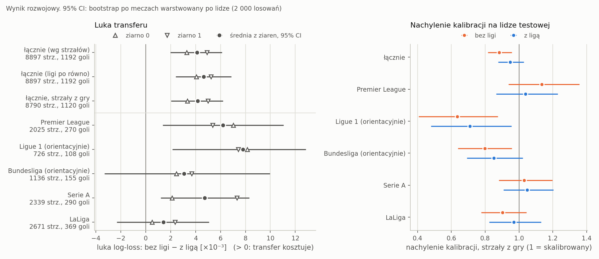
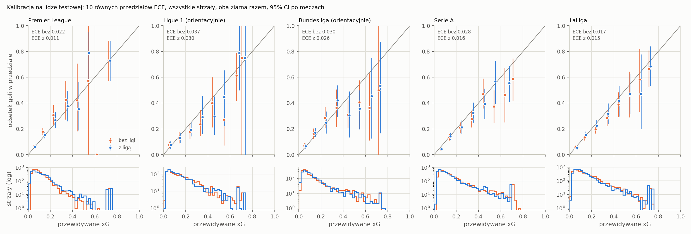
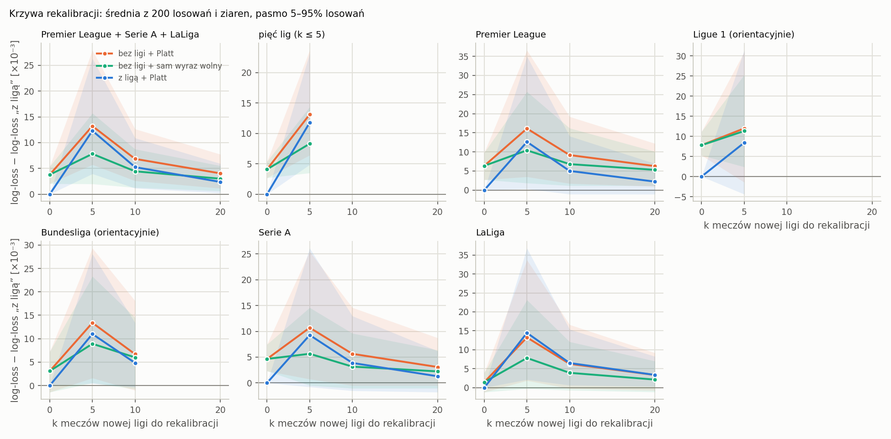

# Transfer do nowej ligi: test leave-one-league-out

Wersja z 2026-10-09. Prośba 3 recenzenta, ticket 13 rundy xG credibility. Analiza idzie dokładnie według zatwierdzonego protokołu `research/xgc_transfer_protocol.md` (sha256 `e5ae4662…`, plan podziału `33229bbf…`) na 40 treningach z ticketu 12. Numery w nawiasach to sekcje protokołu.

**Wszystkie liczby tutaj są wynikami rozwojowymi.** Każdy mecz widzieliśmy we wcześniejszych rundach, a receptę G-combo dobrano na walidacji ze wszystkich lig.

Test to 8 897 strzałów z 399 meczów pięciu lig krajowych (1 192 gole). Każdy mecz ligi jest w teście dokładnie raz. Przedziały to 95% bootstrap po meczach warstwowany po lidze (2 000 losowań, ziarno 0, te same losowania dla obu ziaren treningu).

## Wynik

1. **Luka transferu wykazana.** Model, który nie widział ligi ani jej klubów, ma log-loss wyższy o **0.0041 [0.0020; 0.0061]** niż model uczony na tej samej liczbie meczów z połową meczów tej ligi. Luka względna to 1.2% [0.6%; 1.8%] log-lossu ramienia „z”. Ziarno 0 daje 0.0033, ziarno 1 daje 0.0049 (różnica 0.0016). Oba mają ten sam znak, a przedział nie obejmuje zera, więc według reguły z pkt 6 to „luka transferu wykazana”.
2. **Luka jest mała w skali modelu.** To tyle, ile pojedynczy model foldowy traci wobec G-combo (0.0010–0.0083 w raporcie punktu 1), i ok. 8 razy więcej niż różnica między dwiema wersjami G z 5 foldami (0.0005). Różnica między ziarnami w tym teście (0.0016) jest 2.5 raza mniejsza od luki.
3. **Rekalibracja na 5–20 meczach nowej ligi luki nie odzyskuje.** Platt dopasowany na k meczach pogarsza wynik przy k = 5 i 10, a przy k = 20 zostaje na poziomie bez rekalibracji. Sam wyraz wolny przy k = 20 odzyskuje ok. 21% luki. Ramię „z” po tej samej rekalibracji też traci, więc koszt to szum dopasowania na małej próbie.
4. **Reguły przypisania goli wyniku nie zmieniają.** Pod każdą regułą i granicą z ticketu 03 łączna luka leży między 0.0023 a 0.0053 i każdy przedział wyklucza zero.

Zastrzeżenia są w sekcji 6. Najważniejsze: pięć lig dzieli realizację telewizyjną i sezony, więc dla Ekstraklasy luka będzie prawdopodobnie większa.

## 1. Luka log-lossu (pkt 6)

„Bez” minus „z”, średnia z dwóch ziaren treningu. Dodatnia luka znaczy, że transfer kosztuje.

| | strzały | gole | luka | 95% CI | ziarno 0 | ziarno 1 | log-loss „bez” | log-loss „z” |
|---|---:|---:|---:|---|---:|---:|---:|---:|
| **łącznie, wg strzałów (główny)** | 8 897 | 1 192 | **+0.0041** | [+0.0020; +0.0061] | +0.0033 | +0.0049 | 0.3521 | 0.3480 |
| łącznie, ligi po równo | 8 897 | 1 192 | +0.0046 | [+0.0024; +0.0069] | +0.0041 | +0.0052 | 0.3581 | 0.3535 |
| łącznie, strzały z gry | 8 790 | 1 120 | +0.0042 | [+0.0020; +0.0062] | +0.0033 | +0.0050 | 0.3486 | 0.3444 |
| Premier League | 2 025 | 270 | +0.0062 | [+0.0014; +0.0111] | +0.0070 | +0.0054 | 0.3523 | 0.3461 |
| Ligue 1 (orientacyjnie) | 726 | 108 | +0.0078 | [+0.0021; +0.0128] | +0.0082 | +0.0074 | 0.3893 | 0.3815 |
| Bundesliga (orientacyjnie) | 1 136 | 155 | +0.0031 | [−0.0033; +0.0100] | +0.0025 | +0.0037 | 0.3625 | 0.3595 |
| Serie A | 2 339 | 290 | +0.0047 | [+0.0012; +0.0083] | +0.0021 | +0.0073 | 0.3285 | 0.3238 |
| LaLiga | 2 671 | 369 | +0.0014 | [−0.0023; +0.0051] | +0.0005 | +0.0024 | 0.3580 | 0.3565 |

Ligue 1 i Bundesliga są orientacyjne: 108 i 155 goli, dawka ligi w ramieniu „z” to 19 i 26–27 meczów. Wnioski opieram na wyniku łącznym. Wszystkie pięć lig ma lukę dodatnią w obu ziarnach. Przedziały Bundesligi i LaLigi obejmują zero. Pojedyncze ligi nie dają podstaw do mówienia o różnicach między nimi.

## 2. Pozostałe metryki (pkt 6)

Łącznie, średnia z ziaren, różnica „bez” minus „z”. AUC, Brier i ECE na wszystkich strzałach (ECE: 10 przedziałów równej szerokości jak `xgpoc.eval.metrics`). Nachylenie, wyraz wolny i średnie xG minus częstość goli na strzałach z gry.

| metryka | „bez” | „z” | różnica | 95% CI |
|---|---:|---:|---:|---|
| AUC | 0.7316 | 0.7384 | −0.0068 | [−0.0121; −0.0015] |
| Brier | 0.1050 | 0.1036 | +0.0014 | [+0.0007; +0.0021] |
| ECE | 0.0118 | 0.0087 | +0.0031 | [−0.0025; +0.0066] |
| średnie xG − częstość goli | +0.8 p.p. | +0.3 p.p. | +0.5 p.p. | [+0.4; +0.7] p.p. |
| wyraz wolny kalibracji | −0.27 | −0.11 | −0.15 | [−0.21; −0.09] |
| nachylenie kalibracji | 0.88 [0.82; 0.96] | 0.95 [0.88; 1.03] | −0.064 | [−0.097; −0.033] |

Luka to trochę gorsze porządkowanie strzałów i trochę gorsza skala prognoz. Przedziały ECE są przesunięte w górę, bo binowany ECE rośnie w każdym losowaniu. Wartości dla lig są w `metrics.csv`.

### Nachylenie kalibracji na każdej lidze

| liga | „bez” | „z” |
|---|---|---|
| Premier League | 1.13 [0.94; 1.36] | 1.04 [0.86; 1.23] |
| Ligue 1 (orientacyjnie) | 0.63 [0.41; 0.88] | 0.71 [0.48; 0.96] |
| Bundesliga (orientacyjnie) | 0.80 [0.64; 0.96] | 0.85 [0.69; 1.02] |
| Serie A | 1.03 [0.88; 1.20] | 1.05 [0.91; 1.20] |
| LaLiga | 0.90 [0.78; 1.04] | 0.97 [0.82; 1.13] |

Protokół pyta, czy nachylenie ok. 1.2 z punktu 1 bierze się z przesunięcia rozkładu. W tym teście nachylenia ok. 1.2 nie widać w żadnym ramieniu. Ramię „bez” odbiega od 1 bardziej niż „z” w czterech ligach z pięciu, ale w różne strony: w Premier League w górę (prognozy zbyt ostrożne), w pozostałych w dół (zbyt pewne siebie). Łącznie „bez” ma nachylenie niższe o 0.064 [0.033; 0.097]. Przesunięcie rozkładu psuje więc skalę, ale nie w kierunku 1.2. Łączne nachylenie miesza też różne częstości goli między ligami. Ticket 03 pokazał, że nachylenie 1.2 na oficjalnym teście spada do 1.0 przy przypisaniu gola do pierwszego strzału łańcucha. Ten test nie daje powodu, by przypisywać 1.2 przesunięciu rozkładu.

Wykres: oba ramiona na każdej lidze, wszystkie strzały, oba ziarna razem, przedziały takie jak w ECE, pod spodem histogram prognoz w skali logarytmicznej.

## 3. Krzywa rekalibracji (pkt 7)

Rekalibracja na k meczach testowego podzbioru, 200 losowań na (liga, podzbiór). Zbiór oceny to podzbiór bez K meczów kandydujących, ten sam dla każdego k w losowaniu, więc luka(0) nie równa się luce z sekcji 1. Wartość to log-loss wariantu minus log-loss ramienia „z” bez rekalibracji, średnia z losowań i ziaren, w nawiasie 5–95% losowań. Odzysk to 1 − luka(k)/luka(0) ze średnich. W żadnym losowaniu k meczów nie zostało bez gola.

Krzywa główna: Premier League, Serie A i LaLiga, 4 292 strzały oceny.

| k | „bez” + Platt (główna) | odzysk | „bez” + sam wyraz wolny | odzysk | „z” + Platt |
|---:|---|---:|---|---:|---|
| 0 | +0.0038 [+0.0020; +0.0054] | | +0.0038 | | 0 |
| 5 | +0.0132 [+0.0057; +0.0279] | −248% | +0.0078 [+0.0020; +0.0157] | −106% | +0.0123 |
| 10 | +0.0069 [+0.0026; +0.0126] | −80% | +0.0044 [+0.0013; +0.0087] | −17% | +0.0053 |
| 20 | +0.0040 [+0.0011; +0.0077] | −7% | +0.0030 [+0.0006; +0.0055] | +21% | +0.0024 |

Pięć lig razem, k ≤ 5: luka(0) +0.0041, Platt przy k = 5 +0.0131, sam wyraz wolny +0.0083, „z” + Platt +0.0118. Ligi osobno przy swoim K: Premier League (K = 20) Platt +1%, wyraz wolny +17%; Serie A (K = 20) +34% i +52%; LaLiga (K = 20, luka(0) tylko +0.0015) −130% i −46%; Bundesliga (K = 10, orientacyjnie) −116% i −94%; Ligue 1 (K = 5, orientacyjnie) −54% i −45%. Pełna tabela: `recalibration_curve.csv`.

Odczyt dla pakietu: kilka meczów nowej ligi nie wystarczy, by rekalibracją odrobić lukę. Platt na 5 meczach (ok. 13 goli) kosztuje trzy razy więcej niż sama luka. Sam wyraz wolny szkodzi mniej i przy 20 meczach zaczyna pomagać. Że to szum dopasowania, pokazuje ramię „z”: rekalibrowane tymi samymi meczami traci prawie tyle samo.

## 4. Wrażliwość na przypisanie goli (pkt 8)

Zmieniają się tylko etykiety testowe. Etykiety uczenia, wyboru epoki i kalibracji zostają przy regule najbliższego strzału, więc wpływu reguł na trening ta tabela nie mierzy. Granice dla jednego ramienia biorą średni logit z obu ziaren. Granice luki wybierają strzał, który maksymalizuje albo minimalizuje sumę różnic log-lossu „bez” minus „z” w łańcuchu, uśrednioną po ziarnach.

| reguła / granica | gole przeniesione | log-loss „bez” | log-loss „z” | luka | 95% CI |
|---|---:|---:|---:|---:|---|
| najbliższy strzał (obecna) | 0 | 0.3521 | 0.3480 | +0.0041 | [+0.0020; +0.0061] |
| najwcześniejszy strzał łańcucha | 79 | 0.3593 | 0.3558 | +0.0035 | [+0.0014; +0.0056] |
| ostatni strzał łańcucha | 0 | 0.3521 | 0.3480 | +0.0041 | [+0.0020; +0.0061] |
| łańcuchy pominięte (8 276 strz.) | 0 | 0.3527 | 0.3488 | +0.0039 | [+0.0018; +0.0061] |
| najgorzej dla „bez” | 63 | 0.3607 | 0.3570 | +0.0037 | [+0.0016; +0.0058] |
| najlepiej dla „bez” | 19 | 0.3507 | 0.3467 | +0.0039 | [+0.0019; +0.0060] |
| najgorzej dla „z” | 61 | 0.3606 | 0.3571 | +0.0035 | [+0.0015; +0.0056] |
| najlepiej dla „z” | 20 | 0.3507 | 0.3466 | +0.0041 | [+0.0020; +0.0061] |
| największa luka | 33 | 0.3552 | 0.3499 | +0.0053 | [+0.0032; +0.0074] |
| najmniejsza luka | 49 | 0.3562 | 0.3539 | +0.0023 | [+0.0001; +0.0044] |

„Ostatni strzał” to z konstrukcji ten sam strzał co „najbliższy” (ticket 03). Granice optymalizują wartość punktową, a przedziały trzymają etykiety stałe. Luki ligowe są w `attribution_sensitivity.csv`; najbardziej rusza się Bundesliga, od −0.0008 do +0.0047.

## 5. Czym ten test różni się od punktu 1

- Każde ramię to jeden model, nie 10 modeli foldowych, i inny jest zbiór testowy, więc log-lossu ok. 0.35 nie porównujemy z 0.324 G-combo.
- Kalibracja (pkt 5): Platt na 45 meczach kalibracyjnych ramienia, korekta priora do częstości goli we wszystkich 300 meczach ramienia, karne z rozkładu a posteriori Beta(0.76, 40) uaktualnionego karnymi ramienia. Częstość docelowa i karne biorą też mecze uczące, co odchodzi od historyjki 55 specyfikacji. Test ligi nie wpływa na kalibrację. Parametry: `calibration_fits.csv`.

## 6. Zastrzeżenia (pkt 10)

- **Wspólna realizacja.** Pięć lig dzieli realizację telewizyjną najwyższego poziomu i sezony 2014–2017. Kamery, grafika i jakość obrazu są podobne. Luka zmierzona tutaj jest więc prawdopodobnie mniejsza niż dla Ekstraklasy, z inną realizacją i innymi latami.
- **Dawka.** Ramię „z” zawiera 19–59 meczów ligi, czyli 6–20% treningu. Luka dotyczy tej dawki.
- **Te same kluby i sezony.** Ramię „z” widzi kluby, stadiony i sezony testowego podzbioru, więc luka to górny kraniec tego, co użytkownik nowej ligi odzyska własnymi danymi.
- **Wynik rozwojowy.** Receptę dobrano na danych ze wszystkich lig, a wszystkie mecze widzieliśmy wcześniej.
- **Szum treningu.** Dwa ziarna to surowa miara szumu treningu; przedział bootstrapowy obejmuje losowość meczów, nie treningu.
- **Ligue 1 i Bundesliga** są orientacyjne.
- **Przypisanie goli** zmieniamy tylko po stronie oceny.

## Odtworzenie

    cd experiments/claude_fable
    CUDA_VISIBLE_DEVICES="" ./run.sh python scripts/report_transfer.py

Ok. 1.5 min na CPU. Skrypt odtwarza plan z indeksu i sprawdza jego hash, potem sprawdza każdy trening z jego rekordem ukończenia. `complete.json` trzyma hash protokołu, planu i indeksu, hashe źródeł, hash każdego wczytanego pliku z 40 treningów, skrót etykiet Labels-v2 z 399 meczów i hashe plików wynikowych. Pojedyncze losowania rekalibracji: `results/xgc_transfer_report/recalibration_draws.csv.gz` (poza repozytorium).
