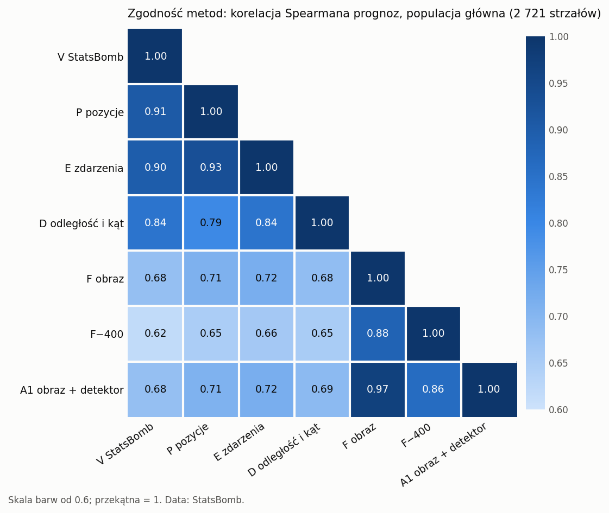
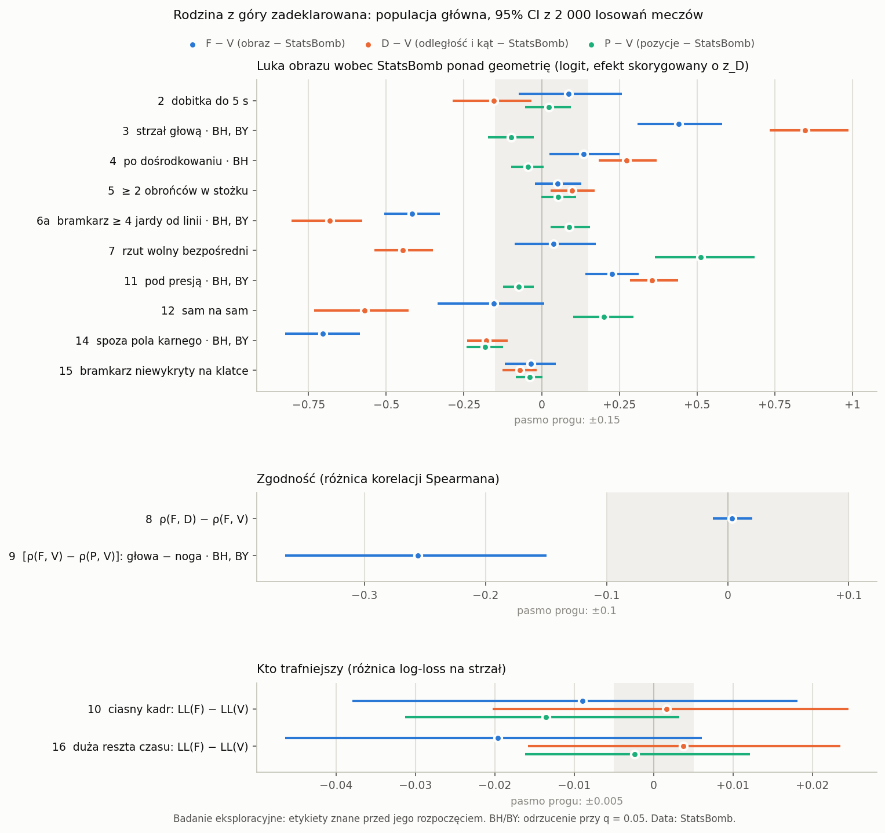

# Gdzie xG z obrazu różni się od xG StatsBomb: raport fazy (xg-compare, ticket 03)

Jakub Eichner, 2026-10-14 (czas UTC). Gałąź `research/xg-detector`, faza xg-compare, tickety 01–02.

Data: StatsBomb. Kategorie strzałów, xG dostawcy, model pozycyjny i etykiety goli pochodzą z otwartych danych StatsBomb. Każda tabela i każdy rysunek tego raportu jest zbudowany z tych danych i ma pod sobą ten podpis.

W tekście źródłowym po każdej liczbie stoi niewidoczny znacznik `<!--n:…-->`. Plik `claims.toml` obok mówi, z którego pliku wyników pochodzi liczba. Skrypt `scripts/check_xgd_audit.py` odczytuje każdą liczbę ze źródła i kończy się błędem przy niezgodności. Przedziały w nawiasach to 95%<!--n:pr.ci--> przedziały percentylowe z 2 000<!--n:pr.draws--> losowań meczów (seed 0). Numery pozycji rodziny (`#3`, `#14`) to numery z protokołu.

## 1. Najważniejsze w skrócie

Całe badanie jest eksploracyjne: etykiety goli tych 135<!--n:t.matches--> meczów były już znane z badania xg-vendor. Każde zdanie niżej ma poziom pewności i obok test „kto ma rację”, bo „inaczej” nie znaczy „lepiej”.

Słowniczek do tej sekcji. **F** to xG z jednej klatki transmisji (G-combo), **V** to xG StatsBomb, **D** to model z samej odległości i kąta. „Ponad geometrię” znaczy: po wyrównaniu strzałów o tę samą wartość xG z odległości i kąta. „Punkt xG” to setna część gola na strzał.

1. **Główki.** Surowo obraz i StatsBomb dają główkom prawie tyle samo xG (różnica +0.3 [−0.8; +1.5]<!--n:r.3.diff--> punktu). Różnią się tym, skąd to xG się bierze. StatsBomb wie, że główka z danego miejsca daje gola rzadziej niż strzał nogą. Model z samej odległości i kąta tego nie wie: przy tej samej geometrii wycenia główkę wyżej niż StatsBomb o +0.85<!--n:f.3.dv2--> logit, a obraz o +0.44 [+0.31; +0.58]<!--n:f.3.eff2-->. Obraz odtwarza więc mniej więcej połowę tej wiedzy StatsBomb, 48% [37; 61]<!--n:r.3.share-->.
   - Poziom: rodzina z góry zadeklarowana, przechodzi BH i BY. Udział odtworzony jest opisowy, dodany po przebiegu.
   - Kto ma rację: na główkach obie prognozy są skalibrowane (O/E obrazu 0.99<!--n:w.3.oe.F-->, StatsBomb 1.00<!--n:w.3.oe.V-->). StatsBomb lepiej szereguje główki (AUC 0.69<!--n:w.3.auc.V--> wobec 0.62<!--n:w.3.auc.F-->), ale różnica log-loss obrazu wobec StatsBomb, +0.020 [−0.007; +0.048]<!--n:w.3.dll-->, nie odróżnia się od zera.
2. **Bramkarz wysunięty co najmniej 4 jardy przed linię.** Obraz daje takim strzałom mniej xG niż StatsBomb, średnio −4.8 [−6.1; −3.7]<!--n:r.6a.diff--> punktu na strzał, i to obraz się myli.
   - Poziom: rodzina, BH i BY (efekt ponad geometrię −0.42 [−0.51; −0.33]<!--n:f.6a.eff2-->). Porównanie surowe i O/E są opisowe.
   - Kto ma rację: StatsBomb. Goli pada więcej, niż przewiduje obraz (O/E 1.26<!--n:w.6a.oe.F--> wobec 0.99<!--n:w.6a.oe.V--> StatsBomb), a log-loss obrazu jest gorszy o +0.044 [+0.016; +0.074]<!--n:w.6a.dll-->. Obraz odtwarza 39% [29; 50]<!--n:r.6a.share--> tego, co StatsBomb wie o tej sytuacji ponad geometrię.
3. **Strzały pod presją.** Obraz daje im więcej xG niż StatsBomb, średnio +1.5 [+0.7; +2.4]<!--n:r.11.diff--> punktu na strzał (ponad geometrię +0.23 [+0.14; +0.31]<!--n:f.11.eff2-->).
   - Poziom: rodzina, BH i BY. Porównanie surowe i O/E są opisowe.
   - Kto ma rację: StatsBomb. Log-loss obrazu jest gorszy o +0.037 [+0.012; +0.064]<!--n:w.11.dll-->, O/E obrazu 0.94<!--n:w.11.oe.F-->, StatsBomb 1.04<!--n:w.11.oe.V-->. Obraz odtwarza 36% [18; 57]<!--n:r.11.share--> wiedzy StatsBomb o presji.
4. **Strzały spoza pola karnego.** Obraz daje im więcej xG niż StatsBomb: oczekuje 68.1<!--n:w.14.e.F--> gola, StatsBomb 58.8<!--n:w.14.e.V-->, a padło 57<!--n:w.14.goals-->. Ponad geometrię obraz jest od StatsBomb dalej niż sam model odległości i kąta (−0.70<!--n:f.14.eff2--> wobec −0.18<!--n:f.14.dv2-->).
   - Poziom: rodzina, BH i BY (efekt ponad geometrię). Porównanie surowe i O/E są opisowe.
   - Kto ma rację: StatsBomb. O/E obrazu 0.84<!--n:w.14.oe.F-->, StatsBomb 0.97<!--n:w.14.oe.V-->. Różnica log-loss +0.009 [−0.002; +0.019]<!--n:w.14.dll--> jest mała, bo goli z dystansu jest mało.
5. **Strzały z ostrego kąta** (bramka widoczna pod kątem poniżej 15°, czyli z boku albo z daleka). Na tych 614<!--n:w.ang.n--> strzałach obraz oczekuje 52.0<!--n:w.ang.e.F--> goli, StatsBomb 20.5<!--n:w.ang.e.V-->, a padły 24<!--n:w.ang.goals-->. Wśród 5%<!--n:pr.tail--> strzałów, w których obraz najbardziej przewyższa StatsBomb, 84%<!--n:dp.ang--> to strzały z takiego kąta.
   - Poziom: skan, wynik eksploracyjny powtórzony na drugiej połowie meczów (+0.77 [+0.62; +0.93]<!--n:sv.ang.eff--> ponad geometrię). Liczby goli i lista rozbieżności są opisowe.
   - Kto ma rację: StatsBomb (O/E 1.17<!--n:w.ang.oe.V--> wobec 0.46<!--n:w.ang.oe.F--> obrazu).
6. **Zgodność metod.** Obraz zgadza się ze StatsBomb wyraźnie słabiej niż modele pozycyjne: korelacja Spearmana F–V wynosi 0.68<!--n:ag.VF-->, P–V 0.91<!--n:ag.VP-->. Najsłabiej przy strzałach z 25+ jardów (0.24<!--n:al.d25-->) i z 18–25 jardów (0.26<!--n:al.d18-->). Obraz nie jest bliżej samej geometrii niż StatsBomb: ρ(F, D) − ρ(F, V) = +0.004 [−0.012; +0.021]<!--n:f.8.eff-->.
   - Poziom: pozycja `#8` rodziny, przedział w paśmie progu, więc brak efektu interesującej wielkości. Macierz korelacji jest opisowa.
   - Kto ma rację: ogólnie StatsBomb. Log-loss obrazu jest gorszy o +0.028 [+0.017; +0.040]<!--n:w.all.dll.F2-->.

**Dwa przykładowe zdania właściciela.**
- „xG z obrazu lepiej premiuje strzały z dystansu kierowane w światło bramki.” **Nie potwierdzone.** Wśród strzałów spoza pola karnego bez gola luka obraz − StatsBomb jest przy obronionych większa niż przy niecelnych tylko o +0.047 [−0.015; +0.108]<!--n:o1.F--> logit, czyli +0.24<!--n:o1.F.xg--> punktu xG. To poniżej progu 0.15<!--n:pr.thr.fam--> i bez istotności (p = 0.0745<!--n:o1.F.p-->). Z klatki −400 ms, sprzed kontaktu, zostaje +0.019<!--n:o1.F400.pt-->, więc nawet ta resztka może pochodzić z tego, co widać po uderzeniu. Ogólnie obraz daje strzałom z dystansu więcej xG niż StatsBomb, ale przesadza (punkt 4).
- „StatsBomb daje dobitkom wyższe prawdopodobieństwo gola.” **Nie wykazano.** Ponad geometrię wynik ma znak przeciwny do zdania, +0.087 [−0.073; +0.257]<!--n:f.2.eff-->, a moc testu dla efektu 0.15<!--n:pr.thr.fam--> logit wynosiła tylko 0.35<!--n:pw.2.bh-->. Surowo StatsBomb daje dobitkom średnio 24.6<!--n:r.2.mV--> punktu xG, obraz 23.2<!--n:r.2.mF-->, różnica −1.3 [−4.2; +1.6]<!--n:r.2.diff-->. Kto ma rację: żadna metoda wyraźnie. Obie oczekują z dobitek więcej goli, niż pada (O/E StatsBomb 0.82<!--n:w.2.oe.V-->, obrazu 0.87<!--n:w.2.oe.F-->). Przedziały są szerokie, więc to nie znaczy, że różnicy nie ma.

## 2. Dane i status badania

**Status.** Badanie jest eksploracyjne i post hoc. Wszystkie prognozy są zamrożone: żaden model nie był uczony ani strojony na tych meczach, a reguła jednego testu na meczach odłożonych pozostaje nietknięta. Etykiety goli tych meczów połączył już wcześniej przebieg konfirmacyjny xg-vendor. Protokół zamrożono przed policzeniem jakiejkolwiek liczby na poziomie kategorii, ale nie przed obejrzeniem etykiet. Dlatego nawet wyniki rodziny przechodzące BH są wynikami eksploracyjnymi, a nie potwierdzeniem.

Cztery zastrzeżenia, które obowiązują w całym raporcie:
- BH przy prawdziwej hipotezie zerowej odrzucał w symulacji choć jedną pozycję rodziny w 8.6%<!--n:pw.null.bh--> badań, a nie w 5%<!--n:pr.q5-->. BY odrzucał w 3.9%<!--n:pw.null.by-->. Dlatego obok BH zawsze stoi BY.
- Dwie pozycje log-loss (`#10` i `#16`) są prawie ślepe: moc przy progu 0.005<!--n:pr.thr.ll--> wynosiła 0.02<!--n:pw.10.bh-->. Ich wynik „nierozstrzygnięty” nie mówi nic w żadną stronę.
- Poziomy ligi i sezonu są opisowe. Tylko trzy z siedmiu lig-sezonów spełniają progi w obu połowach skanu.
- Skala główna zależy od etykiet (rekalibracja na wynikach), więc różnice na niej nie są wolne od etykiet.

**Populacje.**

| populacja | strzały | gole | mecze | rola |
|---|---|---|---|---|
| główna | 2 721<!--n:t.prim--> | 374<!--n:t.prim.goals--> | 135<!--n:t.matches--> | strzały SoccerNet sparowane ze StatsBomb, bez karnych, z klatką |
| połączona | 3 401<!--n:t.comb--> | 417<!--n:t.comb.goals--> | 135<!--n:t.matches--> | odporność: dochodzą strzały tylko ze StatsBomb, głównie zablokowane, i odzyskane gole |

Data: StatsBomb.

Populacja połączona zawiera wszystkie strzały głównej, więc nie jest replikacją. Karne są wyłączone ze wszystkich analiz kategorii.

**Kontrola na danych przemieszanych.** Przed właściwym przebiegiem cała analiza poszła raz na etykietach przemieszanych w obrębie meczów. Rodzina dała 0 odrzuceń BH i 0 BY, skan 0 kandydatów. Właściwy przebieg poszedł raz, w commicie `11543ad`. Skala główna w wierszu obserwowanym odtwarza współczynniki rekalibracji z artykułu xg-vendor.

## 3. Metody

**Metody porównane** (wszystkie zamrożone):

| skrót | metoda |
|---|---|
| V | xG StatsBomb |
| P | model pozycyjny: zdarzenia i freeze frame StatsBomb |
| E | model zdarzeń StatsBomb |
| D | model z samej odległości i kąta |
| F | G-combo z jednej klatki w chwili strzału |
| F−400 | ten sam model na klatce 400 ms wcześniej |
| A1 | G-combo z wejściami detektora (test xg-detector), na 2 721<!--n:t.a1--> strzałach głównych |

Data: StatsBomb.

**Jednostki.** Odległości i wysunięcie bramkarza są w jardach StatsBomb. „4 m” z decyzji rady C4 protokół czyta jako 4 jednostki StatsBomb, czyli jardy, bo w tych jednostkach podano tam medianę i kwartyl.

**Skala.** Każda metoda przechodzi wspólną rekalibrację Platta z artykułu xg-vendor (pięć foldów po meczach), dopasowaną od nowa w każdej populacji, połowie i losowaniu. Raport nazywa ją skalą główną. Logity surowe i rangi percentylowe to sprawdziany wrażliwości (sekcja 10).

**Trzy odczyty każdej kategorii.** Pytanie „czy obraz daje kategorii więcej xG niż StatsBomb” ma dwie różne odpowiedzi zależnie od tego, z czym porównujemy. Dlatego każda pozycja rodziny dostaje trzy odczyty:
- **(a) surowo:** średnie xG obrazu i StatsBomb w kategorii na skali głównej, w punktach xG, oraz kontrast nieskorygowany, czyli średnia luka logitów F − V w kategorii minus poza nią;
- **(b) kto ma rację:** O/E (gole przez xG) obrazu, StatsBomb, modelu pozycyjnego i geometrii w kategorii oraz różnica log-loss obrazu wobec StatsBomb;
- **(c) ponad geometrię:** efekt skorygowany, czyli współczynnik przy kategorii w regresji luki F − V na wskaźnik kategorii i logit D. To jest wielkość testowana. Obok stoi to samo dla D − V.

Odczyty (a) i (c) mogą mieć różne znaki. Obraz jest „płaski”: przy niskim xG z geometrii daje więcej niż StatsBomb, przy wysokim mniej (nachylenie luki względem logitu D wynosi −0.62 [−0.71; −0.52]<!--n:mv.zd-->). Strzał spoza pola karnego dostaje więc od obrazu więcej xG niż od StatsBomb (odczyt a), a mimo to mniej, niż wynikałoby z samej płaskości (odczyt c). Zdanie „obraz daje kategorii więcej xG” wolno oprzeć tylko na odczycie (a).

**Udział odtworzony** (opisowy, dodany po przebiegu, nie ma go w protokole). D nie wie nic poza odległością i kątem, więc D − V ponad geometrię mierzy wiedzę StatsBomb o kategorii, której geometria nie ma. Wielkość 1 − (F − V)/(D − V) to część tej wiedzy, którą odtwarza obraz. Udział równy całości znaczy, że obraz wycenia kategorię ponad geometrię tak jak StatsBomb, a udział zerowy, że nie wie o niej więcej niż geometria. Wartość ujemna znaczy, że obraz jest od StatsBomb dalej niż geometria, a większa od całości, że przeskakuje StatsBomb w drugą stronę. Gdy D − V jest bliskie zera, udział jest niestabilny. Liczy go `scripts/xgc_recovery.py` na tych samych 2 000<!--n:pr.draws--> losowaniach (seed 0) i tej samej populacji co ticket 02. Ten sam skrypt liczy średnie xG z odczytu (a).

**Poziomy pewności.**
- *Rodzina (BH i BY)* albo *rodzina (tylko BH)*: czternaście pozycji zadeklarowanych przed przebiegiem, kontrola BH przy q = 0.05<!--n:pr.q-->, BY jako sprawdzian. Wynik jest „interesujący” dopiero od progu: 0.15<!--n:pr.thr.fam--> logit dla luk, 0.10<!--n:pr.thr.cor--> dla korelacji, 0.005<!--n:pr.thr.ll--> dla log-loss.
- *Skan, eksploracyjny powtórzony*: poziom znaleziony na połowie meczów i potwierdzony na drugiej połowie testem jednostronnym z poprawką Holma.
- *Hipoteza*: kandydat skanu, który się nie powtórzył. Tylko w dodatku.
- *Opisowe*: wszystko inne, w tym zgodność, „kto ma rację” i rozbieżności.

**Progi liczności.** Poziom kategorii wchodzi do testu, gdy ma co najmniej 50<!--n:pr.fl.in--> strzałów w środku i 50<!--n:pr.fl.out--> poza nim z co najmniej 20<!--n:pr.fl.m--> meczów. Metryki z etykiet wymagają 15<!--n:pr.fl.g--> goli i 15<!--n:pr.fl.ng--> strzałów bez gola.

## 4. Zgodność metod

Data: StatsBomb.

Korelacja Spearmana prognoz w populacji głównej (2 721<!--n:t.prim--> strzałów). Opisowe.

| para | Spearman [CI] |
|---|---|
| F – A1 | 0.97 [0.97; 0.97]<!--n:ag.FA1--> |
| P – E | 0.93<!--n:ag.PE--> |
| P – V | 0.91 [0.90; 0.91]<!--n:ag.VP2--> |
| E – V | 0.90 [0.89; 0.91]<!--n:ag.VE--> |
| F – F−400 | 0.88<!--n:ag.FF4--> |
| D – V | 0.84 [0.83; 0.85]<!--n:ag.VD--> |
| F – P | 0.71<!--n:ag.PF--> |
| F – D | 0.68 [0.66; 0.71]<!--n:ag.DF--> |
| F – V | 0.68 [0.65; 0.70]<!--n:ag.VF2--> |
| F−400 – V | 0.62<!--n:ag.VF4--> |

Data: StatsBomb.

Co z tego wynika:
- Modele zbudowane na danych StatsBomb (P, E, D) zgadzają się z V na poziomie od 0.84<!--n:ag.VD.pt--> do 0.91<!--n:ag.VP-->. Obraz zgadza się z każdym z nich słabiej, od 0.68<!--n:ag.DF.pt--> do 0.72<!--n:ag.EF-->.
- A1, czyli obraz z wejściami detektora, prawie nie różni się od F (0.97<!--n:ag.FA1.pt-->). Detektor nie zmienił tego, co model wyczytuje z klatki.
- Pozycja `#8`: obraz nie jest bliżej geometrii niż StatsBomb. ρ(F, D) − ρ(F, V) = +0.004 [−0.012; +0.021]<!--n:f.8.eff-->, a w wersji z korelacją Pearsona logitów −0.000 [−0.018; +0.018]<!--n:f.8.pear-->. Przedział leży w paśmie progu 0.10<!--n:pr.thr.cor-->. Obraz nie jest więc „geometrią z klatki”: zgadza się z geometrią i ze StatsBomb w tym samym, słabym stopniu.
- Ogólnie ρ(F, V) jest niższe od ρ(P, V) o −0.227 [−0.252; −0.202]<!--n:ad.fvpv-->.
- Korelacja Pearsona logitów skali głównej daje ten sam obraz: F–V 0.68<!--n:agp.VF-->, P–V 0.91<!--n:agp.VP-->. Pełne macierze, także w każdej kategorii, są w `results/xgc_compare/analysis/agreement.csv`.

**Gdzie zgodność obrazu ze StatsBomb jest najniższa** (poziomy spełniające próg liczności):

| poziom | strzały | ρ(F, V) [CI] | ρ(P, V) |
|---|---|---|---|
| odległość 25+ jardów | 657<!--n:al.d25.n--> | 0.24 [0.16; 0.31]<!--n:al.d25.ci--> | 0.50<!--n:al.d25.pv--> |
| odległość 18–25 jardów | 755<!--n:al.d18.n--> | 0.26 [0.19; 0.33]<!--n:al.d18.ci--> | 0.79<!--n:al.d18.pv--> |
| wygrany pojedynek w powietrzu | 189<!--n:al.aer.n--> | 0.30 [0.13; 0.45]<!--n:al.aer.ci--> | 0.80<!--n:al.aer.pv--> |
| kąt 0–15° | 614<!--n:w.ang.n--> | 0.30 [0.22; 0.38]<!--n:al.ang.ci--> | 0.41<!--n:al.ang.pv--> |
| odległość 12–18 jardów | 689<!--n:al.d12.n--> | 0.33 [0.26; 0.40]<!--n:al.d12.ci--> | 0.84<!--n:al.d12.pv--> |
| strzał głową | 393<!--n:f.3.n--> | 0.38 [0.27; 0.48]<!--n:al.head.ci--> | 0.85<!--n:al.head.pv--> |
| bramkarz ≥ 4 jardy przed linią (najwyższa) | 501<!--n:f.6a.n--> | 0.81<!--n:al.gk4--> | 0.94<!--n:al.gk4.pv--> |

Data: StatsBomb.

Odległości są w jardach StatsBomb. Wewnątrz jednej kategorii odległości rozrzut xG jest mały, więc korelacje są tam niższe dla wszystkich metod. Liczy się porównanie z P. Przy strzałach z 18–25 jardów model pozycyjny zgadza się ze StatsBomb na poziomie 0.79<!--n:al.d18.pv-->, a obraz 0.26<!--n:al.d18-->; przy 12–18 jardach odpowiednio 0.84<!--n:al.d12.pv--> i 0.33<!--n:al.d12-->. Obraz słabo rozróżnia między sobą strzały z dystansu. Pozycja `#9` rodziny mierzy to samo dla główek: [ρ(F, V) − ρ(P, V)] przy główkach minus przy strzałach nogą wynosi −0.256 [−0.366; −0.150]<!--n:f.9.eff--> (rodzina, BH i BY).

## 5. Rodzina z góry zadeklarowana

Data: StatsBomb.

Rodzina dała 6<!--n:s.bh--> odrzuceń BH i 5<!--n:s.by--> odrzuceń BY. Pięć pozycji osiąga próg: główki, bramkarz wysunięty, presja, strzały spoza pola karnego i zgodność przy główkach (`#9`). Dośrodkowania (`#4`) przechodzą tylko BH, poniżej progu.

### 5.1 Odczyt (c): ponad geometrię

Efekt skorygowany F − V (kontrola: logit D, skala główna). Dodatni znaczy, że obraz wycenia kategorię wyżej niż StatsBomb wobec strzałów o tym samym xG z geometrii. Punkty xG liczone przy średnim xG StatsBomb w kategorii. D − V i P − V to te same efekty dla geometrii i modelu pozycyjnego. Udział odtworzony jest opisowy, dodany po przebiegu.

| # | kategoria | strzały | F − V [CI] | pkt xG | BH q | BY q | odczyt | D − V | P − V | udział odtworzony |
|---|---|---|---|---|---|---|---|---|---|---|
| `2` | dobitka do 5 s (strona <) | 144<!--n:f.2.n--> | +0.087 [−0.073; +0.257]<!--n:f.2.eff--> | +1.6<!--n:f.2.xg--> | 0.928<!--n:f.2.qbh--> | 1.000<!--n:f.2.qby--> | przedział w paśmie progu | −0.153<!--n:f.2.dv--> | +0.023<!--n:f.2.pv--> | 157% [56; 599]<!--n:r.2.share--> |
| `3` | strzał głową | 393<!--n:f.3.n--> | **+0.441 [+0.309; +0.581]<!--n:f.3.eff-->** | +7.0<!--n:f.3.xg--> | < 0.001<!--n:f.3.qbh--> | < 0.001<!--n:f.3.qby--> | BH i BY, ponad progiem | +0.847<!--n:f.3.dv--> | −0.097<!--n:f.3.pv--> | 48% [37; 61]<!--n:r.3.share--> |
| `4` | po dośrodkowaniu | 384<!--n:f.4.n--> | +0.135 [+0.024; +0.250]<!--n:f.4.eff--> | +2.3<!--n:f.4.xg--> | 0.030<!--n:f.4.qbh--> | 0.099<!--n:f.4.qby--> | tylko BH, poniżej progu | +0.273<!--n:f.4.dv--> | −0.043<!--n:f.4.pv--> | 51% [20; 88]<!--n:r.4.share--> |
| `5` | ≥ 2 obrońców w stożku | 386<!--n:f.5.n--> | +0.052 [−0.021; +0.128]<!--n:f.5.eff--> | +0.4<!--n:f.5.xg--> | 0.278<!--n:f.5.qbh--> | 0.905<!--n:f.5.qby--> | przedział w paśmie progu | +0.098<!--n:f.5.dv--> | +0.053<!--n:f.5.pv--> | niestabilny |
| `6a` | bramkarz ≥ 4 jardy przed linią | 501<!--n:f.6a.n--> | **−0.416 [−0.507; −0.327]<!--n:f.6a.eff-->** | −6.5<!--n:f.6a.xg--> | < 0.001<!--n:f.6a.qbh--> | < 0.001<!--n:f.6a.qby--> | BH i BY, ponad progiem | −0.681<!--n:f.6a.dv--> | +0.089<!--n:f.6a.pv--> | 39% [29; 50]<!--n:r.6a.share--> |
| `7` | rzut wolny bezpośredni | 143<!--n:f.7.n--> | +0.039 [−0.087; +0.175]<!--n:f.7.eff--> | +0.2<!--n:f.7.xg--> | 0.718<!--n:f.7.qbh--> | 1.000<!--n:f.7.qby--> | nierozstrzygnięty | −0.446<!--n:f.7.dv--> | +0.511<!--n:f.7.pv--> | 109% [83; 146]<!--n:r.7.share--> |
| `11` | pod presją | 521<!--n:f.11.n--> | **+0.226 [+0.140; +0.312]<!--n:f.11.eff-->** | +2.8<!--n:f.11.xg--> | < 0.001<!--n:f.11.qbh--> | < 0.001<!--n:f.11.qby--> | BH i BY, ponad progiem | +0.355<!--n:f.11.dv--> | −0.073<!--n:f.11.pv--> | 36% [18; 57]<!--n:r.11.share--> |
| `12` | sam na sam | 162<!--n:f.12.n--> | −0.153 [−0.334; +0.009]<!--n:f.12.eff--> | −3.1<!--n:f.12.xg--> | 0.126<!--n:f.12.qbh--> | 0.410<!--n:f.12.qby--> | nierozstrzygnięty | −0.569<!--n:f.12.dv--> | +0.200<!--n:f.12.pv--> | 73% [48; 102]<!--n:r.12.share--> |
| `14` | spoza pola karnego | 1 055<!--n:f.14.n--> | **−0.704 [−0.825; −0.585]<!--n:f.14.eff-->** | −2.7<!--n:f.14.xg--> | < 0.001<!--n:f.14.qbh--> | < 0.001<!--n:f.14.qby--> | BH i BY, ponad progiem | −0.178<!--n:f.14.dv--> | −0.181<!--n:f.14.pv--> | −295% [−509; −205]<!--n:r.14.share--> |
| `15` | bramkarz niewykryty na klatce | 2 222<!--n:f.15.n--> | −0.035 [−0.118; +0.046]<!--n:f.15.eff--> | −0.4<!--n:f.15.xg--> | 0.560<!--n:f.15.qbh--> | 1.000<!--n:f.15.qby--> | przedział w paśmie progu | −0.070<!--n:f.15.dv--> | −0.039<!--n:f.15.pv--> | niestabilny |

Data: StatsBomb.

Udział przy `#5` i `#15` jest niestabilny, bo D − V jest tam blisko zera, a przedział udziału obejmuje zarówno wartości ujemne, jak i większe od całości. Pozostałe pozycje rodziny:

| # | pozycja | wielkość [CI] | BH q | BY q | odczyt |
|---|---|---|---|---|---|
| `8` | ρ(F, D) − ρ(F, V), strona > | +0.004 [−0.012; +0.021]<!--n:f.8.eff--> | 0.502<!--n:f.8.qbh--> | 1.000<!--n:f.8.qby--> | przedział w paśmie progu |
| `9` | [ρ(F, V) − ρ(P, V)] główki minus noga, strona < | **−0.256 [−0.366; −0.150]<!--n:f.9.eff-->** | < 0.001<!--n:f.9.qbh--> | < 0.001<!--n:f.9.qby--> | BH i BY, ponad progiem |
| `10` | ciasny kadr: LL(F) − LL(V), strona > | −0.009 [−0.038; +0.018]<!--n:f.10.eff--> | 0.868<!--n:f.10.qbh--> | 1.000<!--n:f.10.qby--> | nierozstrzygnięty, prawie ślepy |
| `16` | duża reszta czasu: LL(F) − LL(V), strona > | −0.020 [−0.046; +0.006]<!--n:f.16.eff--> | 0.931<!--n:f.16.qbh--> | 1.000<!--n:f.16.qby--> | nierozstrzygnięty, prawie ślepy |

Data: StatsBomb.

Ciasny kadr (`#10`) to dolny tercyl liczby graczy widocznych na klatce. Duża reszta czasu (`#16`) to górny kwartyl rozbieżności czasu strzału między SoccerNet a StatsBomb (co najmniej 46 ms<!--n:pr.cut.t-->). Oba progi ustalono bez etykiet przed analizą (ticket 01).

### 5.2 Odczyty (a) i (b): surowo i kto ma rację

Średnie xG w kategorii na skali głównej, w punktach xG (procent szansy na gola na strzał). Kontrast nieskorygowany to średnia luka logitów F − V w kategorii minus poza nią. O/E powyżej 1 znaczy, że metoda zaniża szansę, poniżej 1, że zawyża. Średnie xG i ich różnica są opisowe, dodane po przebiegu. O/E i log-loss są opisowe z protokołu. O − E, log-loss i AUC każdej metody w każdym poziomie kategorii są w `results/xgc_compare/analysis/who_is_right.csv`.

| # | kategoria | gole | xG obrazu | xG StatsBomb | różnica [CI] | kontrast nieskor. | O/E: F | V | P | D | LL(F) − LL(V) [CI] |
|---|---|---|---|---|---|---|---|---|---|---|---|
| `2` | dobitka do 5 s | 29<!--n:w.2.goals--> | 23.2<!--n:r.2.mF--> | 24.6<!--n:r.2.mV--> | −1.3 [−4.2; +1.6]<!--n:r.2.diff--> | −0.151<!--n:f.2.un--> | 0.87<!--n:w.2.oe.F--> | 0.82<!--n:w.2.oe.V--> | 0.82<!--n:w.2.oe.P--> | 0.90<!--n:w.2.oe.D--> | +0.062 [−0.002; +0.132]<!--n:w.2.dll--> |
| `3` | strzał głową | 65<!--n:w.3.goals--> | 16.8<!--n:r.3.mF--> | 16.5<!--n:r.3.mV--> | +0.3 [−0.8; +1.5]<!--n:r.3.diff--> | −0.087<!--n:f.3.un--> | 0.99<!--n:w.3.oe.F--> | 1.00<!--n:w.3.oe.V--> | 1.06<!--n:w.3.oe.P--> | 0.63<!--n:w.3.oe.D--> | +0.020 [−0.007; +0.048]<!--n:w.3.dll--> |
| `4` | po dośrodkowaniu | 83<!--n:w.4.goals--> | 18.6<!--n:r.4.mF--> | 20.6<!--n:r.4.mV--> | −2.0 [−3.4; −0.6]<!--n:r.4.diff--> | −0.269<!--n:f.4.un--> | 1.16<!--n:w.4.oe.F--> | 1.05<!--n:w.4.oe.V--> | 1.09<!--n:w.4.oe.P--> | 0.89<!--n:w.4.oe.D--> | +0.031 [+0.000; +0.063]<!--n:w.4.dll--> |
| `5` | ≥ 2 obrońców w stożku | 26<!--n:w.5.goals--> | 10.1<!--n:r.5.mF--> | 7.9<!--n:r.5.mV--> | +2.2 [+1.3; +3.1]<!--n:r.5.diff--> | +0.206<!--n:f.5.un--> | 0.67<!--n:w.5.oe.F--> | 0.86<!--n:w.5.oe.V--> | 0.82<!--n:w.5.oe.P--> | 0.67<!--n:w.5.oe.D--> | +0.004 [−0.016; +0.022]<!--n:w.5.dll--> |
| `6a` | bramkarz ≥ 4 jardy przed linią | 113<!--n:w.6a.goals--> | 17.9<!--n:r.6a.mF--> | 22.8<!--n:r.6a.mV--> | −4.8 [−6.1; −3.7]<!--n:r.6a.diff--> | −0.464<!--n:f.6a.un--> | 1.26<!--n:w.6a.oe.F--> | 0.99<!--n:w.6a.oe.V--> | 0.96<!--n:w.6a.oe.P--> | 1.60<!--n:w.6a.oe.D--> | +0.044 [+0.016; +0.074]<!--n:w.6a.dll--> |
| `7` | rzut wolny bezpośredni | 15<!--n:w.7.goals--> | 9.3<!--n:r.7.mF--> | 6.5<!--n:r.7.mV--> | +2.8 [+1.8; +3.8]<!--n:r.7.diff--> | +0.447<!--n:f.7.un--> | 1.13<!--n:w.7.oe.F--> | 1.62<!--n:w.7.oe.V--> | 1.17<!--n:w.7.oe.P--> | 2.57<!--n:w.7.oe.D--> | −0.041 [−0.099; +0.009]<!--n:w.7.dll--> |
| `11` | pod presją | 71<!--n:w.11.goals--> | 14.5<!--n:r.11.mF--> | 13.0<!--n:r.11.mV--> | +1.5 [+0.7; +2.4]<!--n:r.11.diff--> | +0.067<!--n:f.11.un--> | 0.94<!--n:w.11.oe.F--> | 1.04<!--n:w.11.oe.V--> | 1.07<!--n:w.11.oe.P--> | 0.78<!--n:w.11.oe.D--> | +0.037 [+0.012; +0.064]<!--n:w.11.dll--> |
| `12` | sam na sam | 43<!--n:w.12.goals--> | 23.9<!--n:r.12.mF--> | 29.9<!--n:r.12.mV--> | −6.0 [−9.1; −3.2]<!--n:r.12.diff--> | −0.402<!--n:f.12.un--> | 1.11<!--n:w.12.oe.F--> | 0.89<!--n:w.12.oe.V--> | 0.84<!--n:w.12.oe.P--> | 1.27<!--n:w.12.oe.D--> | +0.044 [−0.028; +0.114]<!--n:w.12.dll--> |
| `14` | spoza pola karnego | 57<!--n:w.14.goals--> | 6.5<!--n:r.14.mF--> | 5.6<!--n:r.14.mV--> | +0.9 [+0.1; +1.6]<!--n:r.14.diff--> | +0.153<!--n:f.14.un--> | 0.84<!--n:w.14.oe.F--> | 0.97<!--n:w.14.oe.V--> | 0.98<!--n:w.14.oe.P--> | 1.05<!--n:w.14.oe.D--> | +0.009 [−0.002; +0.019]<!--n:w.14.dll--> |
| `15` | bramkarz niewykryty na klatce | 301<!--n:w.15.goals--> | 13.8<!--n:r.15.mF--> | 13.9<!--n:r.15.mV--> | −0.1 [−0.3; +0.1]<!--n:r.15.diff--> | −0.020<!--n:f.15.un--> | 0.98<!--n:w.15.oe.F--> | 0.98<!--n:w.15.oe.V--> | 0.98<!--n:w.15.oe.P--> | 0.99<!--n:w.15.oe.D--> | +0.028 [+0.016; +0.040]<!--n:w.15.dll--> |

Data: StatsBomb.

### 5.3 Pozycja po pozycji

**Główki (`#3`).** Surowo obraz i StatsBomb dają główkom prawie tyle samo xG (+0.3 [−0.8; +1.5]<!--n:r.3.diff--> punktu), a kontrast nieskorygowany jest bliski zera (−0.087<!--n:f.3.un-->). Różnica pojawia się dopiero ponad geometrię. Geometria przecenia główki (O/E modelu D to 0.63<!--n:w.3.oe.D-->), bo główki oddaje się z bliska, a z bliska strzał nogą jest groźniejszy. StatsBomb tę różnicę zna, obraz zna ją w 48% [37; 61]<!--n:r.3.share-->. Na wynikach obie prognozy są na główkach skalibrowane, a StatsBomb lepiej je szereguje (AUC 0.69<!--n:w.3.auc.V--> wobec 0.62<!--n:w.3.auc.F-->). Na klatce widać sylwetki i wysokość piłki, ale nie zawsze to, czy uderza głowa, czy noga. To wyjaśnia część luki, ale tego nie sprawdzaliśmy.

**Bramkarz wysunięty (`#6a`).** Gdy bramkarz stoi co najmniej 4 jardy przed linią, StatsBomb podnosi szansę ponad geometrię (D − V −0.681<!--n:f.6a.dv-->), a obraz robi to w 39% [29; 50]<!--n:r.6a.share-->. Surowo obraz daje tym strzałom mniej o −4.8 [−6.1; −3.7]<!--n:r.6a.diff--> punktu i to on się myli (O/E 1.26<!--n:w.6a.oe.F-->). Bramkarz bywa na klatce mały albo poza kadrem, więc jego wyjście widać gorzej niż we freeze frame StatsBomb. To przypuszczenie, nie wynik.

**Presja (`#11`).** Obraz daje strzałom pod presją więcej xG niż StatsBomb (+1.5 [+0.7; +2.4]<!--n:r.11.diff--> punktu). StatsBomb obniża im szansę ponad geometrię (D − V +0.355<!--n:f.11.dv-->), obraz odtwarza z tego 36% [18; 57]<!--n:r.11.share-->. Wyniki przyznają rację StatsBomb.

**Spoza pola karnego (`#14`).** Tu trzy odczyty się rozjeżdżają. Surowo obraz daje strzałom z dystansu więcej xG (+0.9 [+0.1; +1.6]<!--n:r.14.diff--> punktu, kontrast +0.153<!--n:f.14.un-->) i przesadza (O/E 0.84<!--n:w.14.oe.F--> wobec 0.97<!--n:w.14.oe.V-->). Ponad geometrię wychodzi −0.704<!--n:f.14.eff1-->, a sam model odległości i kąta daje tylko −0.178<!--n:f.14.dv-->. Obraz jest więc od StatsBomb dalej niż geometria, a udział odtworzony jest ujemny (−295% [−509; −205]<!--n:r.14.share-->).

Najbardziej prawdopodobna przyczyna to dwie rzeczy naraz. Po pierwsze, obraz słabo odróżnia strzał z bliższego dystansu od strzału z dalszego (zgodność rang 0.24<!--n:al.d25--> i 0.26<!--n:al.d18--> w przedziałach 25+ i 18–25 jardów) i daje im podobne xG. Po drugie, korekta o logit D jest liniowa, a luka obrazu wobec StatsBomb nie jest liniowa w odległości, więc kategoria wyznaczona przez geometrię przejmuje część tej nieliniowości. Skan wskazuje w tę stronę: ponad geometrię obraz wycenia wyżej strzały z 12–18 jardów, a niżej z 25+ jardów (sekcja 7). Osobnym modelem tego nie sprawdzaliśmy.

**Dośrodkowania (`#4`).** Przechodzą tylko BH, z efektem +0.135<!--n:f.4.eff1--> poniżej progu. BY ich nie potwierdza, a w populacji połączonej spadają poniżej istotności. Surowo obraz daje strzałom po dośrodkowaniu mniej xG (−2.0 [−3.4; −0.6]<!--n:r.4.diff--> punktu).

**Rzuty wolne (`#7`).** Wynik nierozstrzygnięty, ale ciekawy: obraz wycenia rzuty wolne ponad geometrię prawie dokładnie tak jak StatsBomb (udział 109% [83; 146]<!--n:r.7.share-->). Surowo daje im więcej xG (+2.8 [+1.8; +3.8]<!--n:r.7.diff--> punktu), a StatsBomb je zaniża (O/E 1.62<!--n:w.7.oe.V-->). Różnica log-loss −0.041 [−0.099; +0.009]<!--n:w.7.dll--> sprzyja obrazowi, ale opiera się na 15<!--n:w.7.goals--> golach.

**Sam na sam (`#12`).** Wynik nierozstrzygnięty. Surowo obraz daje mniej xG o −6.0 [−9.1; −3.2]<!--n:r.12.diff--> punktu. Obraz zaniża (O/E 1.11<!--n:w.12.oe.F-->), StatsBomb zawyża (0.89<!--n:w.12.oe.V-->), a różnica log-loss nie rozstrzyga.

**Dobitki według poprzedniego strzału** (opisowe, oba podtypy poniżej progu liczności). Po obronie bramkarza (46<!--n:lv.save.n--> strzałów) obraz wycenia dobitkę ponad geometrię wyżej niż StatsBomb, +0.406 [+0.140; +0.692]<!--n:lv.save-->. Po bloku (73<!--n:lv.block.n--> strzały) różnicy nie widać, −0.076 [−0.288; +0.150]<!--n:lv.block-->. To znów kierunek przeciwny do zdania właściciela.

**Pozostałe.** Dobitki (`#2`), co najmniej dwóch obrońców w stożku (`#5`) i niewykryty bramkarz (`#15`) mają przedział w paśmie progu, więc brak efektu interesującej wielkości. Bramkarz niewykryty na klatce nie zmienia wyceny obrazu. Obraz traci na takich strzałach w log-loss (+0.028 [+0.016; +0.040]<!--n:w.15.dll-->) tyle samo, ile ogólnie.

## 6. Pozycje poza rodziną

**Pozycja 1: celne strzały z dystansu (zdanie właściciela a).** Strzały spoza pola karnego bez gola: 274<!--n:o1.on--> celnych (obronionych) i 464<!--n:o1.off--> niecelnych. Zablokowanych (254<!--n:o1.blk-->) i kilku innych nie liczono. Regresja luki F − V na wskaźnik „celny” z kontrolami H4 z artykułu (logit StatsBomb, część ciała, rzut wolny):

| metoda | populacja główna | populacja połączona |
|---|---|---|
| F | +0.047 [−0.015; +0.108]<!--n:o1.F-->, p = 0.0745<!--n:o1.F.p--> | +0.083 [+0.019; +0.144]<!--n:o1c.F-->, p = 0.005<!--n:o1c.F.p--> |
| F−400 | +0.019 [−0.044; +0.079]<!--n:o1.F400--> | +0.047 [−0.014; +0.109]<!--n:o1c.F400--> |

Data: StatsBomb.

Wszystkie wartości są daleko poniżej progu 0.15<!--n:pr.thr.fam-->. Kategorię wyznacza wynik strzału (po kontakcie), więc klatka −400 ms stoi obok. Na niej efekt maleje, co pasuje do niewielkiej informacji widocznej dopiero po uderzeniu.

**Pozycja 13: celne ogólnie.** Wśród 2 347<!--n:o13.n--> strzałów bez gola obraz daje celnym więcej o +0.061 [+0.006; +0.114]<!--n:o13.F--> (p = 0.0145<!--n:o13.F.p-->), z klatki −400 ms o +0.032 [−0.022; +0.085]<!--n:o13.F400-->. Na logitach surowych wychodzi +0.0565 [+0.0044; +0.1073]<!--n:o13.raw-->, co odtwarza wynik H4 z artykułu xg-vendor.

**Pozycja 6b: pusta bramka** (opisowa, 33<!--n:o6b.n--> strzały, poniżej progu liczności). Surowo obraz oczekuje z tych strzałów 14.2<!--n:o6b.e.F--> gola, StatsBomb 25.3<!--n:o6b.e.V-->, a padło 27<!--n:o6b.goals--> (O/E obrazu 1.90<!--n:o6b.oe.F-->, StatsBomb 1.07<!--n:o6b.oe.V-->). Ponad geometrię efekt wynosi −1.23 [−1.68; −0.88]<!--n:o6b.eff--> logit; geometria daje podobnie (−1.65<!--n:o6b.dv-->), model pozycyjny nie. Obraz nie rozpoznaje pustej bramki.

**Kontrola negatywna: pierwsza połowa wobec drugiej.** +0.011 [−0.047; +0.068]<!--n:nc.prim-->, w populacji połączonej +0.020 [−0.041; +0.082]<!--n:nc.comb-->. Zgodnie z oczekiwaniem wynik leży w paśmie progu.

## 7. Skan

Skan sprawdził lukę F − V ponad geometrię na każdym poziomie słownika kategorii. Mecze podzielono na dwie połowy warstwami po lidze i sezonie. Na połowie odkrywczej kandydatem był poziom z efektem co najmniej 0.20<!--n:pr.thr.scan--> logit i p < 0.05<!--n:pr.alpha-->, spełniający progi liczności w obu połowach. Listę kandydatów zapisano z sumą SHA-256 przed dotknięciem drugiej połowy.

Progi spełniło 64<!--n:sd.floor--> z 83<!--n:sd.all--> poziomów. Kandydatów było 18<!--n:s.cand-->, powtórzyło się 16<!--n:s.rep-->. Bez żadnych efektów symulacja dawała średnio 0.012<!--n:pw.scan.null--> powtórzeń na badanie, a przy efekcie na każdej pozycji rodziny 2.25<!--n:pw.scan.all-->. Te powtórzenia nie są więc przypadkiem, ale nie są też niezależnymi odkryciami. Większość to jeden wzór w różnych przekrojach.

Wyniki eksploracyjne powtórzone (połowa walidacyjna, efekt ponad geometrię):

| poziom | strzały (walidacja) | odkrycie | walidacja [CI] | pkt xG |
|---|---|---|---|---|
| `body=Head` (główka) | 177<!--n:sv.0.n--> | +0.34<!--n:sv.0.d--> | +0.549 [+0.354; +0.765]<!--n:sv.0.v--> | +9.2<!--n:sv.0.xg--> |
| `play_pattern=From Corner` (po rzucie rożnym) | 177<!--n:sv.1.n--> | +0.26<!--n:sv.1.d--> | +0.297 [+0.184; +0.426]<!--n:sv.1.v--> | +3.7<!--n:sv.1.xg--> |
| `key_pass_height=Ground Pass` (podanie po ziemi) | 541<!--n:sv.2.n--> | −0.31<!--n:sv.2.d--> | −0.290 [−0.457; −0.140]<!--n:sv.2.v--> | −3.1<!--n:sv.2.xg--> |
| `key_pass_height=High Pass` (podanie górą) | 292<!--n:sv.3.n--> | +0.41<!--n:sv.3.d--> | +0.467 [+0.294; +0.651]<!--n:sv.3.v--> | +7.4<!--n:sv.3.xg--> |
| `aerial_won=yes` (wygrany pojedynek w powietrzu) | 90<!--n:sv.4.n--> | +0.53<!--n:sv.4.d--> | +0.626 [+0.435; +0.836]<!--n:sv.4.v--> | +9.4<!--n:sv.4.xg--> |
| `distance=12_18` | 318<!--n:sv.5.n--> | +0.29<!--n:sv.5.d--> | +0.183 [+0.041; +0.327]<!--n:sv.5.v--> | +2.9<!--n:sv.5.xg--> |
| `distance=25_plus` | 315<!--n:sv.6.n--> | −0.47<!--n:sv.6.d--> | −0.362 [−0.519; −0.199]<!--n:sv.6.v--> | −1.2<!--n:sv.6.xg--> |
| `angle=00_15` (kąt poniżej 15°) | 287<!--n:sv.7.n--> | +0.66<!--n:sv.7.d--> | +0.767 [+0.620; +0.932]<!--n:sv.7.v--> | +3.7<!--n:sv.7.xg--> |
| `angle=15_20` | 381<!--n:sv.8.n--> | −0.27<!--n:sv.8.d--> | −0.298 [−0.385; −0.215]<!--n:sv.8.v--> | −1.9<!--n:sv.8.xg--> |
| `outside_box=yes` (spoza pola karnego) | 515<!--n:sv.9.n--> | −0.72<!--n:sv.9.d--> | −0.675 [−0.842; −0.510]<!--n:sv.9.v--> | −2.9<!--n:sv.9.xg--> |
| `gk_depth=00_02` (bramkarz na linii) | 565<!--n:sv.10.n--> | +0.33<!--n:sv.10.d--> | +0.343 [+0.256; +0.434]<!--n:sv.10.v--> | +4.0<!--n:sv.10.xg--> |
| `gk_depth=04_plus` (bramkarz wysunięty) | 245<!--n:sv.11.n--> | −0.37<!--n:sv.11.d--> | −0.475 [−0.613; −0.339]<!--n:sv.11.v--> | −7.6<!--n:sv.11.xg--> |
| `nearest_opponent=00_1.5` (rywal tuż obok) | 289<!--n:sv.12.n--> | +0.39<!--n:sv.12.d--> | +0.332 [+0.206; +0.467]<!--n:sv.12.v--> | +5.0<!--n:sv.12.xg--> |
| `players_visible=high` (szeroki kadr) | 375<!--n:sv.14.n--> | −0.22<!--n:sv.14.d--> | −0.207 [−0.314; −0.115]<!--n:sv.14.v--> | −1.8<!--n:sv.14.xg--> |
| `keypoints_visible=le_8` (mało punktów boiska) | 304<!--n:sv.15.n--> | −0.29<!--n:sv.15.d--> | −0.184 [−0.323; −0.054]<!--n:sv.15.v--> | −1.9<!--n:sv.15.xg--> |
| `league_season=england_epl/2015-2016` | 403<!--n:sv.16.n--> | −0.29<!--n:sv.16.d--> | −0.245 [−0.375; −0.129]<!--n:sv.16.v--> | −2.8<!--n:sv.16.xg--> |

Data: StatsBomb.

Wzór jest jeden. Obraz jest płaski i ponad geometrię wycenia wyżej grę górną (główki, pojedynki w powietrzu, podania górą, rzuty rożne), strzały z ostrego kąta i z bliskim rywalem, a niżej strzały z dystansu i przy wysuniętym bramkarzu. Poziom Premier League 2015/16 jest opisowy mimo powtórzenia, bo liga i sezon mieszają się ze składem meczów i stylem realizacji. Dwaj kandydaci, którzy się nie powtórzyli, są w dodatku A.

## 8. Kto ma rację

Na całej populacji głównej, skala główna (opisowe):

| metoda | średnie xG przed rekalibracją | log-loss | AUC | LL − LL(V) [CI] |
|---|---|---|---|---|
| V StatsBomb | 10.5%<!--n:rl.V--> | 0.3264<!--n:w.all.ll.V--> | 0.792<!--n:w.all.auc.V--> | |
| P pozycje | 11.0%<!--n:rl.P--> | 0.3275<!--n:w.all.ll.P--> | 0.788<!--n:w.all.auc.P--> | +0.0010 [−0.0056; +0.0076]<!--n:w.all.dll.P--> |
| E zdarzenia | 10.9%<!--n:rl.E--> | 0.3333<!--n:w.all.ll.E--> | 0.778<!--n:w.all.auc.E--> | +0.0069 [−0.0001; +0.0138]<!--n:w.all.dll.E--> |
| D odległość i kąt | 9.7%<!--n:rl.D--> | 0.3518<!--n:w.all.ll.D--> | 0.741<!--n:w.all.auc.D--> | +0.0253 [+0.0156; +0.0345]<!--n:w.all.dll.D--> |
| F obraz | 13.3%<!--n:rl.F--> | 0.3547<!--n:w.all.ll.F--> | 0.736<!--n:w.all.auc.F--> | +0.0283 [+0.0166; +0.0395]<!--n:w.all.dll.F--> |
| F−400 | 12.3%<!--n:rl.F4--> | 0.3648<!--n:w.all.ll.F4--> | 0.711<!--n:w.all.auc.F4--> | +0.0384<!--n:w.all.dll.F4--> |
| A1 | 13.6%<!--n:rl.A1--> | 0.3561<!--n:w.all.ll.A1--> | 0.732<!--n:w.all.auc.A1--> | +0.0297<!--n:w.all.dll.A1--> |

Data: StatsBomb.

Przed rekalibracją średnie xG metod różnią się (najniżej geometria i StatsBomb, najwyżej obraz i A1), a po wspólnej rekalibracji sumy się wyrównują: O/E każdej metody w całej populacji leży między 0.998<!--n:w.all.oe.V--> a 1.000<!--n:w.all.oe.F4-->. Różnice między metodami w kategoriach (sekcja 5.2) są więc różnicami w tym, jak metoda rozkłada xG między kategorie, a nie różnicą ogólnej skali.

Wzór z kategorii rodziny: tam, gdzie obraz wycenia inaczej niż StatsBomb, wyniki prawie zawsze przyznają rację StatsBomb. Wyjątki to rzuty wolne, gdzie StatsBomb zaniża, a obraz wypada lepiej w log-loss na 15<!--n:w.7.goals--> golach, oraz główki, gdzie obie prognozy są skalibrowane.

## 9. Największe rozbieżności

Po 136<!--n:dt.n--> strzałów w każdą stronę, czyli 5%<!--n:pr.tail--> populacji, według luki F − V na skali głównej. Nikt nie oglądał klatek. Identyfikatory strzałów z profilem kategorii są w `results/xgc_compare/analysis/disagreement_shots.csv` (poza repozytorium).

| kierunek | gole | odsetek goli [CI] | średnie xG StatsBomb | średnie xG obrazu |
|---|---|---|---|---|
| obraz ponad StatsBomb | 11<!--n:dt.a.goals--> | 8.1% [3.9; 13.2]<!--n:dt.a.rate--> | 3.3%<!--n:dt.a.V--> | 21.1%<!--n:dt.a.F--> |
| obraz poniżej StatsBomb | 57<!--n:dt.b.goals--> | 41.9% [33.8; 51.0]<!--n:dt.b.rate--> | 49.8%<!--n:dt.b.V--> | 19.8%<!--n:dt.b.F--> |

Data: StatsBomb.

W obu ogonach StatsBomb jest bliżej wyniku. Tam, gdzie obraz daje więcej, 84%<!--n:dp.ang--> strzałów ma kąt poniżej 15°, a rzutów wolnych jest 3.1<!--n:dp.fk--> razy więcej niż w populacji. Tam, gdzie daje mniej, pustych bramek jest 15.8<!--n:dp.og--> razy więcej, a strzałów z 0–6 jardów 8.5<!--n:dp.d06--> razy więcej. Obraz nie widzi, że bramka jest pusta albo że strzelec stoi tuż przed nią. Nie rozpoznaje też, że strzał z ostrego kąta ma małe szanse.

## 10. Odporność

**Populacja połączona** (3 401<!--n:t.comb--> strzałów, dochodzą głównie zablokowane). Te same pięć pozycji osiąga próg w BH i BY: główki +0.464<!--n:fc.3-->, bramkarz wysunięty −0.407<!--n:fc.6a-->, `#9` −0.242<!--n:fc.9-->, presja +0.248<!--n:fc.11-->, spoza pola karnego −0.744<!--n:fc.14-->. Dośrodkowania spadają do +0.097<!--n:fc.4--> (BH q = 0.083<!--n:fc.4.q-->). Pozycje oparte na klatce i czasie SoccerNet (`#10`, `#15`, `#16`) nie są tam określone.

**Skale wrażliwości.** Pozycje rodziny, które przeszły BH:

| # | kategoria | skala główna | logity surowe [CI] | rangi, punkty percentylowe [CI] |
|---|---|---|---|---|
| `3` | strzał głową | +0.441<!--n:f.3.eff1--> | +0.480 [+0.385; +0.584]<!--n:f.3.raw--> | +7.9 [+4.7; +11.2]<!--n:f.3.rank--> |
| `4` | po dośrodkowaniu | +0.135<!--n:f.4.eff1--> | +0.146 [+0.043; +0.255]<!--n:f.4.raw--> | +0.7 [−2.4; +3.7]<!--n:f.4.rank--> |
| `6a` | bramkarz ≥ 4 jardy przed linią | −0.416<!--n:f.6a.eff1--> | −0.443 [−0.510; −0.375]<!--n:f.6a.raw--> | −7.7 [−9.6; −5.6]<!--n:f.6a.rank--> |
| `11` | pod presją | +0.226<!--n:f.11.eff1--> | +0.244 [+0.170; +0.319]<!--n:f.11.raw--> | +4.3 [+2.1; +6.5]<!--n:f.11.rank--> |
| `14` | spoza pola karnego | −0.704<!--n:f.14.eff1--> | −0.694 [−0.774; −0.618]<!--n:f.14.raw--> | −20.7 [−23.4; −18.2]<!--n:f.14.rank--> |

Data: StatsBomb.

Znaki i rząd wielkości zgadzają się na wszystkich trzech skalach. Tylko dośrodkowania tracą istotność na rangach.

**Pozostałe sprawdziany.**
- BY zostawia 5<!--n:s.by--> z 6<!--n:s.bh--> odrzuceń BH. Wypadają dośrodkowania.
- Dobitka w oknie 3 s (`#2`, 123<!--n:f.2.n3--> strzały): +0.130 [−0.053; +0.322]<!--n:f.2.s3-->, też w złą stronę dla zdania właściciela.
- Regresja wielu kategorii naraz (opisowa) zostawia główkom, bramkarzowi wysuniętemu, presji i strzałom spoza pola karnego te same znaki: +0.330<!--n:mv.3-->, −0.306<!--n:mv.6a-->, +0.133<!--n:mv.11-->, −0.725<!--n:mv.14-->.

## 11. Ograniczenia

- **Etykiety były znane.** Protokół zamrożono przed liczbami kategorii, ale po przebiegu konfirmacyjnym xg-vendor, który połączył etykiety. Wszystko tu jest eksploracyjne.
- **BH jest nieco liberalny.** Przy hipotezie zerowej odrzuca w 8.6%<!--n:pw.null.bh--> badań zamiast w 5%<!--n:pr.q5-->, bo bootstrap percentylowy ma przy danych grupowanych w meczach za cienkie ogony. Dlatego obok stoi BY.
- **Skala główna zależy od etykiet.** Logity surowe dają te same wnioski (sekcja 10), ale nie wyrównują różnic kalibracji między metodami.
- **Moc.** Symulacja bez etykiet, efekt wstawiony na progu, BH:

| # | kategoria | moc BH | moc BY | najmniejszy efekt wykrywalny (MDE80) |
|---|---|---|---|---|
| `2` | dobitka do 5 s | 0.35<!--n:pw.2.bh--> | 0.23<!--n:pw.2.by--> | 0.17<!--n:pw.2.mde--> logit |
| `3` | strzał głową | 0.76<!--n:pw.3.bh--> | 0.67<!--n:pw.3.by--> | 0.11<!--n:pw.3.mde--> logit |
| `4` | po dośrodkowaniu | 0.75<!--n:pw.4.bh--> | 0.66<!--n:pw.4.by--> | 0.12<!--n:pw.4.mde--> logit |
| `5` | ≥ 2 obrońców w stożku | 0.71<!--n:pw.5.bh--> | 0.62<!--n:pw.5.by--> | 0.12<!--n:pw.5.mde--> logit |
| `6a` | bramkarz ≥ 4 jardy przed linią | 0.82<!--n:pw.6a.bh--> | 0.74<!--n:pw.6a.by--> | 0.11<!--n:pw.6a.mde--> logit |
| `7` | rzut wolny bezpośredni | 0.29<!--n:pw.7.bh--> | 0.20<!--n:pw.7.by--> | 0.20<!--n:pw.7.mde--> logit |
| `8` | ρ(F, D) − ρ(F, V) | 1.00<!--n:pw.8.bh--> | 1.00<!--n:pw.8.by--> | 0.02<!--n:pw.8.mde--> |
| `9` | zgodność przy główkach | 0.79<!--n:pw.9.bh--> | 0.65<!--n:pw.9.by--> | 0.08<!--n:pw.9.mde--> |
| `10` | ciasny kadr, log-loss | 0.02<!--n:pw.10.bh--> | 0.01<!--n:pw.10.by--> | 0.029<!--n:pw.10.mde--> LL |
| `11` | pod presją | 0.83<!--n:pw.11.bh--> | 0.77<!--n:pw.11.by--> | 0.11<!--n:pw.11.mde--> logit |
| `12` | sam na sam | 0.32<!--n:pw.12.bh--> | 0.25<!--n:pw.12.by--> | 0.18<!--n:pw.12.mde--> logit |
| `14` | spoza pola karnego | 0.96<!--n:pw.14.bh--> | 0.95<!--n:pw.14.by--> | 0.09<!--n:pw.14.mde--> logit |
| `15` | bramkarz niewykryty | 0.81<!--n:pw.15.bh--> | 0.74<!--n:pw.15.by--> | 0.11<!--n:pw.15.mde--> logit |
| `16` | duża reszta czasu, log-loss | 0.01<!--n:pw.16.bh--> | 0.00<!--n:pw.16.by--> | 0.030<!--n:pw.16.mde--> LL |

  Data: StatsBomb.

  Dobitki, rzuty wolne i sam na sam mają za mało strzałów, by wykryć efekt progu. Pozycje log-loss są prawie ślepe. Symulacja jest optymistyczna: trzyma rekalibrację stałą i miesza kategorie między strzałami bez zachowania grup meczów.
- **Liga i sezon.** Cztery z siedmiu lig-sezonów nie spełniają progu 20<!--n:pr.fl.m--> meczów, a pozostałe mieszają ligę ze stylem realizacji. Te poziomy są opisowe.
- **Kategorie z jednego źródła.** Kategorie zdarzeń i freeze frame pochodzą od StatsBomb, czyli od dostawcy, z którym porównujemy. Model V zna je wprost, obraz nie.
- **Udział odtworzony nie był zadeklarowany.** Dodano go po przebiegu jako czytelną miarę. Przy małym D − V jest niestabilny.
- **Przegląd tylko modelami Anthropic.** Przeglądy kodu tej fazy robił Claude, bez drugiego dostawcy.

## 12. Otwarte punkty dla właściciela

1. **Czy coś z tego trafia do artykułu xg-vendor.** Raport nie dotyka plików zarejestrowanych ani artykułu. Najbliżej artykułu są główki, bramkarz wysunięty i strzały spoza pola karnego, ale tylko jako wynik eksploracyjny.
2. **Strzały z dystansu i z ostrego kąta.** Tu obraz zawyża xG najbardziej. Najprostsza poprawka dla modelu z klatki to odległość albo kąt z homografii jako dodatkowe wejście. Wymaga to nowego modelu i nowych danych do oceny.
3. **Pusta bramka i strzały z bliska.** Obraz ich nie rozpoznaje (pozycja 6b, ogon rozbieżności). Lista identyfikatorów jest w `results/xgc_compare/analysis/disagreement_shots.csv`. Obejrzenie klatek to decyzja właściciela, bo C4 zabrania tego agentom.
4. **Przegląd termonuklearny** uruchamia właściciel.

## Dodatek A. Hipotezy ze skanu (bez powtórzenia)

Tylko do stawiania hipotez, nie do wniosków.

| poziom | odkrycie | walidacja [CI] |
|---|---|---|
| `rebound_5s=yes` (dobitka) | +0.25<!--n:sv.13.d--> | −0.099 [−0.367; +0.141]<!--n:sv.13.v--> |
| `league_season=spain_laliga/2015-2016` | +0.21<!--n:sv.17.d--> | +0.063 [−0.054; +0.189]<!--n:sv.17.v--> |

Data: StatsBomb.

Skany F − D i F − P (opisowe, bez testów) są w `results/xgc_compare/analysis/scan_descriptive.csv`.

## Źródła i sumy kontrolne

| Plik | SHA-256 | Zawartość |
|---|---|---|
| `research/xgc_compare_protocol.json` | `0bc8a44b527efebe43178ed9c726022bd81893483f578a6f067ce588638a974f` | zamrożony protokół (ticket 01): stałe projektu, progi, moc |
| `results/xgc_compare/analysis/agreement.csv` | `cd4d1a94de1b9b4607543a7e7b0cae85b05418fc91e5dfe8d0c79cc574782707` | ticket 02: korelacje metod |
| `results/xgc_compare/analysis/agreement_differences.csv` | `2a9cd7af3a93acb282bb039e33ddd27fd957b7e7ba94688df2ec8facc0e2893c` | ticket 02: różnice korelacji |
| `results/xgc_compare/analysis/disagreement_profile.csv` | `75655a52d3924ed282a64bc78c4eb44184c14275b7b6ab775d05128900fb2cfe` | ticket 02: profil kategorii największych rozbieżności |
| `results/xgc_compare/analysis/disagreement_tails.csv` | `812127b0da42f5870c01fe19a515d59f0b5cceb98b253b1e7ae2cf21e1f0e451` | ticket 02: ogony rozbieżności |
| `results/xgc_compare/analysis/family.csv` | `224b3830fa8c3eb36a4cd7c2af0ddd6c3ff8fb32685749579185a85fb63b4b84` | ticket 02: rodzina, populacja główna |
| `results/xgc_compare/analysis/family_combined.csv` | `8f9d23c70aa65ee8081d25d12bf2ce3977f947df0286a712cd78ca006c061bc3` | ticket 02: rodzina, populacja połączona |
| `results/xgc_compare/analysis/levels.csv` | `61f986be6ea258b53fe4190007d3b416c976b8201948acccaf6e9a1b10fb389d` | ticket 02: poziomy kategorii, podtypy dobitek |
| `results/xgc_compare/analysis/multivariable.csv` | `c962c69aecfc478601bedeb0f9a21b719d93a0ae4360d1603c36b6a647d0d277` | ticket 02: regresja wielu kategorii (opisowa) |
| `results/xgc_compare/analysis/outside_family.json` | `4cd1ebee7dce1a963e87045d2402e98f50759f28d7367b5c64961a3fb20d61d1` | ticket 02: pozycje poza rodziną i kontrola negatywna |
| `results/xgc_compare/analysis/raw_levels.csv` | `a4d0466d0c0e01a3f399eb5f39719bc9dc5bf52fbd76aaca5defeff998d3d97f` | ticket 02: poziomy surowe, gole populacji połączonej |
| `results/xgc_compare/analysis/scan_discovery.csv` | `968fc61b3fa3207748bd325be649b5b745a945bc5914aff1d569b85c07167729` | ticket 02: skan, połowa odkrywcza |
| `results/xgc_compare/analysis/scan_validation.csv` | `43924d667827fc0edd87171262b3240019d25f48ad27c6fef0cd2ed4e2910978` | ticket 02: skan, połowa walidacyjna |
| `results/xgc_compare/analysis/summary.json` | `50f784a600afe54c0e39ae2f846352dcb604f62d6b9c680dbd826826c5036d09` | ticket 02: liczby odrzuceń i kandydatów |
| `results/xgc_compare/analysis/who_is_right.csv` | `5e718f670ca50a26163824c493f651dcebdc18c45db204f11641771a60d25dba` | ticket 02: kto ma rację |
| `results/xgc_compare/recovery/recovery.csv` | `f2a0cc8159cc7fd9b99c2607640531d2ab8aed329752adeda44ed4af39457e18` | ticket 03: udział odtworzony i średnie xG (opisowe, dodane po przebiegu) |
