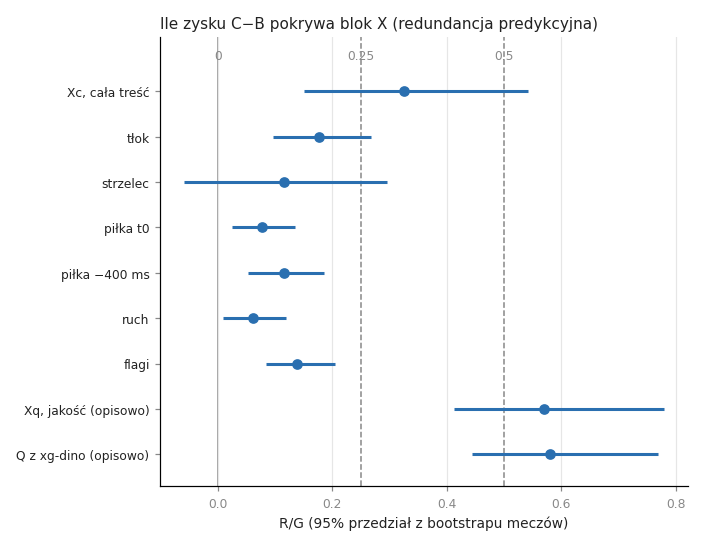
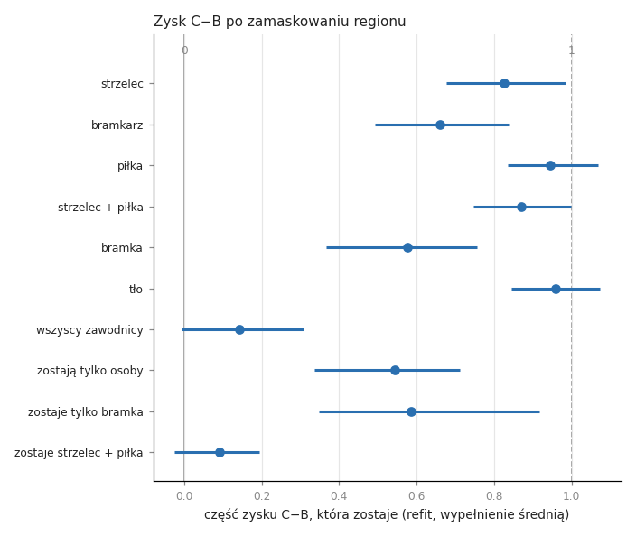

# Skąd bierze się zysk DINOv2 ponad automatyczną geometrię: raport xg-dino-info (wyniki rozwojowe)

2026-10-28. Gałąź `research/xg-dino`, tickety 09–16. Dalszy ciąg raportu fazy xg-dino (`results.md` obok, `7025b34`). Sprawdza hipotezę z jego sekcji 6.

W tekście źródłowym po każdej liczbie stoi niewidoczny znacznik `<!--n:…-->`. Plik `info_claims.toml` obok mówi, z którego pliku wyników pochodzi liczba. Skrypt `scripts/check_xgd_audit.py` odczytuje każdą liczbę ze źródła i kończy się błędem przy niezgodności.

## 1. Pytanie i decyzje właściciela

xg-dino pokazało, że DINOv2 (G-combo) poprawia xG ponad automatyczną geometrię: C−B = −0.0097 [−0.0131; −0.0064]<!--n:ab.C-B.ll--> log-loss out of fold na 7 062<!--n:p.shots--> strzałach (902<!--n:p.goals--> gole) z 328<!--n:p.matches--> meczów treningowych. Pokazało też, że DINOv2 nie czyta pięciu cech geometrycznych lepiej niż detektor. Raport zostawił nietestowaną hipotezę: zysk to inna informacja niż geometria. Pytanie tej fazy brzmi: **jaka informacja niesie C−B i z której części klatki pochodzi?**

Decyzje właściciela z 2026-10-28:

- **E1, pełny zakres.** (a) Sondy na atrybutach spoza geometrii. (b) C−B w podgrupach. (c) Domykanie luki automatycznymi atrybutami. (d) Maskowanie fragmentów klatki i ponowne przeliczenie przez G-combo.
- **E2, etykiety główki.** Komentarze SoccerNet-Caption (słabe, na meczach treningowych) i `GPT-6.1 Sol low` na próbie 1 000<!--n:lb.sample--> strzałów. Etykiety są tylko celami sond i kluczami podgrup. Nigdy nie wchodzą do modelu, bo komentarze wspominają wynik.
- **E3, poza.** W tej fazie bez modelu pozy.

Zasady bez zmian. StatsBomb nie jest czytany. 172<!--n:p.held--> odłożone mecze nie są używane. Wszystko liczymy out of fold na 328<!--n:p.matches--> meczach, na foldach i z kalibracją xg-dino. Przedziały pochodzą z bootstrapu par po meczach, 2 000<!--n:p.draws--> losowań. Model dostaje tylko atrybuty liczone automatycznie z klatek i potoku detektora oraz flagi SoccerNet-v2 z xg-stack. To porównania rozwojowe, nie niezależny test. Optymizm G-combo (ujawnienie C6) przechyla C−B w stronę „DINOv2 dodaje”.

## 2. Projekt i pre-rejestracja

### 2.1 Atrybuty

Ticket 09 (`dd4549d`). Automatyczne atrybuty Xa liczone w t0 i −400 ms. Braki zostają brakami. Rada C3 podzieliła je przed przypięciem protokołu:

- **Xq, blok jakościowy:** liczba punktów kluczowych boiska i ich pewność, liczba zawodników, mediana wysokości ramek zawodników, skala homografii (piksele na metr), udział pola karnego w kadrze, wykrycie piłki. Odczyty Xq są opisowe, bo mogą nieść artefakty transmisji i adnotacji.
- **Bloki treści:** tłok (zawodnicy w polu karnym, w promieniu 5 m od miejsca strzału, atakujący w polu karnym), strzelec (wysokość i proporcje ramki, nakładanie na innych), piłka w t0 i piłka w −400 ms (tylko własna detekcja w klatce: piłka nad strzelcem, odległość piłka–strzelec), ruch między −400 ms a t0, flagi stałych fragmentów z SoccerNet. Razem tworzą Xc.
- Strzelca, bramkarza i piłkę odtworzono z potoku lokalizacji stóp. Odtworzenie daje zapisaną pozycję strzału na 7 062<!--n:at.replay--> z 7 062<!--n:p.shots--> strzałów.
- Ruch liczymy tylko przy spójnym kierunku ataku, ważnych homografiach w obu klatkach, tym samym strzelcu i bramkarzu i bez cięcia kamery. Ma go 2 769<!--n:at.motion--> strzałów.
- Flaga rzutu wolnego bezpośredniego sięga do 300 ms po strzale. Wariant z oknem ≤ 0 ms to analiza wrażliwości.

### 2.2 Reguły redundancji

Protokół `research/xgdino_info_protocol.json` przypięto przed pierwszym prawdziwym dopasowaniem (ticket 11, `0ee48ed`), sha256 `39a547b5…3298`. Dla każdego bloku X dopasowano B+X i C+X na tych samych foldach i tą samą procedurą co B i C. Na każdym losowaniu meczów liczymy:

- G = LL_B − LL_C, zysk z DINOv2;
- G_X = LL_{B+X} − LL_{C+X}, zysk z DINOv2, gdy model ma już X;
- R_X = G − G_X, część zysku, którą X przejmuje.

Werdykty:

- **wyjaśnia większość:** B+X jest lepsze od B (jednostronna górna granica 95%<!--n:p.ci95--> poniżej 0, Holm w rodzinie) i 5. percentyl R_X − 0.5<!--n:pr.most-->·G leży powyżej 0;
- **wyjaśnia część:** to samo z 0.25<!--n:pr.part-->·G;
- **nie wyjaśnia:** 95. percentyl R_X − 0.25<!--n:pr.part-->·G leży poniżej 0;
- w pozostałych przypadkach **nierozstrzygnięte**. To nie jest dowód przeciw.

Xc to jeden test główny. Sześć bloków treści tworzy rodzinę z poprawką Holma. Xq oraz Q z xg-dino (ramiona B+Q i C+Q) są opisowe i stoją obok jako znana linia odniesienia. Każdy kontrast powtórzono na meczach bez obrazów v3 i na strzałach niewidzianych przez detektor, z tabelą wycieku C1. Słownictwo: „redundancja predykcyjna z DINOv2”, nigdy przyczynowa identyfikacja tego, czego DINOv2 używa.

### 2.3 Kontrole przed przypięciem

Kontrole `controls_r1000`: 1 000<!--n:ct.reps--> powtórzeń na scenariusz, syntetyczny wynik z efektem meczu, zasadzone G = 0.0097<!--n:ct.g-->.

- Zero redundancji: fałszywe „wyjaśnia część” dla Xc w 0.000<!--n:ct.null.xc--> przebiegów (górna granica Wilsona 0.004<!--n:ct.null.wilson-->), w całej rodzinie 0.000<!--n:ct.null.fam-->.
- Zasadzone R = 0.5<!--n:pr.most-->·G: „wyjaśnia część” lub „większość” w 0.833<!--n:ct.p50.power--> przebiegów. Przy dużej redundancji moc jest dobra.
- Zasadzone R = 0.25<!--n:pr.part-->·G, na samej granicy reguły: „nie wyjaśnia” w 0.598<!--n:ct.p25.not--> przebiegów, nierozstrzygnięte w 0.401<!--n:ct.p25.inc-->.

Stąd bramka graniczna (wzorzec C2). „Nie wyjaśnia” wolno ogłosić tylko wtedy, gdy jego fałszywy odsetek na granicy nie przekracza 0.05<!--n:ct.limit-->. Bramka nie przeszła. Każde surowe „nie wyjaśnia” czytamy więc jako „nierozstrzygnięte”, a surowy werdykt stoi obok. **Ta metoda może potwierdzić redundancję, ale nie może jej wykluczyć.**

R odzyskane out of fold jest obciążone w dół. Przy zasadzonym R = 0.25<!--n:pr.part-->·G średnie odzyskane R wynosi 0.00103<!--n:ct.p25.meanR-->, a prawdziwe 0.00242<!--n:ct.p25.oracleR-->. Werdykty „wyjaśnia” są więc ostrożne: prawdziwa redundancja może być większa niż pokazana. Przebieg próbny na permutowanych etykietach nie dał żadnego „wyjaśnia” ani odrzucenia Holma.

## 3. Etykiety główki

Ticket 10 (`2ebfc1c`, `3daf44a`).

- Plik komentarzy ma 303<!--n:lb.cap.present--> z 328<!--n:p.matches--> meczów. Warunków serwisu flashscore, z którego pochodzą komentarze, nie sprawdzono.
- Dopasowanie strzału do komentarza: ta sama połowa, okno od −5 s do +60 s, przypisanie jeden do jednego, przypadki niejednoznaczne odrzucone, wynik strzału nieużyty. Brak słów o głowie nie oznacza nogi.
- Etykiety z komentarzy: główka 491<!--n:lb.cap.head--> (gole 88<!--n:lb.cap.head.goal-->, nie-gole 403<!--n:lb.cap.head.nogoal-->), noga 50<!--n:lb.cap.foot-->, nieznane 6 521<!--n:lb.cap.unknown-->.
- `GPT-6.1 Sol low` ocenił 1 000<!--n:lb.sample--> strzałów wylosowanych warstwowo: wynik × etykieta z komentarza × pasmo odległości. Widział tylko klatki t0 i −400 ms z zasłoniętym paskiem wyniku, pod anonimowymi nazwami, bez komentarza i bez wyniku. Odpowiedzi: głowa 264<!--n:lb.gpt.head-->, noga 690<!--n:lb.gpt.foot-->, niejasne 46<!--n:lb.gpt.unclear-->.

Komentarze wobec GPT, ważone wagami warstw, bez odpowiedzi niejasnych:

| miara | wszystkie | gole | nie-gole |
|---|---|---|---|
| precyzja „główki” z komentarza | 0.656 | 0.817 | 0.622<!--n:lb.prec--> |
| odsetek „głów” GPT z „główką” w komentarzu (ważony) | 0.295 | 0.310 | 0.291<!--n:lb.recall--> |
| odsetek „głów” GPT wśród komentarzy bez etykiety | 0.117 | 0.192 | 0.107<!--n:lb.unknown--> |

- Precyzja komentarzy zależy od wyniku: wśród goli jest wyższa niż wśród nie-goli. Odczyty oparte na komentarzach zależą więc od wyniku. Dlatego GPT jest etykietą główną, a komentarze drugorzędną.
- Ważony odsetek „głów” z „główką” w komentarzu jest niski, bo próba nadreprezentuje strzały z „główką” w komentarzu. Bez wag wynosi 0.648<!--n:lb.recall.unw-->.
- GPT to też zaszumiony pomiar, nie prawda. W kontroli wyrywkowej jedna odpowiedź „głowa” była wywnioskowana z kontekstu dośrodkowania (piłka w t0 jeszcze przy nodze dośrodkowującego), a nie zobaczona. Kontrola była mała i nie daje odsetka błędów.
- Główka jest dostępna tylko na próbie GPT: 954<!--n:lb.n--> strzałów z odpowiedzią „głowa” albo „noga”.

## 4. Wyniki

### 4.1 (a) Co embeddingi czytają

Ticket 12 (`364c80b`). Sondy grzbietowe na blokach 20–23 zamrożonego DINOv2 i G-combo, klatki t0 i −400 ms, zagnieżdżony wybór bloku, progi C2 bez zmian, korekta BH w rodzinie celów. „Koduje ponad dystans”: embedding dołożony do sondy na samym dystansie daje przyrost z dolną granicą 95%<!--n:p.ci95--> powyżej 0 i co najmniej 0.05<!--n:p.gain.r2--> R² albo 0.03<!--n:p.gain.auc--> AUC.

W t0 ponad dystans koduje 42<!--n:pb.dino.enc--> z 51<!--n:pb.dino.n--> celów w DINOv2 i 43<!--n:pb.g.enc--> z 51<!--n:pb.g.n--> w G-combo. Wybrane cele, klatka t0, metryka R² albo AUC:

| cel | metryka | DINOv2 | G-combo | sam dystans | przyrost G-combo [95%<!--n:p.ci95-->] | koduje ponad dystans |
|---|---|---|---|---|---|---|
| zawodnicy w polu karnym | R² | 0.804<!--n:pb.box.d--> | 0.817 | 0.196 | +0.623 [+0.604; +0.642]<!--n:pb.box.g--> | tak<!--n:pb.box.v--> |
| zawodnicy w promieniu 5 m | R² | 0.194<!--n:pb.near5.d--> | 0.240 | 0.193 | +0.146 [+0.131; +0.160]<!--n:pb.near5.g--> | tak<!--n:pb.near5.v--> |
| wysokość ramki strzelca | R² | 0.582<!--n:pb.sh.d--> | 0.575 | 0.027 | +0.548 [+0.480; +0.609]<!--n:pb.sh.g--> | tak<!--n:pb.sh.v--> |
| proporcje ramki strzelca | R² | 0.165<!--n:pb.asp.d--> | 0.181 | 0.115 | +0.114 [+0.100; +0.128]<!--n:pb.asp.g--> | tak<!--n:pb.asp.v--> |
| skala homografii (Xq) | R² | 0.741<!--n:pb.ppm.d--> | 0.739 | −0.007 | +0.778 [+0.756; +0.798]<!--n:pb.ppm.g--> | tak<!--n:pb.ppm.v--> |
| liczba zawodników (Xq) | R² | 0.867<!--n:pb.np.d--> | 0.864 | 0.136 | +0.729 [+0.714; +0.746]<!--n:pb.np.g--> | tak<!--n:pb.np.v--> |
| stały fragment | AUC | 0.920<!--n:pb.sp.d--> | 0.923 | 0.686 | +0.239 [+0.222; +0.255]<!--n:pb.sp.g--> | tak<!--n:pb.sp.v--> |
| rzut rożny tuż przed strzałem | AUC | 0.871<!--n:pb.corner.d--> | 0.875 | 0.696 | +0.181 [+0.160; +0.204]<!--n:pb.corner.g--> | tak<!--n:pb.corner.v--> |
| piłka nad strzelcem | AUC | 0.845<!--n:pb.above.d--> | 0.852 | 0.820 | +0.048 [+0.031; +0.063]<!--n:pb.above.g--> | tak<!--n:pb.above.v--> |
| przesunięcie miejsca strzału | R² | 0.165<!--n:pb.mot.d--> | 0.178 | 0.046 | +0.178 [+0.150; +0.207]<!--n:pb.mot.g--> | tak<!--n:pb.mot.v--> |
| główka, GPT (ważona) | AUC | 0.848<!--n:pb.hg.d--> | 0.876 | 0.886 | +0.027 [+0.002; +0.050]<!--n:pb.hg.g--> | nie<!--n:pb.hg.v--> |
| główka, komentarz | AUC | 0.703<!--n:pb.hc.d--> | 0.724 | 0.763 | +0.005 [−0.037; +0.052]<!--n:pb.hc.g--> | nie<!--n:pb.hc.v--> |

- Embeddingi dobrze czytają tłok w polu karnym, stały fragment, kadrowanie (skala, liczba zawodników) i wielkość strzelca. Wszystkie te cele kodują dużo ponad dystans.
- Główka (GPT, ważona) nie przekracza progu: przyrost jest dodatni, ale mniejszy niż 0.03<!--n:p.gain.auc--> AUC. Rozbicie po wyniku (blok 23): wśród goli przyrost +0.070 [+0.017; +0.121]<!--n:pb.head.goal-->, wśród nie-goli +0.015 [−0.018; +0.046]<!--n:pb.head.nogoal-->. G-combo uczono na etykiecie gola, więc odczyt wśród goli nie jest czystym odczytem główki. „Koduje ponad dystans” to tu zresztą tylko stwierdzenie o czytelności, nie o źródle zysku.
- Sonda na różnicy logitów z_C − z_B (opisowo): sam embedding G-combo daje R² 0.413 [0.378; 0.444]<!--n:pb.z.alone-->, sama geometria −0.022<!--n:pb.z.geo-->, embedding ponad geometrię +0.692 [+0.664; +0.720]<!--n:pb.z.beyond-->. To odczyt bliski tautologii, bo z_C zawiera logit G-combo.
- To, że atrybut da się odczytać, nie znaczy, że niesie zysk. Sekcja 4.3 sprawdza to wprost.

### 4.2 (b) C−B w podgrupach

Ticket 13 (`906ce43`). d = ℓ_C − ℓ_B na strzał, z zamrożonych predykcji xg-dino. Ujemne d oznacza zysk z DINOv2. Przedziały są warunkowe na dopasowanych predykcjach. Dwa kontrasty potwierdzające (Holm po dwóch): główka wobec nogi na próbie GPT (ważone) i stały fragment wobec gry z akcji. Reszta opisowa. Granice tercyli i minimalna liczebność 100<!--n:pr.minsup--> strzałów są zapisane w protokole.

| klucz | podgrupa | strzały | gole | średnie d [95%<!--n:p.ci95-->] | kontrast [95%<!--n:p.ci95-->] | p | Holm |
|---|---|---|---|---|---|---|---|
| główka (GPT) | głowa | 264 | 107 | −0.0127 [−0.0342; +0.0080]<!--n:sg.hg.in--> | | | |
| | noga | 690 | 265 | −0.0012 [−0.0097; +0.0070] | −0.0116 [−0.0345; +0.0106] | 0.295<!--n:sg.hg.out--> | nie<!--n:sg.hg.holm--> |
| stały fragment | tak | 1 427 | 164 | −0.0108 [−0.0177; −0.0043]<!--n:sg.sp.in--> | | | |
| | gra z akcji | 5 635 | 738 | −0.0094 [−0.0133; −0.0056] | −0.0014 [−0.0093; +0.0059] | 0.723<!--n:sg.sp.out--> | nie<!--n:sg.sp.holm--> |
| odległość | górny tercyl | 2 332 | 96 | −0.0049 [−0.0085; −0.0016]<!--n:sg.dist.in--> | | | |
| | dolny tercyl | 2 333 | 546 | −0.0148 [−0.0223; −0.0073] | +0.0099 [+0.0019; +0.0183] | 0.019<!--n:sg.dist.out--> | opisowo |
| tłok w polu karnym | górny tercyl | 2 050 | 283 | −0.0120 [−0.0180; −0.0059]<!--n:sg.crowd.in--> | | | |
| | dolny tercyl | 2 379 | 252 | −0.0125 [−0.0182; −0.0072] | +0.0005 [−0.0079; +0.0091] | 0.882<!--n:sg.crowd.out--> | opisowo |
| skala kadru | górny tercyl | 2 321 | 306 | −0.0097 [−0.0161; −0.0035]<!--n:sg.frame.in--> | | | |
| | dolny tercyl | 2 321 | 255 | −0.0069 [−0.0122; −0.0013] | −0.0028 [−0.0114; +0.0053] | 0.471<!--n:sg.frame.out--> | opisowo |
| piłka wykryta | tak | 4 331 | 531 | −0.0071 [−0.0112; −0.0031]<!--n:sg.ball.in--> | | | |
| | nie | 2 731 | 371 | −0.0138 [−0.0196; −0.0081] | +0.0066 [−0.0006; +0.0136] | 0.069<!--n:sg.ball.out--> | opisowo |
| bramkarz wykryty | tak | 6 276 | 833 | −0.0086 [−0.0124; −0.0050]<!--n:sg.gk.in--> | | | |
| | nie | 786 | 69 | −0.0183 [−0.0279; −0.0093] | +0.0097 [−0.0004; +0.0195] | 0.059<!--n:sg.gk.out--> | opisowo |
| główka (komentarz) | główka | 491 | 88 | −0.0034 [−0.0171; +0.0108]<!--n:sg.hc.in--> | | | |
| | reszta | 6 571 | 814 | −0.0102 [−0.0138; −0.0068] | +0.0068 [−0.0073; +0.0220] | 0.329<!--n:sg.hc.out--> | opisowo |

- Żaden kontrast potwierdzający nie jest odrzucony. Zysk nie różni się wykrywalnie między główkami i strzałami nogą ani między stałymi fragmentami i grą z akcji. Przedział dla główki jest szeroki: próba GPT jest mała.
- Opisowo zysk skupia się w krótkich strzałach. Strzały bez wykrytej piłki i bez wykrytego bramkarza też mają większy zysk, ale przedziały kontrastu dotykają 0.
- Pasmo czasu i cięcie kamery są nieczytelne: wszystkie strzały mają błąd czasu w jednym paśmie, a cięć jest za mało.

### 4.3 (c) Czy automatyczne atrybuty zastępują DINOv2

Ticket 13 (`906ce43`). Zysk z DINOv2 w tym przebiegu: G = +0.0097 [+0.0064; +0.0131]<!--n:rd.G-->, żadne losowanie nie dało G ≤ 0. „Przyrost B+X” to LL_{B+X} − LL_B (ujemny = X pomaga geometrii). R/G to część zysku DINOv2, którą X przejmuje. C − (B+X) to zysk DINOv2 ponad geometrię z X.

| blok | rola | przyrost B+X [95%<!--n:p.ci95-->] | R/G [95%<!--n:p.ci95-->] | C − (B+X) [95%<!--n:p.ci95-->] | werdykt surowy | werdykt |
|---|---|---|---|---|---|---|
| Xc, cała treść | test główny | −0.00004 [−0.00314; +0.00290] | 0.33 [0.15; 0.54] | −0.0097 [−0.0136; −0.0057]<!--n:rd.Xc.row--> | nierozstrzygnięte | nierozstrzygnięte<!--n:rd.Xc.v--> |
| tłok | rodzina treści | −0.00197 [−0.00356; −0.00033] | 0.18 [0.10; 0.27] | −0.0077 [−0.0110; −0.0045]<!--n:rd.crowding.row--> | nierozstrzygnięte | nierozstrzygnięte<!--n:rd.crowding.v--> |
| strzelec | rodzina treści | +0.00121 [−0.00056; +0.00321] | 0.12 [−0.06; 0.30] | −0.0109 [−0.0146; −0.0072]<!--n:rd.shooter.row--> | nierozstrzygnięte | nierozstrzygnięte<!--n:rd.shooter.v--> |
| piłka t0 | rodzina treści | −0.00039 [−0.00187; +0.00124] | 0.08 [0.03; 0.14] | −0.0093 [−0.0129; −0.0059]<!--n:rd.ball_t0.row--> | nie wyjaśnia | nierozstrzygnięte<!--n:rd.ball_t0.v--> |
| piłka −400 ms | rodzina treści | −0.00068 [−0.00234; +0.00096] | 0.12 [0.05; 0.19] | −0.0090 [−0.0124; −0.0057]<!--n:rd.ball_m400.row--> | nie wyjaśnia | nierozstrzygnięte<!--n:rd.ball_m400.v--> |
| ruch | rodzina treści | −0.00022 [−0.00129; +0.00082] | 0.06 [0.01; 0.12] | −0.0095 [−0.0130; −0.0063]<!--n:rd.motion.row--> | nie wyjaśnia | nierozstrzygnięte<!--n:rd.motion.v--> |
| flagi | rodzina treści | −0.00187 [−0.00356; −0.00026] | 0.14 [0.08; 0.21] | −0.0078 [−0.0115; −0.0044]<!--n:rd.flags.row--> | nie wyjaśnia | nierozstrzygnięte<!--n:rd.flags.v--> |
| flagi, okno ≤ 0 ms | wrażliwość | −0.00189 [−0.00358; −0.00026] | 0.14 [0.08; 0.20] | −0.0078 [−0.0115; −0.0044]<!--n:rd.flags_le0.row--> | nie wyjaśnia | nierozstrzygnięte<!--n:rd.flags_le0.v--> |
| Xq, jakość | opisowo | −0.00451 [−0.00779; −0.00140] | 0.57 [0.41; 0.78] | −0.0052 [−0.0089; −0.0016]<!--n:rd.Xq.row--> | wyjaśnia część | wyjaśnia część<!--n:rd.Xq.v--> |
| Q z xg-dino | opisowo, znana linia odniesienia | −0.00648 [−0.00971; −0.00329] | 0.58 [0.44; 0.77] | −0.0032 [−0.0069; +0.0001]<!--n:rd.Q.row--> | wyjaśnia część | wyjaśnia część<!--n:rd.Q.v--> |

**Test główny, Xc.** Cała automatyczna treść nie poprawia geometrii: przyrost B+Xc jest bliski zera. R/G wynosi 0.33 [0.15; 0.54]<!--n:rd.Xc.rg-->, więc werdykt brzmi „nierozstrzygnięte”. DINOv2 nadal dodaje ponad B+Xc tyle co ponad B: C − (B+Xc) = −0.0097 [−0.0136; −0.0057]<!--n:rd.Xc.cbx-->, werdykt C1 „DINOv2 dodaje”. Dołożenie Xc do C pogarsza model: C+Xc − C = +0.0031 [+0.0009; +0.0053]<!--n:rd.Xc.cxc-->. Szeroki blok najpewniej przeucza się w regresji.

**Bloki treści.** Tłok i flagi same poprawiają geometrię (przedziały przyrostu poniżej 0), ale Holm w rodzinie ich nie odrzuca. Żaden blok treści nie dostaje werdyktu „wyjaśnia”. Piłka w t0 i w −400 ms, ruch i flagi mają surowe „nie wyjaśnia”, które bramka graniczna zamienia na „nierozstrzygnięte”. Ponad każdy blok treści DINOv2 nadal dodaje.

**Blok jakościowy, opisowo.** Tylko Xq i Q „wyjaśniają część”: R/G 0.57 [0.41; 0.78]<!--n:rd.Xq.rg--> i 0.58 [0.44; 0.77]<!--n:rd.Q.rg-->. To ta sama znana linia odniesienia co w xg-dino: B+Q − B = −0.0065 [−0.0097; −0.0033]<!--n:ab.BQ-B.ll-->, czyli 67%<!--n:ir.bqshare--> zysku C−B. Rada C1 nazwała Q kanałem, który może być skorelowany z wynikiem (artefakty transmisji i adnotacji), dlatego te wiersze są opisowe i nie są wyjaśnieniem treściowym.

**Kontrole wycieku.** Na meczach bez obrazów v3 (1 028<!--n:p.nov3.shots--> strzałów) Xc ma R/G 0.38<!--n:rd.nov3.Xc--> i werdykt nierozstrzygnięte<!--n:rd.nov3.Xc.v-->. Na strzałach niewidzianych przez detektor (3 249<!--n:p.unseen.shots--> strzałów) R/G 0.35<!--n:rd.unseen.Xc-->, werdykt nierozstrzygnięte<!--n:rd.unseen.Xc.v-->. Tabela wycieku C1 dla Xc: R rozstrzygalny<!--n:rd.leak.Xc.R-->, C − (B+Xc) rozstrzygalny<!--n:rd.leak.Xc.cbx-->. Xq i Q na tych podzbiorach czytają się jako „wyjaśnia większość” (bez v3: R/G 0.88<!--n:rd.nov3.Xq--> i 0.77<!--n:rd.nov3.Q-->), ale ich R jest nierozstrzygalne<!--n:rd.leak.Xq.R--> w tabeli wycieku (Q też: nierozstrzygalny<!--n:rd.leak.Q.R-->). Tak samo R tłoku (nierozstrzygalny<!--n:rd.leak.crowding.R-->) i strzelca (nierozstrzygalny<!--n:rd.leak.shooter.R-->). Kontrole są małe i nie rozstrzygają drobnych tłumień.

**Kontrole odtworzenia.** Ponownie dopasowane B, C, B+Q i C+Q różnią się od zamrożonych predykcji xg-dino najwyżej o 5.0e−10<!--n:rd.chk.refit--> w prawdopodobieństwie. Powtórne dopasowanie B+Xc różni się od zapisanego najwyżej o 5.0e−10<!--n:rd.chk.bxc-->.

### 4.4 (d) Maskowanie fragmentów klatki

Tickety 14–15 (`bdd2521`, `4a75a63`). Klatkę t0 każdego strzału przeliczono przez oba seedy jego własnego foldu G-combo z jednym regionem zastąpionym: średnim kolorem klatki (wypełnienie główne) albo rozmyciem (sprawdzenie zgodności). Regiony leżą na siatce łatek wejścia G-combo, z marginesem jednej łatki: strzelec, bramkarz (tylko wykryty), piłka (własna detekcja), strzelec + piłka, bramka (przybliżona z homografii), wszyscy zawodnicy, tło. Placebo to ta sama maska przesunięta na boisku, poza osobami, piłką i bramką, trzy losowania uśrednione. Wariant „zostaje tylko …” wypełnia wszystko poza regionem. Razem 241 226<!--n:ms.frames--> klatek.

**Bramka odtworzenia.** Nieosłonięte klatki przeliczone tym samym potokiem odtwarzają zapisany logit G-combo z różnicą najwyżej 0.00106<!--n:mk.gate.max-->, średnio 8.9e−07<!--n:mk.gate.mean-->. Odstające strzały skupiają się w kilku meczach: to szum składu batcha. Orkiestrator przyjął regułę `max |Δz| ≤ 2e-3, mean ≤ 1e-5`. Punktem odniesienia dla maskowania jest ten odtworzony logit, więc kontrasty „zamaskowane − nieosłonięte” nie niosą szumu odtworzenia. C na odtworzonym logicie różni się od zamrożonego C najwyżej o 1.5e−04<!--n:mk.cont--> w prawdopodobieństwie.

**Dwa estymandy.** *Refit* (główny): stacker C dopasowany od nowa na zamaskowanym logicie, geometria bez zmian. Mówi, ile informacji zostaje w obrazie bez regionu. *Zamrożony*: dopasowane modele C zastosowane do zamaskowanego logitu. Mówi, na czym opiera się wdrożony model. Test na region: pogorszenie wobec nieosłoniętego **i** wobec placebo, p = większe z dwóch jednostronnych p, Holm po pięciu regionach. Populacja: strzały z regionem i z ważnym placebo. Bramkę testujemy tylko na podzbiorze z ważnym placebo. Dodatni wynik to „wrażliwość na interwencję”, nie dowód tego, czego DINOv2 używa. Gdy wypełnienia dają różne decyzje Holma, werdykt brzmi „nierozstrzygnięte”.

Refit (główny), wypełnienie średnią, ΔLL = LL zamaskowane − LL nieosłonięte (dodatnie = gorzej):

| region | strzały w teście | wobec nieosłoniętego [95%<!--n:p.ci95-->] | wobec placebo [95%<!--n:p.ci95-->] | p | Holm, średnia | Holm, rozmycie | werdykt |
|---|---|---|---|---|---|---|---|
| strzelec | 5 173 | +0.0014 [−0.0003; +0.0032] | +0.0012 [−0.0006; +0.0030] | 0.110<!--n:mr.shooter--> | nie | nie | brak wykrywalnej wrażliwości<!--n:mr.shooter.v--> |
| bramkarz | 4 285 | +0.0031 [+0.0007; +0.0056] | +0.0031 [+0.0005; +0.0056] | 0.009<!--n:mr.goalkeeper--> | tak | nie | nierozstrzygnięte (wypełnienia się różnią)<!--n:mr.goalkeeper.v--> |
| piłka | 4 033 | +0.0007 [−0.0011; +0.0026] | +0.0006 [−0.0012; +0.0024] | 0.255<!--n:mr.ball--> | nie | nie | brak wykrywalnej wrażliwości<!--n:mr.ball.v--> |
| strzelec + piłka | 3 116 | +0.0016 [−0.0008; +0.0040] | +0.0014 [−0.0010; +0.0038] | 0.117<!--n:mr.sb--> | nie | nie | brak wykrywalnej wrażliwości<!--n:mr.sb.v--> |
| bramka (podzbiór z placebo) | 1 495 | +0.0023 [−0.0019; +0.0069] | +0.0032 [−0.0013; +0.0080] | 0.148<!--n:mr.goal--> | nie | nie | brak wykrywalnej wrażliwości<!--n:mr.goal.v--> |

Zamrożony C, wypełnienie średnią:

| region | strzały w teście | wobec nieosłoniętego [95%<!--n:p.ci95-->] | wobec placebo [95%<!--n:p.ci95-->] | p | Holm, średnia | Holm, rozmycie | werdykt |
|---|---|---|---|---|---|---|---|
| strzelec | 5 173 | +0.0022 [+0.0001; +0.0043] | +0.0019 [−0.0001; +0.0041] | 0.035<!--n:mf.shooter--> | nie | nie | brak wykrywalnej wrażliwości<!--n:mf.shooter.v--> |
| bramkarz | 4 285 | +0.0042 [+0.0015; +0.0069] | +0.0042 [+0.0014; +0.0070] | 0.002<!--n:mf.goalkeeper--> | tak | tak | wrażliwe na interwencję<!--n:mf.goalkeeper.v--> |
| piłka | 4 033 | +0.0011 [−0.0009; +0.0032] | +0.0010 [−0.0010; +0.0031] | 0.165<!--n:mf.ball--> | nie | nie | brak wykrywalnej wrażliwości<!--n:mf.ball.v--> |
| strzelec + piłka | 3 116 | +0.0025 [−0.0005; +0.0053] | +0.0023 [−0.0006; +0.0051] | 0.055<!--n:mf.sb--> | nie | nie | brak wykrywalnej wrażliwości<!--n:mf.sb.v--> |
| bramka (podzbiór z placebo) | 1 495 | +0.0085 [+0.0014; +0.0163] | +0.0094 [+0.0021; +0.0176] | 0.010<!--n:mf.goal--> | tak | tak | wrażliwe na interwencję<!--n:mf.goal.v--> |

Część zysku C−B, która zostaje po maskowaniu, (LL_B − LL_C,mask) / (LL_B − LL_C), wszystkie strzały, wypełnienie średnią. Wiersze poza pięcioma regionami rodziny są opisowe.

| maska | refit [95%<!--n:p.ci95-->] | zamrożony [95%<!--n:p.ci95-->] |
|---|---|---|
| strzelec | 0.83 [0.68; 0.98]<!--n:gl.shooter.r--> | 0.73 [0.50; 0.92]<!--n:gl.shooter.f--> |
| bramkarz | 0.66 [0.49; 0.84]<!--n:gl.goalkeeper.r--> | 0.56 [0.27; 0.77]<!--n:gl.goalkeeper.f--> |
| piłka | 0.94 [0.83; 1.07]<!--n:gl.ball.r--> | 0.92 [0.78; 1.05]<!--n:gl.ball.f--> |
| strzelec + piłka | 0.87 [0.75; 1.00]<!--n:gl.sb.r--> | 0.82 [0.65; 0.96]<!--n:gl.sb.f--> |
| bramka | 0.58 [0.37; 0.76]<!--n:gl.goal.r--> | −0.65 [−1.60; −0.07]<!--n:gl.goal.f--> |
| tło | 0.96 [0.85; 1.07]<!--n:gl.background.r--> | 0.96 [0.85; 1.07]<!--n:gl.background.f--> |
| wszyscy zawodnicy | 0.14 [−0.01; 0.31]<!--n:gl.players.r--> | −4.94 [−7.69; −3.44]<!--n:gl.players.f--> |
| zostają tylko osoby | 0.54 [0.34; 0.71]<!--n:gl.keep_persons.r--> | 0.12 [−0.37; 0.45]<!--n:gl.keep_persons.f--> |
| zostaje tylko bramka | 0.59 [0.35; 0.92]<!--n:gl.keep_goal.r--> | −4.67 [−7.31; −3.20]<!--n:gl.keep_goal.f--> |
| zostaje strzelec + piłka | 0.09 [−0.03; 0.19]<!--n:gl.keep_sb.r--> | −1.17 [−2.04; −0.62]<!--n:gl.keep_sb.f--> |

Odczyt:

- **Refit (główny): żaden pojedynczy region nie jest potrzebny w sposób odporny.** Tylko bramkarz przechodzi Holma, i to tylko przy wypełnieniu średnią (przy rozmyciu p = 0.012<!--n:mr.goalkeeper.blur-->). Wypełnienia się różnią, więc werdykt to „nierozstrzygnięte”. Po zamaskowaniu jednego obiektu zostaje od 0.58<!--n:gl.goal.pt--> do 0.94<!--n:gl.ball.pt--> zysku.
- **Zysk jest rozłożony na układ zawodników.** Zamaskowanie wszystkich zawodników zostawia 0.14<!--n:gl.players.pt--> zysku, a pozostawienie samego strzelca z piłką 0.09<!--n:gl.keep_sb.pt-->. Tło prawie nic nie zmienia: refit +0.0004 [−0.0007; +0.0014]<!--n:md.background-->. Opisowe, bez placebo: dla wszystkich zawodników placebo jest wykonalne tylko na 14<!--n:mk.players.placebo--> strzałach.
- **Wdrożony model opiera się na bramkarzu i okolicy bramki.** W estymandzie zamrożonym bramkarz i bramka są wrażliwe na interwencję przy obu wypełnieniach. Zamaskowanie bramki albo wszystkich zawodników sprawia, że zamrożony C jest gorszy od samej geometrii (ujemna część zysku). To zachowanie modelu poza rozkładem uczenia, nie miara informacji.
- **Nakładanie regionów.** Piłka leży w 92%<!--n:ov.ball.shooter--> swoich łatek wewnątrz regionu strzelca (Jaccard strzelca i piłki 0.50<!--n:ov.jacc-->). Bramkarz leży w 72%<!--n:ov.gk.goal--> swoich łatek w regionie bramki. Samymi maskami usuwającymi nie da się więc oddzielić piłki od strzelca ani bramkarza od bramki. Dlatego dodano region strzelec + piłka, a odczyt „bramka” obejmuje zwykle bramkarza.
- **Wielkość regionu.** Pogorszenie rośnie z wielkością maski bramkarza. W największym tercylu (397<!--n:sb.gk.large.n--> strzałów) wynosi +0.0127 [+0.0000; +0.0243]<!--n:sb.gk.large--> wobec nieosłoniętego. Mniejsze maski nie dają wykrywalnego efektu.
- Model A (sam obraz) jest wrażliwy na każdy region rodziny (opisowo). Geometria w C kompensuje większość tej utraty.

## 5. Synteza

Embeddingi dobrze czytają tłok w polu karnym, stały fragment, kadrowanie i wielkość strzelca. Te automatyczne atrybuty treści nie zastępują jednak DINOv2 w modelu xG. Test główny Xc jest nierozstrzygnięty (R/G 0.33 [0.15; 0.54]<!--n:rd.Xc.rg-->), a DINOv2 nadal dodaje pełne −0.0097 [−0.0136; −0.0057]<!--n:rd.Xc.cbx--> ponad geometrię z Xc. Część zysku wyjaśnia tylko blok jakościowy (R/G 0.57 [0.41; 0.78]<!--n:rd.Xq.rg-->), opisowo i z zastrzeżeniem, że może nieść kanał skorelowany z wynikiem. Ta metoda może potwierdzić redundancję, ale nie może jej wykluczyć, a odzyskane R jest obciążone w dół. „Nierozstrzygnięte” nie znaczy więc „treść nie ma znaczenia”. Główka nie jest zakodowana ponad dystans w całej próbie. Wśród goli jest (+0.070 [+0.017; +0.121]<!--n:pb.head.goal-->), ale G-combo uczono na golach, więc to odczyt zakłócony. W refit żaden pojedynczy region nie jest potrzebny w sposób odporny. Zamaskowanie wszystkich zawodników zostawia 0.14 [−0.01; 0.31]<!--n:gl.players.r--> zysku, a pozostawienie samego strzelca z piłką 0.09 [−0.03; 0.19]<!--n:gl.keep_sb.r-->. Zysk jest więc rozłożony na układ zawodników na scenie, a nie zamknięty w jednym obiekcie. Wdrożony model opiera się najbardziej na bramkarzu i okolicy bramki. Wszystko to redundancja predykcyjna i wrażliwość na interwencję, nie przyczynowa identyfikacja tego, czego DINOv2 używa.

Rekomendacja bez zmian: zostawić C, czyli DINOv2 razem z geometrią. Żaden zestaw automatycznych atrybutów nie zastąpił DINOv2.

## 6. Ograniczenia

- Wszystko to dane rozwojowe: 328<!--n:p.matches--> meczów treningowych, out of fold. Optymizm G-combo (C6) przechyla G w stronę „DINOv2 dodaje”. W R = G − G_X ten przechył częściowo się znosi, ale nie znika.
- Bramka graniczna nie przeszła, więc werdykt „nie wyjaśnia” jest niedostępny. Odzyskane R jest obciążone w dół. Brak werdyktu „wyjaśnia” dla treści nie wyklucza redundancji.
- Kontrole wycieku są małe (1 028<!--n:p.nov3.shots--> strzałów bez v3) i nie rozstrzygają drobnych tłumień. R dla Xq, Q, tłoku i strzelca jest nierozstrzygalne w tabeli wycieku.
- Etykiety główki to zaszumione pomiary. Precyzja komentarzy zależy od wyniku. GPT sprawdzono tylko wyrywkowo. Analizy główki obejmują 954<!--n:lb.n--> strzałów, więc przedziały są szerokie.
- t0 nie jest potwierdzoną klatką sprzed kontaktu z piłką. Bloki piłki i ruchu nie zamknęły luki, więc rozróżnienie „lot piłki” i „część ciała” nie było potrzebne.
- Ruch istnieje tylko dla 2 769<!--n:at.motion--> strzałów. Braki uzupełniono średnią ze wskaźnikiem, więc blok ruchu niesie też informację „ruch mierzalny”.
- Region bramki jest przybliżony z homografii. Placebo dla bramki jest wykonalne tylko na 1 495<!--n:mk.goal.placebo--> z 6 339<!--n:mk.goal.present--> strzałów z bramką, a dla wszystkich zawodników prawie nigdy. Tło i warianty „zostaje tylko …” nie mają placebo i są opisowe.
- Maskowanie zmienia rozkład wejścia. Zamrożony C na zamaskowanym obrazie bywa gorszy od samej geometrii. Stąd estymand refit jako główny.
- Przypięty kod (ticket 11) nadpisuje w podsumowaniu podgrup liczbę goli średnim d wśród goli. Tabela podgrup bierze liczby goli z osobnej kolumny `goal_count`.

## 7. Uzupełnienie odpowiedzi dla recenzenta

Tekst do przekazania, uzupełnienie do punktu 1 i do wniosku odpowiedzi z raportu xg-dino.

**Uzupełnienie: skąd bierze się wkład DINOv2.** W odpowiedzi napisaliśmy, że wkład DINOv2 to najpewniej informacja inna niż geometria, i że tego jeszcze nie testowaliśmy. Teraz to sprawdziliśmy, z protokołem przypiętym przed pierwszym dopasowaniem. Dane są te same: 7 062<!--n:p.shots--> strzały z 328<!--n:p.matches--> meczów treningowych, out of fold, bootstrap par po meczach, wyniki rozwojowe. Po pierwsze, sondy liniowe pokazują, że embeddingi dobrze kodują tłok w polu karnym, stały fragment, kadrowanie i wielkość strzelca. Po drugie, te same atrybuty policzone automatycznie z detektora nie zastępują DINOv2 w modelu xG. Dodane do geometrii nie zmniejszają wykrywalnie jego wkładu: ponad geometrię z tymi atrybutami DINOv2 nadal daje −0.0097 [−0.0136; −0.0057]<!--n:rd.Xc.cbx--> log-loss. Część wkładu pokrywają tylko cechy jakości obrazu i detekcji, ale ten kanał może być skorelowany z wynikiem, więc traktujemy go opisowo. Nasza metoda może potwierdzić taką redundancję, ale nie może jej wykluczyć, więc wynik dla atrybutów treści jest nierozstrzygnięty, a nie negatywny. Po trzecie, wkład nie różni się wykrywalnie między główkami i strzałami nogą ani między stałymi fragmentami i grą z akcji. Po czwarte, zamaskowaliśmy fragmenty klatki i przeliczyliśmy je przez G-combo. Po zamaskowaniu jednego obiektu (strzelca, piłki, bramkarza, bramki) zostaje od 0.58<!--n:gl.goal.pt--> do 0.94<!--n:gl.ball.pt--> wkładu. Po zamaskowaniu wszystkich zawodników zostaje 0.14<!--n:gl.players.pt-->, a gdy zostaje sam strzelec z piłką, 0.09<!--n:gl.keep_sb.pt-->. Wkład jest więc rozłożony na układ zawodników na scenie, a nie zamknięty w jednym obiekcie. Wdrożony model jest najbardziej wrażliwy na zamaskowanie bramkarza i okolicy bramki. Wszystkie te wyniki mówią o redundancji predykcyjnej i wrażliwości na interwencję, nie o przyczynowej identyfikacji tego, czego DINOv2 używa. Rekomendacja się nie zmienia: DINOv2 zostaje w modelu razem z geometrią.

## Źródła i sumy kontrolne

| plik | sha256 | co zawiera |
|---|---|---|
| `research/xgdino_ablation_protocol.json` | `fd142d152a1bc546b023a5f3e3e199888b967e5b2296393c12ca40a4bf75b6b0` | przypięty protokół xg-dino (ticket 01b): populacje, progi sond |
| `research/xgdino_info_protocol.json` | `39a547b5b7b7642e5327a1a0de362faa46b3043dc79189736757b2a37bba3298` | przypięty protokół xg-dino-info (ticket 11): reguły redundancji, podgrupy, maskowanie |
| `research/xgs_stack_protocol_c6.json` | `eaaa6b3bae695e24d98624c24086e8f8d3efeb248d4ea6fa8f2b17b0bccf20ae` | protokół xg-stack C6: liczba odłożonych meczów |
| `results/xgdino_ablation/real/summary.json` | `10a27df5e6be61f0b7eaff9c7c99aa21684e35f9324a5b36954852e94d49f6b5` | xg-dino ticket 02: ablacja A/B/C, B+Q |
| `results/xgdino_info_attributes/coverage.json` | `369f6c1c68fdc3edcd7c62d0eda203d72af1f78257aa755c0635804565a20d02` | ticket 09: pokrycie atrybutów, odtworzenie strzelca, ruch |
| `results/xgdino_info_labels/complete.json` | `b5e325d53106fe640f256723a133aa09ccd7a55d54cb355c1a64c9e30c3e3f8f` | ticket 10: pliki komentarzy, próba GPT |
| `results/xgdino_info_labels/caption_coverage_by_outcome.csv` | `e0ea9e9d99039a94e08571eaffbfc893bdbeaec5b04f40cf228daeb57d36eeac` | ticket 10: etykiety z komentarzy według wyniku |
| `results/xgdino_info_labels/header_gpt.csv` | `2f75d65aa9c789269879df03c2f2ece9c88b88da77b132cf71aae9283e5ad56d` | ticket 10: odpowiedzi GPT |
| `results/xgdino_info_labels/caption_vs_gpt.json` | `1f1a32046ef4e96dff4ef34336abc4c93d066ec4da9461c27a1aedff26fb55dc` | ticket 10: komentarze wobec GPT |
| `results/xgdino_info_protocol/controls_r1000/controls.json` | `493a9116e8a98a7bc18512e4251b0f862c3899fcd177bbe21902ea6f63738578` | ticket 11: kontrole zera, mocy i granicy |
| `results/xgdino_info_probes/summary.csv` | `0220e32f340df542919e9c5fd063bc2a19f72d92b46f7268d8c84388ceb93661` | ticket 12: sondy na atrybutach i etykietach |
| `results/xgdino_info_probes/header_by_outcome.csv` | `06767ddadba150c42d7cbd412ff6e80cc0b0d3ad43b05105b47c1cee96e027da` | ticket 12: sonda główki według wyniku |
| `results/xgdino_info_redundancy/verdicts.csv` | `abe5ff1b3e3c41c34a2fb5e5acdf5600aea4bc966adc3a153473d566cdbddaae` | ticket 13: ramiona B+X i C+X, werdykty |
| `results/xgdino_info_redundancy/estimands.csv` | `f4b775fc35f0599fa47bc92de7202e7b073c054b022e5b117ba9eb6912e8e702` | ticket 13: estymandy bez v3 i niewidziane |
| `results/xgdino_info_redundancy/leak.csv` | `6a70bc05ea3edc0c62aa69ca6f969d40a8edde3368e7a3daef5213f0984f4b86` | ticket 13: tabela wycieku C1 |
| `results/xgdino_info_redundancy/subgroups.csv` | `c68f72b086c1647b6c63350c40ab55325360a59ce7f295d43c0e4f0cace66dbd` | ticket 13: podgrupy |
| `results/xgdino_info_redundancy/checks.json` | `c45ec509d25daedb268f1681f4ab7f7f8b82e0130fa9a9665837b8b80916a1dd` | ticket 13: kontrole odtworzenia |
| `results/xgdino_info_masked/summary.json` | `2305cce74b8fb6fc87615f570f7116bf465d7fb214c7b5fec20295e81e783281` | ticket 14: zamaskowane klatki, bramka odtworzenia |
| `results/xgdino_info_mask/regions.csv` | `a14160798c74d5f781dc59493a93ec52478bd805a027b02b5e877b8659b48d16` | ticket 15: odczyt maskowania na region |
| `results/xgdino_info_mask/gain_left.csv` | `14357dc7b907b9a0bab7ead834545948a7b504185fa0a061e58bb90eb0d4188e` | ticket 15: część zysku C−B po maskowaniu |
| `results/xgdino_info_mask/overlap.csv` | `277425d90f2b9c24280e29597a45b398af6b6fafa81b258b8ce8e611265136f1` | ticket 15: nakładanie regionów |
| `results/xgdino_info_mask/size_bins.csv` | `814b1573e4da345da57d2093647a178907ed00c34fa5f22061dca00f96a5ab6d` | ticket 15: odczyt według wielkości regionu |
| `results/xgdino_info_mask/summary.json` | `47f3e8f40cc0a657cc078eeddc6536b74b35e2ce1641a303dc1c810279ea37fd` | ticket 15: populacje i decyzje Holma |
| `results/xgdino_info_mask/checks.json` | `ca45c95a0e2802599fe4558b5ce40ac4619679cbe14bcbe7d65cfc54b79e76cf` | ticket 15: bramka odtworzenia i ciągłość |
| `results/xgdino_info_report/derived.json` | `ae82c065277118810c17e61b00b98074f857d4b2c823a03d5787f0d95eadce42` | ticket 16: proporcja odczytana z wyników (`scripts/xgdino_info_report.py`) |
