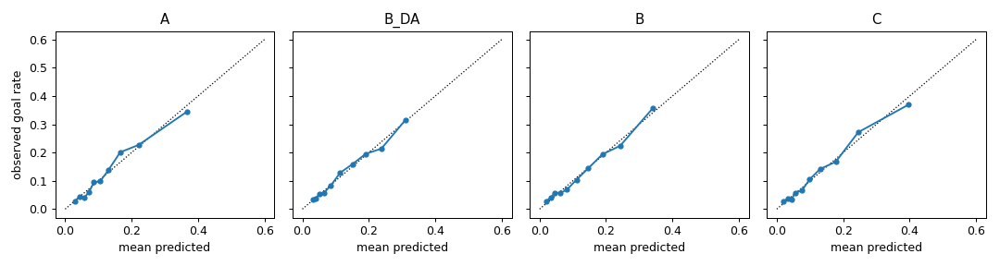
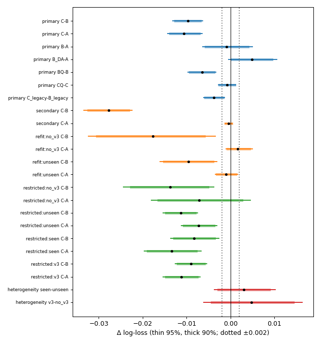
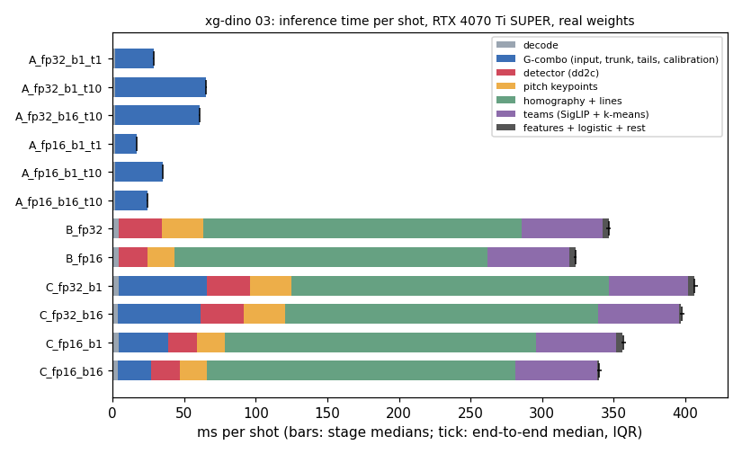
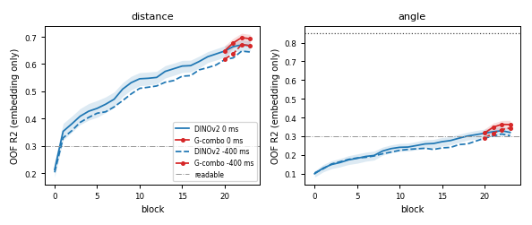
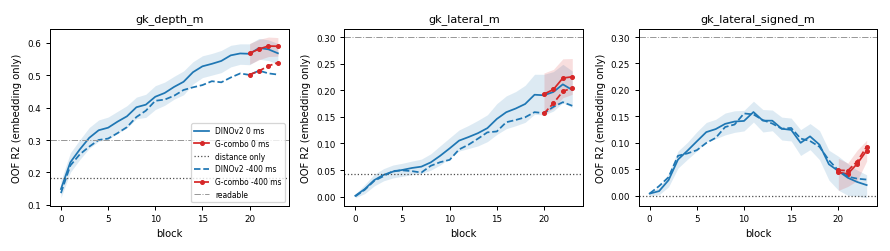
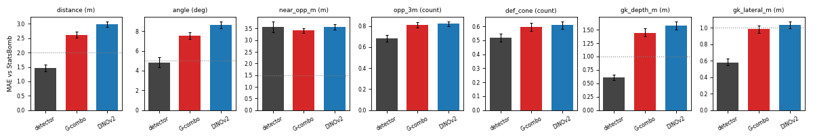

# Czy DINOv2 wnosi coś ponad automatyczną geometrię: raport fazy xg-dino (wyniki rozwojowe)

2026-10-28. Gałąź `research/xg-dino`, tickety 01–08. Odpowiedź na punkty 1–3 uwag recenzenta z 2026-10-27.

W tekście źródłowym po każdej liczbie stoi niewidoczny znacznik `<!--n:…-->`. Plik `claims.toml` obok mówi, z którego pliku wyników pochodzi liczba. Skrypt `scripts/check_xgd_audit.py` odczytuje każdą liczbę ze źródła i kończy się błędem przy niezgodności.

## 1. Co tu znaczy „identyczny zbiór testowy”

Wszystkie ramiona oceniono na tych samych 7 062<!--n:p.shots--> strzałach (902<!--n:p.goals--> gole) z 328<!--n:p.matches--> meczów treningowych, out of fold. Foldy, procedura dopasowania i kalibracja są te same dla każdego ramienia. Różnice mają przedziały z bootstrapu par po meczach: 2 000<!--n:p.draws--> losowań meczów. 172<!--n:p.held--> odłożone mecze są zużyte, bo wybierano na nich warianty detektora. Odczyty na nich są tylko opisowe. To porównanie rozwojowe, nie niezależny test. Epokę i temperaturę G-combo wybrano na każdym z ocenianych foldów (ujawnienie C6). A i C niosą więc optymizm, którego B nie ma, i różnica C−B jest przechylona w stronę „DINOv2 dodaje”.

## 2. Odpowiedź w skrócie

- **Punkt 1.** Sama automatyczna geometria (B) i sam obraz (A) wypadają podobnie: B−A = −0.0009 [−0.0063; +0.0050]<!--n:ab.B-A.ll-->, bez rozstrzygnięcia. Najlepsze jest połączenie (C). Usunięcie DINOv2 z C kosztuje −0.0097 [−0.0131; −0.0064]<!--n:ab.C-B.ll--> log-loss. B liczy się 5.3<!--n:rp.ratio10-->× dłużej niż A.
- **Punkt 2.** Z embeddingów da się odczytać odległość, kąt, obecność obrońcy w stożku i głębokość bramkarza. Liczby rywali w promieniu 3 m i odległości najbliższego rywala sondy nie odczytują na progu „czyta się”. Najwięcej geometrii siedzi w ostatnich blokach. Dostrojony G-combo czyta ją tam lepiej niż zamrożony DINOv2.
- **Punkt 3.** Na sparowanych strzałach detektor jest bliżej StatsBomb niż sondy na każdej cesze poza odległością najbliższego rywala (remis). Nie widać przypadków „detektor się myli, DINO ma rację” ponad to, co wynika z konstrukcji testu.
- **Wniosek.** DINOv2 poprawia model ponad geometrię, ale nie czyta geometrii lepiej niż detektor. Jego wkład to najpewniej inna informacja niż te pięć cech. To hipoteza, nie wynik. Rekomendacja: zostawić C, czyli DINOv2 razem z geometrią.

## 3. Punkt 1: ablacja A/B/C

### 3.1 Co było wiadomo

- Sweep z października (`results_reports/sweep_2026_10/REPORT.md`, `efd7908`, wariant stóp `99d48d2`) policzył A/B/C na 172<!--n:p.held--> zużytych meczach, opisowo. G-combo miał log-loss 0.3376<!--n:sw.g.ll-->. B (pos_ALL, feet_t0) dał −0.0026 [−0.0097; +0.0044]<!--n:fs.b.d-->, C (stack ALL, feet_t0) dał −0.0091 [−0.0142; −0.0042]<!--n:fs.c.d-->.
- xg-stack (`6dd87bf`, test w TEST.md `6e74c19`): stara geometria E3 dołożona do G-combo, out of fold, ΔLL −0.00065<!--n:xs.g.d-->.
- xg-detector (`f281333`): A1, geometria z detektora w głowicy G-combo, w teście +0.0009<!--n:dt.a1-->, równoważne.
- **Nowe:** B out of fold na 328<!--n:p.matches--> meczach nie był wcześniej dopasowany. Nowe są też kontrole wycieku, kontrole mocy i pomiar czasu z prawdziwymi wagami.

### 3.2 Ramiona i wyniki

A to logit G-combo z Plattem w każdym foldzie zewnętrznym. B_DA to dystans i kąt. B to geometria feet_t0 z zamkniętej listy kolumn (lokalizacja, dystans, kąt, bramkarz, rywale, stożek, w t0 i −400 ms) plus wskaźniki braków, bez flag SoccerNet i bez kowariat jakości detekcji. C to logit G-combo plus ta sama geometria. B i C są regresjami logistycznymi z karą dobraną w wewnętrznej walidacji. Protokół przypięto przed pierwszym dopasowaniem (ticket 01b, `14b9d2e`).

| ramię | log-loss | Brier | AUC | nachylenie kalibracji | wyraz wolny kalibracji |
|---|---|---|---|---|---|
| A, obraz | 0.3431 | 0.1021 | 0.734 | 0.99 | −0.023<!--n:ab.A.row--> |
| B_DA, dystans + kąt | 0.3479 | 0.1036 | 0.720 | 0.99 | −0.018<!--n:ab.B_DA.row--> |
| B, geometria | 0.3422 | 0.1016 | 0.738 | 0.95 | −0.084<!--n:ab.B.row--> |
| C, obraz + geometria | 0.3325 | 0.0987 | 0.758 | 0.96 | −0.067<!--n:ab.C.row--> |

### 3.3 Kontrasty i werdykty z zamrożonej tabeli decyzji

Przedziały w nawiasach to 95%<!--n:p.ci95--> przedziały percentylowe. Ujemna ΔLL i ΔBrier oraz dodatnia ΔAUC oznaczają, że pierwsze ramię jest lepsze.

| kontrast | ΔLL | ΔBrier | ΔAUC | werdykt |
|---|---|---|---|---|
| C−B | −0.0097 [−0.0131; −0.0064]<!--n:ab.C-B.ll--> | −0.0029 [−0.0041; −0.0018]<!--n:ab.C-B.brier--> | +0.020 [+0.013; +0.028]<!--n:ab.C-B.auc--> | DINOv2 dodaje<!--n:ab.dec.CB--> |
| C−A | −0.0106 [−0.0143; −0.0065]<!--n:ab.C-A.ll--> | −0.0034 [−0.0045; −0.0022]<!--n:ab.C-A.brier--> | +0.024 [+0.015; +0.032]<!--n:ab.C-A.auc--> | geometria dodaje ponad obraz<!--n:ab.dec.CA--> |
| B−A | −0.0009 [−0.0063; +0.0050]<!--n:ab.B-A.ll--> | −0.0005 [−0.0022; +0.0013]<!--n:ab.B-A.brier--> | +0.004 [−0.011; +0.018]<!--n:ab.B-A.auc--> | nierozstrzygnięte, opisowe |

- C−B: jednostronna górna granica −0.0069<!--n:ab.C-B.up--> leży poniżej 0. C−A: −0.0072<!--n:ab.C-A.up-->. Holm odrzuca obie hipotezy zerowe: tak i tak<!--n:ab.holm-->.
- B−A: przedział 90%<!--n:p.ci90--> to [−0.0057; +0.0040]<!--n:ab.B-A.ci90-->. Nie mieści się w ±0.002<!--n:p.delta-->. Odczyt: „nierozstrzygnięte przy δ = 0.002<!--n:p.delta-->, najmniejszy pokazany margines = 0.0057<!--n:ab.B-A.margin-->”. B i A mogą różnić się o tyle w każdą stronę.

### 3.4 Kontrole wycieku

Detektor dd2c trenowano między innymi na klatkach z puli SoccerNet-v3, które obejmują część strzałów z tej populacji. Kontrole czytają te same predykcje out of fold, zawężone do podzbiorów, bez ponownego dopasowania.

- 47<!--n:p.nov3.matches--> meczów bez żadnego obrazu v3, 1 028<!--n:p.nov3.shots--> strzałów, 137<!--n:p.nov3.goals--> goli: C−B = −0.0137 [−0.0244; −0.0038]<!--n:ab.r.nov3.CB-->.
- Strzały niewidziane przez detektor, 3 249<!--n:p.unseen.shots--> strzałów, 164<!--n:ab.r.unseen.goals--> gole (podzbiór wybrany po wyniku, obciążony w stronę nie-goli, opisowy): C−B = −0.0113 [−0.0153; −0.0075]<!--n:ab.r.unseen.CB-->.
- Heterogeniczność z tych samych losowań: C−B(widziane) − C−B(niewidziane) = +0.0030 [−0.0036; +0.0101]<!--n:ab.het.su-->, C−B(v3) − C−B(bez v3) = +0.0047 [−0.0061; +0.0163]<!--n:ab.het.v3-->. Żaden przedział nie wyklucza 0.

Werdykt według reguły zapisanej przed przebiegiem: rozstrzygalny<!--n:ab.leak-->. Wyciek detektora nie tłumaczy wyniku C−B. Kontrole są jednak małe i nie rozstrzygają niczego na poziomie δ.

### 3.5 Kontrole mocy i fałszywej równoważności

Przed przypięciem protokołu ten sam potok przeliczono na danych syntetycznych z efektem meczu, po 2 000<!--n:ct.reps--> powtórzeń na scenariusz (ticket 01b).

- Prawdziwe C−B = 0: fałszywe „DINOv2 dodaje” w 0.008<!--n:ct.null.adds--> przebiegów. Średnia połowa szerokości przedziału 90%<!--n:p.ci90--> dla C−B wynosi 0.00046<!--n:ct.null.hw-->.
- Zasadzony efekt obrazu C−B = −0.002<!--n:ct.plant.oracle-->: „DINOv2 dodaje” w 0.744<!--n:ct.plant.adds-->, fałszywa równoważność w 0.035<!--n:ct.plant.eq-->, nierozstrzygnięte w 0.221<!--n:ct.plant.inc-->.

Zaobserwowane C−B jest prawie pięć razy większe od zasadzonego efektu.

### 3.6 Wiersze opisowe

| ramię | log-loss | Brier | AUC | nachylenie kalibracji | wyraz wolny kalibracji |
|---|---|---|---|---|---|
| B+Q, geometria + jakość detekcji | 0.3357 | 0.0996 | 0.750 | 0.94 | −0.093<!--n:ab.BQ.row--> |
| C+Q | 0.3316 | 0.0985 | 0.759 | 0.93 | −0.111<!--n:ab.CQ.row--> |
| B, stary zestaw ALL z flagami SoccerNet | 0.3352 | 0.0995 | 0.751 | 0.93 | −0.112<!--n:ab.B_legacy.row--> |
| C, stary zestaw ALL z flagami SoccerNet | 0.3314 | 0.0983 | 0.760 | 0.93 | −0.119<!--n:ab.C_legacy.row--> |

- Kowariaty jakości mocno pomagają geometrii: B+Q − B = −0.0065 [−0.0097; −0.0033]<!--n:ab.BQ-B.ll-->. Do C dodają mało: C+Q − C = −0.0008 [−0.0028; +0.0012]<!--n:ab.CQ-C.ll--> (najmniejszy margines 0.0026<!--n:ab.CQ-C.margin-->). Rada wyłączyła je z ramion głównych, bo mogą nieść wyciek związany z wynikiem.
- Ze starym zestawem ALL obraz nadal dodaje: C−B = −0.0038 [−0.0061; −0.0014]<!--n:ab.CL-BL.ll-->.
- Stara geometria E3 (sprzed lokalizacji stóp): B ma log-loss 0.3704<!--n:ab.sec.B-->, C 0.3426<!--n:ab.sec.C-->. C−A = −0.0004 [−0.0012; +0.0004]<!--n:ab.sec.CA-->, równoważne przy δ (najmniejszy margines 0.0012<!--n:ab.sec.CA.margin-->). Stara geometria nie dodawała nic do obrazu, zgodnie z xg-stack. Zysk geometrii w C pochodzi z nowej lokalizacji stóp.

### 3.7 Czas inferencji

Pomiar z ticketu 03 (`e11e383`): `RTX 4070 Ti SUPER`, prawdziwe wagi, 100<!--n:tm.n--> strzałów, 20<!--n:tm.reps--> powtórzeń, mediana ms na strzał. A z 1 ogonem to jeden model foldu, z 10 ogonami to pełny G-combo ze wspólnym trzonem. B czyta klatki t0 i −400 ms i liczy pełną ścieżkę cech bez pamięci podręcznej. C zmierzono bezpośrednio, ze wspólnym dekodowaniem. B nie korzysta z batcha, więc ma tę samą wartość w obu wierszach batcha.

| konfiguracja | A, 1 ogon | A, 10 ogonów | B | C zmierzone | A + B |
|---|---|---|---|---|---|
| fp32, batch 1 | 28.7 | 65.5 | 346.9 | 406.5 | 412.4<!--n:tm.fp32_b1--> |
| fp16, batch 1 | 16.8 | 35.1 | 323.2 | 356.5 | 358.3<!--n:tm.fp16_b1--> |
| fp32, batch 16 | 27.0 | 60.6 | 346.9 | 397.4 | 407.4<!--n:tm.fp32_b16--> |
| fp16, batch 16 | 12.6 | 24.1 | 323.2 | 339.7 | 347.3<!--n:tm.fp16_b16--> |

Etapy B (fp32, ms na strzał): dekodowanie 4.1<!--n:tm.st.decode-->, detektor 30.3<!--n:tm.st.detect-->, punkty kluczowe boiska 29.1<!--n:tm.st.keypoints-->, homografia z doprecyzowaniem linii na CPU 222.2<!--n:tm.st.homography-->, podział na drużyny 56.7<!--n:tm.st.teams-->, cechy 0.9<!--n:tm.st.features-->, regresja logistyczna 3.0<!--n:tm.st.b_logistic-->. Sama homografia to 64%<!--n:rp.homshare--> czasu B, homografia z drużynami 80%<!--n:rp.homteams-->. B jest 5.3<!--n:rp.ratio10-->× wolniejszy od A z 10 ogonami i 12<!--n:rp.ratio1-->× od A z 1 ogonem.

### 3.8 Odczyt praktyczny

- Sam B jest mniej więcej tak dobry jak sam A, ale różnica jest nierozstrzygnięta.
- C jest najlepsze. Usunięcie DINOv2 z C kosztuje −0.0097<!--n:ab.C-B.pt--> log-loss, usunięcie geometrii −0.0106<!--n:ab.C-A.pt-->.
- Koszt czasu niesie geometria, nie DINOv2: B zajmuje 346.9<!--n:tm.b1.B--> ms, A z 10 ogonami 65.5<!--n:tm.b1.A_10_tails--> ms, C 406.5<!--n:tm.b1.C_measured--> ms (fp32, batch 1). Usunięcie DINOv2 z C skróciłoby czas tylko do poziomu B.

## 4. Punkt 2: co da się odczytać z embeddingów

### 4.1 Co było wiadomo

H3 z xg-vendor (`results_reports/xg_vendor_2026-10`, `2e5fb22`): sondy na ostatniej warstwie G-combo foldu 0, cele ze StatsBomb, 2 721<!--n:ag.rows--> sparowanych strzałów. Odległość R² 0.711<!--n:h3.dist-->, kąt R² 0.450<!--n:h3.angle-->, obrońca w stożku AUC 0.761<!--n:h3.cone-->. **Nowe:** odległość najbliższego rywala, odsunięcie bramkarza od środka bramki (H3 mierzyło je od linii strzelec–bramka), liczba rywali w promieniu 3 m w metrach (H3 i E3 liczyły 3 jardy StatsBomb) oraz odczyt w kolejnych blokach.

### 4.2 Definicje

- Cele pochodzą z automatycznej geometrii feet_t0 E3, w metrach, na 328<!--n:p.matches--> meczach treningowych. Sondy czytają więc geometrię detektora, a nie prawdę.
- Kąt: kąt otwarcia bramki z miejsca strzału. `near_opp_m`: odległość strzelca od najbliższego rywala bez bramkarza. `opp_3m`: liczba rywali bez bramkarza w promieniu 3 m, także jako „co najmniej jeden”. `gk_depth_m`: odległość bramkarza od linii bramkowej. `gk_lateral_m`: odsunięcie bramkarza od środka bramki wzdłuż linii, wartość bezwzględna (główna) i ze znakiem w kierunku ataku (pomocnicza).
- Bramkarz to przybliżenie E3: gdy detektor go nie znajdzie, cel bierze zastępczą pozycję. Tak jest w 690<!--n:rp.gk.proxy--> z 6 966<!--n:rp.gk.present--> strzałów (10%<!--n:rp.gk.share-->).
- Sonda to regresja grzbietowa na tokenie CLS i średnim tokenie łatki po każdym z 24 bloków, zagnieżdżona po meczach. Dla celów binarnych liczy się AUC wyjścia sondy.
- „Czyta się”: sam embedding daje R² ≥ 0.30<!--n:pl.read.r2--> albo AUC ≥ 0.70<!--n:pl.read.auc-->. „Koduje ponad dystans”: embedding dołożony do sondy na samym dystansie daje przyrost z dolną granicą 95%<!--n:p.ci95--> powyżej 0 i co najmniej 0.05<!--n:p.gain.r2--> R² albo 0.03<!--n:p.gain.auc--> AUC. Progi zapisano w protokole przed odczytem.

### 4.3 Najlepszy blok na cel, klatka t0

Kolumny: blok i wynik zamrożonego DINOv2, blok i wynik G-combo, wynik sondy na samym dystansie, przyrost G-combo nad dystans, werdykty dla G-combo. Metryka to R², dla celów „≥ 1” AUC.

| cel | blok DINOv2 | DINOv2 | blok G-combo | G-combo | sam dystans | przyrost G-combo [95%<!--n:p.ci95-->] | czyta się | koduje ponad dystans |
|---|---|---|---|---|---|---|---|---|
| odległość | 23 | 0.668<!--n:pl.distance.dino--> | 23 | 0.693 | 1.000<!--n:pl.distance.g--> | — | tak | tak (R² ≥ 0.50 względem stałej)<!--n:pl.distance.v--> |
| kąt | 23 | 0.320<!--n:pl.angle.dino--> | 23 | 0.362 | 0.851<!--n:pl.angle.g--> | +0.014 [+0.012; +0.017]<!--n:pl.angle.gain--> | tak | nie<!--n:pl.angle.v--> |
| obrońcy w stożku | 23 | 0.227<!--n:pl.def_cone.dino--> | 23 | 0.250 | 0.095<!--n:pl.def_cone.g--> | +0.199 [+0.177; +0.221]<!--n:pl.def_cone.gain--> | nie | tak<!--n:pl.def_cone.v--> |
| obrońca w stożku ≥ 1 | 23 | 0.762<!--n:pl.def_cone_ge1.dino--> | 23 | 0.779 | 0.718<!--n:pl.def_cone_ge1.g--> | +0.093 [+0.082; +0.104]<!--n:pl.def_cone_ge1.gain--> | tak | tak<!--n:pl.def_cone_ge1.v--> |
| najbliższy rywal | 23 | 0.066<!--n:pl.near_opp_m.dino--> | 23 | 0.063 | 0.013<!--n:pl.near_opp_m.g--> | +0.063 [+0.047; +0.079]<!--n:pl.near_opp_m.gain--> | nie | tak<!--n:pl.near_opp_m.v--> |
| rywale w 3 m | 23 | 0.026<!--n:pl.opp_3m.dino--> | 23 | 0.031 | 0.020<!--n:pl.opp_3m.g--> | +0.033 [+0.022; +0.044]<!--n:pl.opp_3m.gain--> | nie | nie<!--n:pl.opp_3m.v--> |
| rywal w 3 m ≥ 1 | 23 | 0.584<!--n:pl.opp_3m_ge1.dino--> | 23 | 0.589 | 0.577<!--n:pl.opp_3m_ge1.g--> | +0.048 [+0.035; +0.062]<!--n:pl.opp_3m_ge1.gain--> | nie | tak<!--n:pl.opp_3m_ge1.v--> |
| głębokość bramkarza | 22 | 0.580<!--n:pl.gk_depth_m.dino--> | 23 | 0.589 | 0.181<!--n:pl.gk_depth_m.g--> | +0.412 [+0.380; +0.444]<!--n:pl.gk_depth_m.gain--> | tak | tak<!--n:pl.gk_depth_m.v--> |
| odsunięcie bramkarza, bezwzględne | 22 | 0.211<!--n:pl.gk_lateral_m.dino--> | 23 | 0.225 | 0.042<!--n:pl.gk_lateral_m.g--> | +0.197 [+0.167; +0.228]<!--n:pl.gk_lateral_m.gain--> | nie | tak<!--n:pl.gk_lateral_m.v--> |
| odsunięcie bramkarza, ze znakiem | 11 | 0.158<!--n:pl.gk_lateral_signed_m.dino--> | 11 | 0.158 | −0.002<!--n:pl.gk_lateral_signed_m.g--> | +0.143 [+0.122; +0.165]<!--n:pl.gk_lateral_signed_m.gain--> | nie | tak<!--n:pl.gk_lateral_signed_m.v--> |

Sonda na samym dystansie przewiduje automatyczny dystans dokładnie, bo to ta sama wielkość.

### 4.4 Gdzie w głębi sieci

- Większość celów osiąga maksimum w blokach 22–23. Głębokość bramkarza czyta się już od bloku 3<!--n:pl.first.gkd-->, obrońcę w stożku od bloku 10<!--n:pl.first.cone-->, kąt od bloku 18<!--n:pl.first.angle-->.
- Odsunięcie bramkarza ze znakiem ma maksimum w bloku 11, potem słabnie.
- Klatka −400 ms daje ten sam obraz, nieco słabszy. Przykład: głębokość bramkarza w G-combo R² 0.539<!--n:pl.m400.gkd--> na 7 018<!--n:pl.n.m400--> strzałach.

### 4.5 G-combo a zamrożony DINOv2

Bloki 0–19 G-combo są identyczne z zamrożonym DINOv2. W bloku 20 różnica sond wynosi najwyżej 0.0039<!--n:rp.b20.max-->. W bloku 22 G-combo czyta lepiej na 8<!--n:rp.b22.g--> z 10<!--n:rp.targets--> celów, w bloku 23 na 7<!--n:rp.b23.g--> z 10<!--n:rp.targets-->. Zamrożony DINOv2 nie jest lepszy na żadnym celu w bloku 23 (liczba celów: 0<!--n:rp.b23.dino-->). Dostrajanie wyostrzyło geometrię w ostatnich blokach.

### 4.6 Sondy wobec StatsBomb (opisowo)

Na 2 721<!--n:ag.rows--> sparowanych strzałach zamrożone predykcje sond porównano ze StatsBomb. Sondy dziedziczą przesunięcie detektora (sekcja 5.3). Jeden wyjątek dotyczy kolejności: obecność obrońcy w stożku sonda G-combo porządkuje z AUC 0.758<!--n:pl.paired.cone.g-->, detektor 0.662<!--n:pl.paired.cone.det-->. Detektor daje tu tylko 0 albo 1, więc jego AUC jest ograniczone z konstrukcji.

## 5. Punkt 3: zgodność trzech źródeł geometrii (opisowo)

### 5.1 Co było wiadomo

Tylko błędy lokalizacji strzału z detektora względem StatsBomb (kolejne fazy detektora) i zgodność rang starych cech E3 (`.scratch/xg-compare/feature-ideas.md`). Synchronizację sprawdzało H4 z xg-vendor. **Nowe:** wszystko poniżej.

Dane: 2 721<!--n:ag.rows--> sparowanych strzałów z 135<!--n:p.paired.matches--> zużytych meczów. Sonda bierze najlepszy blok wybrany na 328<!--n:p.matches--> meczach treningowych. Nic nie dopasowano do StatsBomb.

### 5.2 Błędy względem StatsBomb

Średni błąd bezwzględny. Jednostki: metry, kąt w stopniach, liczby rywali i obrońców w sztukach. Ostatnia kolumna to korelacja Spearmana błędów ze znakiem detektora i sondy G-combo.

| cecha | strzały | detektor | sonda G-combo | sonda DINOv2 | G-combo − detektor [95%<!--n:p.ci95-->] | Spearman błędów |
|---|---|---|---|---|---|---|
| odległość | 2 707 | 1.46 | 2.62<!--n:ag.distance.row--> | 2.99<!--n:ag.distance.dino--> | +1.16 [+1.05; +1.28] | 0.17<!--n:ag.distance.diff--> |
| kąt | 2 707 | 4.83 | 7.55<!--n:ag.angle.row--> | 8.64<!--n:ag.angle.dino--> | +2.72 [+2.17; +3.23] | 0.19<!--n:ag.angle.diff--> |
| najbliższy rywal | 2 701 | 3.58 | 3.41<!--n:ag.near_opp_m.row--> | 3.57<!--n:ag.near_opp_m.dino--> | −0.16 [−0.39; +0.05] | 0.37<!--n:ag.near_opp_m.diff--> |
| rywale w 3 m | 2 701 | 0.68 | 0.81<!--n:ag.opp_3m.row--> | 0.82<!--n:ag.opp_3m.dino--> | +0.13 [+0.11; +0.15] | 0.69<!--n:ag.opp_3m.diff--> |
| obrońcy w stożku | 2 701 | 0.52 | 0.60<!--n:ag.def_cone.row--> | 0.61<!--n:ag.def_cone.dino--> | +0.08 [+0.05; +0.10] | 0.63<!--n:ag.def_cone.diff--> |
| głębokość bramkarza | 2 467 | 0.61 | 1.44<!--n:ag.gk_depth_m.row--> | 1.58<!--n:ag.gk_depth_m.dino--> | +0.84 [+0.76; +0.92] | 0.34<!--n:ag.gk_depth_m.diff--> |
| odsunięcie bramkarza | 2 467 | 0.58 | 0.98<!--n:ag.gk_lateral_m.row--> | 1.03<!--n:ag.gk_lateral_m.dino--> | +0.40 [+0.35; +0.45] | 0.29<!--n:ag.gk_lateral_m.diff--> |

Detektor jest bliżej StatsBomb na każdej cesze poza najbliższym rywalem, gdzie przedział różnicy obejmuje 0. Błędy są skorelowane, częściowo przez wspólny błąd referencji.

### 5.3 Systematyczne przesunięcie detektora

Średni błąd ze znakiem detektora względem StatsBomb: najbliższy rywal +3.13 [+2.88; +3.37]<!--n:ag.near_opp_m.shift--> m, rywale w 3 m −0.57 [−0.60; −0.53]<!--n:ag.opp_3m.shift-->, obrońcy w stożku −0.32 [−0.35; −0.29]<!--n:ag.def_cone.shift-->, głębokość bramkarza +0.33 [+0.26; +0.39]<!--n:ag.gk_depth_m.shift--> m. Detektor gubi zasłoniętych obrońców blisko strzelca. Sondy uczone na celach detektora dziedziczą to przesunięcie.

### 5.4 „Detektor się myli, DINO ma rację”

Detektor „źle”: błąd powyżej tolerancji i powyżej własnego 75.<!--n:p.q75--> percentyla. Tolerancje zapisano w protokole: odległość 2 m, kąt 5°, najbliższy rywal 1.5 m, liczby dokładnie, bramkarz 1 m<!--n:p.tol-->. Komórka liczy strzały, w których detektor się myli, a sonda G-combo mieści się w tolerancji i bije sondę na samym dystansie. Rozkład zerowy permutuje status sondy w decylach odległości. Test diagnostyczny permutuje sam status „sonda ma rację”.

| cecha | detektor źle | komórka | średnia rozkładu zerowego | p | p diagnostyczne |
|---|---|---|---|---|---|
| odległość | 517 | 226 | 106 | 0.0001 | 0.98<!--n:ag.distance.cell--> |
| kąt | 542 | 151 | 134 | 0.0159 | 0.90<!--n:ag.angle.cell--> |
| najbliższy rywal | 675 | 48 | 77 | 1.0000 | 1.00<!--n:ag.near_opp_m.cell--> |
| rywale w 3 m | 368 | 0 | 23 | 1.0000 | 1.00<!--n:ag.opp_3m.cell--> |
| obrońcy w stożku | 203 | 9 | 33 | 1.0000 | 1.00<!--n:ag.def_cone.cell--> |
| głębokość bramkarza | 436 | 126 | 156 | 0.9998 | 1.00<!--n:ag.gk_depth_m.cell--> |
| odsunięcie bramkarza | 378 | 121 | 155 | 1.0000 | 1.00<!--n:ag.gk_lateral_m.cell--> |

Nadwyżka jest tylko dla odległości i kąta. Test diagnostyczny nie pokazuje jej nigdzie. Nadwyżka bierze się więc ze wspólnej referencji: sonda na samym dystansie to funkcja dystansu z detektora, więc warunek „bije dystans” jest mechanicznie związany z błędem detektora. Nie ma śladu, że DINO widzi to, czego detektor nie widzi.

### 5.5 Proste reguły łączenia

Nic nie dopasowano do StatsBomb. Sprawdzono dwie stałe reguły: średnia detektora i sondy oraz sonda tam, gdzie detektora brak.

- Średnia jest gorsza od samego detektora na każdej cesze poza najbliższym rywalem: −0.21 [−0.32; −0.10]<!--n:ag.near.mean--> m. Średnia detektora z sondą na samym dystansie daje tam tyle samo, −0.23 [−0.35; −0.11]<!--n:ag.near.meandist--> m. To ściąganie do średniej, nie wkład DINO.
- Uzupełnienie brakującego bramkarza sondą jest gorsze od sondy na samym dystansie: na 238 strzałach o +4.1 m<!--n:ag.gkd.fill--> w głębokości.

### 5.6 Synchronizacja klatek: t0 i −400 ms

- Wiersze −400 ms biorą tylko strzały z własnym źródłem piłki w obu klatkach: 1 450<!--n:ag.sync.n--> strzałów (53%<!--n:ag.sync.share-->).
- Odległość z detektora jest dużo bliżej StatsBomb w t0 niż w −400 ms: 1.03 m wobec 2.58 m<!--n:ag.sync.det-->. Sonda G-combo: 2.64 m wobec 3.11 m<!--n:ag.sync.g-->. Zmiana między klatkami to głównie ruch, nie błąd. Zmiany detektora i sondy korelują słabo, Spearman 0.29<!--n:ag.sync.rho--> dla odległości.
- Pasma rezydualnego czasu parowania: do 50 ms 2 134<!--n:ag.band.le50--> strzałów, od 50 ms do 200 ms 509<!--n:ag.band.mid-->, powyżej 200 ms 78<!--n:ag.band.hi-->. Zgodnie z regułą pasmo powyżej 200 ms połączono z sąsiednim: powyżej 50 ms jest 587<!--n:ag.band.gt50--> strzałów.
- Błąd odległości detektora rośnie z 1.27<!--n:ag.band.det.le--> m do 2.14<!--n:ag.band.det.gt--> m między tymi pasmami, sondy G-combo z 2.51<!--n:ag.band.g.le--> m do 3.01<!--n:ag.band.g.gt--> m. Sondy tracą mniej, ale startują z większego błędu.
- Nominalne klatki t0 i −400 ms nie są potwierdzonymi klatkami sprzed kontaktu z piłką.

## 6. Synteza

- DINOv2 dodaje do automatycznej geometrii −0.0097 [−0.0131; −0.0064]<!--n:ab.C-B.ll--> log-loss. Kontrole wycieku tego nie podważają.
- DINOv2 nie czyta tych pięciu cech geometrycznych lepiej niż detektor. Na sparowanych strzałach detektor jest dokładniejszy prawie wszędzie, a komórka „detektor się myli, DINO ma rację” nie przekracza tego, co daje konstrukcja testu.
- Najprostsze wyjaśnienie: wkład DINOv2 to informacja inna niż te cechy, na przykład postawa ciała, część ciała przy strzale, ruch piłki albo kontekst akcji. To hipoteza. Nie testowaliśmy jej.
- Rekomendacja: zostawić C, czyli DINOv2 razem z geometrią. Usunięcie DINOv2 pogarsza model i mało skraca czas.
- Co sprawdziłoby hipotezę: sondy na cechach spoza geometrii (część ciała, strzał z pierwszej piłki, typ akcji), odczytane z tych samych embeddingów; ablacja C z maskowaniem strzelca albo bramki na klatce; porównanie C−B w podzbiorach według typu strzału.

## 7. Odpowiedź dla recenzenta

Tekst do przekazania (punkty 1–3; liczby jak wyżej).

**Punkt 1, ablacja DINOv2.** Dziękujemy za tę propozycję. Najpierw jedna korekta. Wynik −0.0004<!--n:h2.pt--> nie dotyczył obrazu dodanego do automatycznej geometrii. To test H2 z badania xg-vendor: model z obrazem i pozycjami StatsBomb (freeze frame) wobec modelu na samych pozycjach StatsBomb, Δ = −0.0004 [−0.0026; +0.0018]<!--n:h2.d-->, równoważne przy δ = 0.005<!--n:h2.delta--> (najmniejszy margines 0.0022<!--n:h2.margin-->). Ablację A/B/C policzyliśmy teraz out of fold na 328<!--n:p.matches--> meczach treningowych (7 062<!--n:p.shots--> strzały), z tymi samymi foldami i kalibracją dla każdego wariantu i z bootstrapem par po meczach. 172<!--n:p.held--> mecze odłożone są już zużyte na wybór detektora, więc „identyczny zbiór testowy” oznacza tu out of fold, a wynik jest rozwojowy, nie niezależnym testem. Wyniki: A (sam DINOv2) log-loss 0.3431<!--n:ab.A.ll-->, B (sama geometria) 0.3422<!--n:ab.B.ll-->, C (oba) 0.3325<!--n:ab.C.ll-->. C−B = −0.0097 [−0.0131; −0.0064]<!--n:ab.C-B.ll-->, czyli DINOv2 wnosi mierzalną wartość ponad geometrię. B−A jest nierozstrzygnięte. Kontrole wycieku detektora (mecze bez obrazów v3, strzały niewidziane) wskazują ten sam kierunek. B liczy się 5.3<!--n:rp.ratio10-->× dłużej niż A, głównie przez homografię. B nie jest równoważne C, więc nie rekomendujemy usunięcia DINOv2. Wcześniej, opisowo na 172<!--n:p.held--> zużytych meczach, sweep dał dla C −0.0091 [−0.0142; −0.0042]<!--n:fs.c.d--> względem samego obrazu.

**Punkt 2, sondy liniowe.** Rozszerzyliśmy sondy o kąt, odległość najbliższego rywala, liczbę rywali w promieniu 3 m (teraz w metrach), głębokość bramkarza i jego odsunięcie od środka bramki, na zamrożonym DINOv2 i na G-combo, w każdym z 24 bloków. Cele pochodzą z automatycznej geometrii, więc sondy mówią, co DINOv2 koduje z tego, co mierzy detektor. Wcześniej (H3) pokazaliśmy odległość R² 0.711<!--n:h3.dist--> i obrońcę w stożku AUC 0.761<!--n:h3.cone-->. Nowe: odczytuje się też kąt i głębokość bramkarza. Liczbę obrońców w stożku, odległość najbliższego rywala i odsunięcie bramkarza embedding koduje ponad dystans, choć sam nie przekracza progu odczytu. Liczby rywali w promieniu 3 m nie koduje, a obecność rywala w 3 m tylko słabo. Większość geometrii pojawia się w blokach 22–23. Dostrojony G-combo czyta ją tam lepiej niż zamrożony DINOv2, a do bloku 20 oba są praktycznie równe.

**Punkt 3, zgodność z detektorem.** Na 2 721<!--n:ag.rows--> strzałach z geometrią StatsBomb (opisowo) detektor jest bliżej referencji niż sondy DINOv2 na każdej cesze poza odległością najbliższego rywala, gdzie wynik jest remisowy. Przypadków „detektor się myli, DINOv2 ma rację” nie ma więcej, niż wynika z konstrukcji testu. Proste połączenie obu źródeł nie poprawia detektora. Detektor ma systematyczne przesunięcie (gubi zasłoniętych obrońców blisko strzelca), a sondy je dziedziczą. Detektor w klatce t0 jest wyraźnie bliżej referencji niż w klatce −400 ms. Wniosek: DINOv2 nie koryguje błędów geometrii. Jego wkład w xG to najpewniej inna informacja, czego jeszcze nie testowaliśmy.

## 8. Ograniczenia

- Wszystko to dane rozwojowe: 328<!--n:p.matches--> meczów treningowych, out of fold. Optymizm G-combo (ujawnienie C6) przechyla C−B w stronę „DINOv2 dodaje”. Zaobserwowane C−B jest kilka razy większe od zasadzonego efektu, ale wielkość optymizmu nie jest zmierzona.
- Kontrole wycieku są małe (1 028<!--n:p.nov3.shots--> strzałów bez v3) albo obciążone (niewidziane: 164<!--n:ab.r.unseen.goals--> gole). Nie rozstrzygają niczego na poziomie δ.
- Sondy na 328<!--n:p.matches--> meczach czytają geometrię detektora, nie prawdę. StatsBomb jest tylko na 135<!--n:p.paired.matches--> zużytych meczach, a odczyt tam jest opisowy.
- Bramkarz jest przybliżeniem w 10%<!--n:rp.gk.share--> strzałów.
- Czas B: współczynniki regresji z ticketu 02 nie zostały zapisane. Zmierzono regresję tej samej szerokości z losowymi współczynnikami na prawdziwym preprocesorze. Na czas to nie wpływa (regresja to 3.0<!--n:tm.st.b_logistic--> ms). Wiersze fp16 B włączają half w detektorze i modelu punktów; to nie jest zamrożona konfiguracja.
- Pomiar czasu szedł przy obciążeniu CPU przez inne zadania: mediana 1-minutowego load average 4.2<!--n:tm.load-->, na początku powyżej 8. Najbardziej dotyka to etapów CPU w B.

## Źródła i sumy kontrolne

| plik | sha256 | co zawiera |
|---|---|---|
| `research/xgdino_ablation_protocol.json` | `fd142d152a1bc546b023a5f3e3e199888b967e5b2296393c12ca40a4bf75b6b0` | przypięty protokół xg-dino (ticket 01b): populacje, δ, progi sond, tolerancje |
| `research/xgs_stack_protocol_c6.json` | `eaaa6b3bae695e24d98624c24086e8f8d3efeb248d4ea6fa8f2b17b0bccf20ae` | protokół xg-stack C6: liczba odłożonych i sparowanych meczów |
| `results/sweep_2026_10/scores.csv` | `76e989e6d5591e5f06aadc1558f59f2d642313365d78308b0d4e2d2e62057ded` | sweep z października (`efd7908`): wyniki na zużytych meczach, opisowo |
| `results/sweep_feet_2026_10/deltas.csv` | `56291612cacd058e817818ac98097eba27d89abdcbeb477982a08161fc5995f1` | sweep stóp (`99d48d2`): różnice na zużytych meczach, opisowo |
| `results/xgd_test/result.json` | `ee3fc40671bb8a500b250e33012bc5ad15f0e11958ddb8da22f87db0111565c3` | xg-detector (`f281333`): test A1 |
| `results/xgdino_ablation/controls_r2000/controls.json` | `68a43d5fc31dc356c9afeeb39dcb33fef1f0667dceaf0758b4c295433ba54df4` | ticket 01b: kontrole mocy i fałszywej równoważności |
| `results/xgdino_ablation/real/summary.json` | `10a27df5e6be61f0b7eaff9c7c99aa21684e35f9324a5b36954852e94d49f6b5` | ticket 02: ablacja A/B/C, kontrasty, kontrole wycieku |
| `results/xgdino_agreement/cells.csv` | `e6c5cdfa1ba9806e480ce752c49c3f92db31fee73ba5b13f1aae2237c67987d6` | ticket 07: komórki i rozkład zerowy |
| `results/xgdino_agreement/combinations.csv` | `39a150ac676ca4f3a8063128463144f3a3f0717fc2d37aa31b0e4d0a1b3d5c30` | ticket 07: stałe reguły łączenia |
| `results/xgdino_agreement/errors.csv` | `59ad746b89595d5acb7f6b52aa5f0f1ef471a046dc6e47a1ec14d25c934e5d6f` | ticket 07: błędy względem StatsBomb |
| `results/xgdino_agreement/sync.csv` | `230e58158f2196cbd43dea37722cfb46237375021e5ec6b166d0146fe13276d8` | ticket 07: t0 wobec −400 ms |
| `results/xgdino_agreement/sync_summary.json` | `56979f38c11e4f670018e66d57234dc0170c48730ac38ffa5200c7387c2ffd43` | ticket 07: pasma czasu, udziały |
| `results/xgdino_agreement/timing_bands.csv` | `09fc74fa9654708beea87cfa1d3f1d39fbd5ee4d302c54f0127e9283b1de7cc1` | ticket 07: błędy w pasmach czasu |
| `results/xgdino_probes_layers/best_layers.json` | `93fcec34efeb1570d8208d7d54a1d4dd90109fab75897ec3a7e9e100209080c4` | ticket 06: najlepszy blok na cel i werdykty |
| `results/xgdino_probes_layers/complete.json` | `c5fb5ce950aee5a7326163aabcc98ba82bb01ec5e5357adc525c6cc22916991c` | ticket 06: rekord ukończenia, liczby strzałów |
| `results/xgdino_probes_layers/paired_vs_statsbomb.csv` | `22d2b4510844709a4662bf939f3cbfc41b4a0c16d72bae8bf996dac39a66dce0` | ticket 06: sondy wobec StatsBomb, opisowo |
| `results/xgdino_report/derived.json` | `4625e2a360ed2d36c807e829cfc7a1e8b016a378709b3fa4162cf17a6fd3a74d` | ticket 08: liczby i proporcje odczytane z wyników (`scripts/xgdino_report.py`) |
| `results/xgdino_timing/timing.json` | `14efa1103b885e4f7fc8a91fb5f5af58005ffd829b377590cd62868bfdd81c22` | ticket 03: czas inferencji |
| `results/xgs_stack/real/summary.json` | `e3245585febac3998900df55d51d3fab2035d54a53878dff984019d0e2a9234b` | xg-stack (`6dd87bf`): przebieg rozwojowy |
| `results/xgv_confirmatory/complete.json` | `2188f91314ae935890ba8091677e1192711bb948db1e81a2f983622da56739da` | xg-vendor: margines δ pre-rejestracji |
| `results/xgv_confirmatory/ladder/h2.json` | `9d5b459b3e307e8e1bbaeec2ac7e54b1941649844d183b3771b9ceecf889e217` | xg-vendor (`2e5fb22`): H2 |
| `results/xgv_confirmatory/probes/probes.csv` | `266e190098d9363f3b2e0d4d282f628abf9686961de1a90a7652ed0f6f70ec98` | xg-vendor (`2e5fb22`): sondy H3 |
