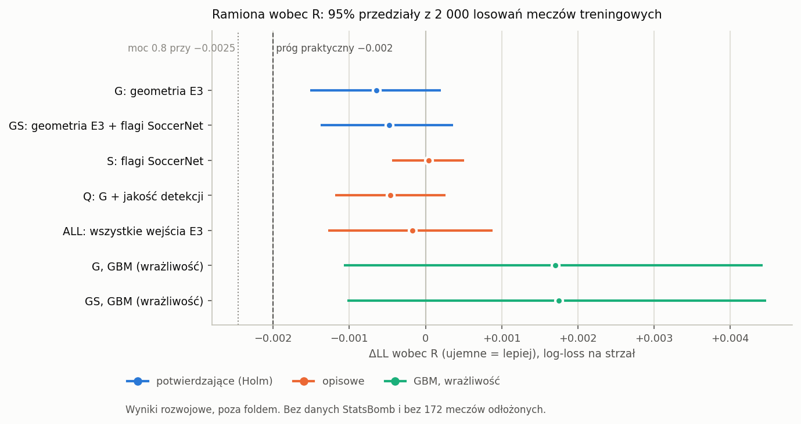

# Czy dodatkowe dane poprawiają model xG z klatki: raport fazy xg-stack (wyniki rozwojowe)

Jakub Eichner, 2026-10-14 (czas UTC). Gałąź `research/xg-detector`, faza xg-stack, tickety 01–02.

W tekście źródłowym po każdej liczbie stoi niewidoczny znacznik `<!--n:…-->`. Plik `claims.toml` obok mówi, z którego pliku wyników pochodzi liczba. Skrypt `scripts/check_xgd_audit.py` odczytuje każdą liczbę ze źródła i kończy się błędem przy niezgodności. Przedziały w nawiasach to 95%<!--n:p.ci--> przedziały percentylowe z 2 000<!--n:p.draws--> losowań meczów (seed 0) spośród 328<!--n:p.matches--> meczów treningowych.

Cały raport to wyniki rozwojowe: walidacja krzyżowa na meczach treningowych. Żaden model tej fazy nie widział danych StatsBomb ani żadnego ze 172<!--n:p.held--> meczów odłożonych. Liczby StatsBomb pojawiają się tylko w dwóch miejscach: w porównaniu z fazą xg-compare (sekcja 6) i w zastrzeżeniach (sekcja 7). Tam stoi podpis „Data: StatsBomb.”.

## 1. Odpowiedź

Pytanie właściciela z 2026-10-14: „przeprowadź eksperyment, który sprawdzi czy dodatkowe dane poprawią w jakimkolwiek stopniu jakość modelu”.

**Poprawy nie wykazano.** Ani geometria strzału z detektora (E3), ani flagi kontekstu z adnotacji SoccerNet nie poprawiły log-loss modelu z klatki w sposób, który dałoby się odróżnić od przypadku.

| ramię | co dodaje do G-combo | ΔLL wobec R | 95%<!--n:p.ci--> przedział | p jednostronne | Holm odrzuca | kandydat praktyczny |
|---|---|---|---|---|---|---|
| G | geometria E3: odległość, kąt, brak lokalizacji, brak piłki | −0.00065<!--n:rl.G.d--> | [−0.00151; +0.00020]<!--n:rl.G.ci--> | 0.070<!--n:rl.G.p--> | nie<!--n:rl.G.rej--> | nie<!--n:rl.G.pc--> |
| GS | G + flagi SoccerNet | −0.00048<!--n:rl.GS.d--> | [−0.00138; +0.00036]<!--n:rl.GS.ci--> | 0.131<!--n:rl.GS.p--> | nie<!--n:rl.GS.rej--> | nie<!--n:rl.GS.pc--> |

Ujemne ΔLL znaczy „lepiej niż R”. R to sam logit G-combo, czyli obecny model z klatki.

Jak to czytać:
- **Kierunek jest dobry, wielkość mała.** Oba ramiona mają ujemny punkt, ale oba przedziały obejmują zero. Holm przy α = 0.05<!--n:p.alpha--> nie odrzuca żadnego ramienia. Próg praktyczny ΔLL ≤ −0.002<!--n:p.prac--> jest daleko od obu punktów.
- **Co eksperyment mógł wykryć.** Symulacja z wstawionym efektem (sekcja 3.4) mówi, że poprawę rzędu ≥ 0.0025<!--n:c6.mde.abs--> ten eksperyment wykryłby z mocą około 80%<!--n:c6.mde.pow-->. Przy poprawie równej progowi praktycznemu, −0.002<!--n:p.prac-->, moc wynosiła 0.685 ± 0.033<!--n:c6.c4.power-->.
- **Czego raport nie mówi.** Nie mówi „nie ma poprawy większej niż X”. Taki zapis wymagał, żeby jednostronna granica przedziału trzymała swoje pokrycie w symulacji z efektem meczu. Nie trzymała: 0.905<!--n:ct.cov.G.pt--> dla G i 0.885<!--n:ct.cov.GS.pt--> dla GS wobec progu 0.919<!--n:ct.cov.floor--> (sekcja 3.5). Mała poprawa, poniżej około 0.0025<!--n:c6.mde.abs-->, pozostaje więc możliwa. Ten eksperyment jej nie rozstrzyga.
- **Rekomendacja.** Nie ma kandydata praktycznego, więc raport nie zaleca testu na 172<!--n:p.held--> meczach odłożonych (sekcja 9).

Pozostałe ramiona są opisowe i też nic nie pokazują: same flagi SoccerNet (S) +0.00005<!--n:rl.S.d-->, geometria z wejściami jakości detekcji (Q) −0.00046<!--n:rl.Q.d-->, wszystkie wejścia E3 (ALL) −0.00017<!--n:rl.ALL.d-->. Model GBM w miejsce regresji logistycznej jest gorszy od R: +0.0017<!--n:gb.G.d--> dla G i +0.0018<!--n:gb.GS.d--> dla GS.

## 2. Co sprawdzono

**Dane.** 7 062<!--n:p.shots--> strzałów bez rzutów karnych, w tym 902<!--n:rl.goals--> gole, z 328<!--n:p.matches--> meczów treningowych. Mecze są podzielone na 5 foldów gospodarza, tych samych co w rozwoju A1. Etykieta gola pochodzi z kolumny `goal` indeksu v1.2 i nigdy nie jest wejściem.

**Model bazowy jest zamrożony.** Wejściem każdego ramienia jest logit `z_g_combo`: uśredniony logit dziesięciu modeli G-combo spoza foldu, z pliku `results/xgd_a1_ensemble/oof.csv`. G-combo nie było uczone od nowa. Nad tym logitem stoi mały model (stacker), dopasowany osobno w każdym foldzie na czterech pozostałych i oceniany na foldzie odłożonym.

**Ramiona** (projekt rady C6, sekcja 3):

| ramię | wejścia | status |
|---|---|---|
| R | sam `z_g_combo` | odniesienie |
| G | R + odległość E3 (naturalny spline, 3 df) + kąt E3 (liniowo, zawinięty do [0, π]) + wskaźnik braku lokalizacji strzału + wskaźnik braku piłki; razem 7 kolumn | potwierdzające |
| GS | G + cztery flagi SoccerNet | potwierdzające |
| S | R + cztery flagi SoccerNet | opisowe |
| Q | G + wejścia jakości: `shot_x`, strzał z piłki, strzelec przy bramce, pewność punktów boiska, liczba punktów boiska, liczba zawodników | opisowe, tylko przedział |
| ALL | GS + Q + wszystkie pozostałe kolumny E3 z chwili strzału i z klatki 400 ms wcześniej (osiemdziesiąt sześć kolumn) | opisowe |

**Flagi SoccerNet** pochodzą z adnotacji akcji `Labels-v2.json`, z drużyny strzelca. Adnotacja „Goal” i własna adnotacja strzału nie są czytane. Flagi to:
- rzut wolny bezpośredni tej drużyny tuż przed strzałem (484<!--n:p.flag.dfk--> strzały);
- rzut wolny pośredni tej drużyny w ciągu 3 s przed strzałem (59<!--n:p.flag.ifk--> strzałów);
- rzut rożny tej drużyny w ciągu 20 s przed strzałem (884<!--n:p.flag.cor--> strzały);
- poprzedni strzał tej drużyny w ciągu 5 s przed strzałem (233<!--n:p.flag.prev--> strzały), oznaczony jako podatny na wiedzę po fakcie.

**Model stackera.** Regresja logistyczna z karą L2 na standaryzowanym projekcie, bez interakcji. Siłę kary C wybiera wewnętrzna walidacja krzyżowa po meczach w każdym foldzie treningowym, z siatki od 0.001<!--n:p.grid.lo--> do 1. Logit `z_g_combo` nie jest karany w żadnym ramieniu. Jako sprawdzian wrażliwości G i GS idą też przez GBM o głębokości 2<!--n:p.c5.gbm.depth-->, monotoniczny w `z_g_combo`.

**Odczyt.**
- ΔLL = LL(ramię) − LL(R), średni log-loss na strzał poza foldem.
- Przedział: sparowany bootstrap meczów, 2 000<!--n:p.draws--> losowań, seed 0.
- p jednostronne = (1 + liczba losowań z ΔLL ≥ 0) / (liczba losowań + 1).
- Holm nad dwoma ramionami potwierdzającymi, G i GS, przy α = 0.05<!--n:p.alpha-->. Odrzucone ramię to „wykrywalna poprawa”. Odrzucone ramię z punktem ≤ −0.002<!--n:p.prac--> to „kandydat praktyczny”.

**Czego tu nie ma.** Żadnych danych StatsBomb: ani jako wejścia, ani celu, ani kryterium wyboru. Żadnego strzału ani etykiety ze 172<!--n:p.held--> meczów odłożonych (135<!--n:p.eval--> ewaluacyjnych i 37<!--n:p.gate--> bramkowych). Pytanie „czy model jest bliżej StatsBomb” wymagałoby tych meczów, więc tu na nie nie odpowiadam.

## 3. Historia projektu: C5, nieudana kontrola pozytywna, C6

### 3.1 Projekt C5

Rada C5 zamroziła pierwszy projekt (protokół `research/xgs_stack_protocol.json`, sha256 4a00c90b<!--n:p.c5.sha-->…). G miało tam dwadzieścia jeden kolumn ponad `z_g_combo`: splajny 4 df odległości i kąta, `shot_x`, kodowanie źródła piłki, wejścia jakości detekcji i wskaźniki braków. Kara była stała, C = 1 na każdej kolumnie, także na `z_g_combo`.

Przed przebiegiem na prawdziwych etykietach protokół wymagał czterech kontroli:
1. sprawdzenia pochodzenia: tylko dozwolone kolumny, żadnych meczów odłożonych, żadnych nazw z „goal” czy „statsbomb”;
2. 200<!--n:p.reps--> symulowanych wyników bez żadnej informacji w nowych wejściach, w których Holm ma odrzucać rzadko;
3. jednego przebiegu na etykietach przemieszanych w obrębie meczów, bez odrzucenia;
4. kontroli pozytywnej: symulowanych wyników z wstawionym efektem odległości o prawdziwej wielkości −0.002<!--n:p.prac-->, którą G ma odzyskać średnio w paśmie [−0.003; −0.001]<!--n:p.c4.band-->.

### 3.2 Kontrola pozytywna C5 nie przeszła

| kontrola | wynik | kryterium | |
|---|---|---|---|
| 1 pochodzenie | wszystkie sprawdzenia przechodzą | każde sprawdzenie | przechodzi |
| 2 symulacje bez efektu | odsetek odrzuceń Holma 0.000<!--n:c5.c2.rate-->; średnie ΔLL G +0.00127<!--n:c5.c2.G-->, GS +0.00164<!--n:c5.c2.GS--> | ≤ 0.09<!--n:p.c2--> | przechodzi |
| 3 etykiety przemieszane | brak odrzucenia; ΔLL G +0.00198<!--n:c5.c3.G-->, GS +0.00219<!--n:c5.c3.GS--> | brak odrzucenia | przechodzi |
| 4 efekt wstawiony | G odzyskało średnio −0.00077<!--n:c5.c4.rec--> (SD 0.00102<!--n:c5.c4.sd-->), moc 0.105<!--n:c5.c4.power--> (GS 0.06<!--n:c5.c4.powGS-->) | średnio w [−0.003; −0.001]<!--n:p.c4.band--> | **nie przechodzi** |

Przyczyną był koszt estymacji, nie błąd w kodzie. Model wyrocznia, czyli prawdziwy model generujący ze znanymi współczynnikami, odzyskiwał na tych samych danych −0.00213<!--n:c5.c4.or-->, więc symulacja i potok liczyły dobrze. Strata G wobec wyroczni była mniej więcej równa temu, ile G płaci za swoje dwadzieścia jeden dopasowanych kolumn, gdy nowe wejścia nic nie wnoszą: średnio +0.00127<!--n:c5.c2.G--> w kontroli 2. Projekt C5 nie mógł więc wykryć efektu progu praktycznego. Zgodnie z protokołem przebieg na prawdziwych etykietach się nie odbył, a decyzja wróciła do rady.

### 3.3 Poprawka C6 i wybór na symulowanych wynikach

Rada C6 nie poluzowała kryterium. Zmieniła projekt G i ustaliła sposób wyboru, zanim cokolwiek policzono:
- **Kandydaci wypisani przed symulacją.** (b) to oszczędne G: spline odległości 3 df, kąt liniowo, jeden wskaźnik braku lokalizacji, jeden wskaźnik braku piłki, kara jak w C5. (c) to kolumny C5 z karą wybieraną wewnętrzną walidacją krzyżową i nienakładaną na `z_g_combo`. Trzeci kandydat, (b)+(c), łączy kolumny (b) z karą (c).
- **Kryterium wyboru:** moc Holma dla G, uśredniona po dwóch wstawionych efektach o prawdziwej wielkości −0.002<!--n:p.prac-->: samej odległości oraz odległości i kąta. Wybór odbywał się tylko na wynikach symulowanych, z ziarnami innymi niż w kontrolach końcowych. Remis wygrywa prostszy kandydat.
- **Przewidywanie zapisane przed symulacją.** Plan (`research/xgs_stack_c6_plan.json`, sha256 f04bb774<!--n:p.plan.sha-->…) zapisał, że (b) odzyska od −0.0017 do −0.0015<!--n:p.pred.b-->. Zaobserwowano −0.00155<!--n:se.obs.b-->, więc przewidywanie trafiło<!--n:se.held--> w pasmo.

| kandydat | moc G, efekt odległości | moc G, odległość i kąt | odzyskane ΔLL (odległość / odległość i kąt) | moc uśredniona |
|---|---|---|---|---|
| (b) | 0.440 ± 0.035<!--n:se.b.d--> | 0.390 ± 0.034<!--n:se.b.da--> | −0.00155 / −0.00158<!--n:se.b.r--> | 0.4150<!--n:se.b.avg--> |
| (c) | 0.540 ± 0.035<!--n:se.c.d--> | 0.715 ± 0.032<!--n:se.c.da--> | −0.00134 / −0.00153<!--n:se.c.r--> | 0.6275<!--n:se.c.avg--> |
| **(b)+(c)** | 0.715 ± 0.032<!--n:se.bc.d--> | 0.730 ± 0.031<!--n:se.bc.da--> | −0.00163 / −0.00169<!--n:se.bc.r--> | **0.7225<!--n:se.bc.avg-->** |

Każda komórka to 200<!--n:se.reps--> symulacji; ± to błąd Monte Carlo. Moc wyroczni wynosiła 0.875<!--n:se.orp-->: to sufit dla każdego ramienia. Wygrał kandydat (b)+(c). Jego projekt zamrożono w nowym protokole `research/xgs_stack_protocol_c6.json` (sha256 eaaa6b3b<!--n:p.c6.sha-->…), zanim jakiekolwiek ramię dopasowano do prawdziwych etykiet. Protokół C5 i jego kontrole zostały zachowane.

### 3.4 Kontrole końcowe pod C6

Wszystkie z nowymi ziarnami. Prawda symulacji to R dopasowane do prawdziwych etykiet: (a, b) = (−0.158, 0.932)<!--n:ct.a-->.

| kontrola | wynik | kryterium | |
|---|---|---|---|
| 1 pochodzenie | wszystkie sprawdzenia przechodzą | każde sprawdzenie | przechodzi |
| 2 symulacje bez efektu | odsetek odrzuceń Holma 0.000<!--n:ct.c2.rate-->; średnie ΔLL G +0.00013<!--n:ct.c2.G-->, GS +0.00019<!--n:ct.c2.GS--> | ≤ 0.09<!--n:p.c2--> | przechodzi |
| 3 etykiety przemieszane | brak odrzucenia; ΔLL G +0.00036<!--n:ct.c3.G-->, GS +0.00052<!--n:ct.c3.GS--> | brak odrzucenia | przechodzi |
| 4 efekt odległości | G odzyskało średnio −0.00159<!--n:ct.c4.rec--> (SD 0.00084<!--n:ct.c4.sd-->) | średnio w [−0.003; −0.001]<!--n:p.c4.band--> | przechodzi |

Koszt estymacji G spadł z +0.00127<!--n:c5.c2.G--> do +0.00013<!--n:ct.c2.G-->. W kontroli 4 moc G wyniosła 0.685 ± 0.033<!--n:c6.c4.power-->, GS 0.645 ± 0.034<!--n:ct.c4.powGS-->, a wyrocznia odzyskiwała −0.00214<!--n:ct.c4.or--> z mocą 0.850<!--n:ct.c4.orp-->. Przy efekcie odległości i kąta (tylko raportowany) moc G wyniosła 0.725 ± 0.032<!--n:ct.da.power-->, odzyskane −0.00165<!--n:ct.da.rec-->.

**Krzywa mocy** (efekt odległości, Holm, 200<!--n:p.reps--> symulacji na punkt):

| prawdziwe ΔLL | moc G | odzyskane ΔLL G | wyrocznia: ΔLL / moc |
|---|---|---|---|
| −0.002<!--n:ct.cv2.t--> | 0.685 ± 0.033<!--n:c6.c4.power--> | −0.00159<!--n:ct.c4.rec--> | −0.00214 / 0.850<!--n:ct.cv2.o--> |
| −0.003<!--n:ct.cv3.t--> | 0.935 ± 0.017<!--n:ct.cv3.p--> | −0.00262<!--n:ct.cv3.r--> | −0.00325 / 0.970<!--n:ct.cv3.o--> |
| −0.004<!--n:ct.cv4.t--> | 0.980 ± 0.010<!--n:ct.cv4.p--> | −0.00355<!--n:ct.cv4.r--> | −0.00418 / 0.985<!--n:ct.cv4.o--> |

Najmniejszy efekt wykrywalny z mocą 0.8<!--n:p.p80--> (interpolacja liniowa) to ΔLL ≈ −0.0025<!--n:c6.mde-->.

### 3.5 Pokrycie granicy jednostronnej

Rada C6 dodała warunek: zdanie „nie ma poprawy większej niż |granica|” wolno napisać tylko wtedy, gdy jednostronna 95<!--n:p.ci.n-->-procentowa granica obejmuje oczekiwane ΔLL ramienia w symulacjach z losowym efektem meczu. Próg to 0.95<!--n:p.floor--> minus dwa błędy Monte Carlo, czyli 0.919<!--n:ct.cov.floor-->.

| symulacja | pokrycie G | pokrycie GS | pokrycie zera (G / GS) | zapis dozwolony |
|---|---|---|---|---|
| z efektem meczu (SD 0.25<!--n:p.sd--> logit) | 0.905 ± 0.021<!--n:ct.cov.G--> | 0.885 ± 0.023<!--n:ct.cov.GS--> | 0.755 / 0.735<!--n:ct.cov.z--> | nie<!--n:ct.cov.ok--> |
| bez efektu meczu (kontrola 2) | 0.935 / 0.945<!--n:ct.ucov--> | | 0.68 / 0.69<!--n:ct.ucov.z--> | — |

W symulacjach z efektem meczu Holm nie odrzucał nigdy (odsetek 0.000<!--n:ct.cl.rate-->), więc test nie jest zbyt liberalny. Za wąska jest natomiast sama granica. Dlatego ten raport nie podaje żadnej górnej granicy poprawy jako wniosku.

## 4. Wynik przebiegu

Przebieg na prawdziwych etykietach odbył się raz, w commicie `222b2fc`, po przejściu wszystkich kontroli końcowych, bez powtórki.

Rysunek: ΔLL każdego ramienia wobec R z 95<!--n:p.ci.n-->-procentowym przedziałem. Linia przerywana to próg praktyczny, kropkowana to efekt wykrywalny z mocą 0.8<!--n:p.p80-->. Rysuje go `scripts/xgs_report.py`.

| ramię | LL | ΔLL wobec R | 95%<!--n:p.ci--> przedział | granica jednostronna 95%<!--n:p.ci--> | p jednostronne |
|---|---|---|---|---|---|
| R | 0.34305<!--n:rl.R.ll--> | — | — | — | — |
| G | 0.34241<!--n:rl.G.ll--> | −0.00065<!--n:rl.G.d--> | [−0.00151; +0.00020]<!--n:rl.G.ci--> | −0.00135<!--n:rl.G.b--> | 0.070<!--n:rl.G.p--> |
| GS | 0.34258<!--n:rl.GS.ll--> | −0.00048<!--n:rl.GS.d--> | [−0.00138; +0.00036]<!--n:rl.GS.ci--> | −0.00121<!--n:rl.GS.b--> | 0.131<!--n:rl.GS.p--> |
| S | 0.34310<!--n:rl.S.ll--> | +0.00005<!--n:rl.S.d--> | [−0.00044; +0.00050]<!--n:rl.S.ci--> | −0.00035<!--n:rl.S.b--> | 0.56<!--n:rl.S.p--> |
| Q | 0.34259<!--n:rl.Q.ll--> | −0.00046<!--n:rl.Q.d--> | [−0.00118; +0.00026]<!--n:rl.Q.ci--> | −0.00106<!--n:rl.Q.b--> | — |
| ALL | 0.34288<!--n:rl.ALL.ll--> | −0.00017<!--n:rl.ALL.d--> | [−0.00128; +0.00088]<!--n:rl.ALL.ci--> | −0.00108<!--n:rl.ALL.b--> | 0.36<!--n:rl.ALL.p--> |

Granicę jednostronną (5. percentyl bootstrapu) C5 kazała podawać przy każdym ramieniu. Z powodu sekcji 3.5 nie wolno jej czytać jako „poprawa nie większa niż”. Tylko G i GS wchodzą do Holma, a p ramion S i ALL jest opisowe.

**Pozostałe miary** (poza foldem, 7 062<!--n:p.shots--> strzałów):

| ramię | AUC | Brier | nachylenie / wyraz wolny kalibracji |
|---|---|---|---|
| R | 0.7343<!--n:rl.R.auc--> | 0.10210<!--n:rl.R.br--> | 0.987 / −0.023<!--n:rl.R.cs--> |
| G | 0.7351<!--n:rl.G.auc--> | 0.10187<!--n:rl.G.br--> | 0.987 / −0.022<!--n:rl.G.cs--> |
| GS | 0.7353<!--n:rl.GS.auc--> | 0.10194<!--n:rl.GS.br--> | 0.983 / −0.028<!--n:rl.GS.cs--> |
| S | 0.7345<!--n:rl.S.auc--> | 0.10213<!--n:rl.S.br--> | 0.983 / −0.029<!--n:rl.S.cs--> |
| Q | 0.7349<!--n:rl.Q.auc--> | 0.10195<!--n:rl.Q.br--> | 0.987 / −0.023<!--n:rl.Q.cs--> |
| ALL | 0.7334<!--n:rl.ALL.auc--> | 0.10194<!--n:rl.ALL.br--> | 0.974 / −0.044<!--n:rl.ALL.cs--> |

Różnice AUC i Briera są w czwartym miejscu po przecinku. Wszystkie ramiona są dobrze skalibrowane.

**Wybrana kara C** w pięciu foldach (mniejsze C to silniejsza kara):

| ramię | C w foldach 0–4 |
|---|---|
| G | 0.01, 0.003, 0.003, 0.003, 0.003<!--n:rl.c.G--> |
| GS | 0.003, 0.003, 0.001, 0.001, 0.001<!--n:rl.c.GS--> |
| S | 0.001, 0.003, 0.001, 0.001, 0.001<!--n:rl.c.S--> |
| Q | 0.003, 0.003, 0.001, 0.001, 0.001<!--n:rl.c.Q--> |
| ALL | 0.001, 0.001, 0.001, 0.001, 0.001<!--n:rl.c.ALL--> |

Wartość 0.001<!--n:p.grid.lo--> to najsilniejsza kara na siatce. ALL trafiło na brzeg siatki w każdym foldzie, a S, GS i Q w większości foldów. Wewnętrzna walidacja chciała więc te wejścia stłumić tak mocno, jak tylko pozwalała siatka. Inaczej jest w G: tam wybór leży wewnątrz siatki.

## 5. Ramiona opisowe i wrażliwość GBM

- **S, same flagi SoccerNet:** +0.00005<!--n:rl.S.d--> [−0.00044; +0.00050]<!--n:rl.S.ci-->. Flagi nic nie dodają do logitu z klatki. Kategorie w sekcji 6 sugerują, że rzut wolny bezpośredni model z klatki już rozpoznaje.
- **Q, geometria z wejściami jakości detekcji:** −0.00046<!--n:rl.Q.d--> [−0.00118; +0.00026]<!--n:rl.Q.ci-->, prawie to samo co G. Wejścia jakości nie dodają nic ponad geometrię.
- **ALL, wszystkie wejścia E3:** −0.00017<!--n:rl.ALL.d--> [−0.00128; +0.00088]<!--n:rl.ALL.ci-->. Bramkarz, obrońcy w stożku, liczby zawodników i klatka sprzed 400 ms nie pomagają. Kalibracja ALL jest najsłabsza ze wszystkich ramion (nachylenie i wyraz wolny 0.974 / −0.044<!--n:rl.ALL.cs-->).
- **GBM** (sprawdzian wrażliwości, z góry ustalone, że nie zmienia żadnego wniosku): G +0.0017 [−0.0011; +0.0044]<!--n:gb.G.ci--> wobec R, GS +0.0018 [−0.0010; +0.0045]<!--n:gb.GS.ci-->. Wobec logistycznego G, GBM jest gorszy o +0.0023<!--n:gb.G.dl-->, a GS o +0.0022<!--n:gb.GS.dl-->. GBM gorzej szereguje (AUC 0.7284<!--n:gb.G.auc-->) i jest przesadnie pewny siebie (nachylenie kalibracji 0.89<!--n:gb.G.cs-->). Elastyczniejszy model nie znajduje w tych wejściach niczego, czego nie znalazła regresja liniowa.

## 6. Kategorie (opisowe)

O/E to liczba goli przez sumę xG w kategorii poza foldem. O/E poniżej 1 znaczy, że model zawyża szanse, a powyżej 1, że je zaniża. Kategorie E3 są określone na 6 802<!--n:cat.e3.n--> strzałach z lokalizacją. Pozostałe 260<!--n:p.miss--> strzałów jej nie ma.

| kategoria | strzały | gole | O/E R | O/E G | O/E GS | ΔLL G w kategorii [95%<!--n:p.ci-->] |
|---|---|---|---|---|---|---|
| E3 spoza pola karnego | 2 577<!--n:cat.box.n--> | 180<!--n:cat.box.o--> | 0.87<!--n:cat.box.oe.R--> | 0.94<!--n:cat.box.oe.G--> | 0.92<!--n:cat.box.oe.GS--> | −0.0002 [−0.0013; +0.0008]<!--n:cat.box.d.G--> |
| E3 kąt < 15° | 2 553<!--n:cat.ang.n--> | 227<!--n:cat.ang.o--> | 0.84<!--n:cat.ang.oe.R--> | 0.90<!--n:cat.ang.oe.G--> | 0.89<!--n:cat.ang.oe.GS--> | −0.0004 [−0.0015; +0.0008]<!--n:cat.ang.d.G--> |
| E3 odległość < 6 m | 601<!--n:cat.d6.n--> | 127<!--n:cat.d6.o--> | 1.19<!--n:cat.d6.oe.R--> | 1.01<!--n:cat.d6.oe.G--> | 1.04<!--n:cat.d6.oe.GS--> | −0.0023 [−0.0094; +0.0049]<!--n:cat.d6.d.G--> |
| rzut rożny w ciągu 20 s | 884<!--n:cat.cor.n--> | 100<!--n:cat.cor.o--> | 0.88<!--n:cat.cor.oe.R--> | 0.85<!--n:cat.cor.oe.G--> | 0.93<!--n:cat.cor.oe.GS--> | +0.0005 [−0.0022; +0.0031]<!--n:cat.cor.d.G--> |
| rzut wolny bezpośredni | 484<!--n:cat.fk.n--> | 57<!--n:cat.fk.o--> | 1.02<!--n:cat.fk.oe.R--> | 1.03<!--n:cat.fk.oe.G--> | 1.01<!--n:cat.fk.oe.GS--> | +0.0018 [−0.0025; +0.0056]<!--n:cat.fk.d.G--> |

Co z tego wynika:
- **G przesuwa O/E w stronę 1 we wszystkich trzech kategoriach E3.** Spoza pola karnego R oczekuje 206.4<!--n:cat.box.e.R--> goli, G 192.4<!--n:cat.box.e.G-->, a padło 180<!--n:cat.box.o-->. Z ostrego kąta R oczekuje 271.4<!--n:cat.ang.e.R-->, G 252.6<!--n:cat.ang.e.G-->, a padło 227<!--n:cat.ang.o-->. Z bliska jest odwrotnie: R oczekuje 106.5<!--n:cat.d6.e.R-->, G 125.7<!--n:cat.d6.e.G-->, a padło 127<!--n:cat.d6.o-->. Geometria z detektora poprawia więc kalibrację tam, gdzie model z klatki się myli.
- **Ale żadna z tych zmian nie jest pewna.** Każdy przedział ΔLL w kategorii obejmuje zero. Poprawa kalibracji w podgrupach jest za mała albo za rzadka, żeby przesunąć log-loss całej populacji.
- **Flagi SoccerNet w kategoriach.** Po rzutach rożnych R zawyża (O/E 0.88<!--n:cat.cor.oe.R-->), a S przesuwa to do 0.93<!--n:cat.cor.oe.S--> (ΔLL S −0.0004 [−0.0025; +0.0017]<!--n:cat.cor.d.S-->). Rzuty wolne bezpośrednie R już wycenia trafnie (O/E 1.02<!--n:cat.fk.oe.R-->), więc flaga nie ma czego poprawić: ΔLL S +0.0007 [−0.0009; +0.0023]<!--n:cat.fk.d.S-->.

**Zgodność z fazą xg-compare.** Tam, na 135<!--n:p.eval--> meczach ewaluacyjnych i według kategorii StatsBomb, model z klatki zawyżał strzały spoza pola karnego (O/E 0.84<!--n:xc.box.oe-->) i strzały z kąta poniżej 15° (oczekiwał 52.0<!--n:xc.ang.e--> goli, padły 24<!--n:xc.ang.goals-->, O/E 0.46<!--n:xc.ang.oe-->). Zaniżał strzały z bliska: wśród strzałów, którym dawał najmniej xG wobec StatsBomb, strzałów z 0–6 jardów było 8.5<!--n:xc.d06--> razy więcej niż w populacji.

Data: StatsBomb.

Tu, na meczach treningowych, z kategoriami z detektora i bez StatsBomb, R ma te same trzy błędy w tych samych kierunkach, a G każdy z nich zmniejsza. Kategorie i skale obu faz są różne, więc liczby nie są porównywalne wprost. Porównywalny jest tylko kierunek.

## 7. Zastrzeżenia

Ujawnienia wymagane przez rady C5 i C6:
1. **Konfiguracja E3 była wybrana na meczach odłożonych.** Wybrano ją na 135<!--n:p.eval--> ze 172<!--n:p.held--> meczów odłożonych, według błędu pozycji wobec StatsBomb, bez wyników strzałów. Wejścia E3 nie widziały goli tych meczów, ale ich konfiguracja widziała te mecze.
2. **Pochodzenie stackowania.** Wartości `z_g_combo` w foldach treningowych stackera pochodzą z modeli, które widziały fold oceniany. To standardowy koszt stackowania na predykcjach spoza foldu.
3. **Zastrzeżenie 3 w wersji poprawionej przez C6.** `z_g_combo` to uśredniony logit przed krokiem Platta. Epokę i temperaturę każdego modelu składowego wybrano na jego własnym foldzie ocenianym, a to krok zależny od wyników. Pierwotne brzmienie z C5 („Platt dopasowany na wszystkich 7 062<!--n:p.shots--> etykietach”) było nieścisłe: ten krok działa tylko na `p_g_combo`, którego ramiona nie używają.
4. **Okna flag ukształtowano po sprawdzeniu ze StatsBomb.** Kształt okien wybrano po porównaniu czułości i precyzji flag z adnotacjami StatsBomb na 135<!--n:p.eval--> meczach ewaluacyjnych.
5. **Flagi są tylko do badań.** W produkcie wymagałyby detektora akcji, bo adnotacji SoccerNet tam nie ma.
6. **Bez progu szumu A1.** Stacker jest deterministyczny, więc progu szumu z rozwoju A1 tu nie podaję.
7. **Projekt C5 nie przeszedł kontroli pozytywnej.** Obecny projekt rada C6 wybrała spośród kandydatów wypisanych wcześniej, tylko na wynikach symulowanych (sekcja 3).
8. **Kara na brzegu siatki.** W przebiegu na etykietach przemieszanych i w ramionach S, GS, Q i ALL wewnętrzna walidacja wybierała zwykle najsilniejszą karę z siatki, 0.001<!--n:p.grid.lo-->. Siatka mogła więc być za krótka od strony silnej kary. Dla wniosku nie ma to znaczenia, bo przy silniejszej karze ramiona tym bardziej zbliżają się do R.
9. **Liczby ustalone przez agenta w planie C6.** Rada C6 nazwała raporty, ale nie podała dla nich liczb. Agent ustalił je w planie przed jakąkolwiek symulacją: najmniejszy efekt wykrywalny przy mocy 0.8<!--n:p.p80-->, próg pokrycia 0.95<!--n:p.floor--> minus dwa błędy Monte Carlo, SD efektu meczu 0.25<!--n:p.sd--> logit i 200<!--n:p.reps--> symulacji na punkt.

Data: StatsBomb.

Inne zastrzeżenia:
- **Zmiany techniczne.** Kąt zawinięto do [0, π] po dokładnym sprawdzeniu powtórzenia E3. Zmieniło to 20<!--n:p.wrap0--> strzałów w chwili strzału i 15<!--n:p.wrap4--> na klatce sprzed 400 ms. Kolumny `shooter_by_goal` i `gk_dist_goal` występują jako `shooter_by_net` i `gk_dist_net`, bo kontrola 1 zakazuje fragmentu „goal” w nazwach kolumn. `sn_team_unknown` jest stale równe 0, więc reguła zerowej wariancji je usunęła.
- **Odczyty opisowe dodane po przebiegu.** Moc na 172<!--n:p.held--> meczach (sekcja 9) i rysunek nie były w protokole. Liczy je `scripts/xgs_report.py` z plików przebiegu.
- **Przegląd tylko modelami Anthropic.** Przeglądy kodu tej fazy robił Claude, bez drugiego dostawcy.

## 8. Interpretacja

*To jest interpretacja, nie wynik. Żadna liczba tej sekcji jej nie dowodzi.*

**Dlaczego wynik jest prawdopodobnie zerowy.** Geometria E3 i model G-combo patrzą na tę samą klatkę transmisji. G-combo uczył się z całego obrazu, więc odległość i kąt są w nim już w dużej mierze zakodowane. Detektor dodaje tę samą informację drugim kanałem, z błędem lokalizacji rzędu kilku metrów. Zostaje mu tylko poprawka kalibracji w podgrupach (sekcja 6). Ta poprawka jest prawdziwa co do kierunku, ale za mała na całej populacji.

**Czego ta faza nie mogła sprawdzić.** Faza xg-compare znalazła największe luki modelu z klatki tam, gdzie potok nie umie nic zmierzyć:
- bramkarz wysunięty przed linię;
- strzelec pod presją;
- strzały głową.

E3 nie identyfikuje wiarygodnie bramkarza, nie wie, kiedy pada strzał, i nie rozpoznaje główki. Flagi SoccerNet opisują stałe fragmenty gry, a te model z klatki w dużej mierze rozpoznaje już sam (sekcja 6).

**Co byłoby potrzebne.** Praca nad percepcją, a nie nad kolejnym stackerem:
- identyfikacja bramkarza i jego pozycji;
- detektor piłki trenowany na SoccerNet, który ustala moment strzału;
- wykrywanie strzałów głową.

Dopiero wejścia, których model z klatki nie ma, mogą dać poprawę rzędu progu praktycznego.

## 9. Rekomendacja (rada C5, pytanie 6)

Rada C5 ustaliła, że test na meczach odłożonych raport może zalecić tylko dla kandydata praktycznego, czyli ramienia odrzuconego przez Holma z punktem ≤ −0.002<!--n:p.prac-->. **Takiego ramienia nie ma, więc raport nie zaleca testu na 172<!--n:p.held--> meczach.** Reguła jednego testu należy do właściciela i pozostaje nienaruszona.

Dla pełności: moc takiego testu, policzona z błędu bootstrapu tego przebiegu. Błąd przeskalowano do populacji testowej (3 819<!--n:pt.shots--> strzałów w 172<!--n:pt.matches--> meczach) przez pierwiastek ze stosunku liczby strzałów. Prawdopodobieństwo sukcesu, czyli górnej granicy przedziału poniżej zera, pochodzi z przybliżenia normalnego, jak przy teście A1:

| ramię | błąd na teście | przy prawdziwym ΔLL = punkt z tego przebiegu: jeden wariant / dwa z Bonferronim | przy prawdziwym ΔLL = −0.002<!--n:p.prac-->: jeden / dwa |
|---|---|---|---|
| G | 0.00058<!--n:pt.G.se--> | 0.20<!--n:pt.G.obs1--> / 0.13<!--n:pt.G.obs2--> | 0.93<!--n:pt.G.prac1--> / 0.88<!--n:pt.G.prac2--> |
| GS | 0.00059<!--n:pt.GS.se--> | 0.12<!--n:pt.GS.obs1--> / 0.07<!--n:pt.GS.obs2--> | 0.92<!--n:pt.GS.prac1--> / 0.87<!--n:pt.GS.prac2--> |

Jeśli prawdziwa poprawa jest taka jak tu zmierzona, test wykryłby ją w co piątym przypadku albo rzadziej. Liczby przy −0.002<!--n:p.prac--> są optymistyczne: stacker odzyskuje tylko część prawdziwego efektu (−0.00159<!--n:ct.c4.rec--> z −0.002<!--n:p.prac--> w kontroli 4). Przybliżenie pomija też to, że ramię w teście byłoby dopasowane na wszystkich 328<!--n:p.matches--> meczach, a nie na czterech foldach. Reguła testu jest przy tym surowsza niż odczyt rozwojowy: sukces wymaga górnej granicy przedziału dwustronnego poniżej zera, a nie jednostronnego p z Holmem. Do tego zastrzeżenie członka S rady C5: konfigurację E3 wybrano na 135<!--n:p.eval--> z tych 172<!--n:p.held--> meczów, więc test na nich nie byłby całkiem czysty.

## 10. Otwarte punkty dla właściciela

1. **Zamknięcie linii stackera.** Ta faza i A1 dają ten sam obraz: wejścia z detektora nie poprawiają wykrywalnie modelu z klatki. Raport proponuje nie rozwijać dalej wejść geometrycznych nad G-combo.
2. **Praca nad percepcją** (sekcja 8): bramkarz, detektor piłki i moment strzału, główki. Każde z nich to osobna faza z własnym kryterium.
3. **Test na meczach odłożonych:** niezalecany (sekcja 9). Decyzja należy do właściciela.
4. **Przegląd termonuklearny** uruchamia właściciel.

## Źródła i sumy kontrolne

| Plik | SHA-256 | Zawartość |
|---|---|---|
| `research/xgs_stack_protocol_c6.json` | `eaaa6b3bae695e24d98624c24086e8f8d3efeb248d4ea6fa8f2b17b0bccf20ae` | zamrożony protokół C6 (ticket 01): projekt, ramiona, kontrole, ujawnienia |
| `research/xgs_stack_protocol.json` | `4a00c90b3841b757076c8bea7847901078cd0effe084fa040701c069fa81d03d` | zamrożony protokół C5 (ticket 01), zachowany |
| `research/xgs_stack_c6_plan.json` | `f04bb774dc35ad99e56816f5641110d5872dbdcdd62672050ca86dda0059edb2` | plan wyboru C6, zapisany przed symulacjami |
| `results/xgs_stack/c5_controls/controls.json` | `d879cec757f6bff30db96c8558bf24e28a759ced3c3899c964f3b6f440aa006b` | ticket 01: kontrole C5 (kontrola 4 nie przeszła) |
| `results/xgs_stack/selection/selection.json` | `2e6094e206a1b24cf2392d7379f92ccc3d1258b00fbd8438ff8ce9ce83bfb642` | ticket 01: wybór kandydata na wynikach symulowanych |
| `results/xgs_stack/controls/controls.json` | `825b9d7319fa433a451eeb932469a5efae231fe0aafdf8810a546c4b6b5d7339` | ticket 01: kontrole końcowe C6, krzywa mocy, pokrycie |
| `results/xgs_stack/real/summary.json` | `e3245585febac3998900df55d51d3fab2035d54a53878dff984019d0e2a9234b` | ticket 02: przebieg na prawdziwych etykietach |
| `results/xgs_stack/real/categories.csv` | `38d76142fa9652d947ae2c9d4984d3e317a0d3616f65053c49e8b040b7efc910` | ticket 02: kategorie (opisowe) |
| `results/xgs_stack/report/power.json` | `733ca78e81958a5dabbf51eda91c80ea345911c80c4dfff96fe11b2a8550de4f` | ticket 03: moc na 172<!--n:p.held--> meczach (opisowa, dodana po przebiegu) |
| `results/xgc_compare/analysis/who_is_right.csv` | `5e718f670ca50a26163824c493f651dcebdc18c45db204f11641771a60d25dba` | xg-compare, ticket 02: O/E według kategorii StatsBomb |
| `results/xgc_compare/analysis/disagreement_profile.csv` | `75655a52d3924ed282a64bc78c4eb44184c14275b7b6ab775d05128900fb2cfe` | xg-compare, ticket 02: profil rozbieżności |
