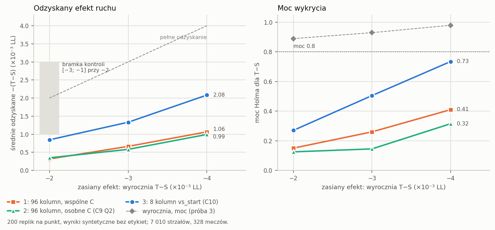
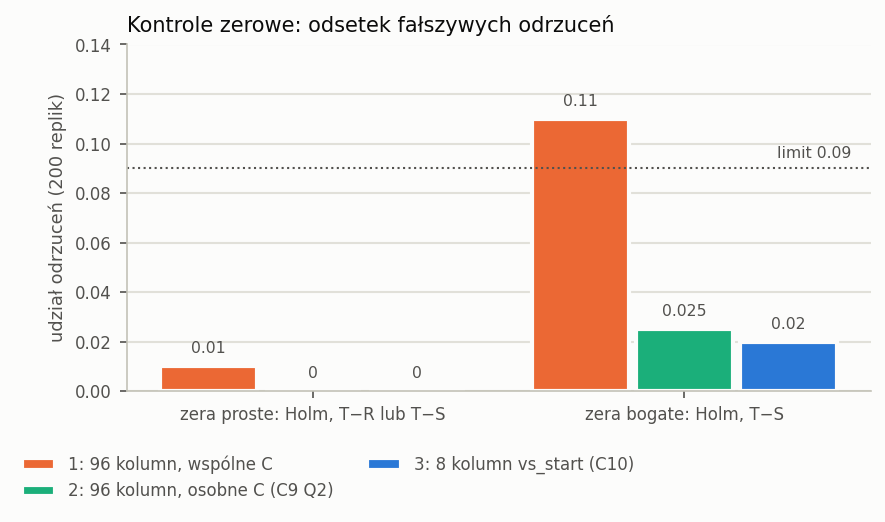

# Czy ruch przed kontaktem dodaje coś do G-combo: raport zamknięcia fazy xg-temporal

Jakub Eichner, 2026-10-28. Gałąź `research/xg-detector`, faza xg-temporal, tickety 01–03 wykonane, ticket 05 (ten raport). Faza zamknięta decyzją właściciela z 2026-10-28, **bez żadnego eksperymentu ani analizy na prawdziwych etykietach wyniku**. Jedyny kontakt z etykietami to incydent z ticketu 01b (dwa wypisane przypadkiem, nieużyte wiersze z kolumną `goal`), opisany w sekcji 7.

W tekście źródłowym po każdej liczbie stoi niewidoczny znacznik `<!--n:…-->`. Plik `claims.toml` obok mówi, z którego pliku wyników pochodzi liczba. Skrypt `scripts/check_xgd_audit.py` odczytuje każdą liczbę ze źródła i kończy się błędem przy niezgodności. Wszystkie źródła są bez etykiet: wyniki syntetyczne kontroli, maski klatek, logity modelu i odpowiedzi AI o czasie kontaktu. Ujemne ΔLL znaczy „lepiej”.

## 1. Werdykt

**H1 i H2 nie zostały przetestowane.** Metoda trzy razy nie przeszła własnej, zapisanej z góry kontroli pozytywnej. Przebieg na prawdziwych etykietach nie rozstrzygnąłby więc niczego: metoda, która w symulacji nie odzyskuje zasianego efektu, nie może na danych ani go potwierdzić, ani wykluczyć.

| | H1: T lepsze od R | H2: T lepsze od S („ruch pomaga”) |
|---|---|---|
| status | nie testowano | nie testowano |
| powód | kontrola pozytywna nie przeszła trzy razy (sekcja 5) | jak obok |

**Co to znaczy.** Przy 7 010<!--n:pop.shots--> strzałach z 328<!--n:pop.matches--> meczów (około 931<!--n:pop.xg--> oczekiwanych goli według samego G-combo, 13.3%<!--n:pop.xgrate--> strzałów) liniowa głowa na tych embeddingach odzyskuje tylko od 16%<!--n:rp.share.min--> do 42%<!--n:rp.share.max--> prawdziwego efektu ruchu wielkości −0.002<!--n:k.t2--> LL. Żaden badany efekt, aż do −0.004<!--n:k.t4-->, nie osiąga mocy 80%<!--n:k.pow-->. Najwyższa moc we wszystkich trzech próbach to 0.735<!--n:rp.maxpow-->.

**Czego to nie znaczy.** To nie jest dowód, że ruch przed kontaktem nie niesie informacji o golu. Żadna analiza nie użyła etykiet, a kontrola mówi o mocy metody, nie o danych.

**Granica sformułowań (C10, zdanie odrębne S).** Nawet gdyby kontrola C10 przeszła, projekt pozwalałby co najwyżej na zdanie „brak sygnału ruchu w tych 8 kierunkach” (zmiana o_max − start składowych pc01..pc08), nigdy „brak sygnału ruchu”. Kontrola nie przeszła, więc raport nie formułuje nawet tego.

## 2. Pytanie i plan

Pytanie specu: czy mała głowa czasowa na embeddingach G-combo z klatek sprzed kontaktu (okno −1600…−600 ms, siatka co 200 ms, sześć klatek) obniża out-of-fold log-loss G-combo na meczach treningowych?

- **R:** sam logit `z_g_combo` (out-of-fold, foldy xgv).
- **S:** R plus PCA-32 embeddingu w o_max = −600 ms i wskaźniki braku klatek. Kontrola statyczna.
- **T:** S plus kolumny ruchu. Kontrast T − S oddziela ruch od samej wcześniejszej klatki.
- Odczyt: ΔLL z bootstrapem po meczach, Holm nad {T − R, T − S}, próg praktyczny −0.002<!--n:k.t2-->.
- k = 32<!--n:k.k-->, ustalone bez etykiet; k = 16 i k = 64 tylko opisowo.

Przed jakimkolwiek odczytem etykiety protokół wymagał kontroli bez etykiet: proweniencji, zer syntetycznych (prostych i bogatych) i kontroli pozytywnej z zasianym efektem ruchu. Protokół `research/xgt_protocol.json` nigdy nie został zamrożony, bo kontrole nie przeszły.

## 3. Dane i proweniencja (tickety 01, 01b)

- **Populacja P_G:** strzały roli `training` z co najmniej jedną użyteczną klatką w oknie: 7 010<!--n:pop.shots--> z 7 062<!--n:pop.base--> strzałów bez karnych, 328<!--n:pop.matches--> meczów, 6 620<!--n:pop.complete--> z kompletem klatek. Zgadza się z tabelą pokrycia specu.
- **Embeddingi xgv (ticket 01b):** policzone modelem G-combo foldu xgv, który wstrzymał mecz strzału (dziesięć bundli z `results/xgv_g_combo`, te same modele co `z_g_combo`). Bez treningu, tylko ekstrakcja: 77 304<!--n:em.frames--> klatek w jedenastu offsetach (−1600…+400 co 200 ms), 2 148<!--n:em.sec--> s GPU pod blokadą `agent-state`, szczyt 3.92<!--n:em.gpu--> GB. Wszystkie mecze mają rolę `training` (328<!--n:em.roles--> meczów), a fold każdego embeddingu to fold xgv meczu.
- **Zgodność z `z_g_combo` w offsecie 0:** `xg_logit` z klatki PNG klipu a `z_g_combo` z klatki JPEG indeksu, na 7 056<!--n:em.d0.n--> strzałach: średnio |Δlogit| 0.077<!--n:em.d0-->, maksymalnie 0.84<!--n:em.d0.max-->, r 0.993<!--n:em.r-->. Różnica pochodzi z wejścia (PNG kontra JPEG). Kontrola potoku na tych samych klatkach JPEG co indeks (120<!--n:em.jpeg.n--> strzałów) przeszła z różnicą rzędu milionowych części logitu.
- **PCA:** 32<!--n:k.k--> składowe wyjaśniają średnio 0.762<!--n:pop.pca32--> wariancji klatek okna na foldach treningowych.

Dzięki embeddingom xgv S i R pochodzą z tego samego zestawu modeli, a populacja obejmuje wszystkie mecze. Zastrzeżenie o proweniencji embeddingów xgc (foldy v1.2) dotyczyło tylko replikacji opisowej z ticketu 09, której nie uruchomiono.

## 4. Granica o_max = −600 ms (ticket 02) i decyzja właściciela

Reguła zapisana przed oznaczaniem (`research/xgt_safe_margin_rule.md`, sha256 `5522847a…`, commit `2a47728`): −600 przechodzi, gdy jednostronna górna granica 95%<!--n:sm.ci--> Cloppera–Pearsona udziału strzałów uderzonych już w −600 ms wynosi najwyżej 5%<!--n:sm.max-->. Dwa niezależne przebiegi AI na 120<!--n:sm.n--> losowych strzałach treningowych, tylko klatki ≤ 0; niezgodność albo „nie wiem” liczy się jako naruszenie.

- **Wynik: STOP.** 5<!--n:sm.v--> naruszeń na 120<!--n:sm.n-->, granica 8.56%<!--n:sm.cp--> > 5%<!--n:sm.max-->.
- Żaden przebieg nie odpowiedział „tak” w −600 ms (0<!--n:sm.yes--> zgodnych „tak”). Wszystkie naruszenia to „nie wiem” jednego przebiegu przy „nie” drugiego.
- Zgodność przebiegów w −600 ms 95.8%<!--n:sm.agree-->, kappa −0.02<!--n:sm.kappa--> (prawie same „nie”, więc kappa niewiele mówi).
- Opisowo: −800 ms 4<!--n:sm.v800--> naruszenia (granica 7.47%<!--n:sm.cp800-->), −400 ms 6<!--n:sm.v400--> (9.63%<!--n:sm.cp400-->). Przesunięcie na wcześniej nie pomaga.
- Walidacja rozrzutu (D6): 96.6%<!--n:sm.d6--> z 2 754<!--n:sm.d6.n--> sparowanych strzałów w ±200 ms; nie zmienia reguły.

**Decyzja właściciela (2026-10-25):** o_max zostaje −600 mimo STOP. To odstępstwo od zapisanej reguły stopu. Wrażliwość na granicę miała pokazać siatka ticketu 07, której nie uruchomiono, więc pozostaje niezbadana.

## 5. Kontrole bez etykiet: trzy próby (ticket 03)

### 5.1 Co sprawdzają kontrole

Każda kontrola to 200<!--n:k.reps--> replik z wynikami syntetycznymi y* losowanymi z prawdopodobieństw G-combo, z tym samym kodem dopasowania i odczytu co przebieg na etykietach.

- **Zera proste:** y* ~ Bernoulli(σ(z_g_combo)). Odsetek replik z odrzuceniem Holma (T − R albo T − S) musi wynosić najwyżej 0.09<!--n:k.null-->.
- **Zera bogate (C8 Q3):** y* ~ Bernoulli(σ(z_g_combo + u)), gdzie u to stała losowa projekcja statycznych cech PCA. S ma co znaleźć, T nic ponad S. Odsetek odrzuceń T − S najwyżej 0.09<!--n:k.null-->.
- **Kontrola pozytywna:** efekt zasiany w kombinację kolumn ruchu, zresidualizowaną na wejściach S, tak żeby wyrocznia T − S wynosiła −0.002<!--n:k.t2-->. Bramka: średnie odzyskane T − S w [−0.003; −0.001]<!--n:k.gate-->. Punkty −0.003<!--n:k.t3--> i −0.004<!--n:k.t4--> dają krzywą mocy.

### 5.2 Trzy próby

| | próba 1 | próba 2 (remedy C9 Q2) | próba 3 (C10) |
|---|---|---|---|
| T | S + 96 kolumn ruchu (vs_start, vs_mid, nachylenie pc01..pc32), jedno C | jak 1, osobne C bloku ruchu | S + 8 kolumn: vs_start pc01..pc08, osobne C |
| kod, katalog | `cded06d`, `label_free` | `8e5da29`, `label_free_remedy` | `44c41f8`, `label_free_c10` |
| proweniencja | przeszła | przeszła | przeszła |
| zera proste (≤ 0.09<!--n:k.null-->) | 0.010<!--n:c1.plain--> | 0.000<!--n:c2.plain--> | 0.000<!--n:c3.plain--> |
| zera bogate, T − S (≤ 0.09<!--n:k.null-->) | **0.110<!--n:c1.rich-->** | 0.025<!--n:c2.rich--> | 0.020<!--n:c3.rich--> |
| odzyskane T − S przy −0.002<!--n:k.t2--> | **−0.00032<!--n:c1.m2-->** | **−0.00035<!--n:c2.m2-->** | **−0.00085<!--n:c3.m2-->** |
| udział odzyskany | 16%<!--n:rp.c1.s2--> | 17%<!--n:rp.c2.s2--> | 42%<!--n:rp.c3.s2--> |
| moc Holma T − S przy −0.002<!--n:k.t2--> | 0.150<!--n:c1.m2.p--> | 0.125<!--n:c2.m2.p--> | 0.270<!--n:c3.m2.p--> |
| moc wyroczni przy −0.002<!--n:k.t2--> | 0.895<!--n:c1.m2.o--> | 0.875<!--n:c2.m2.o--> | 0.890<!--n:c3.m2.o--> |
| odzyskane T − S przy −0.003<!--n:k.t3--> | −0.00066<!--n:c1.m3--> | −0.00058<!--n:c2.m3--> | −0.00133<!--n:c3.m3--> |
| moc przy −0.003<!--n:k.t3--> | 0.260<!--n:c1.m3.p--> | 0.145<!--n:c2.m3.p--> | 0.505<!--n:c3.m3.p--> |
| odzyskane T − S przy −0.004<!--n:k.t4--> | −0.00106<!--n:c1.m4--> | −0.00099<!--n:c2.m4--> | −0.00208<!--n:c3.m4--> |
| udział odzyskany przy −0.004<!--n:k.t4--> | 27%<!--n:rp.c1.s4--> | 25%<!--n:rp.c2.s4--> | 52%<!--n:rp.c3.s4--> |
| moc przy −0.004<!--n:k.t4--> | 0.410<!--n:c1.m4.p--> | 0.315<!--n:c2.m4.p--> | 0.735<!--n:c3.m4.p--> |
| roślina pc01 przy −0.002<!--n:k.t2--> (opisowo) | −0.00073<!--n:c1.pc01--> | −0.00067<!--n:c2.pc01--> | −0.00116<!--n:c3.pc01--> |
| C bloku ruchu na dnie siatki (kontrola pozytywna) | 0.12<!--n:c1.floor.T--> | 0.08<!--n:c2.floor.T--> | 0.04<!--n:c3.floor.T--> |
| czas CPU | 5 581<!--n:c1.sec--> s | 2 764<!--n:c2.sec--> s | 804<!--n:c3.sec--> s |
| wynik | nie przeszła (pozytywna, zera bogate) | nie przeszła (pozytywna) | nie przeszła (pozytywna) |

Pogrubione wartości to bramki, które nie przeszły. „Udział odzyskany” to średnie odzyskane T − S podzielone przez wyrocznię T − S zasianej rośliny. Zasiana roślina w próbach 1 i 2 jest kombinacją 96 kolumn ruchu (C9 Q1), w próbie 3 kombinacją 8 kolumn nowego T (C10 Q2). Nie są to więc te same rośliny, a próby 1–2 i 3 różnią się trudnością zadania.

W próbie 3 odzyskane T − S przy −0.002<!--n:k.t2--> ma SD 0.00077<!--n:c3.m2.sd--> między replikami, a moc ma błąd Monte Carlo 0.031<!--n:c3.m2.pse-->. Chybienie bramki nie jest więc szumem symulacji. T − R w tej samej kontroli: −0.00075<!--n:c3.m2.tr-->.

### 5.3 Ścieżka decyzji

- **C8 (2026-10-25), przed kontrolami:** siatka kary rozszerzona w dół, o_max −400 jako wiersz kontroli przecieku, bogate zera jako bramka T − S. Warunek: chybienie przez skurczenie idzie do rady jako pytanie o projekt, nie jako błąd kodu.
- **Próba 1:** pozytywna chybiła przez skurczenie (−0.00032<!--n:c1.m2-->, powyżej −0.001<!--n:k.lo-->). Zera bogate odrzucały T − S w 0.110<!--n:c1.rich--> replik (błąd MC 0.022<!--n:c1.rich.se-->), średnio T − S +0.00014<!--n:c1.rich.d-->: koszt jednej kary wspólnej dla bloku statycznego i ruchu.
- **C9 Q2 (zapisane z góry remedy):** T bierze C bloku statycznego z S i wybiera osobne C bloku ruchu tą samą wewnętrzną CV. Wszystkie bramki od nowa na świeżych ziarnach; drugie chybienie zatrzymuje fazę.
- **Próba 2:** zera bogate naprawione (0.025<!--n:c2.rich-->), pozytywna chybiła znowu (−0.00035<!--n:c2.m2-->). Faza stanęła. Właściciel (2026-10-28) wybrał przeprojektowanie zamiast zamknięcia.
- **C10 (2026-10-28):** T = S + 8 kolumn (o_max − start dla pc01..pc08), roślina bramkująca w tym bloku, roślina C9 tylko opisowo, bez wstępnej selekcji projektu, osobne C zostaje. Chybienie zamyka fazę bez odczytu etykiet.
- **Próba 3:** zera przeszły, pozytywna chybiła (−0.00085<!--n:c3.m2--> przy bramce ≤ −0.001<!--n:k.lo-->). Właściciel zamknął fazę. Ticket 04 oraz tickety 07–09 mają status `wontfix`.

### 5.4 Przewidywania a wyniki

Przewidywanie zapisano przed przebiegiem próby 3 (ticket 03) (miejsce V w radzie C10):

| roślina przy −0.002<!--n:k.t2--> | przewidywane T − S | odzyskane T − S |
|---|---|---|
| w bloku 8 kolumn (bramka) | −0.0016 do −0.0013<!--n:rp.pred--> | −0.00085<!--n:c3.m2--> |
| rozproszona roślina C9 (opisowo) | −0.0006<!--n:rp.pred.dif--> | −0.00012<!--n:c3.dif--> |

Oba wyniki wyszły słabsze od przewidywania. Przewidywanie dla rośliny C9 opierało się na tym, że blok 8 kolumn obejmuje 0.31<!--n:k.span--> jej wariancji; odzyskano 6%<!--n:rp.dif.s--> jej efektu, przy mocy 0.045<!--n:c3.dif.p-->. Miejsce S w radzie C10 przewidywało dla szerszego projektu (vs_start na wszystkich składowych) odzyskanie poniżej bramki; ta liczba jest tylko w notatce rady (`.scratch`), nie w pliku wyników, więc raport jej nie podaje.

### 5.5 Odzyskanie i moc na figurze

Po lewej średnie odzyskane T − S wobec zasianej wyroczni, z linią pełnego odzyskania i bramką. Po prawej moc Holma dla T − S i moc wyroczni (próba 3). Moc wyroczni to test wyroczni względem R bez korekty Holma, więc nie jest wprost porównywalna z krzywymi głowy; oś opisuje tylko te ostatnie. Krzywe rosną z efektem, ale żadna krzywa dopasowanej głowy nie dochodzi do mocy 0.8<!--n:k.pow8-->. Próba 3 odzyskuje około dwa razy więcej niż próby 1–2, i to w łatwiejszym zadaniu (roślina w bloku T).

Od próby 2 kontrole zerowe (proste, bogate i z efektem meczu) mieszczą się w zapisanych z góry progach. Kontrolą, która nie przeszła, jest kontrola mocy.

## 6. Czego nie uruchomiono i dlaczego

Każda pozycja poniżej wymagała etykiet albo przebiegu z ticketu 04, a ten był warunkowany zaliczonymi kontrolami.

| pozycja checklisty ticketu 05 | status |
|---|---|
| wyniki główne H1, H2 (ticket 04) | nie uruchomiono: kontrola pozytywna nie przeszła |
| krzywa przecieku S − R, T − R, T − S i kontrola metody S − R przy +400 | nie uruchomiono (ticket 04) |
| weto czytelności celności (AUC przyrostu T − S względem `on_target`) | nie uruchomiono: wymaga etykiet |
| kategorie detektora E3 | nie uruchomiono: wymaga etykiet |
| siatka okna (ticket 07) | `wontfix` |
| sieć sekwencyjna N (ticket 08) | `wontfix` |
| arm L, embeddingi xgc, zamrożony DINOv2 (ticket 09), w tym liczba meczów ewaluacyjnych z modeli v1.2 | `wontfix`; obliczenia nie zapisano |
| wrażliwość k = 16 i k = 64 | nie uruchomiono |
| permutacja etykiet w meczach | nie uruchomiono: wymaga zamrożonego protokołu |
| zamrożenie `research/xgt_protocol.json` | nie zamrożono |

Wcześniejszy test z 2026-10-15 (uśrednianie logitów klatek sprzed strzału, `results/preshot_frames_2026_10`, commit `2281fc1`) zostaje jedynym odczytem na etykietach w tym temacie. Jego populacja obejmuje mecze wstrzymane, a test łączył logity, nie embeddingi. Raport nie podaje jego liczb, bo to wynik z etykietami spoza tej fazy.

## 7. Ujawnienia

- **Dwa wiersze z kolumną `goal` (ticket 01b).** Przy sprawdzaniu formatu pliku `results/xgv_g_combo/fold0/seed0/*_valid_predictions.csv` agent przygotowania wypisał nagłówek i 2 wiersze. Plik ma kolumnę `goal`, więc dwa wyniki strzałów treningowych trafiły do logu. Nie wykorzystano ich; kod xgt tych plików nie czyta (`oof.csv` tylko z kolumnami `shot_id` i `z_g_combo`).
- **Ticket 02 pominął 5<!--n:sm.skip--> kontaktów** z przeglądu v1.5, bo pochodzą z meczów ewaluacyjnych (zasada: nic z meczów wstrzymanych). Liczono je tylko z kolumny `game`, czasów nie wczytano. Tabela dowodów zawiera 11<!--n:sm.gsr--> kopnięć GSR i 12<!--n:sm.v15--> kontaktów v1.5 z meczów treningowych, opisowo.
- **Ticket 02 STOP i odstępstwo od reguły stopu** (sekcja 4): o_max −600 utrzymane decyzją właściciela.
- **Dryf PCA w roślinach.** Rośliny kontroli pozytywnej i projekcja bogatych zer powstają na jednym PCA dopasowanym do wszystkich klatek okna populacji. Kolumny ruchu T pochodzą z PCA dopasowanego osobno w każdym foldzie treningowym (i w każdym wewnętrznym foldzie). Roślina leży więc w przestrzeni T tylko w przybliżeniu. Kontrola sprawdza potok, nie wykrywalność prawdziwego ruchu (C9, zastrzeżenie S). Część braku odzyskania może wynikać z tego dryfu; nie zmierzono, jaka.
- **Próby są adaptacyjne.** Każda zmiana projektu (wspólne C, potem osobne C, potem 8 kolumn) zapadła przed odczytem jakiejkolwiek etykiety, na podstawie wyników poprzedniej kontroli bez etykiet. Kolejne próby nie są jednak niezależne: projekt próby 3 dobrano po zobaczeniu, gdzie metoda traci moc w próbach 1 i 2, a rada C10 wybrała roślinę bramkującą w bloku nowego T, czyli łatwiejsze zadanie. Każda próba ma świeże ziarna, a ślad poprzednich chybień jest zapisany w `complete.json` próby 3.
- **Oznaczanie AI (ticket 02)** robiły dwa modele (przebieg A jednym, przebieg B mieszanką dwóch, decyzja Jakuba z 2026-10-25), bez kontroli człowieka.
- **Oczekiwane gole zamiast goli.** Liczba goli w P_G nie jest w żadnym pliku bez etykiet. Raport podaje sumę σ(`z_g_combo`) po P_G, czyli liczbę goli oczekiwaną przez sam G-combo.

## 8. Ograniczenia

- Kontrola pozytywna mierzy moc dla jednej klasy efektu: liniowej kombinacji kolumn PCA, zresidualizowanej na S. Prawdziwy sygnał ruchu może być nieliniowy, rzadki albo leżeć poza 32<!--n:k.k--> składowymi PCA; o takich efektach kontrole nic nie mówią, w żadną stronę.
- Wielkość efektu jest wyrażona wyrocznią ΔLL, nie rzeczywistym zyskiem. Sufity z `.scratch/xg-image-info` to szacunki pełnej informacji, a nie tego, co widać w embeddingu G-combo; ten raport ich nie sprawdza.
- Pokrycie granicy jednostronnej pod zerami z efektem meczu wyszło w próbie 3 0.940<!--n:c3.cov--> dla T − S, ale bez przebiegu na etykietach nie ma granicy do raportowania.
- Wszystko dotyczy jednego okna (−1600…−600 ms), jednego o_max i jednego enkodera (G-combo xgv, ziarno 0).
- Embeddingi G-combo uczono na pojedynczej klatce strzału. Nie ma gwarancji, że kodują ruch w sposób liniowo czytelny między klatkami.

## 9. Co dalej: rekomendacja dla właściciela

**Rekomendacja: nie wracać do głowy czasowej na tych embeddingach przy obecnych danych.** Trzy projekty liniowej głowy na tych samych 7 010<!--n:pop.shots--> strzałach dały od 16%<!--n:rp.share.min--> do 42%<!--n:rp.share.max--> odzyskania przy −0.002<!--n:k.t2-->. To nie jest granica dla innych projektów, ale żaden z trzech nie zbliżył się do bramki z zapasem, a każda kolejna próba na tych samych danych zwiększa adaptacyjność protokołu.

**Ile danych by było trzeba (ekstrapolacja, nie wynik).** Założenia: udział odzyskanego efektu zostaje jak teraz, SD odzyskanego T − S maleje jak 1/√N, a zależność mocy od stosunku efektu do SD zostaje taka jak w danym punkcie krzywej. Wtedy do mocy 0.8<!--n:k.pow8--> projekt C10 potrzebowałby mniej więcej:

| prawdziwy efekt w bloku 8 kolumn | strzałów | meczów (przy 21.4<!--n:pop.spm--> strzału na mecz) |
|---|---|---|
| −0.002<!--n:k.t2--> | około 38<!--n:rp.x2.n--> tys. (5.4<!--n:rp.x2.f-->× obecnej próby) | około 1 775<!--n:rp.x2.m--> |
| −0.003<!--n:k.t3--> | około 16<!--n:rp.x3.n--> tys. | około 732<!--n:rp.x3.m--> |
| −0.004<!--n:k.t4--> | około 8.6<!--n:rp.x4.n--> tys. | około 403<!--n:rp.x4.m--> |
| −0.002<!--n:k.t2-->, rozproszony jak roślina C9 | około 781<!--n:rp.xd.n--> tys. | około 36 540<!--n:rp.xd.m--> |

Dla porównania projekt z 96 kolumnami (próba 2) przy −0.004<!--n:k.t4--> potrzebowałby około 34<!--n:rp.xr.n--> tys. strzałów (1 602<!--n:rp.xr.m--> mecze). Przy większej próbie mniej traci się na skurczeniu, więc udział odzyskany powinien rosnąć; liczby dla rośliny w bloku są raczej górnym oszacowaniem. Wiersz rozproszony mówi tylko tyle, że liniowa głowa nie dosięgnie takiego efektu na żadnej realnej próbie. Ekstrapolacja opiera się na trzech punktach po 200<!--n:k.reps--> replik i nie powinna służyć do planowania bez nowej symulacji.

**Co mogłoby zmienić moc:**
- **Nowe dane.** Efekt −0.002<!--n:k.t2--> w bloku wymagałby kilkukrotnie więcej meczów niż mamy, rzędu tysiąca lub więcej meczów ze strzałami i klipami. Same nowe mecze do testu potwierdzającego (D7) nie mają sensu, dopóki nie ma kandydata.
- **Inne wejście zamiast innej głowy.** Embedding G-combo z jednej klatki jest pośrednim nośnikiem ruchu. Bezpośrednie, niskowymiarowe cechy ruchu z detektora (tor bramkarza, odległość i prędkość najbliższego obrońcy, feature-ideas §4–5) mają kilka kolumn zamiast 8 albo 96 kolumn i trafiają tam, gdzie G-combo się myli. Taka faza potrzebuje własnej kontroli pozytywnej, ale koszt estymacji kilku kolumn jest mały.
- **Sieć sekwencyjna (arm N) nie jest odpowiedzią na moc.** Ma więcej parametrów niż liniowa głowa, więc przy tej samej liczbie goli traci więcej na estymacji.

**Otwarte punkty dla właściciela:**
1. Czy zamknąć temat modelu klipowego do czasu nowych danych (rekomendacja: tak)?
2. Czy następna faza o ruchu ma iść przez cechy z detektora zamiast embeddingów?

## Źródła i sumy kontrolne

| plik | SHA-256 | opis |
|---|---|---|
| `results/xgt_inputs_xgv/summary.json` | `dd1e2218da12b96eb902adc3a8a771429c47727bf3a01f4f1dfa91fe3452a890` | tickety 01/01b: populacja P_G na embeddingach xgv, PCA |
| `results/xgt_xgv_embeddings/complete.json` | `70930f71a122a230625ed4bed24300c4f7ec617660dd6aeac104d3ffb69a7371` | ticket 01b: ekstrakcja, zgodność z `z_g_combo`, role |
| `results/xgt_safe_margin/result.json` | `6a1ca0e145ad0cd9aae5ba1fd6e7a6a9ca1e5bda8099d4e546f8b73c387f5551` | ticket 02: sprawdzenie o_max −600 |
| `results/xgt/controls/label_free/controls.json` | `ecbe44c203ac3dd7ccb0f9084f154e052c7b95a2d537a617833566edeffd08ff` | ticket 03, próba 1 |
| `results/xgt/controls/label_free_remedy/controls.json` | `4bb1a75712b5b1f0c600396438e757e3c69171823f5e3339bc0d0ac8d10973ba` | ticket 03, próba 2 (remedy C9 Q2) |
| `results/xgt/controls/label_free_c10/controls.json` | `218d42fb7c2634971b995e0555c0b2d601eca1d8f23774a4ce9fed5e673d40a9` | ticket 03, próba 3 (C10) |
| `results/xgt/controls/label_free_c10/complete.json` | `5469aa8c460982d7dfe7ea49d7b76dedb12e99ede0bbac971f0a7c5d9d44f530` | ticket 03, rekord próby 3: przewidywanie, ślad prób |
| `results/xgt_report/readings.json` | `32e9c33c5ff126fb9c8f60dda48f7ede7076dc827d7e71f40979b19ef82c4a76` | ticket 05: udziały odzyskane, ekstrapolacja, oczekiwane gole (`scripts/xgt_report.py`) |

Duże wyjścia zostają poza repozytorium: embeddingi `outputs/xgt_xgv_embeddings/embeddings_g_combo.npy` (sha256 `46c08bf3…`) i `embeddings_g_combo_seed1.npy`, tabele replik w `results/xgt/controls/*/`.
