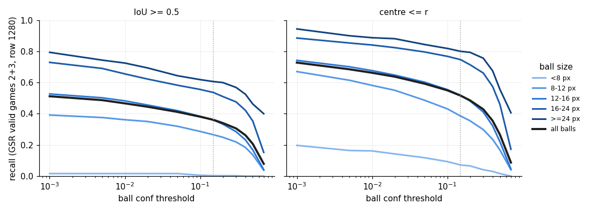

# ball-detection 01: analiza błędów piłki dd2c

2026-10-24. Wagi `models/detector_yolo11l_1280_dd2c.pt` (sha256 05d706cf…). Bez treningu. Tabele i decyzje liczone
tylko na splicie wyboru (GSR valid, gry 2 i 3: 39 klipów, 5 850 klatek co 5., 5 501 piłek). Gra 5 weszła wyłącznie do
kontroli zgodności zrzutu z liczbami z całego zbioru. Przedziały 95% to bootstrap po klipach (2 000 losowań, seed 0),
dla Ekstraklasy i próbek galerii przedziały Wilsona.

Kod: `scripts/detector_bench.py dump` (zrzut, `score_dump`, `dump_top_ball`) i `scripts/ball_errors.py`
(`check`, `analyse`, `gallery`, `taxonomy`), testy `tests/test_ball_errors.py`.

## Zrzut i jego zgodność

Zrzut: wszyscy kandydaci wszystkich klas przy conf ≥ 0,001, wiersze 1280 (NMS IoU 0,7) i e3 (720p → 1920, NMS
IoU 0,5), `max_det` 300, GSR valid (8 700 klatek) i Ekstraklasa dev (56 obrazów), 726 149 ramek, 10 min GPU.
Ramki w pikselach obrazu źródłowego, tak jak liczy je `evaluate`; ustawienia w `dump.json`.

| odczyt ze zrzutu vs plik wyników | zrzut | plik | |
|---|---|---|---|
| GSR valid 1280: AP50 / AP50-95 / P / R piłki | 0,356 / 0,139 / 0,537 / 0,421 | 0,356 / 0,139 / 0,537 / 0,421 | max różnica 0,0 we wszystkich klasach, zbiorach i wierszach |
| umieszczenie e3: umieszczona / > 5 m / dobrze umieszczona | 72,55% / 14,61% / 61,95% | 72,55% / 14,61% / 61,95% | ta sama flaga na 6 404 klatkach, max różnica błędu 0,0001 m |

Zrzut zastępuje więc wagi w karcie wyników ticketu 02 bez straty dokładności.

## Dwie liczby dla decyzji (wiersz 1280, reguła IoU, conf 0,15)

- **Decyzja 7 (rozmycie):** piłki rozmyte to **19,3% pudeł** [16,1; 22,6] (679 z 3 515). Proxy główne ustalone przed
  liczeniem pudeł: prędkość w obrazie ≥ 1 średnica piłki na klatkę (z `track_id`, 25 fps; przy migawce 1/50 s smuga
  ≥ pół średnicy). Takich piłek jest 15,1% wśród wszystkich. Wrażliwość na definicję: ≥ 0,5 średnicy/klatkę 43,5%,
  ≥ 2 średnice 3,2%, ramka wydłużona ≥ 1,5 5,1%, rozmycie lub wydłużenie 21,7%, najniższy kwartyl wariancji
  Laplasjanu 32,2%. Reguła środka: 19,9%. Próg 15% jest przekroczony, ale niewiele: przy surowszej definicji wynik
  spada poniżej progu. Wycinki 24 piłek szybkich i 24 wolnych potwierdzają proxy na oko (`gallery/blur_check.jpg`).
- **Decyzja 9 (małe piłki):** piłki < 12 px (średnia boków przy 1080p) to **49,1% pudeł** [37,7; 59,1] (1 725 z
  3 515), przy 40,3% wszystkich piłek; reguła środka 55,5%. Piłki < 8 px to 10,4% pudeł.

## Recall w koszykach (gry 2+3, wiersz 1280, conf 0,15)

Recall całości: IoU 0,361, odległość środka 0,516 (e3: 0,377 / 0,527).

| cecha | koszyk | piłki | recall IoU | recall środek | udział w pudłach IoU |
|---|---|---|---|---|---|
| rozmiar | < 8 px | 365 | 0,003 | 0,071 | 10,4% |
| | 8–12 | 1 853 | 0,266 | 0,385 | 38,7% |
| | 12–16 | 1 579 | 0,360 | 0,518 | 28,8% |
| | 16–24 | 1 544 | 0,536 | 0,747 | 20,4% |
| | ≥ 24 | 160 | 0,606 | 0,800 | 1,8% |
| rozmycie | ≥ 1 średnica/klatkę | 833 | 0,185 | 0,363 | 19,3% |
| | wolniej | 4 667 | 0,393 | 0,544 | 80,7% |
| pokrycie ramkami ludzi | ≥ 0,5 | 1 599 | 0,265 | 0,363 | 33,4% |
| | 0 | 3 472 | 0,399 | 0,582 | 59,4% |
| w powietrzu (proxy) | tak | 897 | 0,242 | 0,418 | 19,3% |
| | nie | 4 039 | 0,393 | 0,549 | 69,7% |
| odległość od kamery | dalsza tercja | 1 823 | 0,273 | 0,427 | 37,7% |
| | bliższa tercja | 1 541 | 0,478 | 0,674 | 22,9% |
| poza boiskiem | tak | 1 126 | 0,194 | 0,287 | 25,8% |
| najlepszy kandydat w promieniu r | brak (nawet ≥ 0,001) | 1 497 | 0 | 0 | **42,6%** [37; 48] |
| | < 0,15 | 1 165 | 0 | 0 | **33,1%** [29; 38] |
| | ≥ 0,15 | 2 839 | 0,700 | 1 | **24,3%** [20; 30] |

Kontakt ze stopami (< 1 m) i strefa bramki (≤ 30 m) prawie nie zmieniają recallu (0,36 vs 0,35; 0,37 vs 0,34).
Pełne tabele, przecięcia (rozmiar × rozmycie / kandydat / kamera / pokrycie, rozmycie × kandydat, kamera × kandydat)
i e3: `tables/tables.md`.

**Tylko zła ramka:** 24,3% pudeł IoU trafia reguła środka (853 z 3 515; e3 24,1%). To te same piłki co koszyk
„kandydat ≥ 0,15”: detektor widzi piłkę, ale ramka ma IoU < 0,5. Umieszczenie bierze środek ramki, więc te pudła
mało szkodzą mierze głównej.

Przy conf 0,001 recall środka rośnie z 0,516 do 0,728, a IoU z 0,361 do 0,512. Piłki < 8 px nie ratuje żaden próg
(IoU 0,016 przy 0,001), bo 80% z nich nie ma żadnego kandydata.

## Fałszywe piłki

Pomiar z etykiet, na wszystkich klatkach splitu wyboru:
- **Umieszczenie e3 > 5 m** (548 z 2 764 umieszczonych): top-1 to ramka sędziego 299 (54,6% [50,4; 58,7]),
  zawodnika 16, prawdziwa piłka 167 (30,5% [26,8; 34,5]; błąd z homografii albo piłka nad ziemią), inne 66. Wszystkie
  ramki sędziów są z gry 3.
- **Fałszywe piłki ≥ 0,15, wiersz 1280** (1 217 na 964 klatkach): ramka sędziego 638 (52,4% [49,6; 55,2]), zawodnika
  44, druga ramka na prawdziwej piłce 121, inne (wielkości piłki) 414 (34,0%). Ramki ludzi: tylko gra 3.

Ramki ludzi z klasą „ball” mają dłuższy bok 46–141 px; prawdziwe piłki mają najwyżej 43 px (99,9% ≤ 34,5 px).

**Taksonomia (proxy: klasyfikacja agenta z galerii, nie człowieka).** Losowo (seed 0) 25 klatek z umieszczeniem
> 5 m i 25 z fałszywą piłką ≥ 0,15 (najsilniejsza na klatkę):

| klasa | próbka 50 | > 5 m (25) | FP ≥ 0,15 (25) |
|---|---|---|---|
| ramka człowieka (sędzia w czerni, sędzia liniowy z chorągiewką) | 33 (66% [52; 78]) | 16 | 17 |
| prawdziwa piłka (homografia, piłka w rękach lub w powietrzu, druga ramka, etykieta za smugą) | 11 (22% [13; 35]) | 6 | 5 |
| zapasowa piłka przy bandach | 3 (6% [2; 16]) | 2 | 1 |
| głowa / publiczność / inne | 1 / 1 / 1 | 0 / 0 / 1 | 1 / 1 / 0 |
| punkt karny, linia, but | 0 | 0 | 0 |

Próbka bierze najsilniejszą fałszywą piłkę z klatki, więc niedoreprezentuje fałszywe piłki wielkości piłki
(34% wszystkich). Dodatkowa próbka 24 takich: prawdziwa piłka poza r od etykiety (zwykle rozmyta, etykieta za
smugą) 7, jedna zapasowa piłka leżąca przy bandzie w kolejnych klatkach 7, but 3, publiczność 1, inne (rękawica,
podstawa chorągiewki, plama na bandzie) 6. Klasy „ramka człowieka” i „prawdziwa piłka” dodałem do listy z ticketu,
bo bez nich połowa próbki nie miałaby sensownej klasy.

## Ekstraklasa dev (46 piłek: tylko kierunek)

Recall IoU / środek: 1280 0,54 [0,40; 0,68] / 0,63; e3 0,48 / 0,65. Piłki są tu większe (mediana 23 px w
przeliczeniu na 1080p; jedna < 12 px), więc rozmiar nie tłumaczy pudeł. Dominują pokrycie ramkami ludzi ≥ 0,5
(14 z 21 pudeł IoU; recall 0,36 vs 0,82 bez pokrycia) i brak jakiegokolwiek kandydata (12 z 21). Bez torów i
pozycji na boisku, więc bez rozmycia z prędkości.

## Wnioski

1. Pudła to w 43% brak jakiegokolwiek kandydata, w 33% kandydat poniżej progu, w 24% zła ramka przy dobrym
   środku. Pierwszą grupę może naprawić tylko rozdzielczość albo trening, drugą próg, śledzenie albo drugi stopień,
   trzecia mało szkodzi umieszczeniu.
2. Rozmiar dominuje: połowa pudeł to piłki < 12 px, a piłek < 8 px dd2c przy 1280 praktycznie nie widzi. Przy e3
   (efektywnie większa rozdzielczość) recall IoU piłek < 8 px rośnie z 0,003 do 0,027.
3. Rozmycie ruchu to 19% pudeł (proxy główne), tuż nad progiem 15% decyzji 7. Rozmyte piłki mają recall o połowę
   niższy (0,19 vs 0,39), ale jest ich mało.
4. Największe źródło fałszywych piłek na splicie wyboru to błąd klasy: sędziowie i liniowi w czarnych strojach
   (gra 3) dostają klasę „ball” z conf do 0,8. To 55% umieszczeń > 5 m i 52% fałszywych piłek ≥ 0,15. Punkty karne
   i linie w próbce nie wystąpiły.
5. 30% umieszczeń > 5 m to prawdziwa piłka umieszczona źle (homografia, piłka w rękach przy wrzucie lub w
   powietrzu). Detektor tego nie naprawi.

## Rekomendacja ticketów 03–06

- **03 (rozdzielczość, kafle): uruchomić, priorytet 1.** Celuje w 49% pudeł (< 12 px) i w 43% bez kandydata.
  Dodać tani wariant bez treningu: odrzucenie kandydatów piłki o dłuższym boku > ok. 45 px przy 1080p (albo
  pokrywających się z wykrytym człowiekiem). Wariant zapisać z góry w tickecie 02; tutaj nie był mierzony, żeby nie
  czytać wariantu przed regułą. Dotyczy co najmniej 299 z 4 250 klatek mianownika splitu wyboru (7,0%).
- **04 (śledzenie offline): uruchomić, priorytet 2.** 33% pudeł ma kandydata < 0,15 w promieniu r; recall środka
  przy conf 0,001 to 0,728 wobec 0,516.
- **05 (dotrenowanie z kontrolą): uruchomić, priorytet 3.** Ramię B: nadpróbkować obrazy z piłką < 12 px albo
  rozmytą (prędkość ≥ 1 średnica/klatkę; na GSR train z `track_id`, na v3 tylko rozmiar). Te koszyki to 50,5%
  piłek i 61,0% pudeł; dopasowanie udziału w pudłach wymaga ok. ×1,5, więc proponuję **×2** (wrażliwość ×3).
  Dołożyć twarde negatywy: sędziów i liniowych w ciemnych strojach (ramki osób z GSR train, na których dd2c widzi
  piłkę ≥ 0,15), bo to dziś główny fałszywy pozytyw.
- **06 (SoccerSynth): formalnie kwalifikuje się** (19,3% ≥ 15%), ale z małym zapasem, który zależy od definicji
  rozmycia. Uruchamiać po 03–05 i tylko jeśli 05 nie ruszy koszyka „rozmyta”.
- **Decyzja 9:** 49% pudeł < 12 px to dużo; jeśli 03 pokaże zysk skupiony w tych koszykach, rozważyć trening na
  1600 px.

## Ograniczenia proxy

- GSR nie ma atrybutów widoczności. „Pokrycie” to część ramki piłki leżąca w ramkach ludzi (wszystkie role, także
  `other`), nie zasłonięcie: piłka przy nodze leży w ramce zawodnika, ale bywa widoczna.
- „W powietrzu”: każda stopa ≥ 2 m od piłki i piłka ≥ 2 m od środka odcinka między pozycjami w klatkach f ± 10 na
  boisku. Pozycje piłek w GSR to rzut dołu ramki, więc szum ramki daje medianę odchylenia 0,44 m. Proxy myli lot z
  rykoszetem daleko od zawodników i gubi wolne loby; 10% piłek nie ma klatek f ± 10 w torze.
- Rozmycie z prędkości obejmuje też ruch kamery (panorama rozmywa tak samo). Wariancja Laplasjanu zależy od tła
  (na Ekstraklasie „najostrzejszy” kwartyl ma najniższy recall, bo to piłki na tle zawodników).
- „Poza boiskiem” (20% piłek) to w części piłki w powietrzu rzutowane za linię i piłki zapasowe z etykietą.
- Taksonomia to klasyfikacja agenta; przegląd właściciela opcjonalny (`gallery/false_balls_labelled.csv`).

## Ścieżki (poza gitem)

`/mnt/storage/tactifoot_research/detector_data/ball/01/`: `dump/` (zrzut, `dump.json`, log), `check.json`,
`tables/` (`tables.md`, `summary.json`, `recall_*.csv`, `cross_*.csv`, `curve_*.csv`, `balls_*.parquet`,
`false_balls_*.parquet`, `false_ball_taxonomy.csv`), `gallery/` (`sheet_01..10.jpg`, `false_balls_labelled.csv`,
`other_false_balls.jpg`, `other_false_balls_labelled.csv`, `blur_check.jpg`).

Odtworzenie: `uv run python scripts/detector_bench.py dump --weights models/detector_yolo11l_1280_dd2c.pt --out
…/ball/01/dump`, potem `uv run python scripts/ball_errors.py check|analyse|gallery|taxonomy` (domyślne ścieżki).
